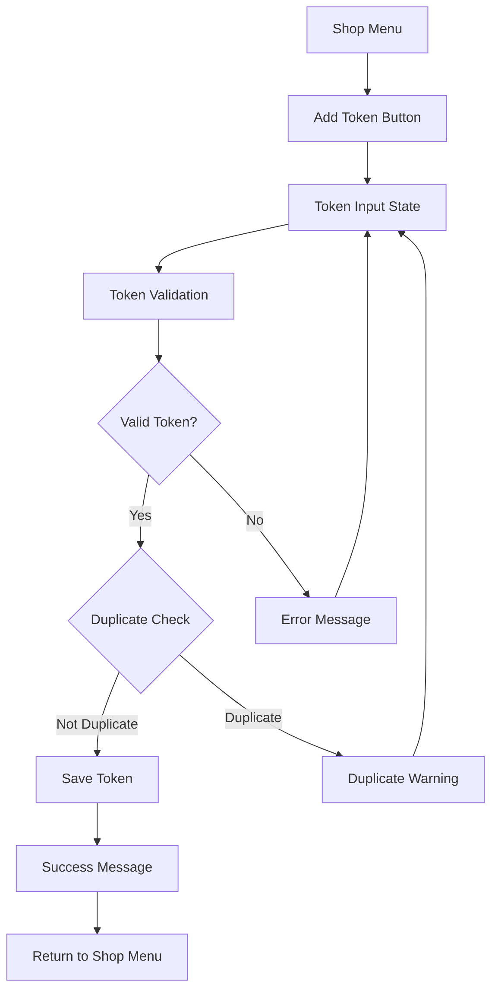
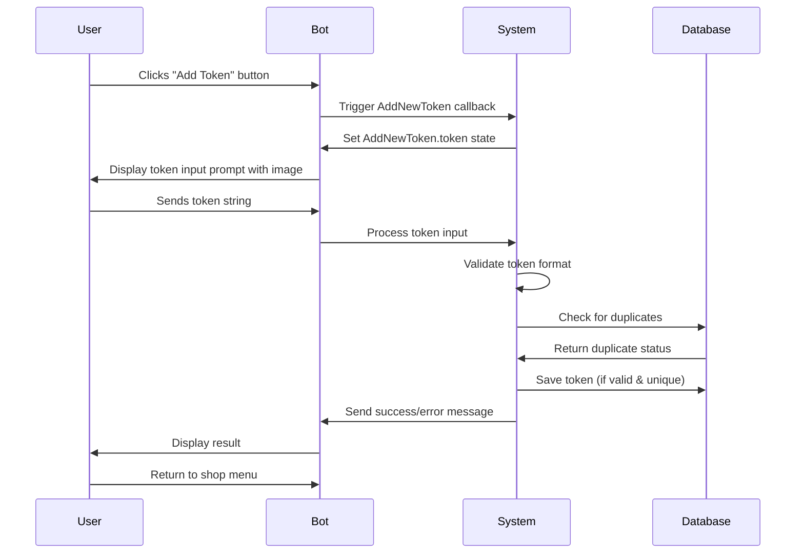

# Add Token Button Feature Design

## Overview

This feature adds a "Add New Token" button to the shop menu in the Telegram bot interface, allowing users to add additional WB (Wildberries) API tokens to existing shops. The feature enables users to maintain multiple active tokens per shop, providing better redundancy and API quota management.

## Architecture

### Component Integration

The add token button integrates with the existing shop menu system by extending the current shop management interface. The feature leverages the existing token validation infrastructure and user state management system.



### Data Flow Architecture

The feature follows the existing FSM (Finite State Machine) pattern using aiogram states to manage user interactions:

1. **Initial State**: User clicks "Add New Token" button in shop menu
2. **Input State**: System prompts for token input with instructions and image
3. **Processing State**: Token validation and duplicate checking
4. **Resolution State**: Success or error handling with appropriate messaging

## User Interface Design

### Shop Menu Button Integration

The add token button will be positioned in the shop menu interface alongside existing management options. The button placement follows the established UI hierarchy:

**Button Properties:**
- Text: "Добавить новый токен" (Add New Token)
- Callback Data: `AddNewToken` with `wb_user_cabinet_original_id`
- Position: After balance management button, before administrative functions

### User Interaction Flow



### Message Templates

**Token Input Prompt:**
- Text: "Пришлите новый Api ключ для магазина (кабинета) {shop_name}.\nДля работы бота нужны права Контент, Статистика, Аналитика, Продвижение"
- Image: API settings instruction image
- Context: Existing `AddNewTokenGet` template will be reused

**Success Message:**
- Confirmation that token was successfully added
- Automatic return to shop menu

**Error Messages:**
- Invalid token format: "Токен не валиден, попробуйте еще раз:"
- Duplicate token: "Такой токен уже есть в системе"
- General errors with retry options

## Business Logic Layer

### Token Addition Workflow

The token addition process implements the following business rules:

**Validation Rules:**
1. Token must be a valid JWT format
2. Token must be extractable for shop_id
3. Token must not already exist in the system (any user)
4. Token must belong to the correct shop (shop_id match)

**Association Logic:**
- New token is associated with the current user (`user_id`)
- Token is linked to the specific shop (`shop_id` from token payload)
- No restrictions on number of tokens per shop
- Tokens maintain individual expiration tracking

### Duplicate Detection Strategy

```mermaid
flowchart TD
    A[New Token Input] --> B[Extract shop_id from token]
    B --> C{Query existing tokens}
    C --> D{Token exists?}
    D -->|No| E[Proceed with creation]
    D -->|Yes| F{Same user?}
    F -->|Yes| G[Show "already using" message]
    F -->|No| H[Show "used by another user" message]
    E --> I[Create new WBToken record]
    G --> J[Return to input state]
    H --> J
```

**Duplicate Checking Logic:**
- Check against `WBToken.api_key` and `WBToken.shop_id`
- Differentiate between same-user and different-user duplicates
- Provide appropriate messaging for each scenario

### Error Handling Strategy

**Token Validation Errors:**
- `NotValidTokenError`: Return user to input state with error message
- JWT decode errors: Handled as invalid token
- Network/API errors: Generic error message with retry option

**Database Errors:**
- Connection failures: Graceful degradation with user notification
- Constraint violations: Handled as duplicate token scenario
- Transaction rollbacks: Automatic cleanup with user notification

## State Management Architecture

### FSM State Definition

The feature utilizes the existing `AddNewToken` state group:

```
class AddNewToken(StatesGroup):
    token = State()
```

**State Transitions:**
1. **None → AddNewToken.token**: Triggered by button callback
2. **AddNewToken.token → None**: After successful processing or cancellation
3. **AddNewToken.token → AddNewToken.token**: On validation errors (retry)

### State Data Management

**Stored State Data:**
- `wb_user_cabinet_original_id`: Links token to specific shop
- `cabinet_name`: For user-friendly messaging
- Session context for error recovery

## Integration Points

### Existing System Integration

**Callback System Integration:**
- Reuses existing `AddNewToken` callback data structure
- Maintains compatibility with current callback routing
- Preserves callback data validation patterns

**Message System Integration:**
- Leverages existing `AddNewTokenGet` message template
- Integrates with current message routing infrastructure
- Maintains consistent messaging patterns

**Database Integration:**
- Utilizes existing `WBToken` model structure
- Maintains referential integrity with user and cabinet relationships
- Preserves existing indexing and constraint patterns

### Token Management Integration

**Validation Integration:**
- Reuses existing token validation logic from shop creation flow
- Maintains consistency with current token parsing methods
- Preserves existing error handling patterns

**Shop Association:**
- Integrates with existing shop-token relationship management
- Maintains compatibility with current cabinet access patterns
- Preserves existing permission and ownership models

## Security Considerations

### Input Validation

**Token Security:**
- All token inputs undergo JWT validation
- Shop ID extraction prevents token misassociation
- User ownership verification prevents unauthorized access

**State Security:**
- State data includes user context validation
- Session management prevents state hijacking
- Timeout handling prevents abandoned states

### Access Control

**User Authorization:**
- Token addition restricted to shop owners
- Cabinet access verification before token association
- User session validation throughout process

**Data Protection:**
- Token storage follows existing encryption patterns
- Sensitive data masked in logging
- Audit trail maintained for token operations

## Performance Considerations

### Database Optimization

**Query Efficiency:**
- Indexed lookups for duplicate detection
- Minimal database operations per transaction
- Efficient shop-token relationship queries

**Connection Management:**
- Reuses existing session management patterns
- Transaction scoping for atomic operations
- Connection pooling for concurrent operations

### User Experience Optimization

**Response Time:**
- Immediate feedback for user actions
- Asynchronous processing where possible
- Progressive disclosure of validation results

**Error Recovery:**
- Quick retry mechanisms for transient errors
- Clear error messaging for user guidance
- Automatic state cleanup on abandonment

## Testing Strategy

### Unit Testing

**Component Testing:**
- Token validation logic verification
- Duplicate detection accuracy testing
- State transition correctness validation
- Error handling completeness verification

**Integration Testing:**
- End-to-end user flow validation
- Database transaction integrity testing
- Message template rendering verification
- Callback routing accuracy testing

### User Acceptance Testing

**Functional Testing:**
- Complete user workflow validation
- Error scenario handling verification
- Message clarity and accuracy testing
- Performance under normal load conditions

**Usability Testing:**
- Interface intuitiveness assessment
- Error message comprehensibility evaluation
- Recovery workflow effectiveness testing
- Overall user satisfaction measurement