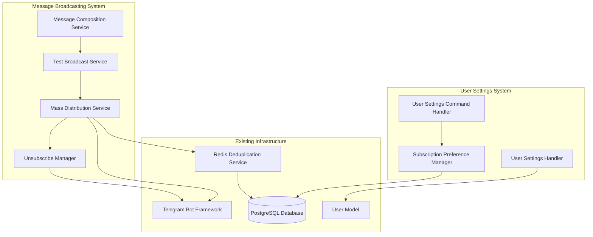
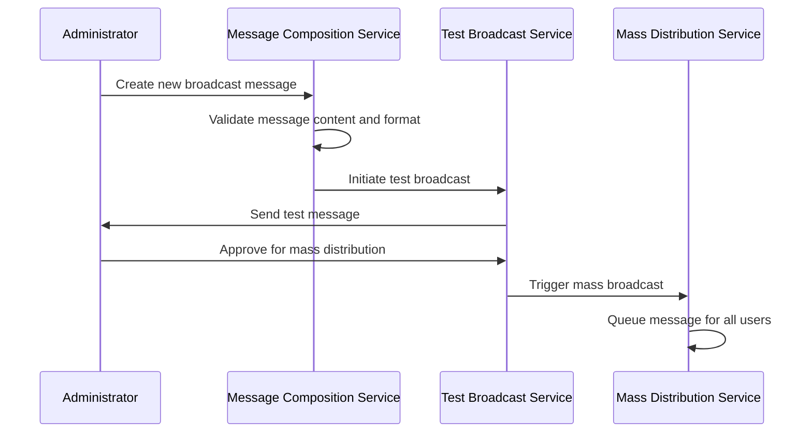
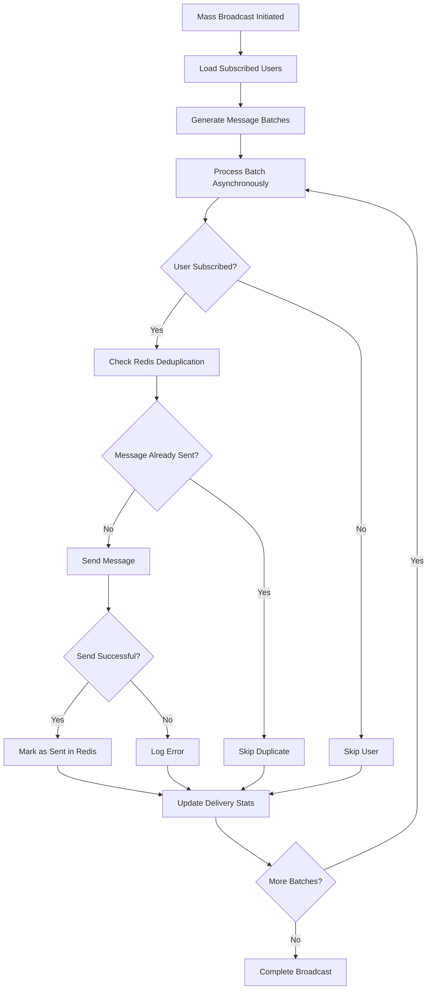
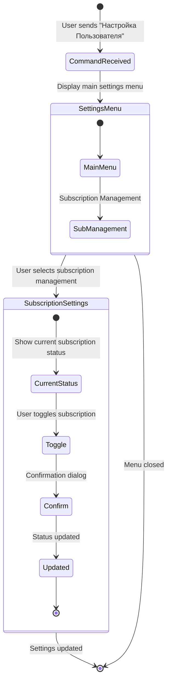

# User Message Processing System Design

## Overview

The User Message Processing System is a comprehensive solution for managing broadcast communications within the Telegram bot application. This system extends the existing message broadcasting capabilities to provide robust, feature-rich user communication management with subscription controls and administrative oversight.

The system transforms the current basic broadcasting script into a sophisticated messaging platform that supports:
- Structured message composition and management
- Test broadcast functionality for administrative validation
- Asynchronous mass distribution to all users
- Subscription management with opt-out capabilities
- User preference settings through dedicated command interface

The design leverages the existing infrastructure including Redis for deduplication, PostgreSQL for user management, and the Aiogram framework for Telegram integration, while introducing new components for enhanced user experience and administrative control.

## Architecture

The system follows a modular architecture that integrates seamlessly with the existing bot infrastructure while providing clear separation of concerns between message composition, distribution, and user preference management.

### Core Components

**Message Broadcasting Pipeline**
- Message Composition Service: Handles creation and templating of broadcast messages
- Test Broadcast Service: Manages test message delivery to administrators
- Mass Distribution Service: Orchestrates asynchronous delivery to all subscribed users
- Unsubscribe Manager: Processes opt-out requests and manages subscription status

**User Settings Interface**
- User Settings Command Handler: Processes the new "Настройка Пользователя" text command
- Subscription Preference Manager: Manages user subscription states and preferences
- User Settings Handler: Provides interactive interface for subscription management

**Integration Layer**
- Leverages existing Redis-based message deduplication system
- Extends current User model with subscription preferences field
- Integrates with established Telegram bot routing and state management

## Message Broadcasting System

### Message Composition Workflow

The message composition process provides structured content creation with support for rich formatting, media attachments, and interactive elements.

**Message Structure Components**
- Text content with Markdown formatting support
- Optional media attachments (images, documents)
- Mandatory unsubscribe button integration
- Message metadata for tracking and analytics
- Deduplication hash for Redis-based duplicate prevention

**Content Validation Rules**
- Maximum message length enforcement
- Required unsubscribe button validation
- Media file size and format restrictions
- Markdown syntax validation
- Character escaping for special symbols

### Test Broadcast Implementation

The test broadcast functionality ensures message quality and formatting validation before mass distribution.

**Test Broadcast Flow**
- Message composition triggers automatic test delivery to predefined administrator accounts
- Test message includes all formatting, media, and interactive elements as they will appear to end users
- Administrator approval interface provides options to approve, modify, or cancel the broadcast
- Test message metadata includes estimated delivery time and recipient count

**Administrator Interface**
- Test message delivery with visual formatting preview
- Approval controls with inline keyboard buttons
- Message modification workflow for content adjustments
- Broadcast cancellation with reason logging

### Mass Distribution Engine

The mass distribution system manages asynchronous delivery to all subscribed users with comprehensive error handling and delivery tracking.

**Batch Processing Strategy**
- User list segmentation into manageable batches
- Configurable batch size for optimal performance
- Asynchronous processing with controlled concurrency
- Rate limiting to comply with Telegram API restrictions
- Progress tracking and delivery statistics

**Error Handling and Resilience**
- User blocking detection and graceful handling
- Network timeout management with retry logic
- Invalid user account handling
- Delivery failure logging with categorized error types
- Automatic retry mechanisms for transient failures

### Unsubscribe Management

Every broadcast message includes a mandatory unsubscribe mechanism that provides users immediate control over subscription preferences.

**Unsubscribe Button Implementation**
- Standardized unsubscribe button text and callback data
- Immediate subscription status update in database
- Confirmation message delivery to user
- Opt-out logging for compliance and analytics

**Subscription Status Tracking**
- User model extension with subscription preference field
- Default subscription status for new users
- Subscription history tracking for analytics
- Re-subscription workflow for users who change preferences

## User Settings Command System

### Command Interface Design

The new "Настройка Пользователя" text command provides users with a dedicated interface for managing their account preferences and subscription settings.

**Command Recognition**
- Text command handler registration in bot routing system
- Case-insensitive command matching
- Integration with existing middleware stack
- State management for multi-step interactions

**Settings Menu Structure**
- Primary settings interface with subscription management option
- Future-extensible design for additional user preferences
- Intuitive navigation with inline keyboard controls
- Context-aware options based on user subscription status

### Subscription Preference Management

The subscription management interface provides users with granular control over their communication preferences.

**Subscription Interface Components**
- Current subscription status display
- Toggle controls for subscription activation/deactivation
- Confirmation dialogs for preference changes
- Success/failure feedback messages

**Database Integration**
- User model extension with subscription_active boolean field
- Database migration for new field addition
- Default subscription status configuration
- Subscription change audit logging

**User Experience Flow**
- Clear subscription status presentation
- One-click subscription toggle functionality
- Immediate feedback for preference changes
- Help text explaining subscription implications

## Data Models & Database Schema

### User Model Extension

The existing User model requires extension to support subscription preference management.

| Field Name | Data Type | Constraints | Description |
|------------|-----------|-------------|-------------|
| subscription_active | Boolean | NOT NULL, DEFAULT TRUE | User subscription status for broadcast messages |
| subscription_updated_at | DateTime | NULL | Timestamp of last subscription preference change |

**Migration Strategy**
- Alembic migration for new field addition
- Default subscription status for existing users
- Index creation for subscription_active field
- Data validation for subscription status integrity

### Message Tracking Schema

Enhanced message tracking capabilities for broadcast management and analytics.

| Field Name | Data Type | Constraints | Description |
|------------|-----------|-------------|-------------|
| message_id | String | PRIMARY KEY | Unique message identifier |
| message_hash | String | NOT NULL, UNIQUE | Redis deduplication hash |
| content_preview | Text | NOT NULL | Truncated message content for identification |
| created_at | DateTime | NOT NULL | Message creation timestamp |
| test_sent_at | DateTime | NULL | Test broadcast completion time |
| broadcast_started_at | DateTime | NULL | Mass distribution start time |
| broadcast_completed_at | DateTime | NULL | Mass distribution completion time |
| total_recipients | Integer | NULL | Total number of intended recipients |
| successful_deliveries | Integer | DEFAULT 0 | Count of successful message deliveries |
| failed_deliveries | Integer | DEFAULT 0 | Count of failed delivery attempts |

### Unsubscribe Event Logging

Comprehensive tracking of user subscription changes for compliance and analytics.

| Field Name | Data Type | Constraints | Description |
|------------|-----------|-------------|-------------|
| user_id | Integer | FOREIGN KEY | Reference to User table |
| action_type | String | NOT NULL | 'subscribe' or 'unsubscribe' |
| triggered_by | String | NOT NULL | Source of subscription change |
| message_id | String | NULL | Associated broadcast message identifier |
| timestamp | DateTime | NOT NULL | Event occurrence time |

## System Integration Points

### Redis Integration Enhancement

Extension of existing Redis-based deduplication system for improved broadcast management.

**Enhanced Deduplication Strategy**
- Message hash generation with content and timestamp
- User-specific delivery tracking with TTL
- Batch processing status management
- Delivery statistics caching

**Cache Key Structure**
- `broadcast:{message_hash}:user:{user_id}` - Individual delivery status
- `broadcast:{message_id}:stats` - Aggregate delivery statistics
- `broadcast:{message_id}:progress` - Batch processing progress
- `user:{user_id}:last_broadcast` - User's last received broadcast timestamp

### Telegram Bot Framework Integration

Seamless integration with existing Aiogram-based bot infrastructure.

**Router Integration**
- New message handler registration for user settings command
- Callback handler registration for subscription management
- State management integration for multi-step interactions
- Middleware compatibility with existing throttling and authentication

**Message Template Extension**
- Standardized unsubscribe button template
- Settings menu template with extensible structure
- Subscription status display templates
- Confirmation and feedback message templates

### Background Processing Integration

Integration with existing ARQ worker system for scalable message distribution.

**Worker Task Definition**
- Broadcast initiation task for mass distribution
- Batch processing tasks for user segments
- Delivery status update tasks
- Statistics aggregation tasks

**Queue Management**
- Priority queue configuration for broadcast messages
- Failure handling and retry mechanisms
- Progress tracking and status reporting
- Resource utilization monitoring

## Testing Strategy

### Unit Testing Coverage

Comprehensive unit testing for all system components with focus on subscription management and message distribution logic.

**Core Component Testing**
- Message composition validation logic
- Subscription status management functions
- Unsubscribe button generation and handling
- User settings command processing
- Database model extensions and migrations

**Error Handling Testing**
- Invalid message content handling
- Subscription status validation
- User blocking and network error scenarios
- Database connection failure handling
- Redis connectivity issues

### Integration Testing Framework

End-to-end testing scenarios covering complete user workflows and system interactions.

**Broadcast Workflow Testing**
- Complete message creation to delivery pipeline
- Test broadcast functionality with administrator approval
- Mass distribution with subscription filtering
- Unsubscribe workflow from broadcast messages

**User Settings Testing**
- User settings command recognition and processing
- Subscription preference changes and database updates
- Settings menu navigation and state management
- Error scenarios and user feedback

**System Integration Testing**
- Redis deduplication effectiveness
- Database consistency across operations
- Background task processing and completion
- Performance under load with concurrent users
