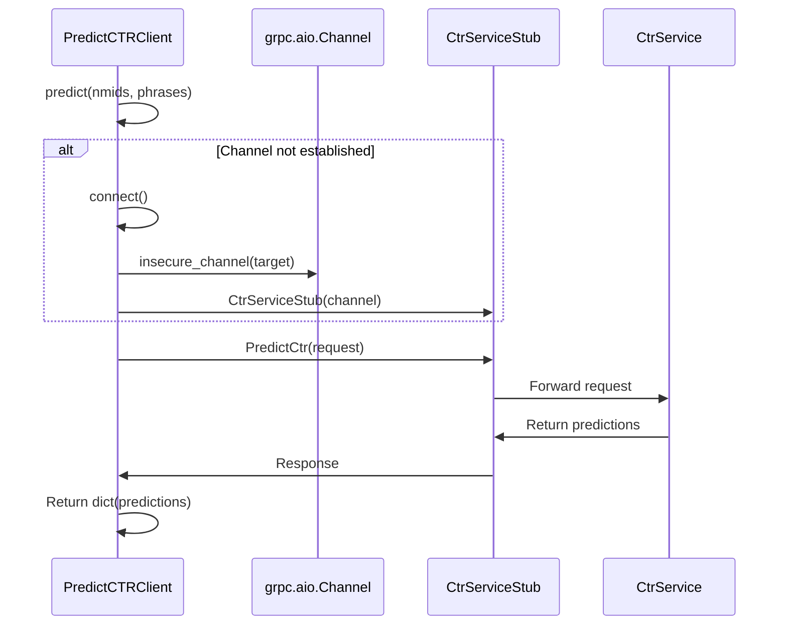

# API Integrations

<cite>
**Referenced Files in This Document**   
- [api.py](file://app/modules/common_slaves/wildberries/api/api.py)
- [base.py](file://app/core/wb_api/base.py)
- [ABC_WB_API.py](file://app/modules/common_slaves/wildberries/ABC_WB_API.py)
- [http_request.py](file://app/core/wb_api/http_request.py)
- [predict_ctr_service.proto](file://app/modules/grpcs/predict_ctr_service/grpc_service/predict_ctr_service.proto)
- [predict_ctr_client.py](file://app/modules/grpcs/predict_ctr_service/predict_ctr_client/predict_ctr_client.py)
- [config.py](file://app/modules/grpcs/predict_ctr_service/config.py)
- [client_bot_run.py](file://client_bot_run.py)
- [settings_master.py](file://app/settings/settings_master.py)
</cite>

## Table of Contents
1. [Introduction](#introduction)
2. [Wildberries API Integration](#wildberries-api-integration)
3. [Telegram Bot API Integration](#telegram-bot-api-integration)
4. [GRPC Predict CTR Service](#grpc-predict-ctr-service)
5. [Client Implementation Guidelines](#client-implementation-guidelines)
6. [Error Handling Strategies](#error-handling-strategies)
7. [Performance Optimization Tips](#performance-optimization-tips)
8. [Debugging Approaches](#debugging-approaches)
9. [Conclusion](#conclusion)

## Introduction
This document provides comprehensive documentation for the external integrations used in the adv-bot system. It covers three primary integration points: the Wildberries API for e-commerce operations, the Telegram Bot API for user interaction, and the GRPC Predict CTR Service for machine learning predictions. Each section details the technical specifications, authentication methods, request/response patterns, and best practices for implementation and troubleshooting.

## Wildberries API Integration

The Wildberries API integration enables the adv-bot system to interact with Wildberries' advertising and content management systems. The integration is implemented through a layered architecture that handles authentication, rate limiting, and error recovery.

### HTTP Methods and Endpoints
The Wildberries API integration uses standard HTTP methods (GET, POST) to communicate with Wildberries endpoints. Key endpoints include:

- **Advert API**: `https://advert-api.wildberries.ru` - Manages advertising campaigns, bids, and statistics
- **Content API**: `https://content-api.wildberries.ru` - Handles product content and catalog information
- **Analytics API**: `https://seller-analytics-api.wildberries.ru` - Provides sales and performance analytics

Key endpoints documented in the code:
- `POST /adv/v0/cpm` - Set CPM for search campaigns
- `GET /adv/v1/promotion/count` - Get count of advertising campaigns
- `POST /adv/v1/promotion/adverts` - Retrieve advertising campaign details
- `POST /content/v2/get/cards/list` - Search for product cards by text
- `GET /content/v2/object/all` - Retrieve subcategories

### Request/Response Schemas
The integration uses structured request and response schemas. For example, when setting CPM for a search campaign:

**Request Schema**:
```json
{
  "advertId": int,
  "type": 9,
  "cpm": int
}
```

**Response Schema**:
The API returns JSON responses with campaign statistics including views, clicks, CTR, CPC, sum, atbs, orders, cr, shks, and sum_price across specified date ranges.

### Authentication Methods (WBToken)
Authentication is handled using WBToken objects that contain API keys. The system implements token management with the following features:

- Multiple tokens can be associated with a single WBCabinetAccess
- Tokens are sorted by expiration date (most recent first)
- Automatic token rotation when a token becomes invalid
- Token validation through ping requests to verify permissions

The `Headers` class in `ABC_WB_API.py` manages the Authorization header using the token's api_key:

```python
class Headers:
    def __init__(self, token: 'WBToken'):
        self.current_token: 'WBToken' = token

    @property
    def standart(self) -> dict[str, str]:
        return {"Authorization": self.current_token.api_key}
```

### Rate Limiting Considerations
The system implements sophisticated rate limiting and retry logic through the `try_except_decorator` in `http_request.py`:

- Configurable requests per interval and interval duration
- Exponential backoff for failed requests
- Adaptive pause calculation based on response times
- Maximum attempt limits with configurable delays
- Token rotation when encountering 401 errors

The decorator parameters can be customized per method call:
```python
@try_except_decorator(requests_per_interval=1, interval_seconds=1)
```

**Section sources**
- [api.py](file://app/modules/common_slaves/wildberries/api/api.py)
- [base.py](file://app/core/wb_api/base.py)
- [ABC_WB_API.py](file://app/modules/common_slaves/wildberries/ABC_WB_API.py)
- [http_request.py](file://app/core/wb_api/http_request.py)

## Telegram Bot API Integration

The Telegram Bot API integration enables the adv-bot system to communicate with users through Telegram. The system supports both webhook and polling modes for receiving updates.

### Message Handling
Message handling is implemented using the aiogram framework with a dispatcher pattern. The system processes different types of updates including:

- Text messages
- Callback queries (button presses)
- Commands
- State transitions

The message processing flow:
1. Incoming updates are validated with a secret token
2. Updates are parsed into aiogram Update objects
3. The dispatcher routes updates to appropriate handlers
4. Handlers process the business logic and send responses

### Webhook Configuration
The system supports both webhook and polling modes, configurable through environment variables:

```python
POLLING_MODE = settings.polling_mode
```

**Webhook Mode**:
- FastAPI endpoint at `settings.WEBHOOK_PATH`
- Secret token validation using `X-Telegram-Bot-Api-Secret-Token` header
- Automatic webhook setup and cleanup through lifespan context manager
- Health check endpoints for monitoring

**Polling Mode**:
- Long polling implementation using aiogram's `start_polling()`
- Automatic webhook cleanup before starting
- Error handling for network issues and API errors

Webhook endpoint configuration:
```python
@app.post(settings.WEBHOOK_PATH)
async def telegram_webhook(request: Request):
    token = request.headers.get("X-Telegram-Bot-Api-Secret-Token")
    if token != WEBHOOK_SECRET_TOKEN:
        return Response(status_code=403, content="Forbidden")
```

### Interaction Patterns
The system implements several interaction patterns:

- **Router-based organization**: Different functionality is organized into separate routers (e.g., manual_update_phrase_position_router, AuctionBoostModeSettingsRouter)
- **State management**: FSM (Finite State Machine) patterns for multi-step interactions
- **Error handling**: Specific handlers for network errors and bad requests
- **Middleware**: Throttling and user data management middleware

**Section sources**
- [client_bot_run.py](file://client_bot_run.py)
- [settings_master.py](file://app/settings/settings_master.py)

## GRPC Predict CTR Service

The GRPC Predict CTR Service provides machine learning predictions for click-through rates (CTR) based on product and keyword data.

### Protocol Buffer Definitions
The service uses Protocol Buffers for message definition in `predict_ctr_service.proto`:

```protobuf
syntax = "proto3";

package ctr;

// Request for CTR prediction
message PredictCtrRequest {
  repeated int64 nmids = 1;     // List of product IDs
  repeated string phrases = 2;  // List of keyword phrases
}

// Response with CTR predictions
message PredictCtrResponse {
  map<string, float> predictions = 1;  // Dictionary of predictions: key -> CTR value
}

// CTR prediction service
service CtrService {
  rpc PredictCtr(PredictCtrRequest) returns (PredictCtrResponse);
}
```

The key data structures:
- **PredictCtrRequest**: Contains nmids (product identifiers) and phrases (search keywords)
- **PredictCtrResponse**: Returns a map of prediction keys to CTR values
- **CtrService**: Single RPC method for predicting CTR

### Service Methods
The service exposes one primary method:
- **PredictCtr**: Takes a list of product IDs and keyword phrases, returns predicted CTR values

The prediction key format combines product ID and keyword (e.g., "123456789:keyword phrase").

### Connection Handling
The client implements asynchronous connection management with:

- Lazy connection establishment (connects on first request)
- Channel reuse across multiple requests
- Proper connection cleanup
- Async context manager support

### Error Responses
The service returns predictions as a dictionary. If no predictions are available, it returns None. The client handles connection errors and ensures proper cleanup.



**Diagram sources**
- [predict_ctr_service.proto](file://app/modules/grpcs/predict_ctr_service/grpc_service/predict_ctr_service.proto)
- [predict_ctr_client.py](file://app/modules/grpcs/predict_ctr_service/predict_ctr_client/predict_ctr_client.py)

**Section sources**
- [predict_ctr_service.proto](file://app/modules/grpcs/predict_ctr_service/grpc_service/predict_ctr_service.proto)
- [predict_ctr_client.py](file://app/modules/grpcs/predict_ctr_service/predict_ctr_client/predict_ctr_client.py)
- [config.py](file://app/modules/grpcs/predict_ctr_service/config.py)

## Client Implementation Guidelines

### Wildberries API Client
When implementing clients for the Wildberries API:

1. **Use the provided API classes**: Leverage `AdvertApi` and `ContentApi` rather than making raw HTTP requests
2. **Handle token rotation**: The system automatically handles token rotation, but ensure your code can handle temporary failures
3. **Respect rate limits**: Use the built-in retry logic and avoid aggressive polling
4. **Batch requests**: Where possible, batch multiple operations into single requests
5. **Implement proper error handling**: Catch specific exceptions like `ApiForbiddenError`, `TooManyRequests`, etc.

Example usage:
```python
# The system automatically handles authentication and rate limiting
wb_api = WBApi(wb_access, session)
advs = await wb_api.advert.get_advs()
await wb_api.advert.set_search_cpm(search_adv_id, cpm)
```

### Telegram Bot Client
For Telegram Bot integration:

1. **Use the configured mode**: Respect the `POLLING_MODE` setting
2. **Implement proper webhook security**: Always validate the secret token
3. **Handle different update types**: Process messages, callbacks, and commands appropriately
4. **Use state management**: For multi-step interactions, use FSM patterns
5. **Implement error handling**: Handle network errors and API exceptions

### GRPC Predict CTR Client
When using the CTR prediction service:

1. **Use async context manager**: Best practice for connection management
```python
async with PredictCTRClient(host, port) as client:
    predictions = await client.predict(nmids, phrases)
```

2. **Handle None responses**: The predict method may return None if no predictions are available
3. **Reuse client instances**: Create clients once and reuse them for multiple requests
4. **Configure proper timeouts**: Ensure your application handles potential network delays

**Section sources**
- [api.py](file://app/modules/common_slaves/wildberries/api/api.py)
- [predict_ctr_client.py](file://app/modules/grpcs/predict_ctr_service/predict_ctr_client/predict_ctr_client.py)
- [client_bot_run.py](file://client_bot_run.py)

## Error Handling Strategies

### Wildberries API Error Handling
The system implements comprehensive error handling for Wildberries API interactions:

- **Token-related errors**: `ApiForbiddenError` triggers token rotation via `set_next_token`
- **Rate limiting**: `TooManyRequests` triggers exponential backoff
- **Validation errors**: `BadRequestError` and `NotValidDataError` for malformed requests
- **Network errors**: Retry logic for connection issues
- **Business logic errors**: Specific exceptions like `MinAdvBidWBApiError`

The `try_except_decorator` provides a unified error handling mechanism with:
- Configurable retry attempts
- Adaptive pause calculation
- Token rotation on authentication failures
- Exponential backoff for transient failures

### Telegram Bot Error Handling
The system handles Telegram API errors through:

- **Network error handling**: `TelegramNetworkError` with user-friendly messages
- **Bad request handling**: `TelegramBadRequest` with appropriate user feedback
- **Update validation**: Secret token verification for webhook requests
- **Graceful degradation**: Continue operation despite individual request failures

### GRPC Service Error Handling
The Predict CTR client handles errors through:

- **Connection management**: Automatic reconnection on failures
- **Graceful degradation**: Return None when predictions are unavailable
- **Proper cleanup**: Ensure channels are closed even when errors occur
- **Exception propagation**: Allow underlying GRPC errors to bubble up when appropriate

**Section sources**
- [http_request.py](file://app/core/wb_api/http_request.py)
- [exceptions.py](file://app/core/wb_api/exceptions.py)
- [client_bot_run.py](file://client_bot_run.py)
- [predict_ctr_client.py](file://app/modules/grpcs/predict_ctr_service/predict_ctr_client/predict_ctr_client.py)

## Performance Optimization Tips

### Wildberries API Optimization
1. **Batch requests**: Use methods that accept multiple IDs to reduce round trips
2. **Cache responses**: Implement caching for frequently accessed data
3. **Optimize polling intervals**: Adjust based on rate limits and business needs
4. **Use efficient data structures**: Process responses efficiently to minimize CPU usage
5. **Parallelize independent operations**: When managing multiple shops or campaigns

### Telegram Bot Optimization
1. **Use webhook mode in production**: More efficient than polling for high-volume bots
2. **Implement message queuing**: Handle bursts of messages without dropping updates
3. **Optimize response times**: Keep webhook processing fast to avoid timeouts
4. **Use connection pooling**: Reuse HTTP connections for outgoing messages
5. **Implement proper load balancing**: Distribute load across multiple instances if needed

### GRPC Service Optimization
1. **Reuse client connections**: Avoid creating new channels for each request
2. **Batch predictions**: Combine multiple prediction requests when possible
3. **Implement client-side caching**: Cache frequent prediction combinations
4. **Use streaming when appropriate**: Consider streaming RPCs for large prediction sets
5. **Monitor connection health**: Implement health checks for the prediction service

## Debugging Approaches

### Wildberries API Debugging
1. **Enable detailed logging**: The system logs request URLs, status codes, and response snippets
2. **Monitor token health**: Use the token monitoring service to track token validity
3. **Check rate limit headers**: Monitor API response headers for rate limit information
4. **Validate request payloads**: Ensure JSON payloads match expected schemas
5. **Test with single tokens**: Isolate issues by testing with a single token before using multiple tokens

### Telegram Bot Debugging
1. **Use health check endpoints**: `/health` and `/readiness` endpoints to verify bot status
2. **Inspect webhook info**: `/webhook-info` endpoint to verify webhook configuration
3. **Enable debug logging**: Capture detailed information about incoming updates
4. **Test error scenarios**: Simulate network failures and invalid requests
5. **Monitor message queues**: Ensure updates are being processed in a timely manner

### GRPC Service Debugging
1. **Verify service availability**: Ensure the GRPC server is running and accessible
2. **Check network connectivity**: Verify the client can reach the server host and port
3. **Validate input data**: Ensure nmids and phrases are properly formatted
4. **Monitor connection state**: Track channel connectivity and reconnection attempts
5. **Use GRPC debugging tools**: Leverage GRPC command-line tools for testing

## Conclusion
The adv-bot system integrates with three key external services: Wildberries API, Telegram Bot API, and a custom GRPC Predict CTR Service. Each integration is designed with robust error handling, authentication, and performance considerations. The Wildberries API integration handles complex authentication with token rotation and sophisticated rate limiting. The Telegram Bot API integration supports both webhook and polling modes with comprehensive error handling. The GRPC Predict CTR Service provides machine learning predictions through a clean, efficient protocol. By following the implementation guidelines and best practices outlined in this document, developers can effectively work with these integrations while maintaining system reliability and performance.