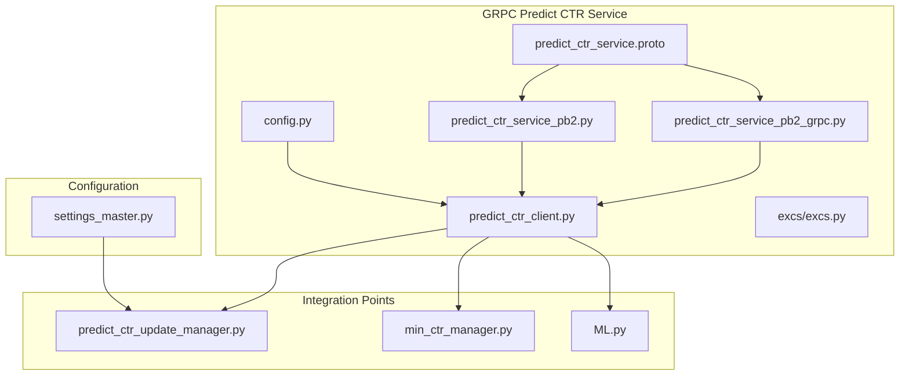
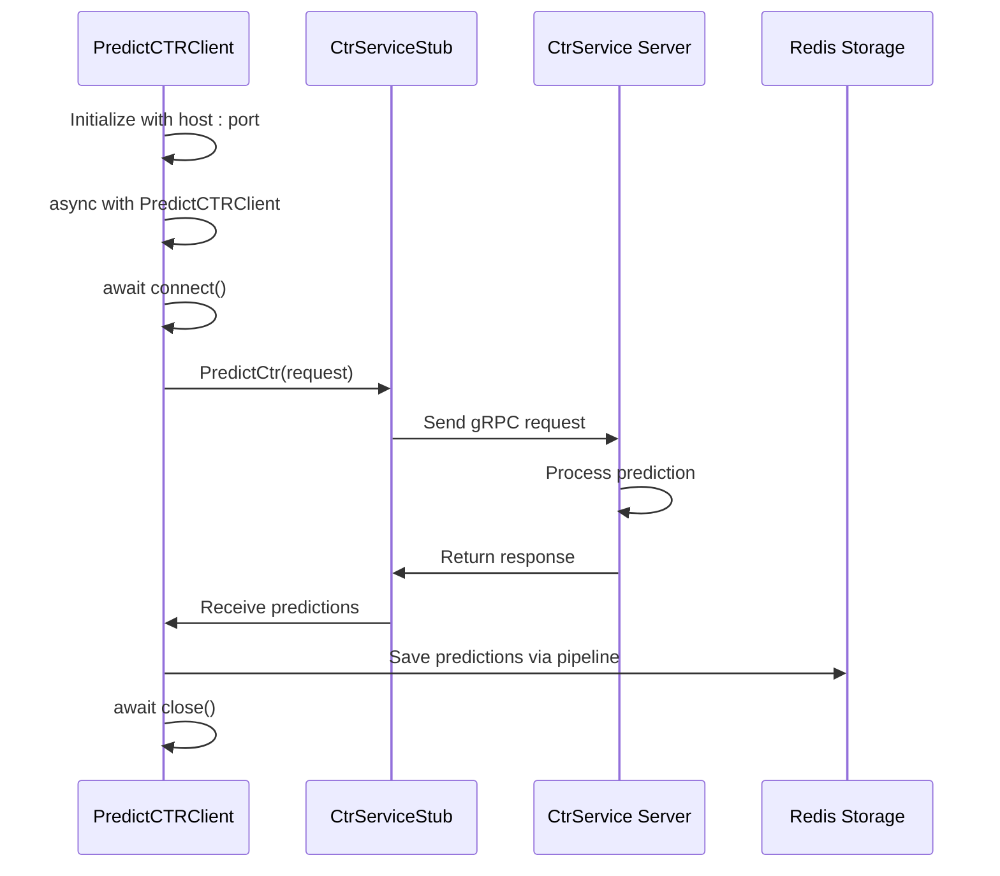
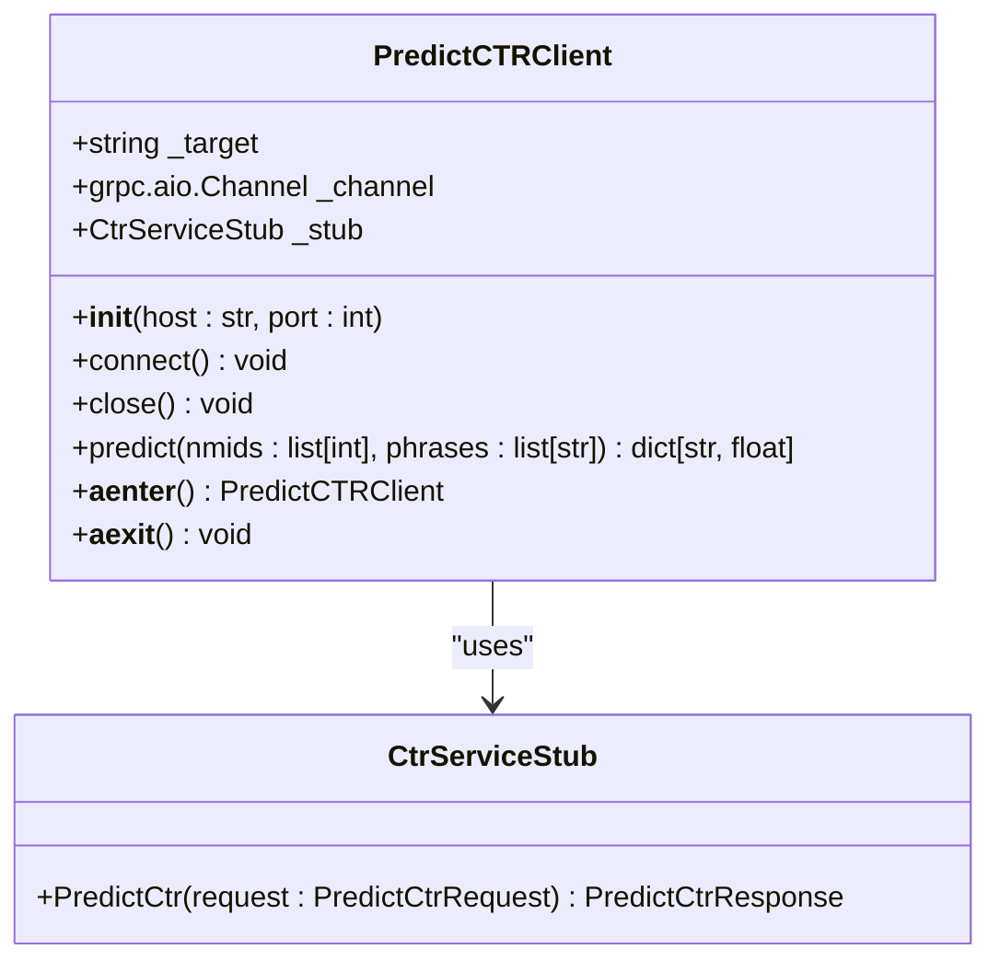
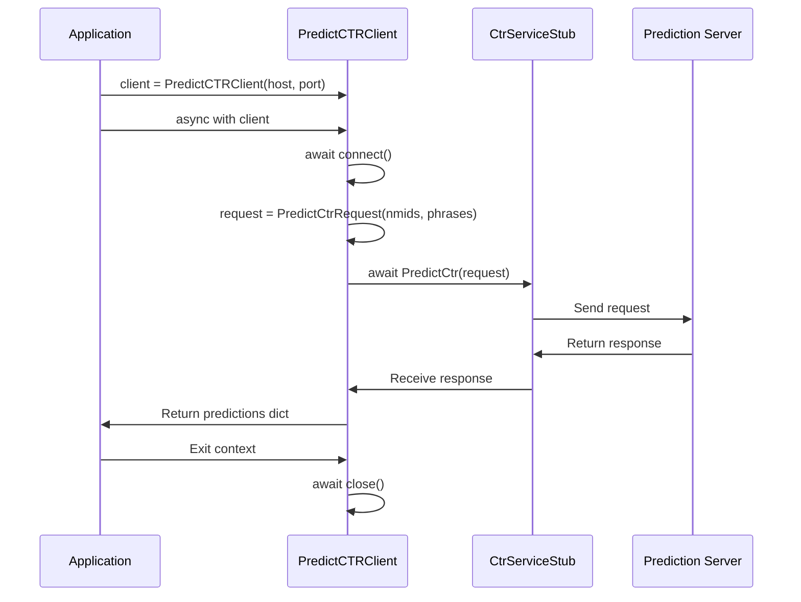
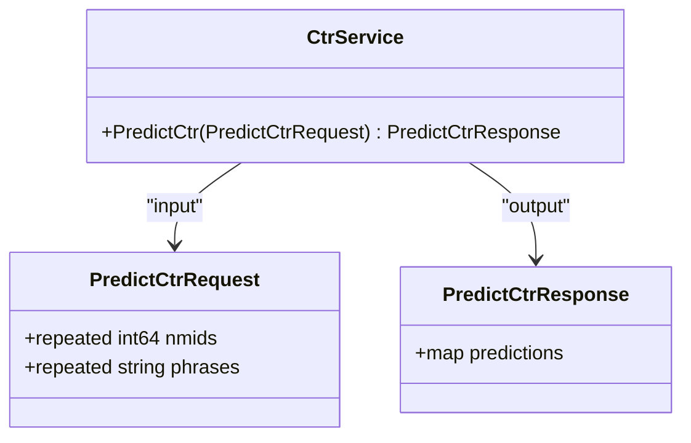
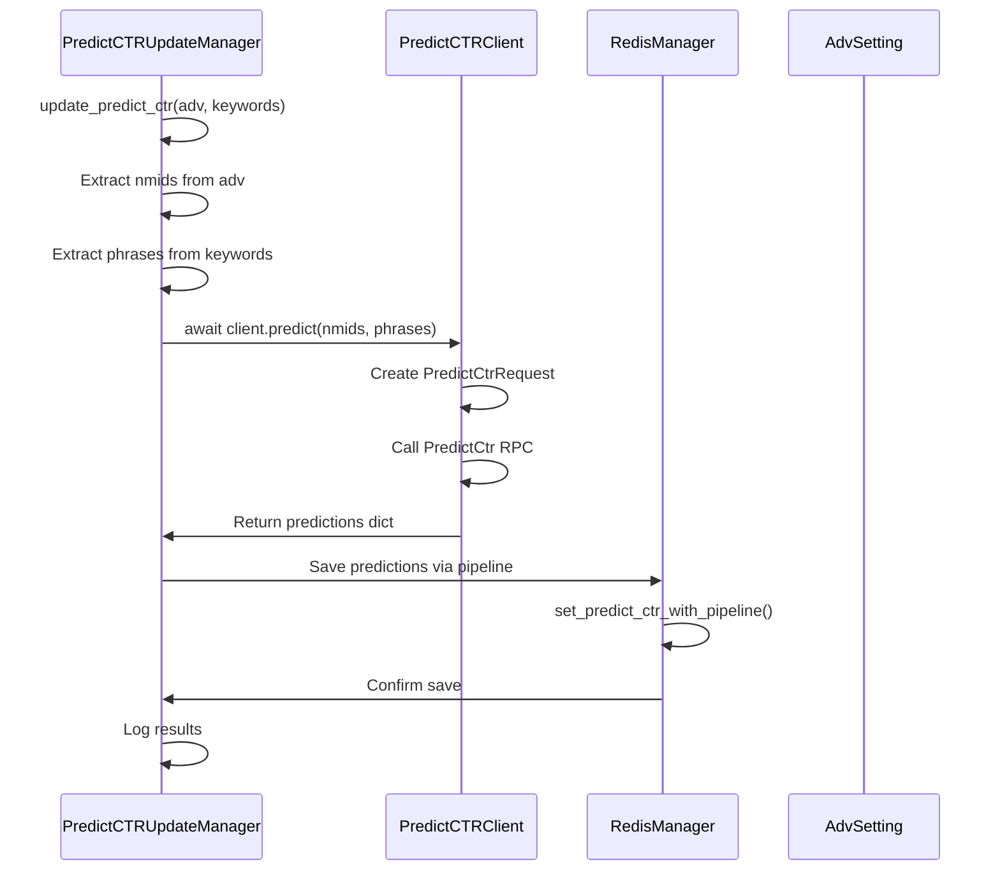
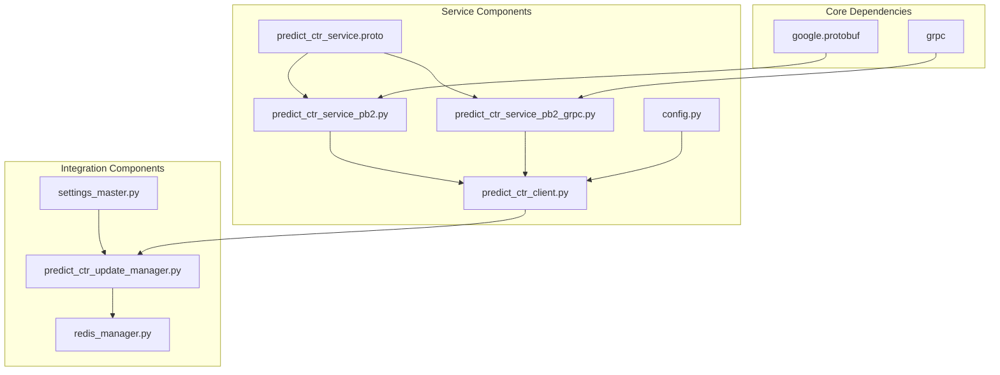

# GRPC Predict CTR Service

<cite>
**Referenced Files in This Document**   
- [predict_ctr_service.proto](file://app/modules/grpcs/predict_ctr_service/grpc_service/predict_ctr_service.proto)
- [predict_ctr_client.py](file://app/modules/grpcs/predict_ctr_service/predict_ctr_client/predict_ctr_client.py)
- [config.py](file://app/modules/grpcs/predict_ctr_service/config.py)
- [settings_master.py](file://app/settings/settings_master.py)
- [predict_ctr_update_manager.py](file://app/modules/shop_runner/service_manager/services/predict_ctr_update_manager/predict_ctr_update_manager.py)
- [predict_ctr_client.py](file://app/modules/grpcs/predict_ctr_service/predict_ctr_client/predict_ctr_client.py)
- [min_ctr_manager.py](file://app/modules/wb_adv_updater/min_ctr_manager/min_ctr_manager.py)
- [ML.py](file://app/modules/wb_adv_updater/ML.py)
- [predict_ctr_service_pb2.py](file://app/modules/grpcs/predict_ctr_service/grpc_service/predict_ctr_service_pb2.py)
- [predict_ctr_service_pb2_grpc.py](file://app/modules/grpcs/predict_ctr_service/grpc_service/predict_ctr_service_pb2_grpc.py)
- [redis_manager.py](file://app/modules/shop_runner/service_manager/services/predict_ctr_update_manager/redis_manager.py)
- [predict_ctr.py](file://app/core/redis_manager_v2/mixins/predict_ctr.py)
</cite>

## Table of Contents
1. [Introduction](#introduction)
2. [Project Structure](#project-structure)
3. [Core Components](#core-components)
4. [Architecture Overview](#architecture-overview)
5. [Detailed Component Analysis](#detailed-component-analysis)
6. [Dependency Analysis](#dependency-analysis)
7. [Performance Considerations](#performance-considerations)
8. [Troubleshooting Guide](#troubleshooting-guide)
9. [Conclusion](#conclusion)

## Introduction
The GRPC Predict CTR Service is a critical component in the advertising optimization system, providing click-through rate (CTR) predictions for Wildberries advertising campaigns. This service enables data-driven bidding decisions by predicting the likelihood of user clicks on specific product keywords. The system is built using gRPC for efficient communication between components, with a clear separation between the client interface, protocol definition, and integration points within the advertising workflow. The service supports both synchronous and asynchronous operations, with comprehensive error handling for network failures and service unavailability.

## Project Structure
The GRPC Predict CTR Service is organized in a modular structure within the application's modules directory. The service components are located in `app/modules/grpcs/predict_ctr_service/` and include the protocol definition, client implementation, configuration, and exception handling. The service is integrated with other components through dependency injection and follows a clean separation of concerns. The client implementation is designed for asynchronous operation, supporting modern Python async/await patterns for efficient resource utilization.

**Diagram sources**
- [predict_ctr_service.proto](file://app/modules/grpcs/predict_ctr_service/grpc_service/predict_ctr_service.proto)
- [predict_ctr_client.py](file://app/modules/grpcs/predict_ctr_service/predict_ctr_client/predict_ctr_client.py)
- [config.py](file://app/modules/grpcs/predict_ctr_service/config.py)
- [predict_ctr_update_manager.py](file://app/modules/shop_runner/service_manager/services/predict_ctr_update_manager/predict_ctr_update_manager.py)
- [min_ctr_manager.py](file://app/modules/wb_adv_updater/min_ctr_manager/min_ctr_manager.py)
- [ML.py](file://app/modules/wb_adv_updater/ML.py)
- [settings_master.py](file://app/settings/settings_master.py)

**Section sources**
- [predict_ctr_service.proto](file://app/modules/grpcs/predict_ctr_service/grpc_service/predict_ctr_service.proto)
- [predict_ctr_client.py](file://app/modules/grpcs/predict_ctr_service/predict_ctr_client/predict_ctr_client.py)
- [config.py](file://app/modules/grpcs/predict_ctr_service/config.py)

## Core Components
The GRPC Predict CTR Service consists of several core components that work together to provide CTR prediction capabilities. The service is built around a well-defined protocol buffer contract that specifies the request and response formats. The client implementation provides a clean, asynchronous interface for interacting with the prediction service, handling connection lifecycle management and error conditions. Configuration is managed through both local settings and environment variables, allowing for flexible deployment across different environments. The service is integrated into the advertising workflow through dedicated managers that handle the business logic of when and how to use CTR predictions.

**Section sources**
- [predict_ctr_service.proto](file://app/modules/grpcs/predict_ctr_service/grpc_service/predict_ctr_service.proto)
- [predict_ctr_client.py](file://app/modules/grpcs/predict_ctr_service/predict_ctr_client/predict_ctr_client.py)
- [config.py](file://app/modules/grpcs/predict_ctr_service/config.py)
- [settings_master.py](file://app/settings/settings_master.py)

## Architecture Overview
The GRPC Predict CTR Service follows a client-server architecture with a clear separation between the service contract, client implementation, and integration points. The architecture is designed for high performance and reliability, with asynchronous operations throughout the stack. The service uses protocol buffers for efficient serialization and gRPC for reliable, high-performance communication. The client implementation manages connection pooling implicitly through the gRPC channel lifecycle, and supports context manager patterns for automatic resource cleanup.

**Diagram sources**
- [predict_ctr_client.py](file://app/modules/grpcs/predict_ctr_service/predict_ctr_client/predict_ctr_client.py)
- [predict_ctr_service_pb2_grpc.py](file://app/modules/grpcs/predict_ctr_service/grpc_service/predict_ctr_service_pb2_grpc.py)

## Detailed Component Analysis

### PredictCTRClient Analysis
The PredictCTRClient class provides a clean, asynchronous interface for interacting with the CTR prediction service. It handles connection lifecycle management, including automatic connection establishment and proper cleanup. The client supports both explicit connection management through connect()/close() methods and implicit management through async context manager usage. The predict() method accepts lists of nmids and phrases, packages them into the appropriate protocol buffer message, and returns the predictions as a dictionary.

#### For Object-Oriented Components:

**Diagram sources**
- [predict_ctr_client.py](file://app/modules/grpcs/predict_ctr_service/predict_ctr_client/predict_ctr_client.py)
- [predict_ctr_service_pb2_grpc.py](file://app/modules/grpcs/predict_ctr_service/grpc_service/predict_ctr_service_pb2_grpc.py)

#### For API/Service Components:

**Diagram sources**
- [predict_ctr_client.py](file://app/modules/grpcs/predict_ctr_service/predict_ctr_client/predict_ctr_client.py)

**Section sources**
- [predict_ctr_client.py](file://app/modules/grpcs/predict_ctr_service/predict_ctr_client/predict_ctr_client.py)

### Protocol Buffer Definition Analysis
The protocol buffer definition specifies the contract between the client and server, defining the structure of requests and responses. The PredictCtrRequest message contains two repeated fields: nmids (product identifiers) and phrases (search keywords). The PredictCtrResponse message contains a map of predictions, where each key is a phrase and the value is the predicted CTR. The CtrService service contract defines a single RPC method, PredictCtr, which takes a PredictCtrRequest and returns a PredictCtrResponse.

#### For Object-Oriented Components:

**Diagram sources**
- [predict_ctr_service.proto](file://app/modules/grpcs/predict_ctr_service/grpc_service/predict_ctr_service.proto)

**Section sources**
- [predict_ctr_service.proto](file://app/modules/grpcs/predict_ctr_service/grpc_service/predict_ctr_service.proto)

### Integration with Advertising Workflow
The PredictCTRClient is integrated into the advertising optimization workflow through several key components. The PredictCTRUpdateManager orchestrates the process of updating CTR predictions for advertising campaigns, while the MinCtrManager uses predictions to determine minimum CTR thresholds for bidding. The ML component uses predictions as part of its machine learning pipeline for campaign optimization.

#### For API/Service Components:

**Diagram sources**
- [predict_ctr_update_manager.py](file://app/modules/shop_runner/service_manager/services/predict_ctr_update_manager/predict_ctr_update_manager.py)
- [predict_ctr_client.py](file://app/modules/grpcs/predict_ctr_service/predict_ctr_client/predict_ctr_client.py)
- [redis_manager.py](file://app/modules/shop_runner/service_manager/services/predict_ctr_update_manager/redis_manager.py)

**Section sources**
- [predict_ctr_update_manager.py](file://app/modules/shop_runner/service_manager/services/predict_ctr_update_manager/predict_ctr_update_manager.py)
- [predict_ctr_client.py](file://app/modules/grpcs/predict_ctr_service/predict_ctr_client/predict_ctr_client.py)
- [redis_manager.py](file://app/modules/shop_runner/service_manager/services/predict_ctr_update_manager/redis_manager.py)

## Dependency Analysis
The GRPC Predict CTR Service has a well-defined dependency structure that enables clean integration with the rest of the application. The service depends on gRPC and protocol buffers for communication, with generated code providing the interface between Python and the protocol definition. Configuration dependencies are managed through both local configuration files and environment variables, allowing for flexible deployment. The service is integrated into the application through dependency injection, with the PredictCTRUpdateManager container providing the necessary dependencies to the service components.

**Diagram sources**
- [predict_ctr_service.proto](file://app/modules/grpcs/predict_ctr_service/grpc_service/predict_ctr_service.proto)
- [predict_ctr_service_pb2.py](file://app/modules/grpcs/predict_ctr_service/grpc_service/predict_ctr_service_pb2.py)
- [predict_ctr_service_pb2_grpc.py](file://app/modules/grpcs/predict_ctr_service/grpc_service/predict_ctr_service_pb2_grpc.py)
- [predict_ctr_client.py](file://app/modules/grpcs/predict_ctr_service/predict_ctr_client/predict_ctr_client.py)
- [config.py](file://app/modules/grpcs/predict_ctr_service/config.py)
- [settings_master.py](file://app/settings/settings_master.py)
- [predict_ctr_update_manager.py](file://app/modules/shop_runner/service_manager/services/predict_ctr_update_manager/predict_ctr_update_manager.py)
- [redis_manager.py](file://app/modules/shop_runner/service_manager/services/predict_ctr_update_manager/redis_manager.py)

**Section sources**
- [predict_ctr_service.proto](file://app/modules/grpcs/predict_ctr_service/grpc_service/predict_ctr_service.proto)
- [predict_ctr_service_pb2.py](file://app/modules/grpcs/predict_ctr_service/grpc_service/predict_ctr_service_pb2.py)
- [predict_ctr_service_pb2_grpc.py](file://app/modules/grpcs/predict_ctr_service/grpc_service/predict_ctr_service_pb2_grpc.py)
- [predict_ctr_client.py](file://app/modules/grpcs/predict_ctr_service/predict_ctr_client/predict_ctr_client.py)
- [config.py](file://app/modules/grpcs/predict_ctr_service/config.py)
- [settings_master.py](file://app/settings/settings_master.py)

## Performance Considerations
The GRPC Predict CTR Service is designed with performance in mind, leveraging asynchronous operations throughout the stack to maximize throughput and minimize latency. The service supports batch predictions, allowing multiple nmids and phrases to be processed in a single request, which reduces network overhead and improves efficiency. Connection pooling is handled implicitly by the gRPC channel, which maintains a pool of connections to the server for reuse across multiple requests. The client implementation uses pipelining when saving predictions to Redis, reducing the number of round trips to the storage layer. For high-volume scenarios, the service can be scaled horizontally by deploying multiple instances behind a load balancer.

**Section sources**
- [predict_ctr_client.py](file://app/modules/grpcs/predict_ctr_service/predict_ctr_client/predict_ctr_client.py)
- [predict_ctr_update_manager.py](file://app/modules/shop_runner/service_manager/services/predict_ctr_update_manager/predict_ctr_update_manager.py)
- [redis_manager.py](file://app/modules/shop_runner/service_manager/services/predict_ctr_update_manager/redis_manager.py)

## Troubleshooting Guide
When troubleshooting issues with the GRPC Predict CTR Service, several common scenarios should be considered. Network failures and timeout scenarios are handled through gRPC's built-in error handling, with specific error codes indicating the nature of the problem. Malformed responses are handled by validating the response structure and returning None when the response cannot be processed. Connection issues can be diagnosed by checking the service host and port configuration, as well as network connectivity between the client and server. Performance issues may indicate the need for connection pooling optimization or batch size adjustment. Logging is implemented throughout the service to provide visibility into the request/response flow and error conditions.

**Section sources**
- [predict_ctr_client.py](file://app/modules/grpcs/predict_ctr_service/predict_ctr_client/predict_ctr_client.py)
- [predict_ctr_update_manager.py](file://app/modules/shop_runner/service_manager/services/predict_ctr_update_manager/predict_ctr_update_manager.py)
- [excs.py](file://app/modules/grpcs/predict_ctr_service/excs/excs.py)

## Conclusion
The GRPC Predict CTR Service provides a robust, high-performance solution for CTR prediction in the advertising optimization system. The service's clean architecture, well-defined protocol, and comprehensive error handling make it a reliable component in the advertising workflow. The asynchronous design enables efficient resource utilization, while the integration with Redis and other components ensures seamless operation within the larger system. By following the documented patterns for connection management, error handling, and performance optimization, developers can effectively leverage the service to improve advertising campaign performance.