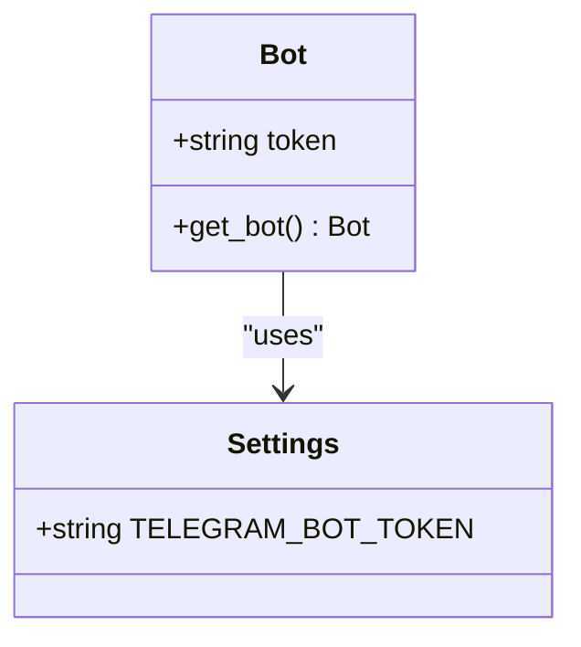
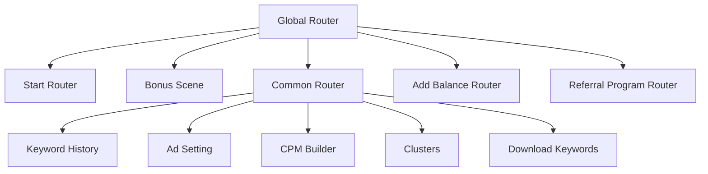
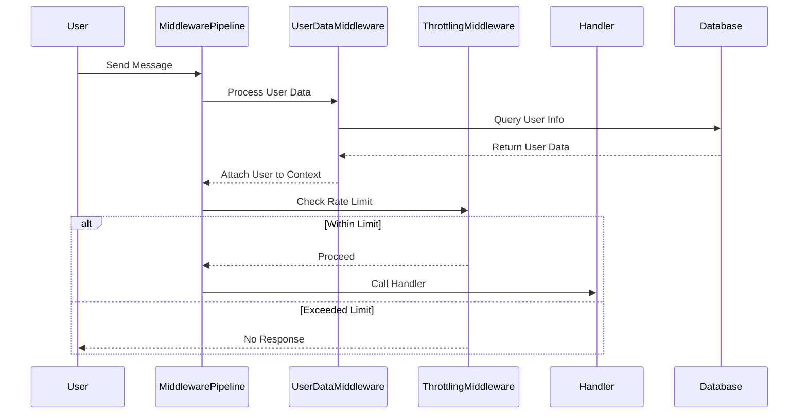
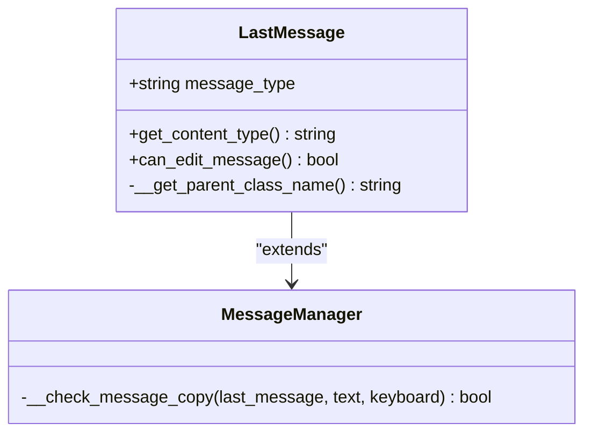
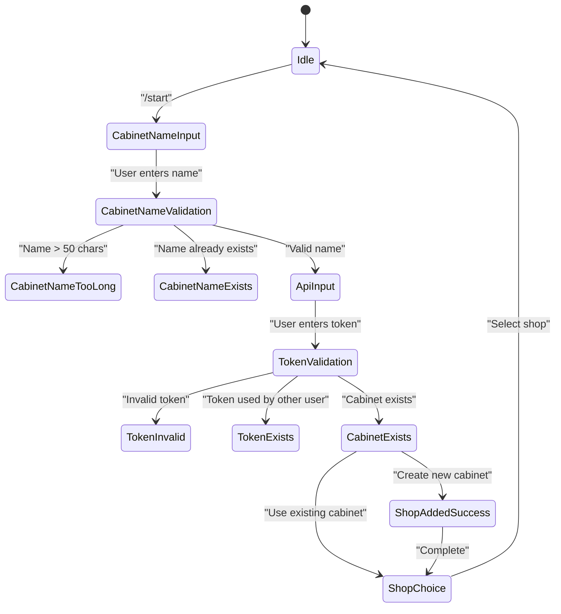
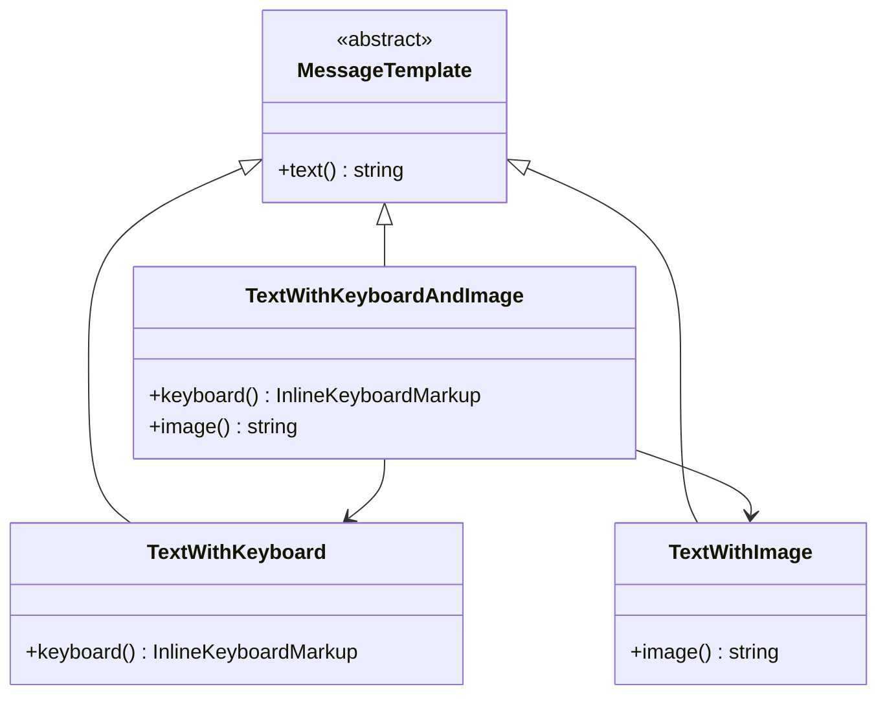
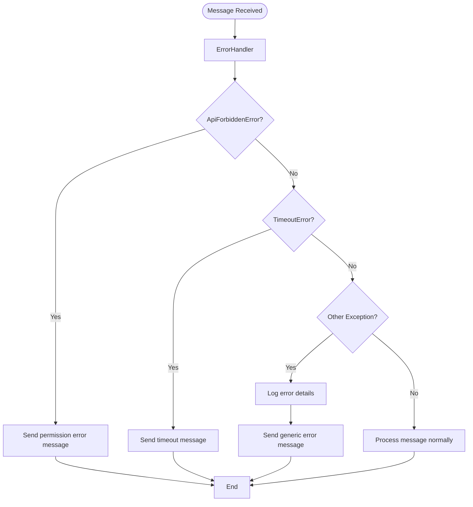
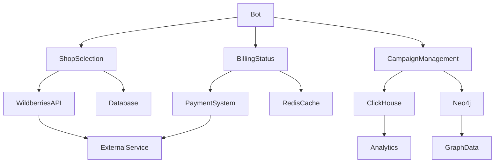
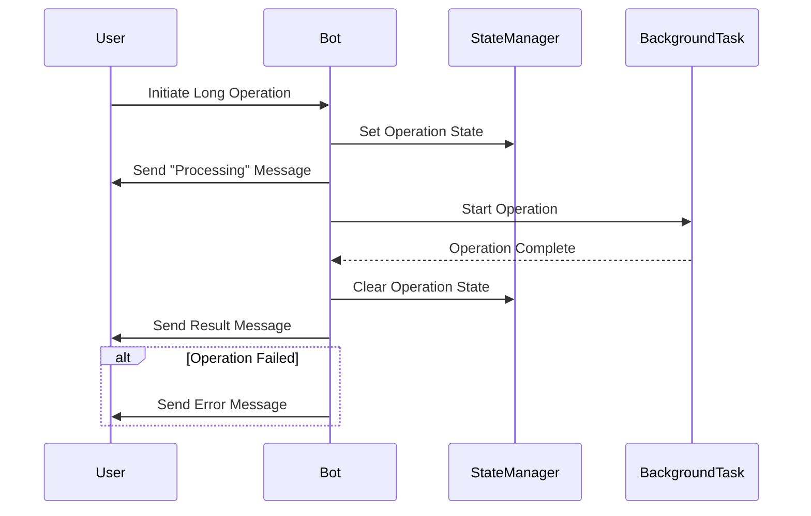

# Telegram Bot API Integration

<cite>
**Referenced Files in This Document**   
- [bot.py](file://app/client_bot/bot.py)
- [global_router.py](file://app/client_bot/global_router.py)
- [message_manager.py](file://app/client_bot/message_manager.py)
- [common_routers.py](file://app/client_bot/common_routers.py)
- [user_data.py](file://app/client_bot/middlewars/user_data.py)
- [throtting.py](file://app/client_bot/middlewars/throtting.py)
- [start.py](file://app/client_bot/user_interface/handlers/start/start.py)
- [keyboards.py](file://app/client_bot/user_interface/views/keyboards.py)
- [states.py](file://app/client_bot/user_interface/states.py)
- [shop_choice_message.py](file://app/client_bot/user_interface/handlers/shop_choice_message.py)
- [messages.py](file://app/client_bot/user_interface/views/messages/messages.py)
- [templates.py](file://app/client_bot/user_interface/message_templates/templates.py)
- [callbacks.py](file://app/client_bot/user_interface/views/callbacks.py)
- [echo_handler.py](file://app/client_bot/echo_handler.py)
</cite>

## Table of Contents
1. [Introduction](#introduction)
2. [Bot Initialization and Configuration](#bot-initialization-and-configuration)
3. [Message Handling Architecture](#message-handling-architecture)
4. [Middleware Pipeline](#middleware-pipeline)
5. [Message Management System](#message-management-system)
6. [Command Handlers and State Management](#command-handlers-and-state-management)
7. [User Interface Components](#user-interface-components)
8. [Error Handling and Rate Limit Management](#error-handling-and-rate-limit-management)
9. [Integration with Internal Services](#integration-with-internal-services)
10. [Best Practices for Conversation State](#best-practices-for-conversation-state)

## Introduction
This document provides comprehensive documentation for the Telegram Bot API integration implemented using aiogram in the advertising management system. The bot serves as a client interface for managing Wildberries advertising campaigns, allowing users to configure campaign settings, monitor performance, and manage billing through a conversational interface. The system integrates with internal services for shop selection, billing status display, and campaign optimization. The architecture follows a modular design with clear separation of concerns between routing, middleware, message handling, and business logic components.

## Bot Initialization and Configuration
The bot initialization process begins in `bot.py`, where the Telegram Bot instance is created using the token from application settings. The bot instance is configured as a singleton through the `get_bot()` factory function, ensuring consistent access throughout the application. The system uses environment variables loaded via `dotenv` for configuration management, with the token retrieved from the centralized settings module. This approach allows for environment-specific configurations while maintaining a clean separation between configuration and code. The bot instance is then used across various components for sending messages, handling updates, and interacting with Telegram's API.

**Diagram sources**
- [bot.py](file://app/client_bot/bot.py#L1-L15)
- [settings.py](file://app/settings/settings_master.py#L1-L50)

**Section sources**
- [bot.py](file://app/client_bot/bot.py#L1-L15)

## Message Handling Architecture
The message handling architecture is centered around the `global_router.py` file, which serves as the main entry point for all incoming messages and callback queries. The global router implements a hierarchical routing system that includes various specialized routers for different functional areas. The routing system follows a specific order of inclusion that is critical for proper command handling, particularly for the `/start` command. The architecture includes a callback answer middleware that provides immediate feedback to users when processing requests, enhancing the user experience by indicating that their request is being handled.

**Diagram sources**
- [global_router.py](file://app/client_bot/global_router.py#L1-L29)
- [common_routers.py](file://app/client_bot/common_routers.py#L1-L112)

**Section sources**
- [global_router.py](file://app/client_bot/global_router.py#L1-L29)
- [common_routers.py](file://app/client_bot/common_routers.py#L1-L112)

## Middleware Pipeline
The middleware pipeline consists of several components that process incoming messages before they reach the handlers. The `user_data.py` middleware extracts and prepares user data by querying the database for the user's information and associated Wildberries cabinets, ensuring that handlers have access to complete user context. The `throtting.py` middleware implements rate limiting using TTL caches to prevent abuse and ensure fair usage of the bot's resources. The throttling mechanism supports different time intervals for different types of operations, allowing for fine-grained control over user interactions. These middleware components are registered at the router level, ensuring they are applied consistently across all handlers.

**Diagram sources**
- [user_data.py](file://app/client_bot/middlewars/user_data.py#L1-L51)
- [throtting.py](file://app/client_bot/middlewars/throtting.py#L1-L29)

**Section sources**
- [user_data.py](file://app/client_bot/middlewars/user_data.py#L1-L51)
- [throtting.py](file://app/client_bot/middlewars/throtting.py#L1-L29)

## Message Management System
The message management system is implemented in `message_manager.py` and provides utilities for handling message lifecycle and content. The `LastMessage` class extends the base Message class with additional functionality for determining message editability based on Telegram's 48-hour edit window. This ensures that the bot only attempts to edit messages that are still within the allowed timeframe. The system also includes utilities for checking message content equality, which helps prevent redundant message updates. The message manager works in conjunction with the message templates system to ensure consistent message formatting and delivery across the application.

**Diagram sources**
- [message_manager.py](file://app/client_bot/message_manager.py#L1-L35)

**Section sources**
- [message_manager.py](file://app/client_bot/message_manager.py#L1-L35)

## Command Handlers and State Management
The command handling system is built around a state management pattern that guides users through various workflows. The `start.py` file contains handlers for the initial user interaction, including shop registration and token validation. The system uses Finite State Machine (FSM) patterns to manage multi-step processes such as adding a new shop or configuring campaign settings. State classes defined in `states.py` represent different stages of these workflows, allowing the bot to maintain context across multiple user interactions. The handler for adding a new shop demonstrates a comprehensive validation process that checks token validity, prevents duplicate entries, and handles various error conditions gracefully.

**Diagram sources**
- [start.py](file://app/client_bot/user_interface/handlers/start/start.py#L1-L462)
- [states.py](file://app/client_bot/user_interface/states.py#L1-L78)

**Section sources**
- [start.py](file://app/client_bot/user_interface/handlers/start/start.py#L1-L462)
- [states.py](file://app/client_bot/user_interface/states.py#L1-L78)

## User Interface Components
The user interface components are organized into a comprehensive system of templates, keyboards, and messages that provide a consistent user experience. The `keyboards.py` file contains functions for generating dynamic inline keyboards based on the current context, such as campaign settings or shop selection. These keyboards provide users with intuitive navigation and action options. The `messages.py` file implements various message templates that combine text, images, and keyboards to deliver rich content. The template system supports different content types, including plain text, text with keyboards, text with images, and combinations thereof. The `callbacks.py` file defines callback data structures that enable stateful interactions through inline buttons.

**Diagram sources**
- [keyboards.py](file://app/client_bot/user_interface/views/keyboards.py#L1-L799)
- [messages.py](file://app/client_bot/user_interface/views/messages/messages.py#L1-L1312)
- [templates.py](file://app/client_bot/user_interface/message_templates/templates.py#L1-L187)
- [callbacks.py](file://app/client_bot/user_interface/views/callbacks.py#L1-L227)

**Section sources**
- [keyboards.py](file://app/client_bot/user_interface/views/keyboards.py#L1-L799)
- [messages.py](file://app/client_bot/user_interface/views/messages/messages.py#L1-L1312)
- [templates.py](file://app/client_bot/user_interface/message_templates/templates.py#L1-L187)
- [callbacks.py](file://app/client_bot/user_interface/views/callbacks.py#L1-L227)

## Error Handling and Rate Limit Management
The system implements comprehensive error handling strategies to manage various failure scenarios, particularly related to Telegram API rate limits and Wildberries API access. The `echo_handler.py` file contains a fallback handler that catches unprocessed messages and provides a generic response, preventing the bot from failing silently. In the shop registration process, specific error handlers manage invalid tokens, permission issues, and timeout conditions when updating campaign data. The system uses try-except blocks to catch specific exceptions like `ApiForbiddenError` and `TimeoutError`, providing appropriate user feedback and guidance for resolution. The throttling middleware also contributes to rate limit management by controlling the frequency of user interactions.

**Diagram sources**
- [echo_handler.py](file://app/client_bot/echo_handler.py#L1-L11)
- [start.py](file://app/client_bot/user_interface/handlers/start/start.py#L1-L462)

**Section sources**
- [echo_handler.py](file://app/client_bot/echo_handler.py#L1-L11)
- [start.py](file://app/client_bot/user_interface/handlers/start/start.py#L1-L462)

## Integration with Internal Services
The bot integrates with various internal services to provide comprehensive functionality for managing advertising campaigns. The shop selection process interacts with the Wildberries API to validate tokens and retrieve shop information, creating appropriate database records for new shops. The billing status display is implemented through the `ExpiredSubscription` message template, which checks the cabinet's balance and prompts users to make payments when necessary. The system also integrates with campaign management services, allowing users to update campaign settings, check keyword positions, and download keyword data. These integrations are facilitated through dependency injection and service containers that provide access to the required business logic components.

**Diagram sources**
- [shop_choice_message.py](file://app/client_bot/user_interface/handlers/shop_choice_message.py#L1-L68)
- [messages.py](file://app/client_bot/user_interface/views/messages/messages.py#L1-L1312)

**Section sources**
- [shop_choice_message.py](file://app/client_bot/user_interface/handlers/shop_choice_message.py#L1-L68)
- [messages.py](file://app/client_bot/user_interface/views/messages/messages.py#L1-L1312)

## Best Practices for Conversation State
The system follows best practices for maintaining conversation state through the use of FSM (Finite State Machine) patterns and careful state management. The state classes in `states.py` provide a clear structure for different workflows, making it easy to understand and extend the conversation flows. The bot uses callback data to maintain context across interactions, allowing users to navigate back and forth between different screens without losing their place in the workflow. For long-running operations, the system uses background task coordination and provides appropriate feedback to users about the operation status. The message manager's ability to check if a message needs updating helps optimize performance by avoiding unnecessary API calls.

**Diagram sources**
- [states.py](file://app/client_bot/user_interface/states.py#L1-L78)
- [message_manager.py](file://app/client_bot/message_manager.py#L1-L35)

**Section sources**
- [states.py](file://app/client_bot/user_interface/states.py#L1-L78)
- [message_manager.py](file://app/client_bot/message_manager.py#L1-L35)