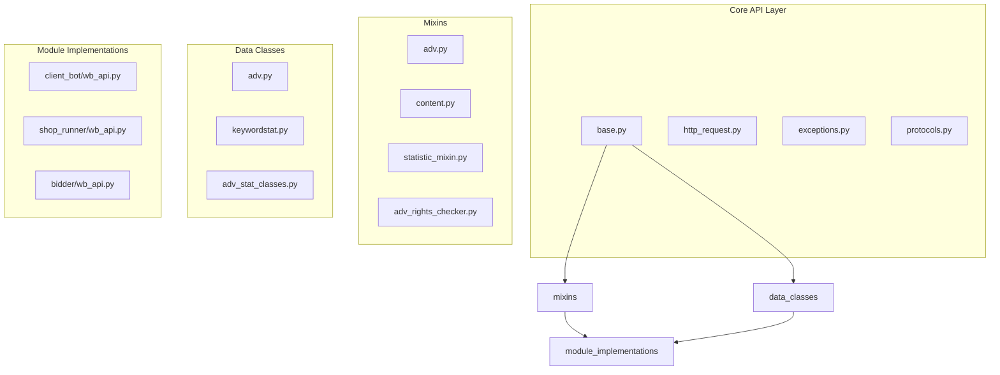
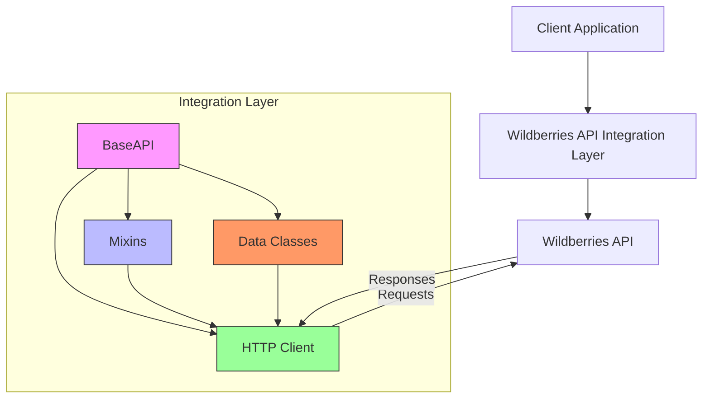
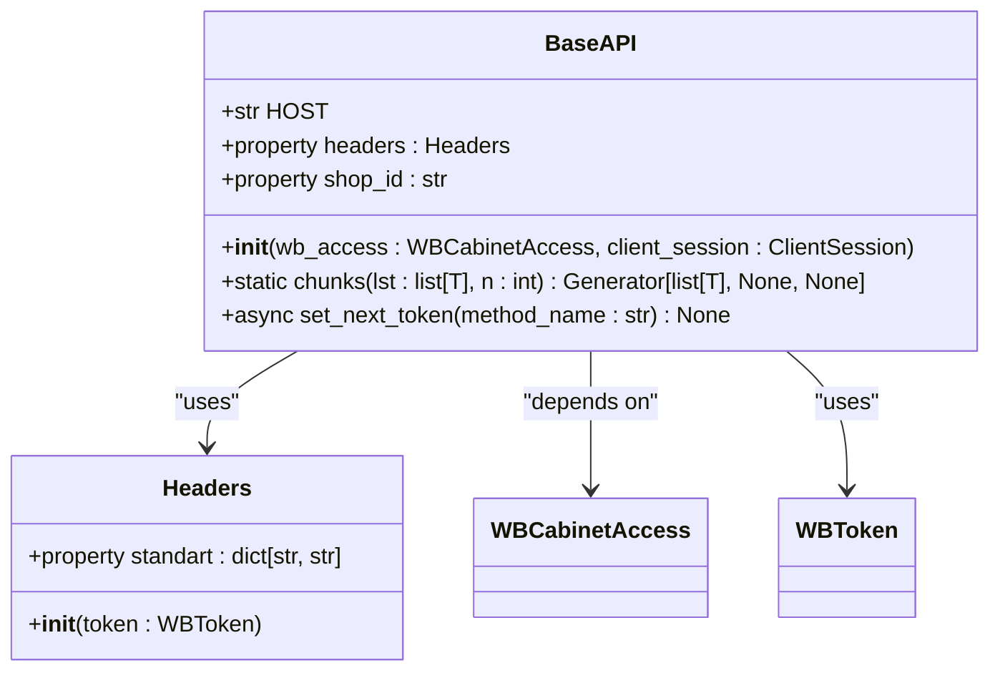
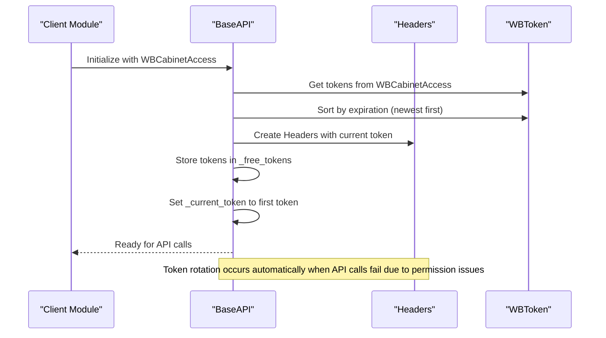
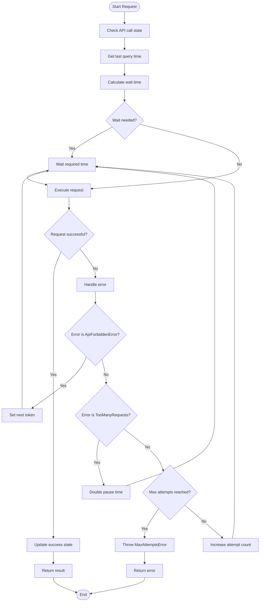
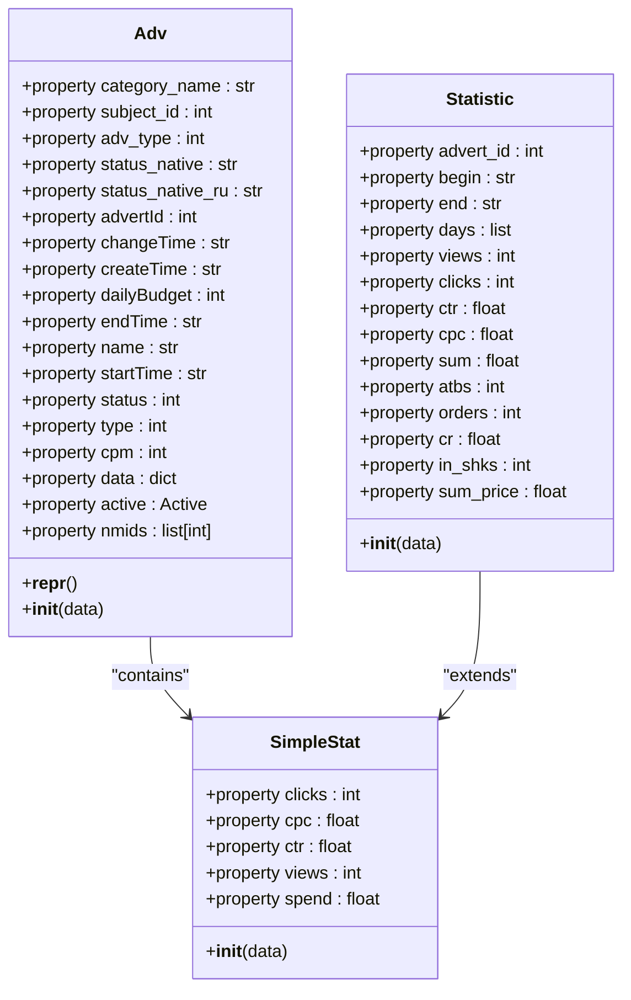
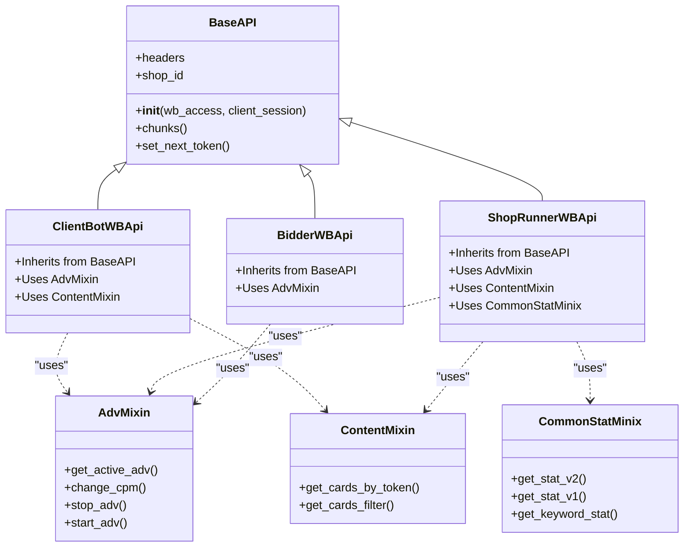
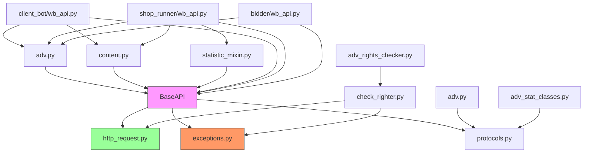

# Wildberries API Integration

<cite>
**Referenced Files in This Document**   
- [base.py](file://app/core/wb_api/base.py)
- [http_request.py](file://app/core/wb_api/http_request.py)
- [adv_rights_checker.py](file://app/core/wb_api/mixins/adv_rights_checker.py)
- [check_righter.py](file://app/core/wb_api/check_righter.py)
- [adv.py](file://app/core/wb_api/data_classes/adv.py)
- [adv_stat_classes.py](file://app/core/wb_api/data_classes/adv_stat_classes.py)
- [wb_api.py](file://app/client_bot/user_interface/handlers/start/wb_api.py)
- [wb_api.py](file://app/modules/shop_runner/modules/wb_api/wb_api.py)
- [wb_api.py](file://app/modules/shop_runner/bidder/wb_api.py)
- [models.py](file://app/modules/common_slaves/wildberries/models/models.py)
- [super_cabinet_manager.py](file://app/modules/common_slaves/wildberries/super_cabinet_manager.py)
- [ABC_WB_API.py](file://app/modules/common_slaves/wildberries/ABC_WB_API.py)
- [redis_manager.py](file://app/modules/shop_runner/shop_run_worker/redis_manager/redis_manager.py)
</cite>

## Table of Contents
1. [Introduction](#introduction)
2. [Project Structure](#project-structure)
3. [Core Components](#core-components)
4. [Architecture Overview](#architecture-overview)
5. [Detailed Component Analysis](#detailed-component-analysis)
6. [Dependency Analysis](#dependency-analysis)
7. [Performance Considerations](#performance-considerations)
8. [Troubleshooting Guide](#troubleshooting-guide)
9. [Conclusion](#conclusion)

## Introduction
This document provides comprehensive documentation for the Wildberries API integration layer used in the advertising management system. The system enables automated management of advertising campaigns, keyword statistics, product data retrieval, and shop configuration through the Wildberries marketplace API. The integration layer handles authentication, rate limiting, error handling, and provides a robust foundation for various modules including client_bot, shop_runner, and bidder functionality. The documentation covers the core WBAPI class implementation, authentication mechanisms, endpoint usage patterns, and best practices for working with the Wildberries API ecosystem.

## Project Structure
The Wildberries API integration is organized within the app/core/wb_api directory, with supporting components distributed across various modules. The core API functionality is implemented in the base.py file, which contains the BaseAPI class that serves as the foundation for all Wildberries API interactions. The mixins directory contains specialized functionality for different API domains such as advertising, content, and statistics. Data classes are defined in the data_classes directory to represent API responses and request payloads. Various modules like client_bot and shop_runner implement their own API clients by inheriting from the base classes and adding module-specific functionality.

**Diagram sources**
- [base.py](file://app/core/wb_api/base.py)
- [adv.py](file://app/core/wb_api/mixins/adv.py)
- [adv_stat_classes.py](file://app/core/wb_api/data_classes/adv_stat_classes.py)

**Section sources**
- [base.py](file://app/core/wb_api/base.py)
- [http_request.py](file://app/core/wb_api/http_request.py)

## Core Components
The Wildberries API integration is built around several core components that provide the foundation for all API interactions. The BaseAPI class serves as the primary interface for making requests to the Wildberries API, handling authentication, token management, and request execution. The http_request.py module provides the underlying HTTP request functionality with retry logic and error handling. The adv_rights_checker mixin enables permission validation for API access. Data classes such as Adv and Statistic provide structured representations of API responses. The implementation supports multiple inheritance, allowing modules to combine different mixins based on their specific requirements.

**Section sources**
- [base.py](file://app/core/wb_api/base.py#L32-L70)
- [http_request.py](file://app/core/wb_api/http_request.py#L0-L213)
- [adv_rights_checker.py](file://app/core/wb_api/mixins/adv_rights_checker.py#L0-L6)

## Architecture Overview
The Wildberries API integration follows a modular architecture with a clear separation of concerns. At the core is the BaseAPI class, which handles authentication, token management, and basic request execution. This class is extended through mixins that provide domain-specific functionality for advertising, content, and statistics. Different modules create their own API clients by inheriting from BaseAPI and the appropriate mixins. The architecture supports multiple tokens per shop, automatic token rotation when permissions are insufficient, and comprehensive error handling. The system integrates with Redis for caching and state management, and uses SQLAlchemy for persistent storage of configuration and state data.

**Diagram sources**
- [base.py](file://app/core/wb_api/base.py#L32-L115)
- [http_request.py](file://app/core/wb_api/http_request.py#L0-L213)
- [adv.py](file://app/core/wb_api/mixins/adv.py)

## Detailed Component Analysis

### Base API Implementation
The BaseAPI class provides the foundational functionality for all Wildberries API interactions. It manages authentication through WBToken headers, handles multiple tokens per shop, and implements automatic token rotation when necessary. The class maintains state for API call rates and implements retry logic for failed requests. It also provides utility methods for chunking large requests to comply with API limitations.

**Diagram sources**
- [base.py](file://app/core/wb_api/base.py#L32-L115)
- [ABC_WB_API.py](file://app/modules/common_slaves/wildberries/ABC_WB_API.py#L0-L115)

**Section sources**
- [base.py](file://app/core/wb_api/base.py#L32-L115)
- [super_cabinet_manager.py](file://app/modules/common_slaves/wildberries/super_cabinet_manager.py#L0-L46)

### Authentication and Token Management
The system implements a robust authentication mechanism using WBToken headers for API requests. Tokens are managed through the WBToken model, which includes validation of token expiration and permissions. The integration supports multiple tokens per shop, allowing for failover when a token becomes invalid. The AdvRightsChecker mixin provides functionality to validate token permissions for specific API endpoints, ensuring that operations are only attempted when the necessary permissions are present.

**Diagram sources**
- [base.py](file://app/core/wb_api/base.py#L32-L115)
- [adv_rights_checker.py](file://app/core/wb_api/mixins/adv_rights_checker.py#L0-L6)
- [check_righter.py](file://app/core/wb_api/check_righter.py#L0-L59)

**Section sources**
- [base.py](file://app/core/wb_api/base.py#L32-L115)
- [adv_rights_checker.py](file://app/core/wb_api/mixins/adv_rights_checker.py#L0-L6)
- [models.py](file://app/modules/common_slaves/wildberries/models/models.py#L0-L719)

### Request Handling and Retry Logic
The http_request.py module implements comprehensive request handling with built-in retry logic and rate limiting. The try_except_decorator function provides adaptive retry behavior with exponential backoff, automatically adjusting pause times between requests based on success or failure. The requests function handles HTTP communication, error parsing, and response validation. The system distinguishes between different error types, including rate limiting (TooManyRequests), authentication issues (ApiForbiddenError), and validation errors (BadRequestError).

**Diagram sources**
- [http_request.py](file://app/core/wb_api/http_request.py#L0-L213)

**Section sources**
- [http_request.py](file://app/core/wb_api/http_request.py#L0-L213)

### Advertising Data Models
The system defines comprehensive data models for representing advertising campaigns and their statistics. The Adv class provides a rich interface for accessing campaign properties, including status, budget, and performance metrics. The Statistic class encapsulates campaign performance data such as views, clicks, CTR, and spending. These models abstract the underlying JSON responses from the Wildberries API, providing a clean, type-safe interface for consuming code.

**Diagram sources**
- [adv.py](file://app/core/wb_api/data_classes/adv.py#L0-L250)
- [adv_stat_classes.py](file://app/core/wb_api/data_classes/adv_stat_classes.py#L0-L24)

**Section sources**
- [adv.py](file://app/core/wb_api/data_classes/adv.py#L0-L250)
- [adv_stat_classes.py](file://app/core/wb_api/data_classes/adv_stat_classes.py#L0-L24)

### Module-Specific API Clients
Different modules in the system implement their own API clients by inheriting from BaseAPI and combining appropriate mixins. The client_bot module uses a client with advertising and content functionality. The shop_runner module extends this with statistical capabilities. The bidder module focuses on advertising functionality for bid management. This modular approach allows each component to have precisely the functionality it needs without unnecessary dependencies.

**Diagram sources**
- [wb_api.py](file://app/client_bot/user_interface/handlers/start/wb_api.py#L0-L8)
- [wb_api.py](file://app/modules/shop_runner/modules/wb_api/wb_api.py#L0-L9)
- [wb_api.py](file://app/modules/shop_runner/bidder/wb_api.py#L0-L10)

**Section sources**
- [wb_api.py](file://app/client_bot/user_interface/handlers/start/wb_api.py#L0-L8)
- [wb_api.py](file://app/modules/shop_runner/modules/wb_api/wb_api.py#L0-L9)
- [wb_api.py](file://app/modules/shop_runner/bidder/wb_api.py#L0-L10)

## Dependency Analysis
The Wildberries API integration has a well-defined dependency structure that enables modularity and code reuse. The core dependency is on aiohttp for HTTP communication, which is abstracted through the http_request.py module. The system depends on SQLAlchemy for database operations and token management. Pydantic is used for data validation in the data classes. The architecture shows a clear pattern of inheritance and composition, with the BaseAPI class serving as the foundation and mixins providing additional functionality. There is a notable duplication between BaseAPI and ABC_WB_API, which represents a technical debt that should be addressed through refactoring.

**Diagram sources**
- [base.py](file://app/core/wb_api/base.py)
- [http_request.py](file://app/core/wb_api/http_request.py)
- [adv_rights_checker.py](file://app/core/wb_api/mixins/adv_rights_checker.py)

**Section sources**
- [base.py](file://app/core/wb_api/base.py)
- [http_request.py](file://app/core/wb_api/http_request.py)
- [check_righter.py](file://app/core/wb_api/check_righter.py)

## Performance Considerations
When making bulk requests to the Wildberries API, performance can be optimized by using the chunks utility method to divide large requests into smaller batches that comply with API rate limits. The adaptive retry mechanism automatically adjusts pause times between requests based on success or failure, helping to avoid rate limiting while maximizing throughput. For frequently accessed data, caching responses in Redis can significantly reduce API call volume and improve response times. The system's token rotation mechanism also contributes to performance by ensuring that API calls continue to succeed even when individual tokens have permission issues.

**Section sources**
- [base.py](file://app/core/wb_api/base.py#L65-L70)
- [http_request.py](file://app/core/wb_api/http_request.py#L0-L213)
- [redis_manager.py](file://app/modules/shop_runner/shop_run_worker/redis_manager/redis_manager.py)

## Troubleshooting Guide
Common issues with the Wildberries API integration include token expiration, rate limiting, and permission errors. Token expiration can be detected through the is_expired property of the WBToken model and should trigger notification to the user to update their token. Rate limiting is handled automatically by the retry mechanism, but persistent issues may require adjusting the rate limits in the try_except_decorator configuration. Permission errors occur when a token lacks the necessary rights for a specific API endpoint and are handled by the set_next_token method, which rotates to a different token. If all tokens lack the necessary permissions, the cabinet is deactivated to prevent further failed attempts.

**Section sources**
- [base.py](file://app/core/wb_api/base.py#L72-L101)
- [models.py](file://app/modules/common_slaves/wildberries/models/models.py#L0-L719)
- [check_righter.py](file://app/core/wb_api/check_righter.py#L0-L59)

## Conclusion
The Wildberries API integration provides a robust foundation for managing advertising campaigns on the Wildberries marketplace. The modular architecture with reusable components enables efficient development across multiple modules while maintaining consistency in API interactions. The comprehensive error handling, token management, and retry logic ensure reliable operation even in the face of API limitations and transient failures. By following the patterns documented here, developers can effectively utilize the API integration layer to build powerful advertising management features. Future improvements should focus on eliminating the duplication between BaseAPI and ABC_WB_API to simplify maintenance and reduce technical debt.