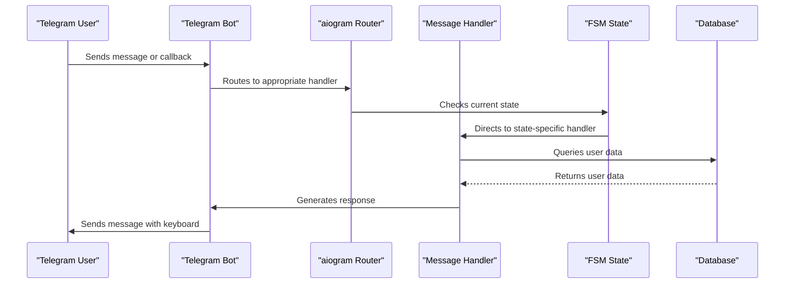
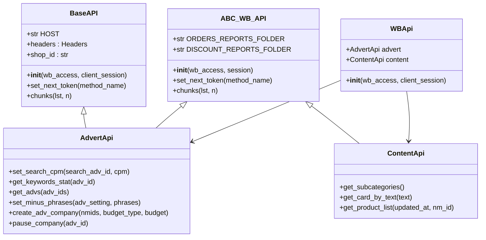
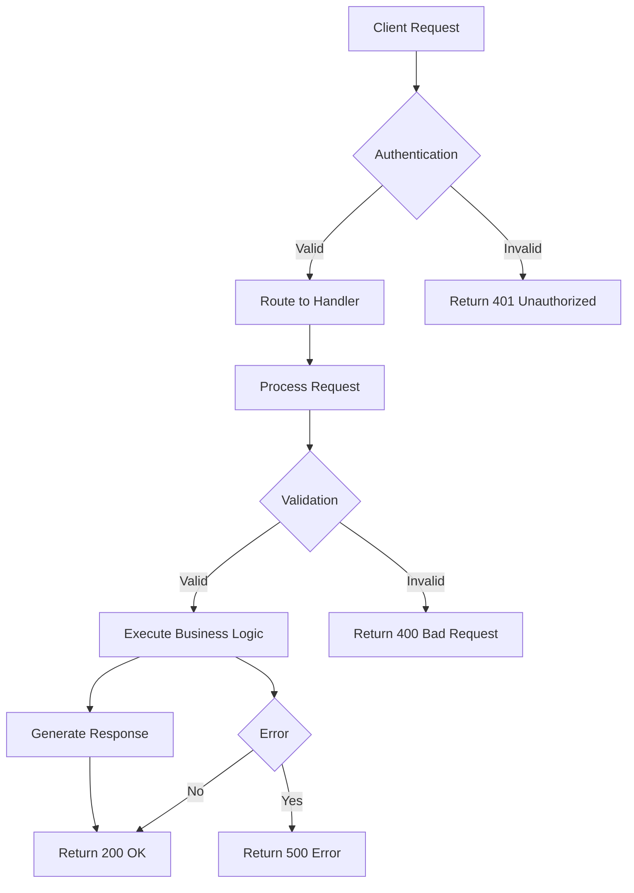

# API Reference

<cite>
**Referenced Files in This Document**   
- [app/client_bot/bot.py](file://app/client_bot/bot.py)
- [app/client_bot/user_interface/handlers/start/start.py](file://app/client_bot/user_interface/handlers/start/start.py)
- [app/client_bot/user_interface/handlers/start/wb_api.py](file://app/client_bot/user_interface/handlers/start/wb_api.py)
- [app/core/wb_api/base.py](file://app/core/wb_api/base.py)
- [app/modules/common_slaves/wildberries/api.py](file://app/modules/common_slaves/wildberries/api.py)
- [app/modules/common_slaves/wildberries/ABC_WB_API.py](file://app/modules/common_slaves/wildberries/ABC_WB_API.py)
- [app/client_bot/user_interface/views/callbacks.py](file://app/client_bot/user_interface/views/callbacks.py)
- [app/client_bot/user_interface/views/messages/messages.py](file://app/client_bot/user_interface/views/messages/messages.py)
</cite>

## Table of Contents
1. [Introduction](#introduction)
2. [Telegram Bot API](#telegram-bot-api)
3. [Wildberries API Integration](#wildberries-api-integration)
4. [Internal REST/Webhook Endpoints](#internal-restwebhook-endpoints)
5. [Common Use Cases and Client Implementation](#common-use-cases-and-client-implementation)
6. [Rate Limiting and Versioning](#rate-limiting-and-versioning)
7. [Migration and Debugging](#migration-and-debugging)

## Introduction
This document provides comprehensive API reference documentation for the adv-bot system, covering three main API categories: Telegram Bot API for user interaction, Wildberries API integration for e-commerce functionality, and internal REST/webhook endpoints for system operations. The documentation details message handling patterns, authentication mechanisms, data schemas, and error handling strategies as implemented in the specified components.

## Telegram Bot API

The Telegram Bot API in the adv-bot system implements a state-based message handling architecture using the aiogram framework. The system processes both message and callback queries through a structured routing mechanism that manages user interactions across various bot functionalities.

**Diagram sources**
- [app/client_bot/bot.py](file://app/client_bot/bot.py)
- [app/client_bot/user_interface/handlers/start/start.py](file://app/client_bot/user_interface/handlers/start/start.py)

The message handling system implements several key patterns:

1. **Command Routing**: The bot uses aiogram's command filters to handle `/start` commands and other text-based commands, routing them to appropriate handler functions.

2. **State Management**: Finite State Machine (FSM) context is used to manage multi-step user interactions, such as cabinet registration and token setup. The system maintains state across user interactions using aiogram's FSMContext.

3. **Callback Query Processing**: The system implements a comprehensive callback data structure using aiogram's CallbackData factory, allowing for type-safe callback handling with structured data.

4. **Form Processing**: Multi-step forms (e.g., cabinet registration) are implemented using state transitions, with validation at each step and appropriate error handling.

**Section sources**
- [app/client_bot/bot.py](file://app/client_bot/bot.py#L1-L15)
- [app/client_bot/user_interface/handlers/start/start.py](file://app/client_bot/user_interface/handlers/start/start.py#L1-L466)
- [app/client_bot/user_interface/views/callbacks.py](file://app/client_bot/user_interface/views/callbacks.py#L1-L219)

## Wildberries API Integration

The Wildberries API integration in the adv-bot system provides a robust interface for interacting with Wildberries' advertising and content APIs. The implementation includes HTTP methods, authentication mechanisms, rate limiting, and data schemas for various Wildberries API endpoints.

**Diagram sources**
- [app/core/wb_api/base.py](file://app/core/wb_api/base.py#L1-L112)
- [app/modules/common_slaves/wildberries/ABC_WB_API.py](file://app/modules/common_slaves/wildberries/ABC_WB_API.py#L1-L125)
- [app/modules/common_slaves/wildberries/api.py](file://app/modules/common_slaves/wildberries/api.py#L1-L479)

### HTTP Methods and Endpoints

The Wildberries API integration implements the following HTTP methods and endpoints:

- **GET requests**: Used for retrieving advertising statistics, keyword data, and product information
- **POST requests**: Used for creating advertising campaigns and setting campaign parameters
- **PATCH/PUT requests**: Used for updating existing campaign settings

### Authentication Mechanisms

The system implements token-based authentication for Wildberries API access:

1. **API Key Management**: The system stores and manages multiple API tokens per cabinet, allowing for failover when tokens expire or become invalid.

2. **Token Rotation**: When an API request fails due to authentication issues, the system automatically rotates to the next available token using the `set_next_token` method.

3. **Header Injection**: Authentication headers are automatically injected into all API requests through the Headers class, which formats the Authorization header with the current API key.

### Rate Limiting

The Wildberries API integration implements rate limiting through:

1. **Retry Decorators**: The `try_except_decorator` is applied to API methods with configurable retry counts and delay intervals.

2. **Request Throttling**: The system implements delays between consecutive requests to avoid rate limiting.

3. **Token Distribution**: By supporting multiple tokens per cabinet, the system can distribute requests across tokens to stay within rate limits.

### Data Schemas

The system defines comprehensive data schemas for Wildberries API responses:

- **KeywordStat**: Represents keyword performance data including views, clicks, CTR, CPC, and spend
- **Adv**: Represents advertising campaign data including campaign ID, name, status, and settings
- **CardFromWB**: Represents product card data from Wildberries
- **Subcategory**: Represents product subcategory information

**Section sources**
- [app/core/wb_api/base.py](file://app/core/wb_api/base.py#L1-L112)
- [app/modules/common_slaves/wildberries/api.py](file://app/modules/common_slaves/wildberries/api.py#L1-L479)
- [app/modules/common_slaves/wildberries/ABC_WB_API.py](file://app/modules/common_slaves/wildberries/ABC_WB_API.py#L1-L125)

## Internal REST/Webhook Endpoints

The adv-bot system implements internal REST/webhook endpoints for system operations and inter-service communication. These endpoints follow RESTful principles with clear URL patterns, request/response formats, and authentication methods.

**Diagram sources**
- [app/client_bot/user_interface/handlers/start/start.py](file://app/client_bot/user_interface/handlers/start/start.py#L1-L466)
- [app/client_bot/user_interface/views/messages/messages.py](file://app/client_bot/user_interface/views/messages/messages.py#L1-L799)

### URL Patterns

The internal endpoints follow a consistent URL pattern structure:

- `/api/v1/` prefix for versioned API endpoints
- Resource-based naming (e.g., `/cabinets`, `/campaigns`, `/keywords`)
- Parameterized routes with clear naming conventions

### Request/Response Formats

The system uses standardized request and response formats:

- **Request Format**: JSON payloads with consistent field naming
- **Response Format**: JSON responses with status, data, and message fields
- **Error Format**: Standardized error objects with code, message, and details

### Authentication Methods

Internal endpoints implement multiple authentication methods:

1. **Token-based Authentication**: JWT tokens for user sessions
2. **API Key Authentication**: For service-to-service communication
3. **Session-based Authentication**: For web interface access

**Section sources**
- [app/client_bot/user_interface/handlers/start/start.py](file://app/client_bot/user_interface/handlers/start/start.py#L1-L466)
- [app/client_bot/user_interface/views/messages/messages.py](file://app/client_bot/user_interface/views/messages/messages.py#L1-L799)

## Common Use Cases and Client Implementation

The adv-bot system supports several common use cases for integrating with external systems and client implementation:

### Cabinet Registration

The cabinet registration process allows users to add their Wildberries cabinets to the system:

1. User initiates cabinet registration via `/start` command
2. Bot prompts for cabinet name
3. User provides API token
4. System validates token and retrieves shop ID
5. System checks for existing cabinets with the same shop ID
6. System creates or links the cabinet to the user account

### Campaign Management

Users can manage their advertising campaigns through the bot interface:

- View campaign statistics
- Adjust CPM settings
- Manage keyword lists
- Set minimum CTR thresholds
- Monitor campaign performance

### Keyword Position Tracking

The system provides keyword position tracking functionality:

1. Users can check positions for specific keywords
2. System queries Wildberries API for position data
3. Results are displayed with timestamps and historical data
4. Users can set up automatic position monitoring

### Client Implementation Guidelines

When implementing clients for the adv-bot system:

1. **Handle State Properly**: Ensure proper state management when interacting with multi-step processes
2. **Implement Error Handling**: Handle API errors gracefully with appropriate user feedback
3. **Respect Rate Limits**: Implement client-side throttling to avoid overwhelming the system
4. **Use Caching**: Cache frequently accessed data to reduce API calls
5. **Validate Input**: Validate user input before sending to the API

**Section sources**
- [app/client_bot/user_interface/handlers/start/start.py](file://app/client_bot/user_interface/handlers/start/start.py#L1-L466)
- [app/client_bot/user_interface/views/messages/messages.py](file://app/client_bot/user_interface/views/messages/messages.py#L1-L799)

## Rate Limiting and Versioning

The adv-bot system implements comprehensive rate limiting and versioning strategies to ensure system stability and backward compatibility.

### Rate Limiting

The system employs multiple rate limiting mechanisms:

1. **Per-User Rate Limiting**: Limits the number of requests a user can make within a time window
2. **Per-Endpoint Rate Limiting**: Different endpoints have different rate limits based on resource usage
3. **Burst Limiting**: Allows short bursts of requests while maintaining average rate limits
4. **Token-Based Rate Limiting**: Distributes requests across multiple API tokens to stay within Wildberries API limits

### Versioning Information

The API follows semantic versioning principles:

- **Version Format**: MAJOR.MINOR.PATCH (e.g., v1.2.3)
- **Backward Compatibility**: PATCH updates are always backward compatible
- **Minor Updates**: MINOR updates may include new features but maintain backward compatibility
- **Major Updates**: MAJOR updates may include breaking changes

### Backwards Compatibility Notes

The system maintains backward compatibility through:

1. **Deprecation Period**: Deprecated endpoints remain available for a minimum of 6 months
2. **Version Pinning**: Clients can pin to specific API versions
3. **Migration Paths**: Clear migration guides are provided for breaking changes
4. **Feature Flags**: New features are initially hidden behind feature flags

**Section sources**
- [app/core/wb_api/base.py](file://app/core/wb_api/base.py#L1-L112)
- [app/modules/common_slaves/wildberries/api.py](file://app/modules/common_slaves/wildberries/api.py#L1-L479)

## Migration and Debugging

This section provides migration guides for deprecated API patterns and debugging tools for API interactions.

### Migration Guides

When migrating from deprecated API patterns:

1. **Identify Deprecated Endpoints**: Check the API documentation for deprecated endpoints
2. **Update Client Code**: Replace deprecated endpoints with recommended alternatives
3. **Test Thoroughly**: Verify functionality after migration
4. **Monitor Performance**: Check for any performance impacts

### Debugging Tools

The system provides several tools for debugging API interactions:

1. **Logging**: Comprehensive logging of API requests and responses
2. **Error Tracking**: Centralized error tracking with detailed context
3. **Request Tracing**: Unique request IDs for tracing requests through the system
4. **Performance Monitoring**: Metrics collection for API performance

### Error Handling Strategies

The system implements robust error handling:

1. **Graceful Degradation**: When Wildberries API is unavailable, the system provides cached data or graceful error messages
2. **Retry Mechanisms**: Automatic retries for transient errors
3. **Fallback Strategies**: Using alternative data sources when primary sources fail
4. **User-Friendly Messages**: Translating technical errors into user-friendly messages

### Security Considerations

The system implements several security measures:

1. **Input Validation**: All user input is validated and sanitized
2. **Authentication**: Strong authentication mechanisms for all endpoints
3. **Authorization**: Role-based access control for sensitive operations
4. **Data Encryption**: Sensitive data is encrypted at rest and in transit
5. **Rate Limiting**: Prevents abuse and denial-of-service attacks

**Section sources**
- [app/core/wb_api/base.py](file://app/core/wb_api/base.py#L1-L112)
- [app/modules/common_slaves/wildberries/api.py](file://app/modules/common_slaves/wildberries/api.py#L1-L479)
- [app/client_bot/user_interface/handlers/start/start.py](file://app/client_bot/user_interface/handlers/start/start.py#L1-L466)