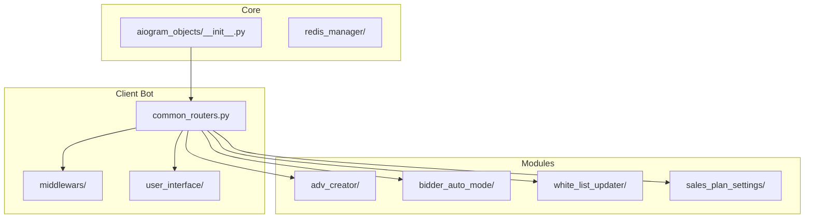
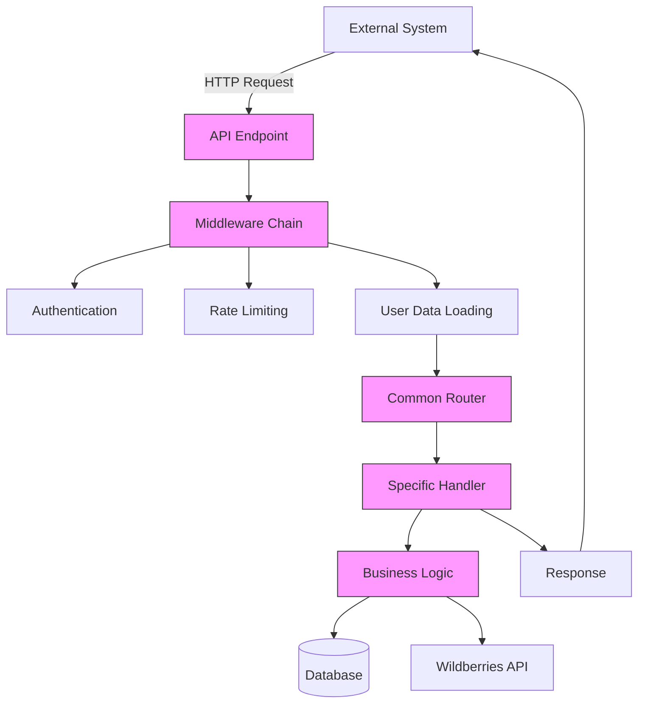
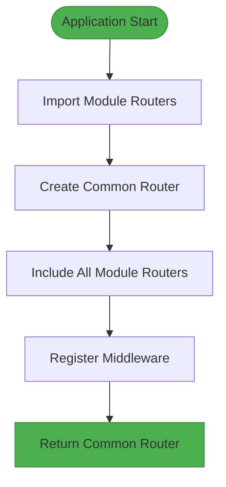
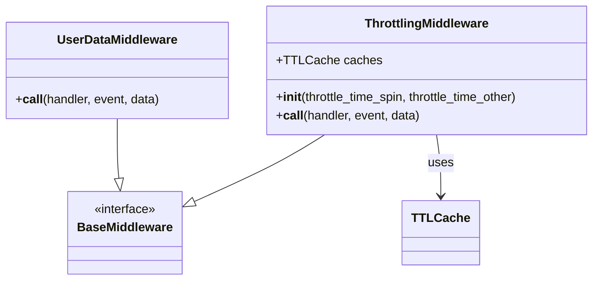
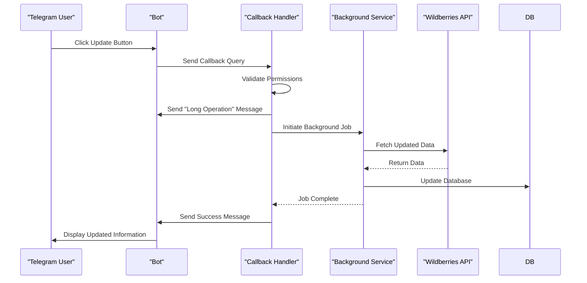
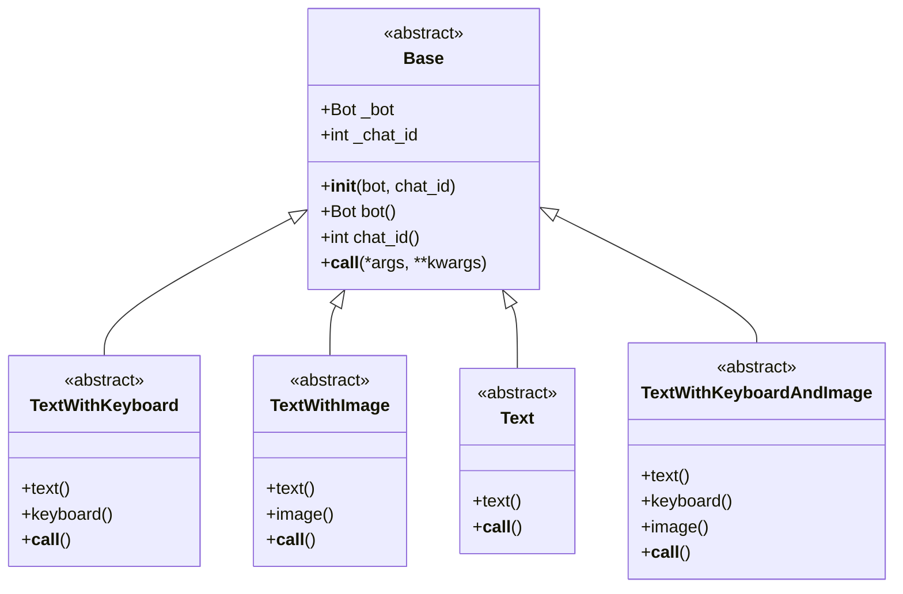
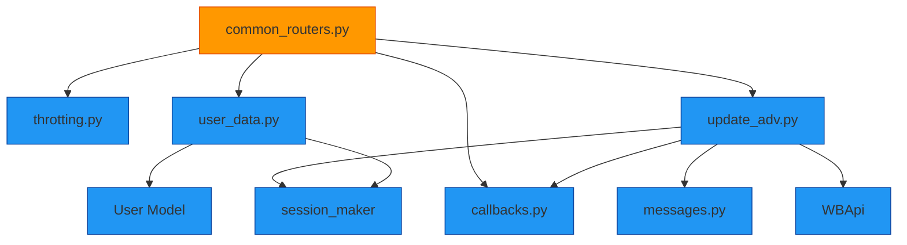

# Internal REST API Endpoints

<cite>
**Referenced Files in This Document**   
- [common_routers.py](file://app/client_bot/common_routers.py)
- [throtting.py](file://app/client_bot/middlewars/throtting.py)
- [user_data.py](file://app/client_bot/middlewars/user_data.py)
- [update_adv.py](file://app/client_bot/user_interface/handlers/update_adv.py)
- [callbacks.py](file://app/client_bot/user_interface/views/callbacks.py)
- [base.py](file://app/client_bot/user_interface/message_templates/base.py)
- [templates.py](file://app/client_bot/user_interface/message_templates/templates.py)
- [__init__.py](file://app/core/telegram/aiogram_objects/__init__.py)
</cite>

## Table of Contents
1. [Introduction](#introduction)
2. [Project Structure](#project-structure)
3. [Core Components](#core-components)
4. [Architecture Overview](#architecture-overview)
5. [Detailed Component Analysis](#detailed-component-analysis)
6. [Dependency Analysis](#dependency-analysis)
7. [Performance Considerations](#performance-considerations)
8. [Troubleshooting Guide](#troubleshooting-guide)
9. [Conclusion](#conclusion)

## Introduction
This document provides comprehensive documentation for the internal REST and webhook endpoints used within the adv-bot system. The documentation covers webhook registration and message processing through `common_routers.py`, including JSON payload schemas and authentication methods. It explains integration with aiogram's event system via `aiogram_objects/__init__.py` for handling incoming updates. The document details usage of internal endpoints for triggering background jobs such as keyword parsing or campaign updates, specifying URL patterns, HTTP methods, and response formats. Security measures including token-based authentication and IP whitelisting are addressed, along with client implementation guidelines for external systems integrating with the bot. Additional topics include rate limiting, logging, monitoring, error responses, and retry mechanisms for failed requests.

## Project Structure
The adv-bot system is organized into a modular structure with clear separation of concerns. The core application resides in the `app/` directory, which contains various modules for different functionalities including bot management, webhook handling, and background job processing. The `client_bot` module contains the webhook and API endpoint handlers, while the `core` module provides foundational services and integrations with external systems.

**Diagram sources**
- [common_routers.py](file://app/client_bot/common_routers.py)
- [__init__.py](file://app/core/telegram/aiogram_objects/__init__.py)

**Section sources**
- [common_routers.py](file://app/client_bot/common_routers.py)
- [app/core/telegram/aiogram_objects/__init__.py](file://app/core/telegram/aiogram_objects/__init__.py)

## Core Components
The core components of the adv-bot system include the common routers that handle webhook registration and message processing, middleware for authentication and rate limiting, and handlers for specific business operations such as updating advertising settings and keyword statistics. The system integrates with aiogram's event system to process incoming updates and trigger appropriate actions. Background jobs for keyword parsing, campaign updates, and other maintenance tasks are initiated through internal endpoints.

**Section sources**
- [common_routers.py](file://app/client_bot/common_routers.py)
- [update_adv.py](file://app/client_bot/user_interface/handlers/update_adv.py)
- [throtting.py](file://app/client_bot/middlewars/throtting.py)

## Architecture Overview
The adv-bot system follows a modular architecture with a clear separation between routing, business logic, and data access layers. The system uses aiogram as the foundation for handling Telegram bot events and webhook requests. Incoming requests are processed through a series of middleware components that handle authentication, rate limiting, and user data management before being routed to the appropriate handler.

**Diagram sources**
- [common_routers.py](file://app/client_bot/common_routers.py)
- [throtting.py](file://app/client_bot/middlewars/throtting.py)
- [user_data.py](file://app/client_bot/middlewars/user_data.py)

## Detailed Component Analysis

### Webhook Registration and Message Processing
The webhook registration and message processing functionality is implemented in `common_routers.py`, which serves as the central routing mechanism for the adv-bot system. The file imports and combines multiple routers from different modules, creating a comprehensive endpoint registry for handling various types of requests.

**Diagram sources**
- [common_routers.py](file://app/client_bot/common_routers.py)

**Section sources**
- [common_routers.py](file://app/client_bot/common_routers.py)

### Authentication and Rate Limiting Middleware
The system implements security measures through middleware components that handle authentication and rate limiting. The throttling middleware uses TTL caches to prevent abuse, while the user data middleware ensures that user information is properly loaded and available for all handlers.

**Diagram sources**
- [throtting.py](file://app/client_bot/middlewars/throtting.py)
- [user_data.py](file://app/client_bot/middlewars/user_data.py)

**Section sources**
- [throtting.py](file://app/client_bot/middlewars/throtting.py)
- [user_data.py](file://app/client_bot/middlewars/user_data.py)

### Background Job Triggering Endpoints
The system provides endpoints for triggering background jobs such as updating keyword statistics and advertising settings. These endpoints are implemented as callback query handlers that initiate long-running operations and provide appropriate feedback to users.

**Diagram sources**
- [update_adv.py](file://app/client_bot/user_interface/handlers/update_adv.py)
- [callbacks.py](file://app/client_bot/user_interface/views/callbacks.py)

**Section sources**
- [update_adv.py](file://app/client_bot/user_interface/handlers/update_adv.py)
- [callbacks.py](file://app/client_bot/user_interface/views/callbacks.py)

### Message Templates and Response Formatting
The system uses a template-based approach for generating consistent responses. The message templates system provides various base classes for different types of messages, including text-only, text with keyboard, and text with image messages.

**Diagram sources**
- [base.py](file://app/client_bot/user_interface/message_templates/base.py)
- [templates.py](file://app/client_bot/user_interface/message_templates/templates.py)

**Section sources**
- [base.py](file://app/client_bot/user_interface/message_templates/base.py)
- [templates.py](file://app/client_bot/user_interface/message_templates/templates.py)

## Dependency Analysis
The adv-bot system has a well-defined dependency structure with clear relationships between components. The common router serves as the central integration point, importing and combining routers from various modules to create a unified endpoint registry.

**Diagram sources**
- [common_routers.py](file://app/client_bot/common_routers.py)
- [throtting.py](file://app/client_bot/middlewars/throtting.py)
- [user_data.py](file://app/client_bot/middlewars/user_data.py)
- [update_adv.py](file://app/client_bot/user_interface/handlers/update_adv.py)
- [callbacks.py](file://app/client_bot/user_interface/views/callbacks.py)

**Section sources**
- [common_routers.py](file://app/client_bot/common_routers.py)
- [throtting.py](file://app/client_bot/middlewars/throtting.py)
- [user_data.py](file://app/client_bot/middlewars/user_data.py)

## Performance Considerations
The system implements several performance optimizations, including caching mechanisms for rate limiting and user data. The throttling middleware uses TTL caches to efficiently track request frequency without requiring database queries. The user data middleware loads user information once per request and makes it available to all subsequent handlers, reducing redundant database queries.

Additionally, long-running operations are handled asynchronously to prevent blocking the main event loop. When a user triggers an operation like updating keyword statistics, the system immediately acknowledges the request and processes the operation in the background, providing a responsive user experience.

## Troubleshooting Guide
When troubleshooting issues with the adv-bot API endpoints, consider the following common scenarios:

1. **Authentication failures**: Verify that the user has the necessary permissions to perform the requested action. Check the user data middleware to ensure user information is being loaded correctly.

2. **Rate limiting issues**: If requests are being blocked unexpectedly, check the throttling middleware configuration and cache state. The system uses separate caches for different types of operations with configurable time windows.

3. **Background job failures**: For operations that update advertising settings or keyword statistics, ensure that the connection to the Wildberries API is functioning properly and that authentication tokens are valid.

4. **Database connection issues**: Verify that the database session maker is properly configured and that connection pooling is working as expected.

5. **Message delivery problems**: Check the message templates system to ensure that the appropriate template classes are being used and that any required media files are accessible.

**Section sources**
- [throtting.py](file://app/client_bot/middlewars/throtting.py)
- [user_data.py](file://app/client_bot/middlewars/user_data.py)
- [update_adv.py](file://app/client_bot/user_interface/handlers/update_adv.py)

## Conclusion
The adv-bot system provides a comprehensive set of internal REST and webhook endpoints for managing advertising campaigns on the Wildberries platform. The system's modular architecture allows for easy extension and maintenance, with clear separation between routing, business logic, and data access layers. Security is handled through middleware components that provide authentication and rate limiting, while a template-based messaging system ensures consistent user experiences. The integration with aiogram's event system enables efficient handling of incoming updates and webhook requests, making the system well-suited for real-time advertising management.