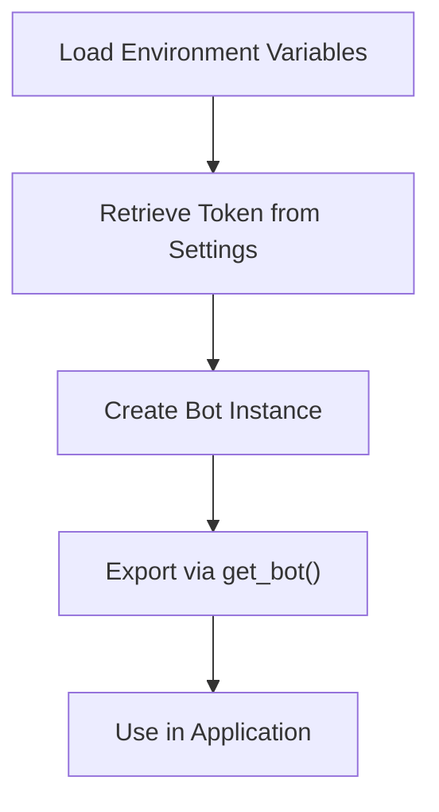
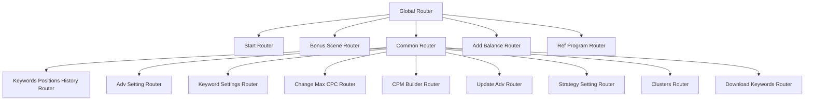
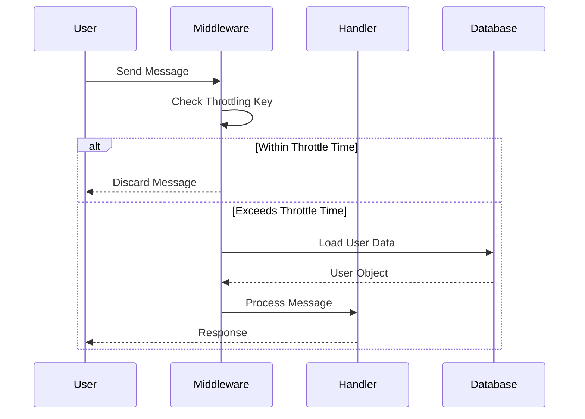
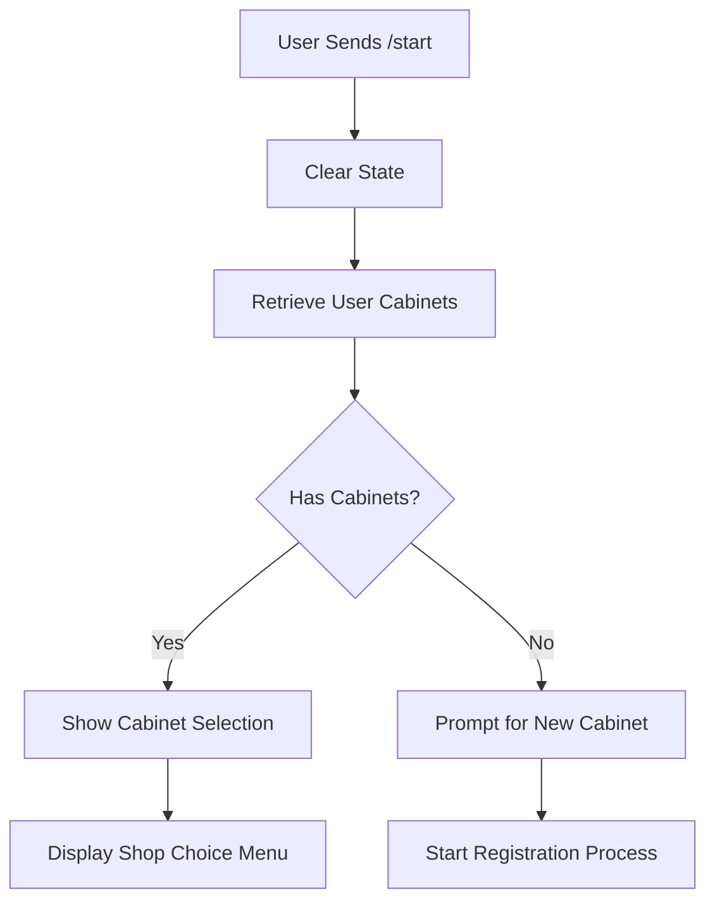
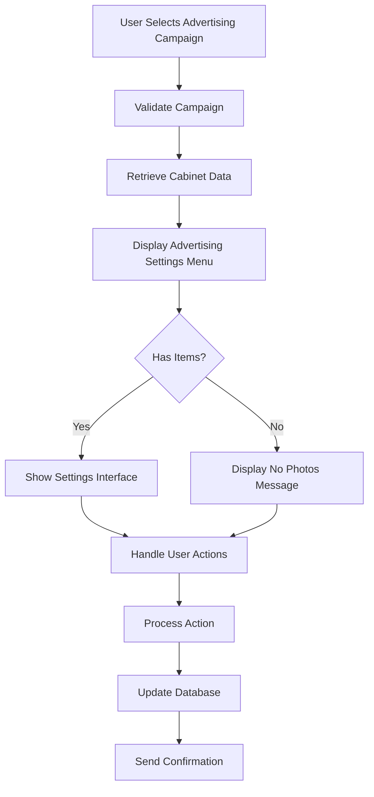
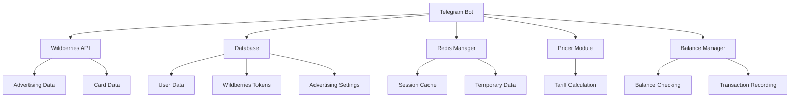
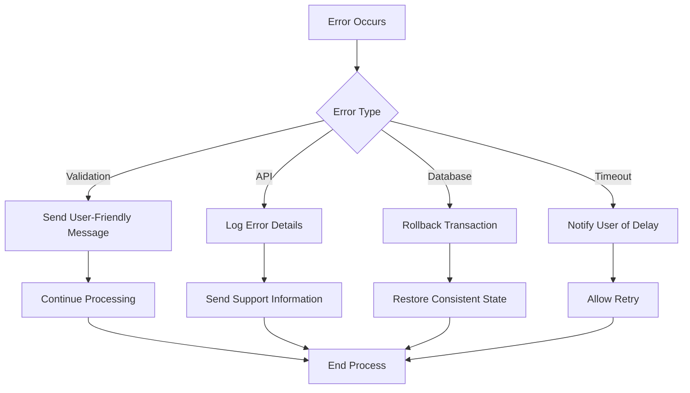

# Telegram Bot API

<cite>
**Referenced Files in This Document**   
- [bot.py](file://app/client_bot/bot.py)
- [global_router.py](file://app/client_bot/global_router.py)
- [states.py](file://app/client_bot/user_interface/states.py)
- [throtting.py](file://app/client_bot/middlewars/throtting.py)
- [user_data.py](file://app/client_bot/middlewars/user_data.py)
- [start.py](file://app/client_bot/user_interface/handlers/start/start.py)
- [adv_setting.py](file://app/client_bot/user_interface/handlers/adv_setting.py)
- [redis_manager.py](file://app/client_bot/redis_manager.py)
- [callbacks.py](file://app/client_bot/user_interface/views/callbacks.py)
</cite>

## Table of Contents
1. [Introduction](#introduction)
2. [Bot Initialization and Token Management](#bot-initialization-and-token-management)
3. [Command Routing Architecture](#command-routing-architecture)
4. [State Management with FSM](#state-management-with-fsm)
5. [Middleware Implementation](#middleware-implementation)
6. [Message and Callback Handlers](#message-and-callback-handlers)
7. [Integration with Core Services](#integration-with-core-services)
8. [Security and Access Control](#security-and-access-control)
9. [Error Handling and Debugging](#error-handling-and-debugging)
10. [Conclusion](#conclusion)

## Introduction
The Telegram Bot API in the adv-bot system provides a comprehensive interface for managing advertising campaigns on Wildberries through a Telegram-based user interface. This documentation details the architecture, implementation, and integration points of the bot system, focusing on initialization, routing, state management, and core functionality.

## Bot Initialization and Token Management

The bot initialization process begins in `app/client_bot/bot.py`, where the Telegram Bot instance is created and configured. The system uses environment variables and settings management to securely handle the bot token.

**Diagram sources**
- [bot.py](file://app/client_bot/bot.py#L1-L15)

The initialization follows these steps:
1. Load environment variables using `dotenv`
2. Retrieve the Telegram bot token from the settings module
3. Create a global Bot instance with the token
4. Provide access to the bot instance through the `get_bot()` function

This approach ensures that the bot token is securely managed and the Bot instance is consistently available throughout the application.

**Section sources**
- [bot.py](file://app/client_bot/bot.py#L1-L15)

## Command Routing Architecture

The command routing system is organized through a hierarchical router structure, with `global_router.py` serving as the central routing point. The architecture follows a specific order of router inclusion to ensure proper command handling.

**Diagram sources**
- [global_router.py](file://app/client_bot/global_router.py#L1-L29)
- [common_routers.py](file://app/client_bot/common_routers.py#L1-L104)

The routing hierarchy is critical for proper command resolution:
- The start router is included first to handle the `/start` command
- Bonus scene registration follows to manage user onboarding
- Common routers are included last to handle general functionality
- Middleware is applied to callback queries for user feedback

This structured approach ensures that commands are processed in the correct order and prevents routing conflicts.

**Section sources**
- [global_router.py](file://app/client_bot/global_router.py#L1-L29)
- [common_routers.py](file://app/client_bot/common_routers.py#L1-L104)

## State Management with FSM

The system implements Finite State Machine (FSM) patterns using aiogram's state management capabilities. States are defined in `states.py` and organized by functional areas.

```mermaid
classDiagram
class StatesGroup {
<<abstract>>
}
class GlobalState {
+shop_choice : State
}
class CabinetRegistration {
+cabinet_name : State
+api : State
}
class ChangeMinCTR {
+waiting_for_new_min_ctr : State
}
class AddNewToken {
+token : State
}
class CreateNewAdvCompany {
+waiting_for_name : State
+waiting_for_nmids : State
}
class RefProgram {
+getting_name : State
}
class AdvSetting {
+waiting_for_filter_by_query : State
+waiting_for_filter_keywords : State
}
class ChangeMaxCPC {
+waiting_for_new_max_cpc : State
}
class ChangeMinViewsForPredictCTR {
+waiting_for_new_min_views : State
}
class AddBalance {
+awaiting_confirmation : State
+awaiting_amount : State
}
class AdvCompanyCatalog {
+waiting_for_keywords_for_filter : State
+waiting_for_sort_type : State
}
class AddWhitePhrases {
+waiting_for_white_phrases : State
}
class CPMSetting {
+waiting_for_min_position : State
+waiting_for_max_cpm : State
+waiting_for_manual_cpm : State
+waiting_for_max_position : State
}
class AddBlackPhrasesTemplates {
+waiting_for_black_phrases : State
}
class AddRelevantPhrases {
+waiting_for_relevant_phrases : State
}
class ChangeCPM {
+waiting_for_cpm : State
}
class ShopMenuState {
+shop_menu : State
}
StatesGroup <|-- GlobalState
StatesGroup <|-- CabinetRegistration
StatesGroup <|-- ChangeMinCTR
StatesGroup <|-- AddNewToken
StatesGroup <|-- CreateNewAdvCompany
StatesGroup <|-- RefProgram
StatesGroup <|-- AdvSetting
StatesGroup <|-- ChangeMaxCPC
StatesGroup <|-- ChangeMinViewsForPredictCTR
StatesGroup <|-- AddBalance
StatesGroup <|-- AdvCompanyCatalog
StatesGroup <|-- AddWhitePhrases
StatesGroup <|-- CPMSetting
StatesGroup <|-- AddBlackPhrasesTemplates
StatesGroup <|-- AddRelevantPhrases
StatesGroup <|-- ChangeCPM
StatesGroup <|-- ShopMenuState
```

**Diagram sources**
- [states.py](file://app/client_bot/user_interface/states.py#L1-L78)

Each state group corresponds to a specific user interaction flow:
- **GlobalState**: Manages shop selection across the application
- **CabinetRegistration**: Handles the process of adding a new cabinet
- **ChangeMinCTR**: Guides users through minimum CTR adjustments
- **AddNewToken**: Manages token addition for existing cabinets
- **AdvSetting**: Handles filtering and navigation within advertising settings

State persistence is managed through the application context and database storage, ensuring continuity across bot interactions.

**Section sources**
- [states.py](file://app/client_bot/user_interface/states.py#L1-L78)

## Middleware Implementation

The system employs middleware for throttling and user data management, ensuring efficient resource usage and consistent user state.

**Diagram sources**
- [throtting.py](file://app/client_bot/middlewars/throtting.py#L1-L28)
- [user_data.py](file://app/client_bot/middlewars/user_data.py#L1-L40)

### Throttling Middleware
The `ThrottlingMiddleware` class implements rate limiting using TTLCache to prevent message flooding:

- Two throttle levels: spin (1 second) and default (1 second)
- Cache stores user chat IDs to track message frequency
- Configurable through initialization parameters
- Uses aiogram's flag system to determine throttling context

### User Data Middleware
The `UserDataMiddleware` ensures user information is available in the handler context:

- Retrieves or creates user records in the database
- Loads associated cabinet and token information
- Injects user data into the handler context
- Handles new user registration automatically

These middleware components work together to provide a smooth user experience while protecting system resources.

**Section sources**
- [throtting.py](file://app/client_bot/middlewars/throtting.py#L1-L28)
- [user_data.py](file://app/client_bot/middlewars/user_data.py#L1-L40)

## Message and Callback Handlers

The system implements a comprehensive set of handlers for various user interactions, with specialized functionality for different use cases.

### Start Handler Flow

**Diagram sources**
- [start.py](file://app/client_bot/user_interface/handlers/start/start.py#L1-L466)

### Advertising Setting Handler

**Diagram sources**
- [adv_setting.py](file://app/client_bot/user_interface/handlers/adv_setting.py#L1-L307)

The handler system is organized by functional areas:
- **Start handlers**: Manage user onboarding and cabinet selection
- **Advertising settings**: Handle campaign configuration and management
- **Keyword settings**: Manage keyword filtering and positioning
- **Balance management**: Handle financial transactions and subscriptions
- **Utility functions**: Provide common operations like data updates

Each handler follows a consistent pattern of input validation, database interaction, and user feedback.

**Section sources**
- [start.py](file://app/client_bot/user_interface/handlers/start/start.py#L1-L466)
- [adv_setting.py](file://app/client_bot/user_interface/handlers/adv_setting.py#L1-L307)

## Integration with Core Services

The Telegram bot integrates with various core services to provide comprehensive functionality for advertising campaign management.

**Diagram sources**
- [start.py](file://app/client_bot/user_interface/handlers/start/start.py#L1-L466)
- [adv_setting.py](file://app/client_bot/user_interface/handlers/adv_setting.py#L1-L307)
- [redis_manager.py](file://app/client_bot/redis_manager.py#L1-L22)

Key integration points include:
- **Shop Selection**: Users can choose from multiple shops/cabinets associated with their account
- **Keyword Settings**: Configuration of keywords for advertising campaigns with filtering capabilities
- **Campaign Updates**: Synchronization of advertising data from Wildberries with local database
- **Balance Management**: Integration with payment systems for subscription management
- **State Persistence**: Use of Redis for temporary state storage and session management

These integrations enable the bot to provide a seamless interface between the user and the underlying advertising management system.

**Section sources**
- [start.py](file://app/client_bot/user_interface/handlers/start/start.py#L1-L466)
- [adv_setting.py](file://app/client_bot/user_interface/handlers/adv_setting.py#L1-L307)
- [redis_manager.py](file://app/client_bot/redis_manager.py#L1-L22)

## Security and Access Control

The system implements multiple security measures to protect user data and prevent unauthorized access.

### Input Validation
All user inputs are validated before processing:
- Cabinet names are checked for length and content
- API tokens are validated for correctness
- Financial transactions are verified for sufficient funds
- State transitions are controlled through FSM

### Access Control
Role-based access control is implemented through:
- Token validation for Wildberries API access
- User ownership verification for cabinets and campaigns
- Permission checks for administrative functions
- Rate limiting to prevent abuse

### Data Protection
Sensitive data is protected through:
- Secure storage of API tokens in the database
- Use of environment variables for bot token
- Encrypted connections to external services
- Regular security audits and updates

These security measures ensure that user data remains protected while providing the necessary functionality for advertising management.

**Section sources**
- [start.py](file://app/client_bot/user_interface/handlers/start/start.py#L1-L466)
- [adv_setting.py](file://app/client_bot/user_interface/handlers/adv_setting.py#L1-L307)

## Error Handling and Debugging

The system implements comprehensive error handling and debugging capabilities to ensure reliability and ease of maintenance.

### Error Handling Patterns

**Diagram sources**
- [start.py](file://app/client_bot/user_interface/handlers/start/start.py#L1-L466)
- [adv_setting.py](file://app/client_bot/user_interface/handlers/adv_setting.py#L1-L307)

### Debugging Strategies
The system provides several tools for debugging and troubleshooting:
- Comprehensive logging with structured messages
- State inspection through FSM context
- Message flow tracking with middleware
- Error reporting with traceback information

Common issues and their solutions include:
- **Message Delivery Failures**: Check network connectivity and Telegram API status
- **State Corruption**: Clear user state and restart the process
- **Token Validation Errors**: Verify token format and permissions
- **Database Connection Issues**: Check database availability and credentials

These debugging tools help maintain system reliability and provide quick resolution of issues.

**Section sources**
- [start.py](file://app/client_bot/user_interface/handlers/start/start.py#L1-L466)
- [adv_setting.py](file://app/client_bot/user_interface/handlers/adv_setting.py#L1-L307)

## Conclusion
The Telegram Bot API in the adv-bot system provides a robust and secure interface for managing Wildberries advertising campaigns. Through careful architecture design, the system offers comprehensive functionality including bot initialization, command routing, state management, and integration with core services. The implementation follows best practices for security, error handling, and user experience, making it a reliable tool for advertising management.