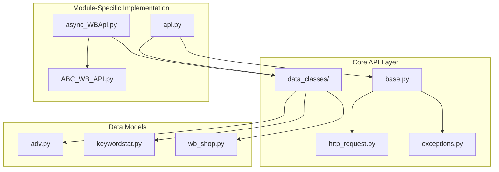
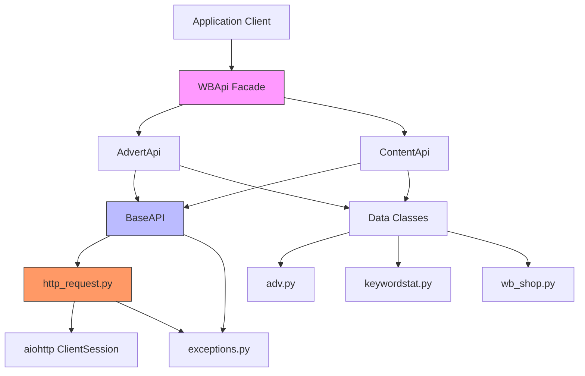
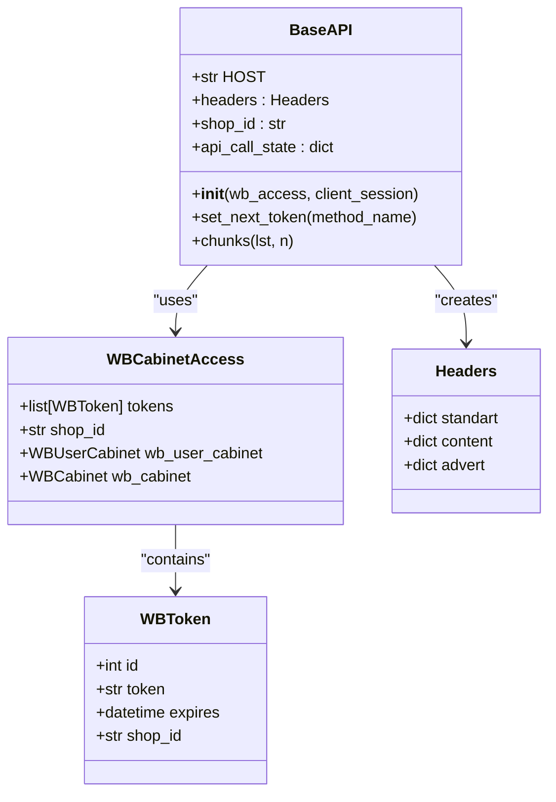
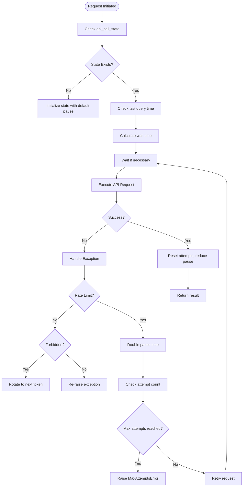
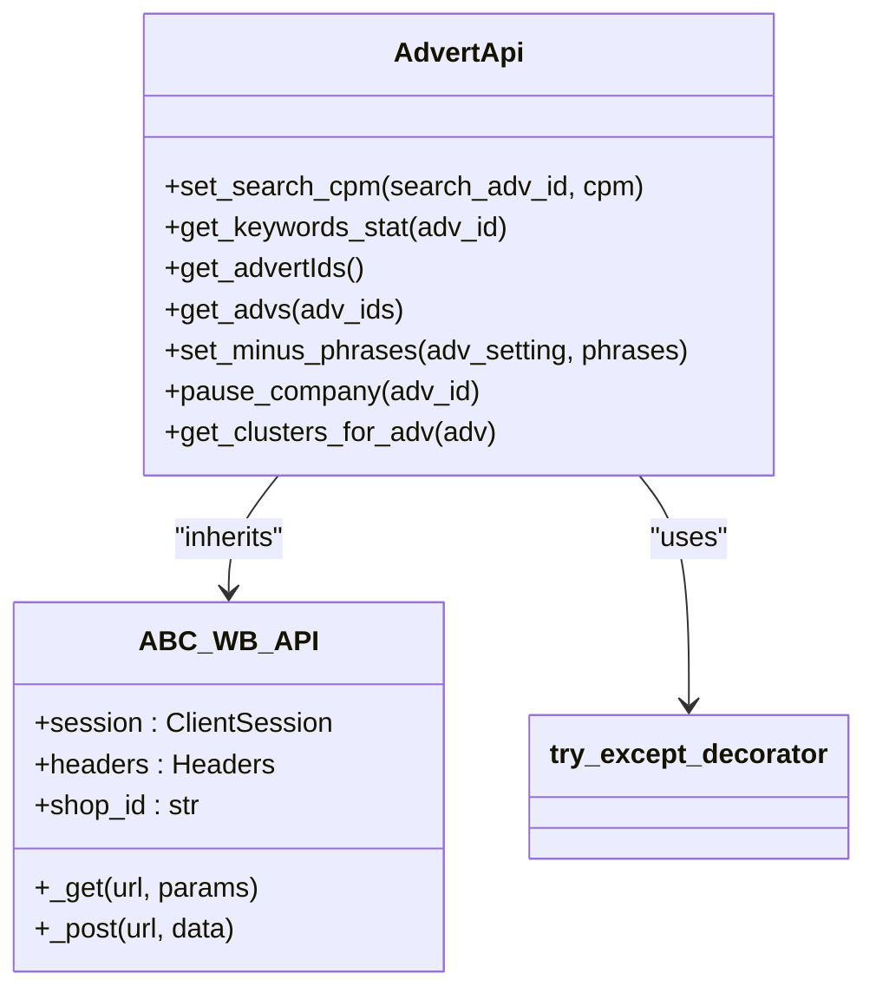
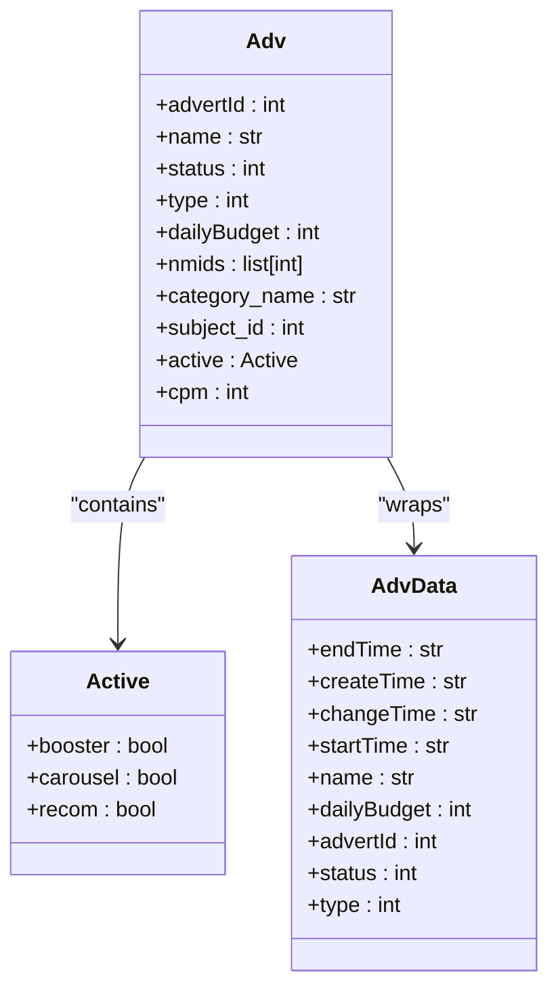
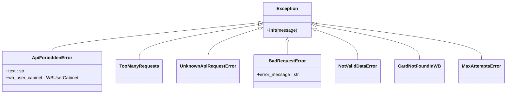
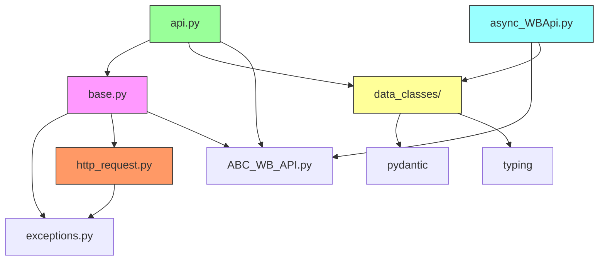

# Wildberries API Integration

<cite>
**Referenced Files in This Document**   
- [base.py](file://app/core/wb_api/base.py)
- [http_request.py](file://app/core/wb_api/http_request.py)
- [api.py](file://app/modules/common_slaves/wildberries/api.py)
- [adv.py](file://app/core/wb_api/data_classes/adv.py)
- [keywordstat.py](file://app/core/wb_api/data_classes/keywordstat.py)
- [wb_shop.py](file://app/core/wb_api/data_classes/wb_shop.py)
- [exceptions.py](file://app/core/wb_api/exceptions.py)
- [async_WBApi.py](file://app/modules/common_slaves/wildberries/async_WBApi.py)
</cite>

## Table of Contents
1. [Introduction](#introduction)
2. [Project Structure](#project-structure)
3. [Core Components](#core-components)
4. [Architecture Overview](#architecture-overview)
5. [Detailed Component Analysis](#detailed-component-analysis)
6. [Dependency Analysis](#dependency-analysis)
7. [Performance Considerations](#performance-considerations)
8. [Troubleshooting Guide](#troubleshooting-guide)
9. [Conclusion](#conclusion)

## Introduction
This document provides comprehensive documentation for the Wildberries API integration layer within the advertising automation system. The integration enables programmatic access to Wildberries' advertising, product content, and statistics APIs, supporting automated campaign management, keyword position tracking, and product data retrieval. The system is designed with asynchronous capabilities, robust error handling, and rate limiting to ensure reliable operation at scale.

## Project Structure
The Wildberries API integration is organized across multiple modules with clear separation of concerns. The core functionality resides in the `app/core/wb_api` directory, while higher-level abstractions and specialized implementations are located in `app/modules/common_slaves/wildberries`. The structure follows a layered approach with base classes, mixins, data classes, and service implementations.

**Diagram sources**
- [base.py](file://app/core/wb_api/base.py)
- [http_request.py](file://app/core/wb_api/http_request.py)
- [api.py](file://app/modules/common_slaves/wildberries/api.py)
- [adv.py](file://app/core/wb_api/data_classes/adv.py)
- [keywordstat.py](file://app/core/wb_api/data_classes/keywordstat.py)
- [wb_shop.py](file://app/core/wb_api/data_classes/wb_shop.py)

**Section sources**
- [base.py](file://app/core/wb_api/base.py)
- [api.py](file://app/modules/common_slaves/wildberries/api.py)

## Core Components
The Wildberries API integration consists of several core components that work together to provide a robust interface to Wildberries' advertising platform. These components include the base API client, HTTP request handling with retry logic, endpoint-specific implementations for advertising and content APIs, data classes for structured responses, and comprehensive error handling mechanisms.

**Section sources**
- [base.py](file://app/core/wb_api/base.py#L1-L112)
- [http_request.py](file://app/core/wb_api/http_request.py#L1-L218)
- [api.py](file://app/modules/common_slaves/wildberries/api.py#L1-L480)

## Architecture Overview
The Wildberries API integration follows a modular architecture with clear separation between the transport layer, business logic, and data representation. The system is built on asynchronous Python with aiohttp for HTTP communication, providing non-blocking operations essential for handling multiple API requests efficiently.

**Diagram sources**
- [base.py](file://app/core/wb_api/base.py#L1-L112)
- [http_request.py](file://app/core/wb_api/http_request.py#L1-L218)
- [api.py](file://app/modules/common_slaves/wildberries/api.py#L1-L480)
- [adv.py](file://app/core/wb_api/data_classes/adv.py#L1-L261)
- [keywordstat.py](file://app/core/wb_api/data_classes/keywordstat.py#L1-L16)
- [wb_shop.py](file://app/core/wb_api/data_classes/wb_shop.py#L1-L76)

## Detailed Component Analysis

### Base Client Implementation
The base client implementation in `base.py` provides the foundational functionality for Wildberries API interactions. It manages authentication through WBToken, handles token rotation when requests are forbidden, and maintains session state across requests. The `BaseAPI` class initializes with a `WBCabinetAccess` object containing authentication tokens and an aiohttp `ClientSession` for HTTP communication.

**Diagram sources**
- [base.py](file://app/core/wb_api/base.py#L1-L112)

#### Request Signing and Authentication
Authentication is handled through the `Headers` class (imported from `ABC_WB_API`) which creates properly formatted headers containing the API token. The system automatically rotates tokens when a 401/403 response is received, using the `set_next_token` method to switch to an alternative valid token from the available pool.

**Section sources**
- [base.py](file://app/core/wb_api/base.py#L1-L112)

#### Rate Limiting Strategies
Rate limiting is implemented through the `try_except_decorator` in `http_request.py`, which provides adaptive throttling based on API response patterns. The decorator tracks request frequency per method and implements exponential backoff when rate limits are approached or exceeded.

**Diagram sources**
- [http_request.py](file://app/core/wb_api/http_request.py#L1-L218)

### HTTP Request Handling
The HTTP request handling is centralized in `http_request.py`, which provides a robust wrapper around aiohttp functionality. The `requests` function handles request execution, response validation, and error parsing, while the `try_except_decorator` manages retry logic and rate limiting.

#### Retry Logic
The retry logic is implemented through the `try_except_decorator`, which automatically retries requests that fail due to transient issues such as network errors, rate limiting (429), or server disconnections. The decorator uses an exponential backoff strategy, doubling the pause time between attempts up to a maximum delay.

#### Timeout Configurations
Timeouts are implicitly handled through the aiohttp ClientSession configuration and the retry mechanism. The system does not specify explicit timeout values in the request functions, relying instead on the underlying aiohttp defaults and the retry logic to handle slow or unresponsive endpoints.

**Section sources**
- [http_request.py](file://app/core/wb_api/http_request.py#L1-L218)

### Endpoint Coverage
The Wildberries API integration provides comprehensive coverage of key endpoints through specialized classes in `api.py`. The `AdvertApi` class handles advertising-related endpoints, while the `ContentApi` class manages product content retrieval.

#### Advertising Endpoints
The `AdvertApi` class provides methods for managing advertising campaigns, including retrieving campaign statistics, updating bids, and managing keyword targeting.

**Diagram sources**
- [api.py](file://app/modules/common_slaves/wildberries/api.py#L1-L480)

#### Statistics Endpoints
Statistics retrieval is implemented through methods like `get_keywords_stat` and `get_keywords_stat_depr`, which fetch keyword performance data for advertising campaigns. These methods handle date range calculations and response parsing to return structured data objects.

#### Product Data Retrieval
Product data retrieval is handled by the `ContentApi` class, which provides methods for searching product cards by text, retrieving subcategories, and fetching patent categories. The `get_card_by_text` method is particularly important for linking advertising campaigns to specific products.

**Section sources**
- [api.py](file://app/modules/common_slaves/wildberries/api.py#L1-L480)

### Data Parsing and Transformation
Data parsing and transformation are handled through dedicated data classes that convert raw API responses into structured Python objects. These classes use Pydantic for data validation and provide convenient property accessors for common operations.

#### Advertising Data Classes
The `adv.py` data class defines the `Adv` class, which represents a Wildberries advertising campaign. It parses the raw JSON response and provides properties for accessing campaign attributes like name, status, budget, and associated NMIDs (product identifiers).

**Diagram sources**
- [adv.py](file://app/core/wb_api/data_classes/adv.py#L1-L261)

#### Keyword Statistics Data Classes
The `keywordstat.py` data class defines the `KeywordStat` model, which represents performance data for a specific keyword in an advertising campaign. It includes fields for views, clicks, spend, and conversion metrics.

#### Shop Data Classes
The `wb_shop.py` data class defines the `WbShop` class, which represents a Wildberries shop configuration. It loads settings from external files and provides access to shop-specific parameters like API keys, brand information, and campaign settings.

**Section sources**
- [adv.py](file://app/core/wb_api/data_classes/adv.py#L1-L261)
- [keywordstat.py](file://app/core/wb_api/data_classes/keywordstat.py#L1-L16)
- [wb_shop.py](file://app/core/wb_api/data_classes/wb_shop.py#L1-L76)

### Error Handling Patterns
Error handling is implemented through a comprehensive exception hierarchy in `exceptions.py`, with specific exception types for different error conditions encountered during API interactions.

The `get_error_from_response` function in `http_request.py` parses Wildberries API error responses and raises appropriate exceptions based on the error details in the response body.

**Section sources**
- [exceptions.py](file://app/core/wb_api/exceptions.py#L1-L81)
- [http_request.py](file://app/core/wb_api/http_request.py#L1-L218)

### Async Execution
Asynchronous execution is supported through the `async_WBApi.py` implementation, which provides an alternative async interface to the Wildberries API. This implementation uses aiohttp for non-blocking HTTP requests and includes caching decorators to reduce redundant API calls.

The `async_cache_ttl` decorator provides time-based caching of API responses, reducing the number of requests to rate-limited endpoints. The implementation also includes queue-based processing for handling large numbers of requests efficiently.

**Section sources**
- [async_WBApi.py](file://app/modules/common_slaves/wildberries/async_WBApi.py#L1-L317)

## Dependency Analysis
The Wildberries API integration has a well-defined dependency structure with clear separation between core functionality and module-specific implementations.

The system has a circular dependency concern noted in the code comments, with both `BaseAPI` and `ABC_WB_API` serving as base classes for API functionality. This architectural issue should be addressed through refactoring to establish a single, clear inheritance hierarchy.

**Diagram sources**
- [base.py](file://app/core/wb_api/base.py)
- [http_request.py](file://app/core/wb_api/http_request.py)
- [api.py](file://app/modules/common_slaves/wildberries/api.py)
- [async_WBApi.py](file://app/modules/common_slaves/wildberries/async_WBApi.py)

**Section sources**
- [base.py](file://app/core/wb_api/base.py)
- [http_request.py](file://app/core/wb_api/http_request.py)

## Performance Considerations
The Wildberries API integration includes several performance optimizations to handle the constraints of the Wildberries API, particularly rate limiting and response times.

### Caching with Redis
While not explicitly shown in the provided code, the system architecture suggests the use of Redis for caching, particularly given the presence of Redis-related modules in the project structure. Caching can be applied to infrequently changing data such as product catalogs and shop configurations to reduce API calls.

### Batch Requests
The implementation supports batch requests for retrieving multiple advertising campaigns, with the `get_advs` method processing IDs in chunks of 50 to comply with API limitations. This batching strategy minimizes the number of HTTP requests while staying within API constraints.

### Connection Pooling
Connection pooling is handled automatically by the aiohttp ClientSession, which reuses underlying TCP connections for multiple requests to the same host. This reduces the overhead of establishing new connections for each API call.

## Troubleshooting Guide
Common issues with the Wildberries API integration typically fall into several categories:

**Section sources**
- [exceptions.py](file://app/core/wb_api/exceptions.py#L1-L81)
- [http_request.py](file://app/core/wb_api/http_request.py#L1-L218)

### Authentication Issues
- **ApiForbiddenError**: Indicates invalid or expired tokens. The system automatically attempts token rotation, but if all tokens are invalid, the cabinet may be deactivated.
- **TokenExpiredError**: Specific error for expired tokens, requiring token renewal.

### Rate Limiting Issues
- **TooManyRequests**: Indicates the API rate limit has been exceeded. The retry logic should handle this automatically with exponential backoff.
- **MaxAttemptsError**: Raised when the maximum number of retry attempts has been reached without success.

### Data Issues
- **CardNotFoundInWB**: Raised when a product card cannot be found by text search.
- **NotValidDataError**: Indicates malformed data in the API request or response.

## Conclusion
The Wildberries API integration provides a comprehensive, robust interface for managing advertising campaigns on the Wildberries platform. The system's modular architecture, asynchronous design, and comprehensive error handling make it suitable for production use in automated advertising scenarios. Key strengths include adaptive rate limiting, automatic token rotation, and structured data handling through Pydantic models. Areas for improvement include resolving the circular dependency between base API classes and enhancing documentation of the caching mechanisms.