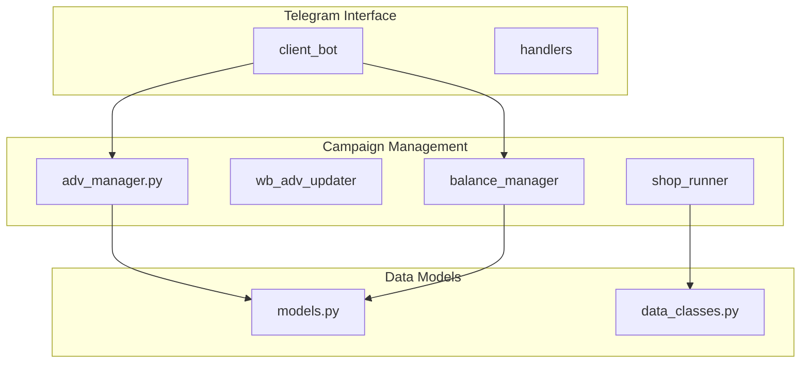
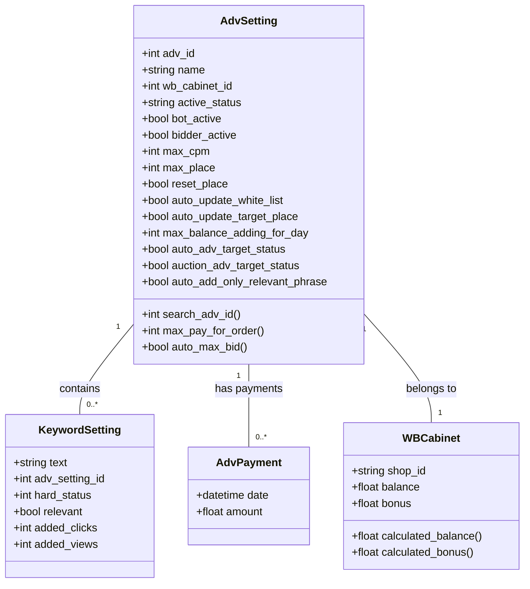
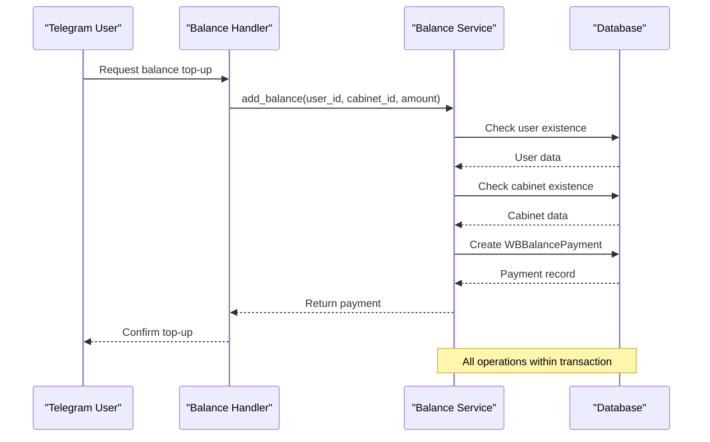
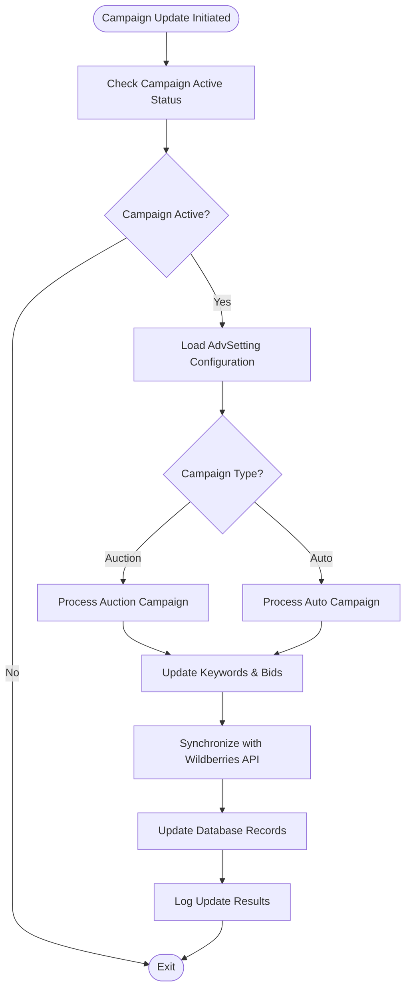
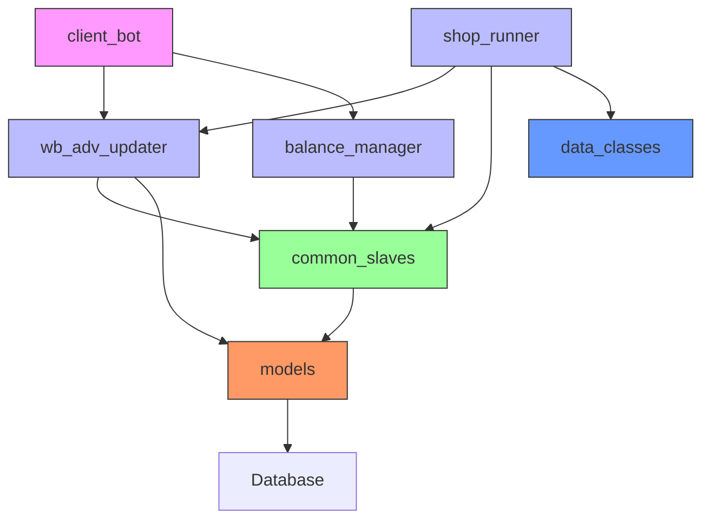

# Advertising Campaign Management

<cite>
**Referenced Files in This Document**   
- [adv_manager.py](file://app/modules/wb_adv_updater/adv_manager.py)
- [balance_service.py](file://app/modules/balance_manager/balance_service.py)
- [models.py](file://app/modules/common_slaves/wildberries/models/models.py)
- [data_classes.py](file://app/modules/shop_runner/data_classes.py)
- [adv_manager.py](file://app/modules/shop_runner/service_manager/modules/adv_manager/adv_manager.py)
</cite>

## Table of Contents
1. [Introduction](#introduction)
2. [Project Structure](#project-structure)
3. [Core Components](#core-components)
4. [Architecture Overview](#architecture-overview)
5. [Detailed Component Analysis](#detailed-component-analysis)
6. [Dependency Analysis](#dependency-analysis)
7. [Performance Considerations](#performance-considerations)
8. [Troubleshooting Guide](#troubleshooting-guide)
9. [Conclusion](#conclusion)

## Introduction
The Advertising Campaign Management system in the adv-bot platform enables users to create, manage, and optimize advertising campaigns on Wildberries. This document details the implementation of campaign creation, budget management, and performance tracking features. The system supports two primary campaign types: auction (search) and auto (automatic) campaigns, each with distinct configuration options and bidding strategies. Campaigns are managed through Telegram handlers that interface with backend services, leveraging domain models like AdvSetting to persist configuration and state. The system uses asynchronous coroutines (shop_runner) for high-frequency campaign updates and integrates with databases for persistent storage.

## Project Structure
The advertising campaign management functionality is organized across multiple modules within the app directory. The core components are distributed across specialized modules that handle different aspects of campaign management.



**Diagram sources**
- [adv_manager.py](file://app/modules/wb_adv_updater/adv_manager.py)
- [models.py](file://app/modules/common_slaves/wildberries/models/models.py)
- [data_classes.py](file://app/modules/shop_runner/data_classes.py)

**Section sources**
- [adv_manager.py](file://app/modules/wb_adv_updater/adv_manager.py)
- [balance_service.py](file://app/modules/balance_manager/balance_service.py)

## Core Components
The advertising campaign management system consists of several core components that work together to provide a comprehensive campaign management solution. The AdvSetting model serves as the central domain entity for campaign configuration, storing all relevant parameters and state information. The balance management system handles financial aspects of campaigns, including budget allocation and payment processing. Campaign updates are processed through asynchronous coroutines in the shop_runner module, which coordinate with Wildberries API services. The system integrates with Telegram handlers to provide a user-friendly interface for campaign management.

**Section sources**
- [models.py](file://app/modules/common_slaves/wildberries/models/models.py#L400-L653)
- [balance_service.py](file://app/modules/balance_manager/balance_service.py#L0-L200)
- [data_classes.py](file://app/modules/shop_runner/data_classes.py#L0-L12)

## Architecture Overview
The advertising campaign management system follows a layered architecture with clear separation of concerns between user interface, business logic, and data access layers. Telegram handlers receive user commands and invoke appropriate service methods. The service layer processes these requests, applying business rules and coordinating with data access components. The data layer persists campaign state and configuration in a PostgreSQL database, with additional caching through Redis for improved performance.

```mermaid
graph TD
Telegram[Telegram Bot] --> Handlers[Telegram Handlers]
Handlers --> Services[Campaign Services]
Services --> DataLayer[Data Access Layer]
DataLayer --> Database[(PostgreSQL)]
DataLayer --> Redis[(Redis Cache)]
Services --> WildberriesAPI[Wildberries API]
class Telegram,Handlers linkStyle0 stroke:#2c5aa0;
class Services linkStyle1 stroke:#e67e22;
class DataLayer,Database,Redis linkStyle2 stroke:#27ae60;
class WildberriesAPI linkStyle3 stroke:#8e44ad;
```

**Diagram sources**
- [adv_manager.py](file://app/modules/wb_adv_updater/adv_manager.py)
- [balance_service.py](file://app/modules/balance_manager/balance_service.py)
- [models.py](file://app/modules/common_slaves/wildberries/models/models.py)

## Detailed Component Analysis

### Campaign Configuration Analysis
The campaign configuration system centers around the AdvSetting model, which encapsulates all parameters and state for an advertising campaign. This model supports both auction and auto campaign types through a flexible configuration schema that accommodates different bidding strategies and optimization goals.



**Diagram sources**
- [models.py](file://app/modules/common_slaves/wildberries/models/models.py#L200-L399)

**Section sources**
- [models.py](file://app/modules/common_slaves/wildberries/models/models.py#L200-L653)

### Budget Management Analysis
The budget management system provides comprehensive controls for campaign spending, including balance tracking, payment processing, and spending limits. The system distinguishes between regular balance and bonus funds, allowing for flexible budget allocation strategies.



**Diagram sources**
- [balance_service.py](file://app/modules/balance_manager/balance_service.py#L0-L200)
- [models.py](file://app/modules/common_slaves/wildberries/models/models.py#L200-L399)

**Section sources**
- [balance_service.py](file://app/modules/balance_manager/balance_service.py#L0-L200)

### Campaign Update Flow Analysis
The campaign update process is orchestrated through asynchronous coroutines that handle high-frequency updates to campaign parameters and keyword configurations. This system ensures timely synchronization between the application state and Wildberries advertising platform.



**Diagram sources**
- [adv_manager.py](file://app/modules/wb_adv_updater/adv_manager.py)
- [shop_runner.py](file://app/modules/shop_runner/wb_shop.py)

**Section sources**
- [adv_manager.py](file://app/modules/wb_adv_updater/adv_manager.py)
- [wb_shop.py](file://app/modules/shop_runner/wb_shop.py)

## Dependency Analysis
The advertising campaign management system has a well-defined dependency structure that separates concerns while enabling seamless integration between components. The core dependencies flow from the user interface through service layers to data models and external APIs.



**Diagram sources**
- [adv_manager.py](file://app/modules/wb_adv_updater/adv_manager.py)
- [balance_service.py](file://app/modules/balance_manager/balance_service.py)
- [models.py](file://app/modules/common_slaves/wildberries/models/models.py)

**Section sources**
- [adv_manager.py](file://app/modules/wb_adv_updater/adv_manager.py)
- [balance_service.py](file://app/modules/balance_manager/balance_service.py)
- [models.py](file://app/modules/common_slaves/wildberries/models/models.py)

## Performance Considerations
The system is designed to handle high-frequency campaign updates efficiently through asynchronous processing and caching mechanisms. The shop_runner coroutines process updates in batches, minimizing API calls to Wildberries. Database queries are optimized with appropriate indexes on frequently queried fields such as wb_cabinet_id, adv_id, and active_status. The calculated_balance and calculated_bonus hybrid properties in WBCabinet efficiently compute current financial states by combining base values with transaction histories. For high-traffic scenarios, Redis caching is employed to reduce database load for frequently accessed campaign data.

## Troubleshooting Guide
Common issues in the advertising campaign management system typically relate to budget overruns, campaign synchronization errors, or configuration problems. Budget overruns can occur when max_balance_adding_for_day limits are not properly configured or when multiple campaigns share a limited budget. These can be resolved by setting appropriate daily limits and monitoring spending patterns. Campaign synchronization errors often stem from API connectivity issues or invalid campaign configurations; implementing retry mechanisms and thorough input validation can mitigate these problems. Configuration issues, such as incorrect search_adv_id parsing, can be addressed by ensuring proper campaign naming conventions and validating configurations before deployment.

**Section sources**
- [models.py](file://app/modules/common_slaves/wildberries/models/models.py#L400-L653)
- [balance_service.py](file://app/modules/balance_manager/balance_service.py#L0-L200)

## Conclusion
The Advertising Campaign Management system in adv-bot provides a comprehensive solution for managing Wildberries advertising campaigns. By combining flexible configuration options, robust budget controls, and efficient update mechanisms, the system enables users to effectively optimize their advertising strategies. The modular architecture separates concerns while maintaining integration between components, allowing for scalable and maintainable code. Future enhancements could include more sophisticated bidding algorithms, enhanced reporting capabilities, and improved error handling for edge cases.