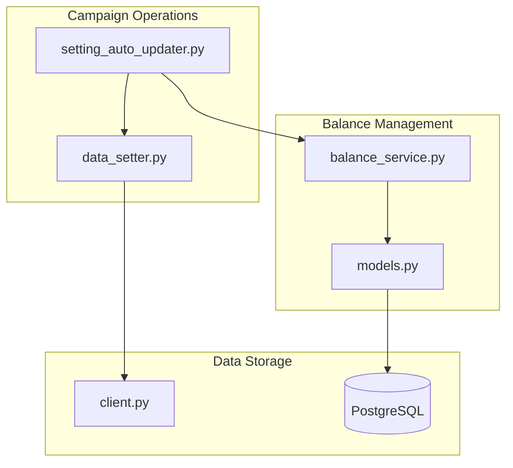
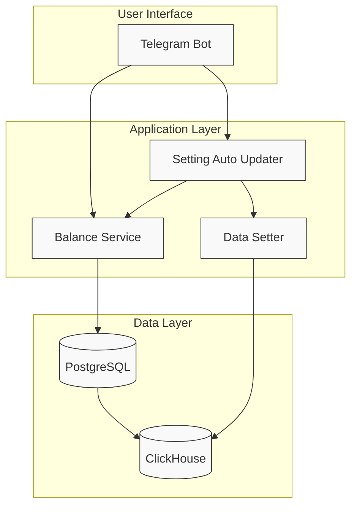
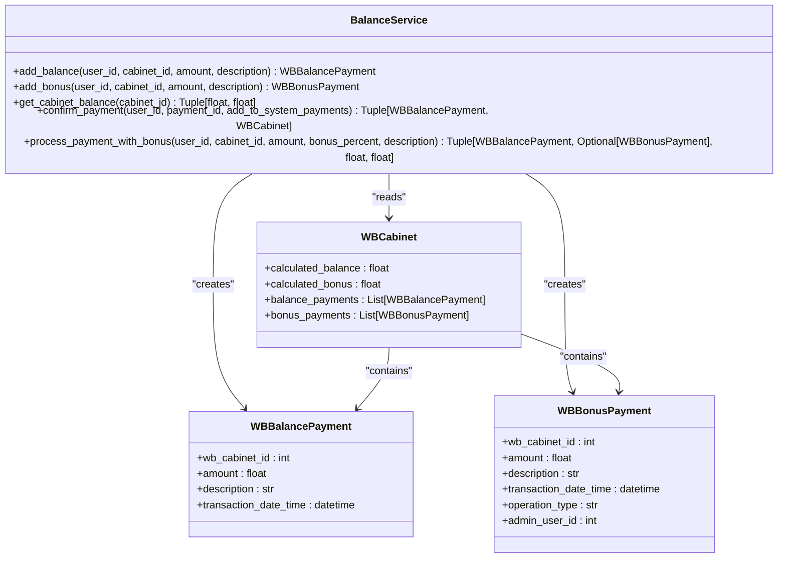
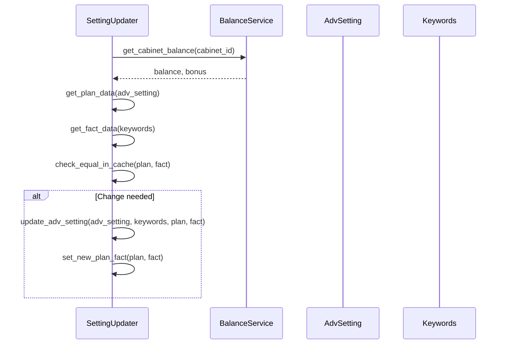
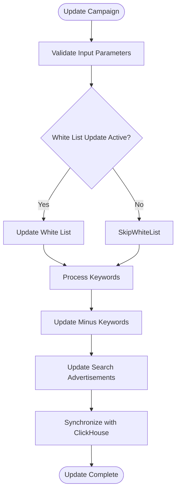
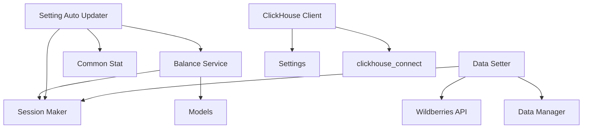

# Budget Management

<cite>
**Referenced Files in This Document**   
- [balance_service.py](file://app/modules/balance_manager/balance_service.py)
- [setting_auto_updater.py](file://app/modules/shop_runner/service_manager/old_modules/setting_auto_updater/setting_auto_updater.py)
- [data_setter.py](file://app/modules/wb_adv_updater/data_setter.py)
- [models.py](file://app/modules/common_slaves/wildberries/models/models.py)
- [client.py](file://app/utils/click_house/client.py)
</cite>

## Table of Contents
1. [Introduction](#introduction)
2. [Project Structure](#project-structure)
3. [Core Components](#core-components)
4. [Architecture Overview](#architecture-overview)
5. [Detailed Component Analysis](#detailed-component-analysis)
6. [Dependency Analysis](#dependency-analysis)
7. [Performance Considerations](#performance-considerations)
8. [Troubleshooting Guide](#troubleshooting-guide)
9. [Conclusion](#conclusion)

## Introduction
The Budget Management sub-feature of the Advertising Campaign Management system provides comprehensive financial controls for advertising campaigns on the Wildberries platform. This system enables users to manage their advertising budgets through balance tracking, spending limits, and payment processing. The implementation focuses on preventing overdrafts, enforcing daily spending caps, and synchronizing spend data with analytical systems. The architecture integrates payment processing with campaign operations, allowing for real-time balance validation during campaign updates. This documentation explains the technical implementation of these features, including how budget constraints are enforced, how spend data is synchronized, and how race conditions are handled in high-concurrency environments.

## Project Structure
The Budget Management functionality is organized across multiple modules within the application. The core balance management logic resides in the `app/modules/balance_manager` directory, while campaign update operations that enforce budget constraints are located in `app/modules/shop_runner/service_manager/old_modules/setting_auto_updater`. Spend data synchronization with ClickHouse occurs through the `app/modules/wb_adv_updater/data_setter.py` module. The data models for balance tracking are defined in `app/modules/common_slaves/wildberries/models/models.py`, and ClickHouse client functionality is implemented in `app/utils/click_house/client.py`. This modular structure separates concerns while maintaining integration between financial controls and advertising operations.

**Diagram sources**
- [balance_service.py](file://app/modules/balance_manager/balance_service.py#L1-L235)
- [setting_auto_updater.py](file://app/modules/shop_runner/service_manager/old_modules/setting_auto_updater/setting_auto_updater.py#L1-L163)
- [data_setter.py](file://app/modules/wb_adv_updater/data_setter.py#L1-L140)

**Section sources**
- [balance_service.py](file://app/modules/balance_manager/balance_service.py#L1-L235)
- [setting_auto_updater.py](file://app/modules/shop_runner/service_manager/old_modules/setting_auto_updater/setting_auto_updater.py#L1-L163)

## Core Components
The Budget Management system consists of several core components that work together to enforce financial controls on advertising campaigns. The `balance_service.py` module provides the primary interface for balance operations, including adding funds, checking balances, and processing payments. The `WBCabinet` model contains calculated properties for balance and bonus amounts that incorporate all historical transactions. The `setting_auto_updater.py` module enforces budget constraints during campaign updates, while `data_setter.py` handles synchronization of spend data with external analytics systems. These components work in concert to prevent overdrafts, enforce daily spending limits, and maintain accurate financial records.

**Section sources**
- [balance_service.py](file://app/modules/balance_manager/balance_service.py#L1-L235)
- [models.py](file://app/modules/common_slaves/wildberries/models/models.py#L1-L653)

## Architecture Overview
The Budget Management architecture follows a service-oriented design with clear separation between financial operations and campaign management. The system uses a PostgreSQL database to store balance transactions and campaign settings, with ClickHouse serving as the analytics backend for spend data. When a user adds funds to their advertising budget, the `add_balance` function in `balance_service.py` creates a transaction record that is later used to calculate the available balance. During campaign operations, the system checks available funds against configured limits before allowing changes. Spend data from advertising activities is periodically synchronized with ClickHouse for reporting and analysis. This architecture ensures financial integrity while providing real-time visibility into advertising expenditures.

**Diagram sources**
- [balance_service.py](file://app/modules/balance_manager/balance_service.py#L1-L235)
- [setting_auto_updater.py](file://app/modules/shop_runner/service_manager/old_modules/setting_auto_updater/setting_auto_updater.py#L1-L163)
- [data_setter.py](file://app/modules/wb_adv_updater/data_setter.py#L1-L140)

## Detailed Component Analysis

### Balance Service Implementation
The `balance_service.py` module implements the core financial operations for the advertising platform. It provides functions for adding balance, adding bonuses, retrieving cabinet balances, and confirming payments. The service uses asynchronous database operations to ensure non-blocking performance in high-concurrency environments. Each financial operation includes comprehensive validation to prevent invalid transactions and maintain data integrity.

#### Balance and Bonus Management

**Diagram sources**
- [balance_service.py](file://app/modules/balance_manager/balance_service.py#L1-L235)
- [models.py](file://app/modules/common_slaves/wildberries/models/models.py#L1-L653)

**Section sources**
- [balance_service.py](file://app/modules/balance_manager/balance_service.py#L1-L235)

### Campaign Budget Enforcement
The `setting_auto_updater.py` module enforces budget constraints during campaign updates. It checks available funds against configured limits before allowing changes to campaign settings. This prevents users from configuring campaigns that would exceed their available budget or daily spending limits.

#### Budget Constraint Workflow

**Diagram sources**
- [setting_auto_updater.py](file://app/modules/shop_runner/service_manager/old_modules/setting_auto_updater/setting_auto_updater.py#L1-L163)

**Section sources**
- [setting_auto_updater.py](file://app/modules/shop_runner/service_manager/old_modules/setting_auto_updater/setting_auto_updater.py#L1-L163)

### Spend Data Synchronization
The `data_setter.py` module handles synchronization of advertising spend data with the ClickHouse analytics system. It processes campaign updates and ensures that financial data is accurately reflected in the analytics backend.

#### Data Synchronization Flow

**Diagram sources**
- [data_setter.py](file://app/modules/wb_adv_updater/data_setter.py#L1-L140)

**Section sources**
- [data_setter.py](file://app/modules/wb_adv_updater/data_setter.py#L1-L140)

## Dependency Analysis
The Budget Management system has a well-defined dependency structure that ensures separation of concerns while maintaining integration between components. The `balance_service.py` module depends on database models and session management utilities but has no direct dependencies on campaign management modules. The `setting_auto_updater.py` module depends on the balance service for financial validation but operates independently of the data synchronization components. The `data_setter.py` module depends on Wildberries API clients and state management utilities but does not directly access financial data. This dependency structure prevents circular dependencies and allows for independent testing and deployment of components.

**Diagram sources**
- [balance_service.py](file://app/modules/balance_manager/balance_service.py#L1-L235)
- [setting_auto_updater.py](file://app/modules/shop_runner/service_manager/old_modules/setting_auto_updater/setting_auto_updater.py#L1-L163)
- [data_setter.py](file://app/modules/wb_adv_updater/data_setter.py#L1-L140)
- [client.py](file://app/utils/click_house/client.py#L1-L222)

**Section sources**
- [balance_service.py](file://app/modules/balance_manager/balance_service.py#L1-L235)
- [setting_auto_updater.py](file://app/modules/shop_runner/service_manager/old_modules/setting_auto_updater/setting_auto_updater.py#L1-L163)
- [data_setter.py](file://app/modules/wb_adv_updater/data_setter.py#L1-L140)

## Performance Considerations
The Budget Management system is designed to handle high-concurrency environments with performance optimizations at multiple levels. The balance service uses asynchronous database operations to prevent blocking during financial transactions. The ClickHouse client implements connection pooling and multiprocessing synchronization to efficiently manage database connections in Linux environments. The system uses calculated properties in the `WBCabinet` model to minimize database queries for balance calculations. For high-frequency operations like campaign updates, the system implements caching mechanisms to reduce database load. These performance optimizations ensure responsive operation even during peak usage periods.

**Section sources**
- [client.py](file://app/utils/click_house/client.py#L1-L222)
- [balance_service.py](file://app/modules/balance_manager/balance_service.py#L1-L235)
- [models.py](file://app/modules/common_slaves/wildberries/models/models.py#L1-L653)

## Troubleshooting Guide
Common issues in the Budget Management system typically involve budget synchronization delays, incorrect daily caps, or balance calculation errors. For synchronization delays between PostgreSQL and ClickHouse, verify that the data synchronization processes are running and check the connection status to the ClickHouse server. For incorrect daily caps, ensure that the `max_balance_adding_for_day` configuration is correctly set in the `AdvSetting` model and that the balance service is properly enforcing this limit. Balance calculation errors may occur if transaction records are not properly committed to the database; check for unhandled exceptions in the balance service functions. When troubleshooting race conditions in high-concurrency environments, review the locking mechanisms in the ClickHouse client and ensure that database transactions are properly isolated.

**Section sources**
- [balance_service.py](file://app/modules/balance_manager/balance_service.py#L1-L235)
- [setting_auto_updater.py](file://app/modules/shop_runner/service_manager/old_modules/setting_auto_updater/setting_auto_updater.py#L1-L163)
- [client.py](file://app/utils/click_house/client.py#L1-L222)

## Conclusion
The Budget Management sub-feature provides a robust financial control system for advertising campaigns on the Wildberries platform. By implementing comprehensive balance validation, daily spending limits, and overdraft prevention mechanisms, the system ensures that users can effectively manage their advertising budgets. The integration between payment processing and campaign operations allows for real-time financial controls, while the synchronization with ClickHouse provides accurate reporting and analytics. The system's architecture supports high-concurrency environments through asynchronous operations and connection pooling, making it suitable for large-scale advertising operations. Future enhancements could include more sophisticated budget forecasting, automated alerts for low balances, and enhanced reporting capabilities.