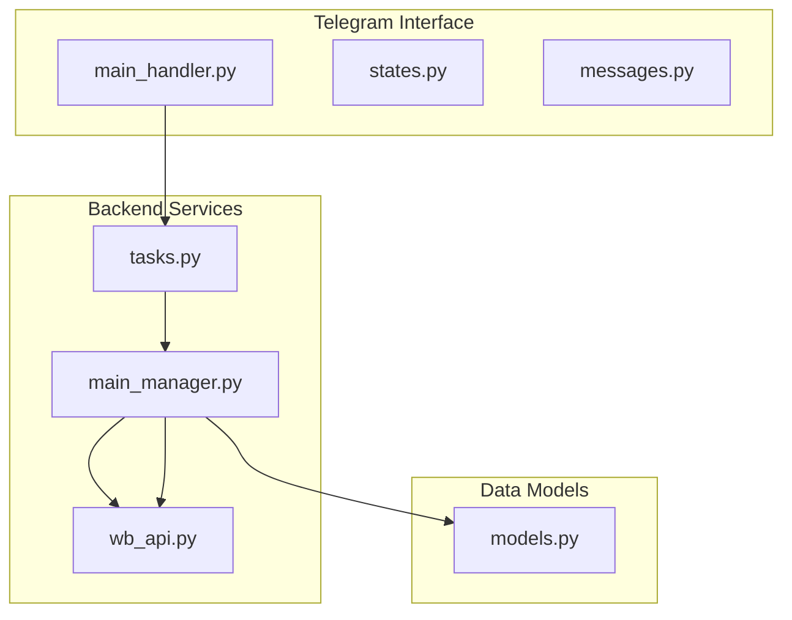
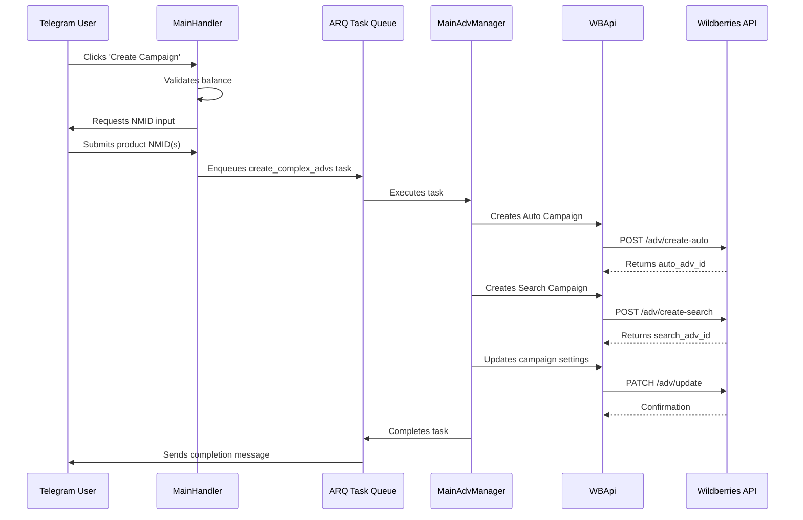
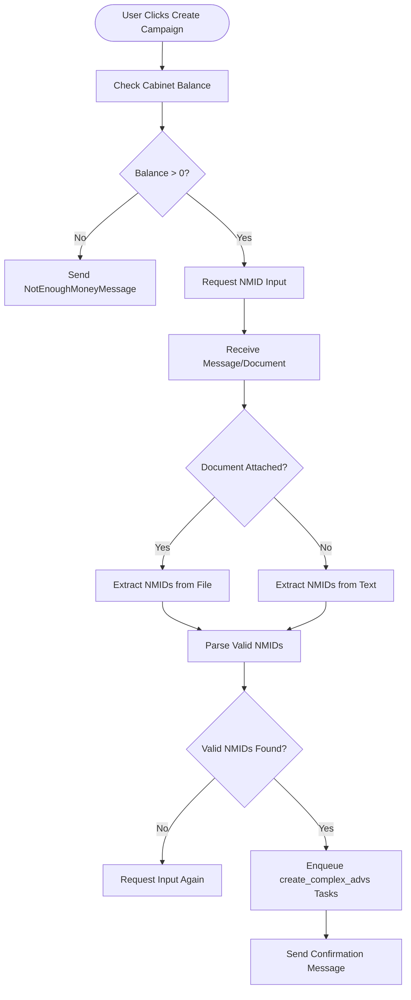
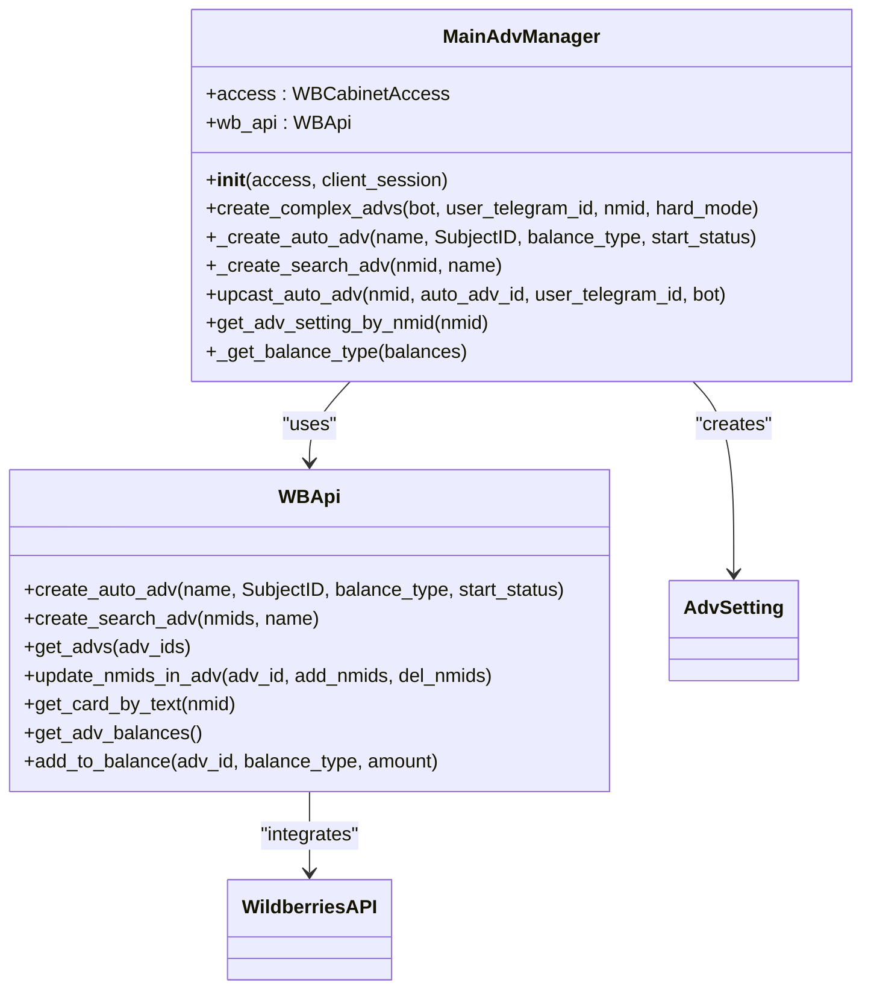
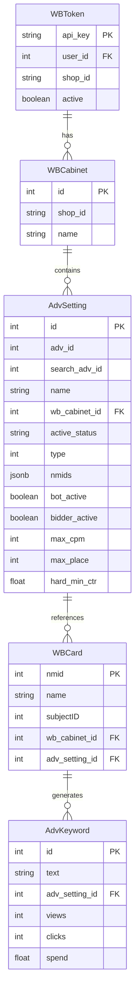

# Campaign Creation

<cite>
**Referenced Files in This Document**   
- [main_handler.py](file://app/modules/adv_creator/telegram/handlers/main_handler.py)
- [main_manager.py](file://app/modules/adv_creator/backend/main_manager.py)
- [wb_api.py](file://app/modules/adv_creator/backend/wb_api.py)
- [tasks.py](file://app/modules/adv_creator/backend/tasks.py)
- [states.py](file://app/modules/adv_creator/telegram/handlers/states.py)
- [messages.py](file://app/modules/adv_creator/telegram/handlers/messages.py)
- [models.py](file://app/modules/common_slaves/wildberries/models/models.py)
</cite>

## Table of Contents
1. [Introduction](#introduction)
2. [Project Structure](#project-structure)
3. [Core Components](#core-components)
4. [Architecture Overview](#architecture-overview)
5. [Detailed Component Analysis](#detailed-component-analysis)
6. [Dependency Analysis](#dependency-analysis)
7. [Performance Considerations](#performance-considerations)
8. [Troubleshooting Guide](#troubleshooting-guide)
9. [Conclusion](#conclusion)

## Introduction
This document provides a comprehensive analysis of the Campaign Creation sub-feature within the Advertising Campaign Management system. The feature enables users to create advertising campaigns through a Telegram bot interface, which triggers backend processes to instantiate campaigns on the Wildberries platform. The workflow spans from user input in Telegram to campaign provisioning via Wildberries API, involving validation, balance checks, and asynchronous task execution. This documentation details the implementation flow, domain model interactions, error handling mechanisms, and configuration options for different campaign types.

## Project Structure
The Campaign Creation functionality is organized across multiple modules with clear separation of concerns between Telegram interface handling and backend campaign management. The structure follows a modular design pattern with distinct layers for user interaction, business logic, and external API integration.



**Diagram sources**
- [main_handler.py](file://app/modules/adv_creator/telegram/handlers/main_handler.py)
- [main_manager.py](file://app/modules/adv_creator/backend/main_manager.py)
- [wb_api.py](file://app/modules/adv_creator/backend/wb_api.py)
- [tasks.py](file://app/modules/adv_creator/backend/tasks.py)
- [models.py](file://app/modules/common_slaves/wildberries/models/models.py)

**Section sources**
- [main_handler.py](file://app/modules/adv_creator/telegram/handlers/main_handler.py)
- [main_manager.py](file://app/modules/adv_creator/backend/main_manager.py)

## Core Components
The Campaign Creation feature consists of several core components that work together to process user requests and create advertising campaigns. The main components include the Telegram handler for user input processing, the backend manager for campaign logic, and the task queue system for asynchronous execution. The flow begins with user interaction in Telegram, proceeds through validation and balance checking, and concludes with campaign creation on the Wildberries platform.

**Section sources**
- [main_handler.py](file://app/modules/adv_creator/telegram/handlers/main_handler.py#L1-L98)
- [main_manager.py](file://app/modules/adv_creator/backend/main_manager.py#L1-L199)
- [tasks.py](file://app/modules/adv_creator/backend/tasks.py#L1-L109)

## Architecture Overview
The Campaign Creation architecture follows a clean separation between user interface, business logic, and external service integration. User interactions in Telegram trigger stateful workflows that collect product information and validate prerequisites before delegating to backend services. The system employs an asynchronous task queue (ARQ) to handle potentially long-running operations, ensuring responsive user experience while maintaining reliability through retry mechanisms.



**Diagram sources**
- [main_handler.py](file://app/modules/adv_creator/telegram/handlers/main_handler.py#L50-L98)
- [tasks.py](file://app/modules/adv_creator/backend/tasks.py#L15-L110)
- [main_manager.py](file://app/modules/adv_creator/backend/main_manager.py#L50-L200)
- [wb_api.py](file://app/modules/adv_creator/backend/wb_api.py#L1-L12)

## Detailed Component Analysis

### Telegram Handler Analysis
The main_handler.py module handles user interactions in the Telegram bot, managing the campaign creation workflow through a state machine. It processes both text input and file uploads containing product NMIDs, validates user eligibility based on account balance, and initiates the campaign creation process by enqueuing tasks.



**Diagram sources**
- [main_handler.py](file://app/modules/adv_creator/telegram/handlers/main_handler.py#L50-L98)
- [messages.py](file://app/modules/adv_creator/telegram/handlers/messages.py#L1-L35)
- [states.py](file://app/modules/adv_creator/telegram/handlers/states.py#L1-L6)

**Section sources**
- [main_handler.py](file://app/modules/adv_creator/telegram/handlers/main_handler.py#L1-L98)
- [states.py](file://app/modules/adv_creator/telegram/handlers/states.py#L1-L6)
- [messages.py](file://app/modules/adv_creator/telegram/handlers/messages.py#L1-L35)

### Backend Manager Analysis
The MainAdvManager class in main_manager.py orchestrates the creation of complex advertising campaigns, handling both auto and search campaign types. It manages the entire lifecycle from initial validation through final configuration, including error recovery for transient API issues.



**Diagram sources**
- [main_manager.py](file://app/modules/adv_creator/backend/main_manager.py#L50-L200)
- [wb_api.py](file://app/modules/adv_creator/backend/wb_api.py#L1-L12)

**Section sources**
- [main_manager.py](file://app/modules/adv_creator/backend/main_manager.py#L1-L200)

### Domain Model Analysis
The campaign creation process relies on several key domain models that represent advertising settings, tokens, and cabinet information. These models define the structure of campaign configurations and their relationships with user accounts and Wildberries shops.



**Diagram sources**
- [models.py](file://app/modules/common_slaves/wildberries/models/models.py#L168-L529)

**Section sources**
- [models.py](file://app/modules/common_slaves/wildberries/models/models.py#L168-L529)

## Dependency Analysis
The Campaign Creation feature has well-defined dependencies between components, with clear separation between interface, business logic, and data access layers. The system depends on external services for Wildberries API integration and uses a message queue for asynchronous task processing.

```mermaid
graph TD
main_handler --> tasks : "enqueues"
tasks --> main_manager : "executes"
main_manager --> wb_api : "calls"
main_manager --> models : "persists"
wb_api --> BaseAPI : "inherits"
wb_api --> AdvMixin : "inherits"
wb_api --> ContentMixin : "inherits"
main_manager --> WBCabinetAccess : "uses"
tasks --> arq : "depends on"
main_handler --> balance_service : "checks"
style main_handler fill:#f9f,stroke:#333
style tasks fill:#ff9,stroke:#333
style main_manager fill:#9ff,stroke:#333
style wb_api fill:#9f9,stroke:#333
style models fill:#f99,stroke:#333
```

**Diagram sources**
- [main_handler.py](file://app/modules/adv_creator/telegram/handlers/main_handler.py)
- [tasks.py](file://app/modules/adv_creator/backend/tasks.py)
- [main_manager.py](file://app/modules/adv_creator/backend/main_manager.py)
- [wb_api.py](file://app/modules/adv_creator/backend/wb_api.py)
- [models.py](file://app/modules/common_slaves/wildberries/models/models.py)

**Section sources**
- [main_handler.py](file://app/modules/adv_creator/telegram/handlers/main_handler.py)
- [tasks.py](file://app/modules/adv_creator/backend/tasks.py)
- [main_manager.py](file://app/modules/adv_creator/backend/main_manager.py)
- [wb_api.py](file://app/modules/adv_creator/backend/wb_api.py)
- [models.py](file://app/modules/common_slaves/wildberries/models/models.py)

## Performance Considerations
The campaign creation process is designed with performance and reliability in mind. Asynchronous task processing ensures that user interactions remain responsive even when campaign creation takes extended time. The system implements retry mechanisms for transient failures and includes appropriate delays between API calls to avoid rate limiting. Database operations are optimized with proper indexing on frequently queried fields such as shop_id and adv_id.

## Troubleshooting Guide
Common issues in the campaign creation process include token expiration, shop ID mismatches, and insufficient balance. The system provides specific error handling for these scenarios:

- **Token Expiration**: When tokens expire during creation, the system catches ApiForbiddenError and prompts users to contact support for token renewal.
- **Shop ID Mismatch**: The system validates that the shop ID from the token matches the intended destination, preventing campaigns from being created in incorrect accounts.
- **Insufficient Balance**: Before creating campaigns, the system checks available balance and displays a NotEnoughMoneyMessage with a direct link to top-up if funds are insufficient.
- **Campaign Not Found**: When auto campaigns aren't immediately available after creation, the system implements a retry mechanism with exponential backoff, checking up to 10 times with increasing delays.
- **NMID Validation**: The system validates that submitted NMIDs correspond to actual products on Wildberries, returning clear error messages when products aren't found.

**Section sources**
- [main_handler.py](file://app/modules/adv_creator/telegram/handlers/main_handler.py)
- [main_manager.py](file://app/modules/adv_creator/backend/main_manager.py)
- [tasks.py](file://app/modules/adv_creator/backend/tasks.py)
- [messages.py](file://app/modules/adv_creator/telegram/handlers/messages.py)

## Conclusion
The Campaign Creation feature provides a robust, user-friendly interface for creating advertising campaigns on the Wildberries platform. By separating concerns between Telegram interaction, business logic, and API integration, the system achieves maintainability and scalability. The asynchronous architecture ensures reliability even when external APIs are temporarily unavailable, while comprehensive error handling provides clear feedback to users. The domain model supports both auction and auto campaign types with flexible configuration options, making it adaptable to various advertising strategies.