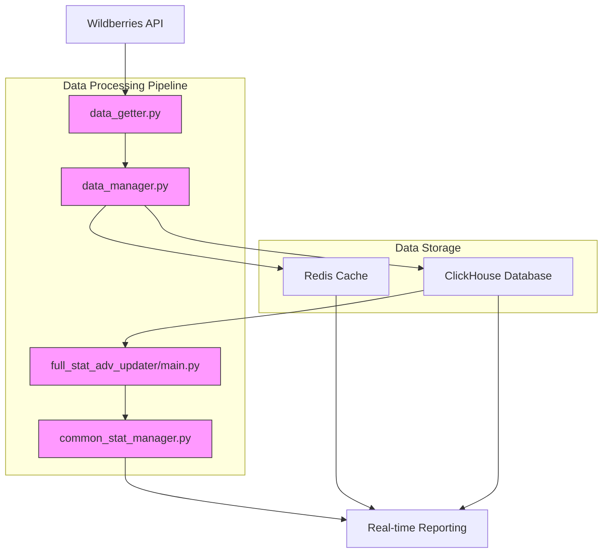
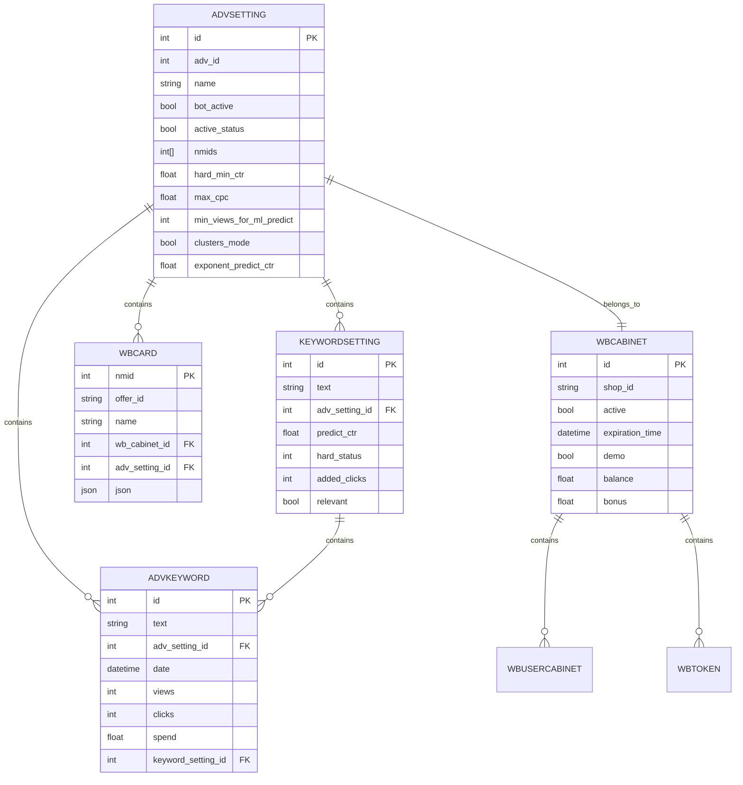
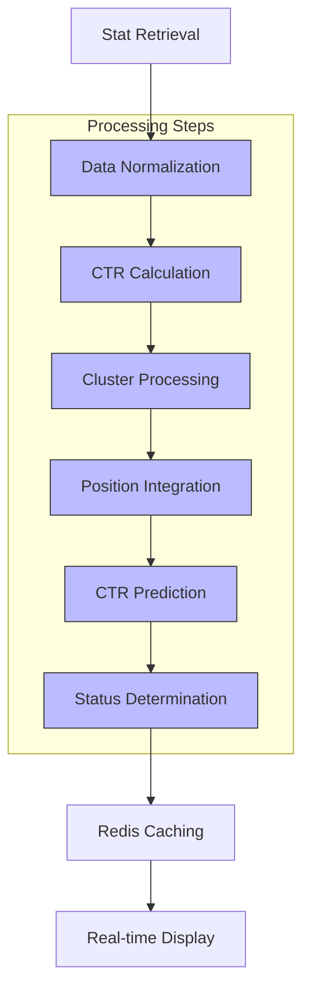

# Performance Tracking

<cite>
**Referenced Files in This Document**   
- [data_getter.py](file://app/modules/wb_adv_updater/data_getter.py)
- [data_manager.py](file://app/modules/wb_adv_updater/data_manager.py)
- [main.py](file://app/modules/full_stat_adv_updater/main.py)
- [db_data_manager.py](file://app/modules/full_stat_adv_updater/db_data_manager.py)
- [adv_stat_classes.py](file://app/modules/common_slaves/wildberries/data_classes/adv_stat_classes.py)
- [keywordstat.py](file://app/modules/common_slaves/wildberries/data_classes/keywordstat.py)
- [models.py](file://app/modules/common_slaves/wildberries/models/models.py)
- [common_stat_manager.py](file://app/modules/shop_runner/wb_statistic_manager/backend/common_stat_manager.py)
- [wb_data_getter.py](file://app/modules/full_stat_adv_updater/wb_data_getter.py)
- [redis_manager.py](file://app/utils/redis_manager.py)
</cite>

## Table of Contents
1. [Introduction](#introduction)
2. [Data Flow Architecture](#data-flow-architecture)
3. [Core Components](#core-components)
4. [Domain Model Relationships](#domain-model-relationships)
5. [Statistical Data Aggregation](#statistical-data-aggregation)
6. [Performance Metrics Processing](#performance-metrics-processing)
7. [Configuration and Optimization](#configuration-and-optimization)
8. [Error Handling and Troubleshooting](#error-handling-and-troubleshooting)
9. [Conclusion](#conclusion)

## Introduction
The Performance Tracking sub-feature of the Advertising Campaign Management system provides comprehensive monitoring and analysis of advertising campaign effectiveness across multiple shops on the Wildberries marketplace. This system collects, processes, and presents performance data to enable data-driven optimization decisions. The documentation explains the complete data flow from the Wildberries API through various processing components to persistent storage and real-time reporting interfaces. The system is designed to handle high-frequency data polling, large volumes of statistical data, and complex optimization algorithms while maintaining data consistency and reliability.

## Data Flow Architecture

**Diagram sources**
- [data_getter.py](file://app/modules/wb_adv_updater/data_getter.py)
- [data_manager.py](file://app/modules/wb_adv_updater/data_manager.py)
- [main.py](file://app/modules/full_stat_adv_updater/main.py)
- [common_stat_manager.py](file://app/modules/shop_runner/wb_statistic_manager/backend/common_stat_manager.py)

**Section sources**
- [data_getter.py](file://app/modules/wb_adv_updater/data_getter.py)
- [data_manager.py](file://app/modules/wb_adv_updater/data_manager.py)
- [main.py](file://app/modules/full_stat_adv_updater/main.py)

## Core Components

The Performance Tracking system consists of several core components that work together to collect, process, and present advertising performance data. The data_getter.py component serves as the primary interface with the Wildberries API, retrieving raw statistical data for advertising campaigns. This data is then processed by data_manager.py, which normalizes the data, applies business logic, and prepares it for storage and analysis. The full_stat_adv_updater/main.py component is responsible for aggregating full campaign statistics from multiple sources and updating them in the system. Finally, common_stat_manager.py processes the aggregated data for real-time display in the user interface.

The system uses a combination of Redis for caching frequently accessed data and ClickHouse for persistent storage of historical performance data. This architecture enables both real-time access to current performance metrics and comprehensive analysis of historical trends. The components are designed to work asynchronously, allowing for high-frequency data polling without blocking the main application flow.

**Section sources**
- [data_getter.py](file://app/modules/wb_adv_updater/data_getter.py#L0-L53)
- [data_manager.py](file://app/modules/wb_adv_updater/data_manager.py#L0-L799)
- [main.py](file://app/modules/full_stat_adv_updater/main.py#L0-L88)

## Domain Model Relationships

**Diagram sources**
- [models.py](file://app/modules/common_slaves/wildberries/models/models.py)

**Section sources**
- [models.py](file://app/modules/common_slaves/wildberries/models/models.py#L0-L653)
- [keywordstat.py](file://app/modules/common_slaves/wildberries/data_classes/keywordstat.py#L0-L15)

## Statistical Data Aggregation

The full_stat_adv_updater/main.py component is responsible for aggregating comprehensive campaign statistics from the Wildberries API and storing them for real-time access. This process runs on a scheduled basis, typically every 120 seconds, to ensure that performance data remains current. The aggregation process begins by identifying all active advertising campaigns for each shop through the db_data_manager.py component, which queries the database for active campaign IDs.

Once the active campaigns are identified, the system retrieves full statistical data from the Wildberries API using the advert.get_adv_full_state method. This data includes key performance metrics such as views, clicks, CTR (Click-Through Rate), CPC (Cost Per Click), and total spend. The retrieved data is then processed and stored in Redis cache for rapid access by the reporting interface. The aggregation process is designed to handle potential failures gracefully, with error handling that logs exceptions and continues processing other shops rather than failing the entire update cycle.

The system also implements a distributed architecture where each shop has its own updater instance, allowing for parallel processing of multiple shops' data. This design enables the system to scale horizontally as the number of managed shops increases. The updater tasks are managed asynchronously using Python's asyncio framework, ensuring efficient resource utilization and preventing blocking operations.

**Section sources**
- [main.py](file://app/modules/full_stat_adv_updater/main.py#L0-L88)
- [db_data_manager.py](file://app/modules/full_stat_adv_updater/db_data_manager.py#L0-L20)

## Performance Metrics Processing

**Diagram sources**
- [data_manager.py](file://app/modules/wb_adv_updater/data_manager.py)
- [common_stat_manager.py](file://app/modules/shop_runner/wb_statistic_manager/backend/common_stat_manager.py)

**Section sources**
- [data_manager.py](file://app/modules/wb_adv_updater/data_manager.py#L0-L799)
- [common_stat_manager.py](file://app/modules/shop_runner/wb_statistic_manager/backend/common_stat_manager.py)

The performance metrics processing pipeline transforms raw statistical data into actionable insights for campaign optimization. The process begins with data normalization, where raw metrics are standardized and cleaned to ensure consistency across different data sources. This step is implemented in the normalize_df_data method of the DataGetter class, which applies min-max normalization to key performance indicators.

CTR (Click-Through Rate) is calculated as the ratio of clicks to views, providing a fundamental measure of ad effectiveness. The system also calculates CPC (Cost Per Click) by dividing total spend by the number of clicks. These metrics are essential for evaluating campaign efficiency and ROI (Return on Investment).

For campaigns operating in clusters mode, the system groups related keywords into clusters and calculates aggregate performance metrics for each cluster. This approach enables optimization at the cluster level rather than individual keywords, which can be more effective for certain campaign strategies. Position data is integrated from Redis cache, providing information about where keywords appear in search results, which is crucial for understanding organic visibility and competition.

The system implements a sophisticated CTR prediction model that combines historical performance data with machine learning algorithms. The predict_ctr value is calculated based on various factors including keyword relevance, historical performance, and campaign settings. This prediction is used to determine keyword status (good or bad) and inform optimization decisions.

Status determination applies business rules to classify keywords based on their performance against campaign objectives. Keywords may be marked as "good" if they meet or exceed minimum CTR thresholds, or "bad" if they underperform. The system also considers factors like maximum CPC constraints and position limits when determining keyword status.

Finally, processed metrics are cached in Redis for rapid access by the reporting interface, enabling real-time display of campaign performance. This caching strategy reduces database load and ensures responsive user experience even with high-frequency data updates.

## Configuration and Optimization

The Performance Tracking system offers several configuration options that affect tracking frequency, data retention, and optimization behavior. The stat retrieval interval is controlled by the sleep duration in the FullStatAdvUpdater class, currently set to 120 seconds. This interval can be adjusted based on the need for real-time data versus system resource constraints.

Data retention policies are implemented through the pass_days parameter in various data retrieval functions, which determines how much historical data to include in queries. The default value is typically 7 days for recent performance analysis, but can be extended for longer-term trend analysis. ClickHouse database settings also influence data retention, with automatic partitioning and compression optimizing storage efficiency.

The system implements several optimization strategies for handling large volumes of statistical data across multiple shops. Redis caching is used extensively to reduce database queries and improve response times. The data_getter.py component retrieves keyword features from Redis when available, falling back to Neo4j database only when necessary. This caching hierarchy significantly reduces latency for frequently accessed data.

For high-frequency data polling, the system uses asynchronous processing with asyncio to handle multiple requests concurrently without blocking. The full_stat_adv_updater runs as a continuous loop, processing updates for all active shops in parallel. This design enables the system to scale to hundreds of shops while maintaining consistent update intervals.

The data_manager.py component implements query optimization techniques such as batch processing and efficient SQL generation. The _build_clickhouse_query function constructs optimized ClickHouse queries that leverage the database's columnar storage and aggregation capabilities. This results in faster query execution and reduced resource consumption.

Caching strategies extend beyond Redis to include in-memory caching of frequently used data structures and computed results. The system also implements rate limiting and backoff mechanisms to prevent overwhelming the Wildberries API with requests, ensuring reliable data collection even during peak usage periods.

**Section sources**
- [main.py](file://app/modules/full_stat_adv_updater/main.py#L0-L88)
- [data_manager.py](file://app/modules/wb_adv_updater/data_manager.py#L0-L799)
- [data_getter.py](file://app/modules/wb_adv_updater/data_getter.py#L0-L53)

## Error Handling and Troubleshooting

The Performance Tracking system implements comprehensive error handling to address common issues such as stat synchronization delays and data inconsistencies between systems. The full_stat_adv_updater includes try-except blocks around critical operations, with detailed logging of exceptions to facilitate troubleshooting. When an error occurs during stat updates, the system logs the error with full traceback information and continues processing other shops, preventing a single failure from disrupting the entire update cycle.

Common issues and their solutions include:

1. **Stat synchronization delays**: These can occur when the Wildberries API is slow to update or when network latency affects data retrieval. The system addresses this by implementing retry mechanisms with exponential backoff and by maintaining a queue of pending updates that can be processed when connectivity is restored.

2. **Data inconsistencies between systems**: These may arise when data in Redis cache becomes stale or when database transactions fail. The system uses versioning and timestamp-based validation to detect and resolve inconsistencies. The get_keywords_positions_dict_by_text function includes logic to handle missing or outdated position data.

3. **Failed stat updates**: When stat updates fail, the system logs detailed error information including the shop ID, campaign ID, and error type. The async_process_run function in main.py monitors task status and recreates failed tasks as needed.

4. **Redis connectivity issues**: The system implements connection pooling and automatic reconnection to handle temporary Redis outages. The redis_manager.py component includes health checks and fallback mechanisms to ensure data availability.

5. **Database query timeouts**: For large datasets, ClickHouse queries may exceed timeout limits. The system addresses this by implementing query optimization, result pagination, and timeout handling with retry logic.

Troubleshooting guidance includes monitoring system logs for error patterns, checking Redis and database connectivity, and verifying API credentials. The system also provides diagnostic endpoints that return the status of key components, enabling rapid identification of issues.

**Section sources**
- [main.py](file://app/modules/full_stat_adv_updater/main.py#L0-L88)
- [data_manager.py](file://app/modules/wb_adv_updater/data_manager.py#L0-L799)
- [redis_manager.py](file://app/utils/redis_manager.py)

## Conclusion
The Performance Tracking sub-feature provides a robust and scalable solution for monitoring and optimizing advertising campaigns on the Wildberries marketplace. By implementing a comprehensive data flow from API retrieval through processing to real-time reporting, the system enables data-driven decision making for campaign optimization. The architecture balances real-time performance with historical analysis capabilities, using Redis for caching and ClickHouse for persistent storage. Configuration options allow customization of tracking frequency and data retention to meet specific business needs. Comprehensive error handling and troubleshooting guidance ensure system reliability and ease of maintenance. This documentation provides a foundation for understanding and effectively utilizing the Performance Tracking system to maximize advertising effectiveness.