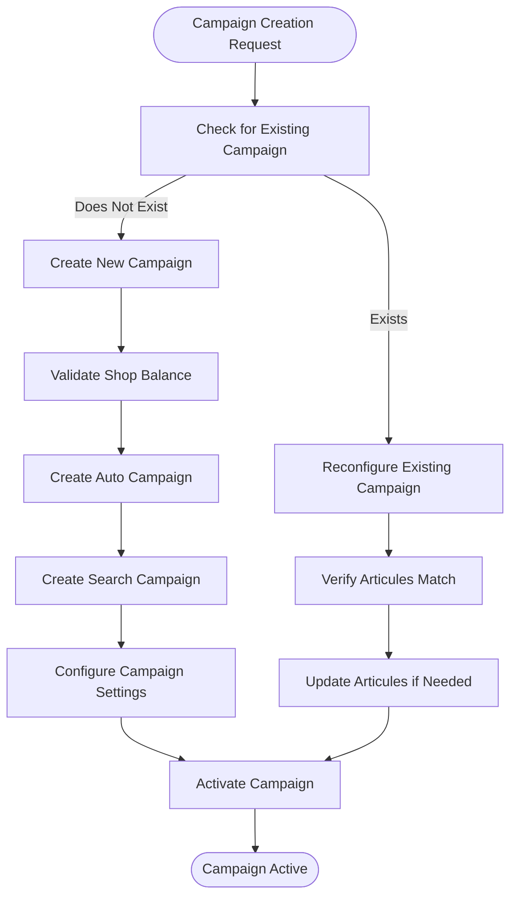
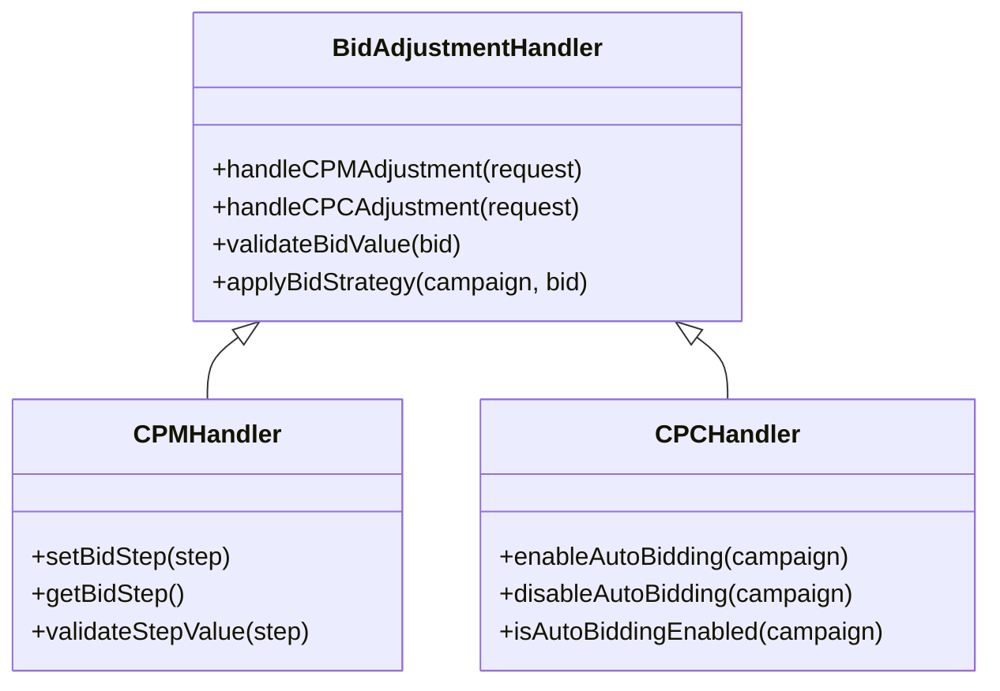
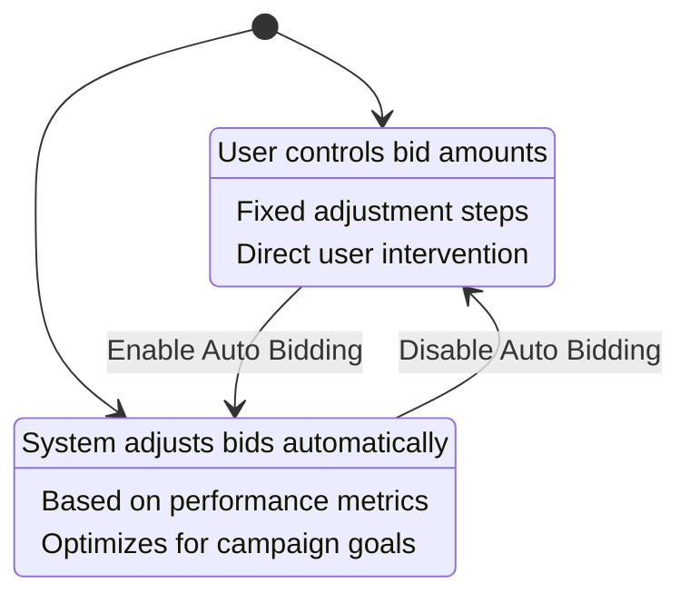
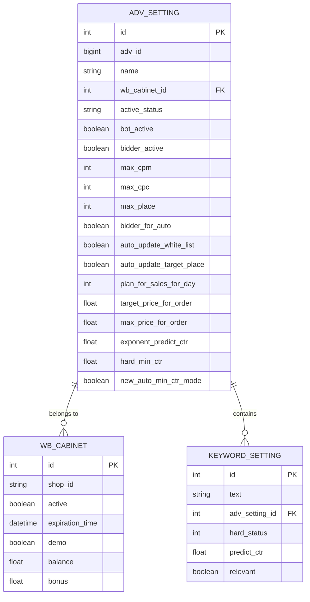
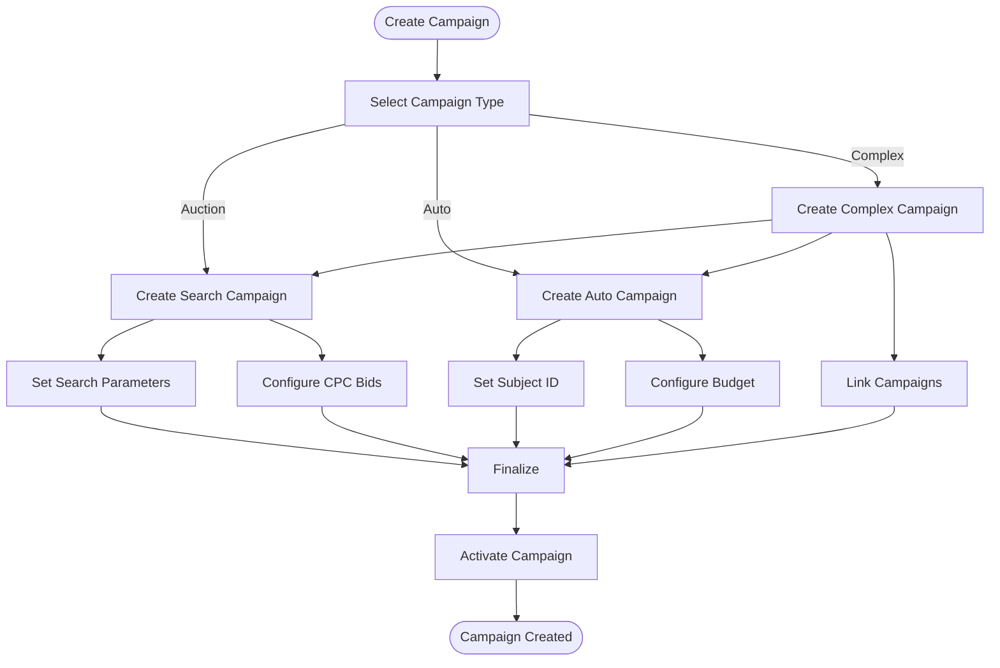
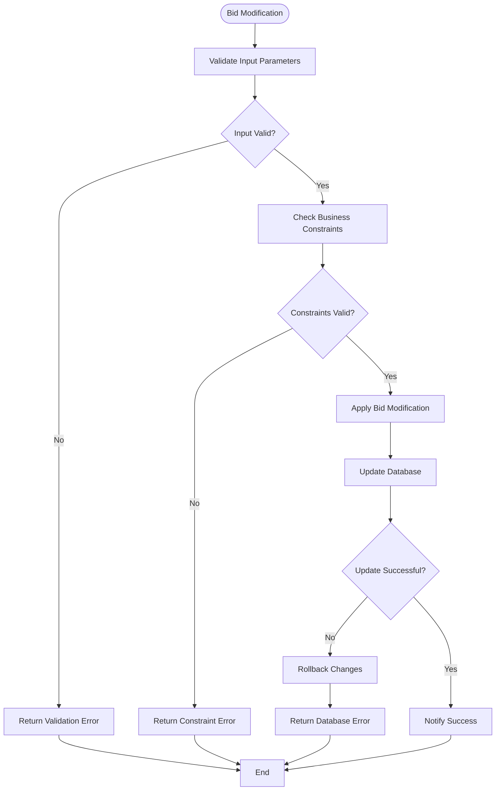
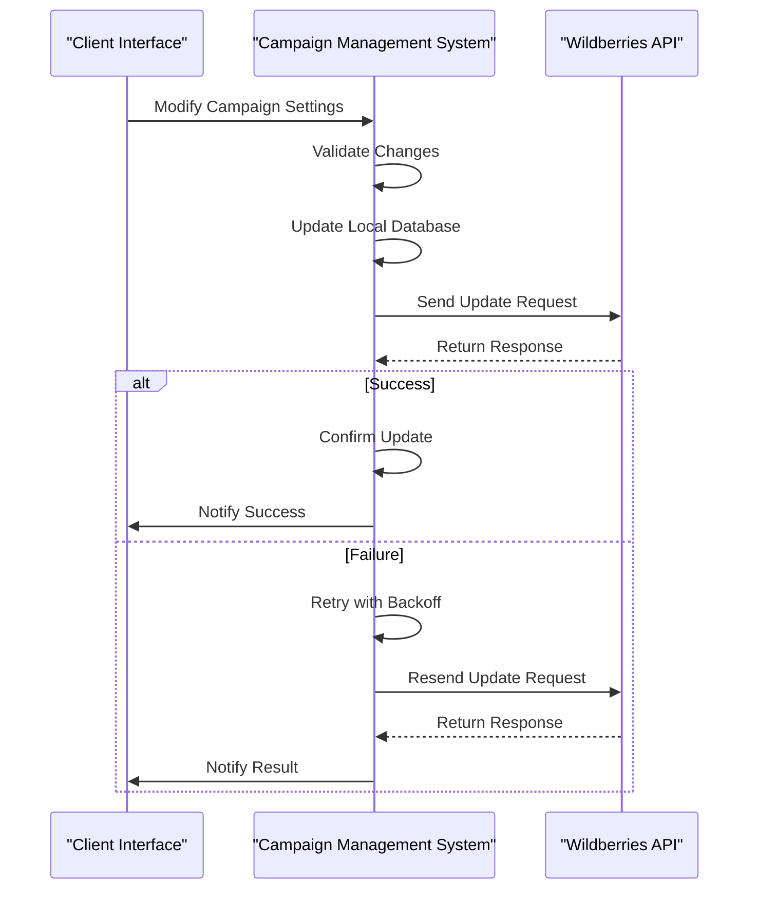
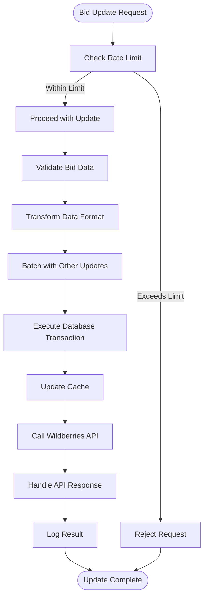

# Advertising Management

<cite>
**Referenced Files in This Document**   
- [main_manager.py](file://app/modules/adv_creator/backend/main_manager.py)
- [adv_setting.py](file://app/client_bot/user_interface/handlers/adv_setting.py)
- [models.py](file://app/modules/common_slaves/wildberries/models/models.py)
- [telegram_handler.py](file://app/modules/bidder_step_setting/telegram_handler.py)
- [handlers.py](file://app/modules/bidder_auto_mode/handlers.py)
- [auto_updater_target_place.py](file://app/modules/shop_runner/service_manager/old_modules/auto_updater_target_place/auto_updater_target_place.py)
- [setting_auto_updater.py](file://app/modules/shop_runner/service_manager/old_modules/setting_auto_updater/setting_auto_updater.py)
- [target_place_updater.py](file://app/modules/shop_runner/service_manager/old_modules/setting_auto_updater/modules/target_place_updater/target_place_updater.py)
- [update_adv_setting.py](file://app/modules/shop_runner/service_manager/old_modules/setting_auto_updater/update_adv_setting.py)
</cite>

## Table of Contents
1. [Introduction](#introduction)
2. [Campaign Lifecycle](#campaign-lifecycle)
3. [Bid Adjustment Mechanisms](#bid-adjustment-mechanisms)
4. [Bidding Strategies](#bidding-strategies)
5. [Campaign Settings Data Model](#campaign-settings-data-model)
6. [Campaign Creation Examples](#campaign-creation-examples)
7. [Validation and Error Handling](#validation-and-error-handling)
8. [Wildberries API Integration](#wildberries-api-integration)
9. [Performance Considerations](#performance-considerations)

## Introduction
The advertising campaign management system provides comprehensive tools for creating, managing, and optimizing advertising campaigns on the Wildberries platform. The system supports both auction-based and auto-mode campaigns, with sophisticated bidding strategies and automated optimization features. This documentation details the complete campaign lifecycle from creation through ongoing management, focusing on the core components that enable effective advertising campaign management.

## Campaign Lifecycle
The campaign lifecycle begins with campaign creation in the adv_creator module and continues with ongoing management through the adv_setting.py handlers. The process involves several key stages: campaign initialization, configuration, activation, and continuous optimization.

The MainAdvManager class in the adv_creator module orchestrates the creation of complex advertising campaigns. It handles both auto and search (auction) advertising types, ensuring proper configuration and initialization. When creating a new campaign, the system first checks for existing campaigns associated with the specified nmid (nominal ID). If no active campaign exists, it proceeds with creation; otherwise, it attempts to reconfigure the existing campaign.

**Diagram sources**
- [main_manager.py](file://app/modules/adv_creator/backend/main_manager.py#L40-L305)

**Section sources**
- [main_manager.py](file://app/modules/adv_creator/backend/main_manager.py#L40-L305)

## Bid Adjustment Mechanisms
The system implements bid adjustment mechanisms for both CPM (Cost Per Mille) and CPC (Cost Per Click) through dedicated handlers. These mechanisms allow for precise control over bidding strategies and campaign optimization.

For CPM adjustments, the system provides a step-based bidding mechanism that allows users to set incremental bid changes. The bidder_step_setting module handles these adjustments through a Telegram interface, allowing users to specify the step size for bid modifications. The maximum step size is capped at 1000 to prevent excessive bid changes.

For CPC adjustments in auto-mode campaigns, the system uses an automated bidding strategy controlled by the bidder_auto_mode module. This handler enables or disables the automatic bidder for specific campaigns, allowing the system to dynamically adjust bids based on performance metrics and optimization goals.

**Diagram sources**
- [telegram_handler.py](file://app/modules/bidder_step_setting/telegram_handler.py#L0-L56)
- [handlers.py](file://app/modules/bidder_auto_mode/handlers.py#L0-L56)

**Section sources**
- [telegram_handler.py](file://app/modules/bidder_step_setting/telegram_handler.py#L0-L56)
- [handlers.py](file://app/modules/bidder_auto_mode/handlers.py#L0-L56)

## Bidding Strategies
The system supports two primary bidding strategies: manual mode and auto mode. Each strategy serves different optimization goals and use cases.

Manual bidding mode gives users direct control over bid amounts and adjustment steps. Users can set specific bid values and define the increment or decrement step for bid changes. This mode is suitable for users who prefer hands-on control over their campaign optimization and have specific bidding strategies in mind.

Auto bidding mode implements an automated optimization strategy where the system dynamically adjusts bids based on campaign performance metrics. When enabled, the system analyzes key performance indicators such as click-through rate (CTR), conversion rates, and return on advertising spend (ROAS) to determine optimal bid values. The auto-mode bidder can be toggled on or off for individual campaigns, providing flexibility in campaign management.

The choice between manual and auto mode depends on the user's expertise, campaign goals, and desired level of control. Auto mode is recommended for users seeking hands-free optimization, while manual mode suits experienced advertisers with specific bidding strategies.

**Diagram sources**
- [handlers.py](file://app/modules/bidder_auto_mode/handlers.py#L0-L56)
- [telegram_handler.py](file://app/modules/bidder_step_setting/telegram_handler.py#L0-L56)

**Section sources**
- [handlers.py](file://app/modules/bidder_auto_mode/handlers.py#L0-L56)
- [telegram_handler.py](file://app/modules/bidder_step_setting/telegram_handler.py#L0-L56)

## Campaign Settings Data Model
The AdvSetting data model represents the core configuration for advertising campaigns. This model stores all campaign parameters, optimization settings, and state information in a comprehensive structure.

The AdvSetting class includes fields for both basic campaign information and advanced optimization parameters. Key attributes include:
- Campaign identification (adv_id, name, nmids)
- Status and activation controls (active_status, bot_active, bidder_active)
- Bidding parameters (max_cpm, max_cpc, bidder_step)
- Targeting and placement settings (max_place, min_block_position, reset_place)
- Optimization strategies (bidder_for_auto, auto_update_white_list, auto_update_target_place)
- Performance targets (plan_for_sales_for_day, target_price_for_order, max_price_for_order)
- Advanced algorithmic parameters (exponent_predict_ctr, hard_min_ctr, new_auto_min_ctr_mode)

The model also includes calculated properties and methods that provide derived information, such as auction_adv_id which extracts the auction campaign ID from the campaign name pattern. This comprehensive data model enables flexible campaign configuration and sophisticated optimization strategies.

**Diagram sources**
- [models.py](file://app/modules/common_slaves/wildberries/models/models.py#L0-L659)

**Section sources**
- [models.py](file://app/modules/common_slaves/wildberries/models/models.py#L0-L659)

## Campaign Creation Examples
The system supports the creation of different campaign types, including auction and auto campaigns, through the adv_creator module. Each campaign type has specific configuration requirements and use cases.

For auction campaigns, the system creates search-based advertising campaigns that compete for placement in search results. These campaigns are created using the _create_search_adv method, which initializes a campaign with a specified nmid and name. The campaign is configured to target specific search queries and optimize for visibility in search results.

For auto campaigns, the system creates automated advertising campaigns that leverage Wildberries' algorithmic targeting. These campaigns are created using the _create_auto_adv method, which initializes a campaign with a subject ID, balance type, and initial status. Auto campaigns are designed to automatically identify relevant audiences and optimize ad placement across the platform.

When creating complex campaigns, the system can combine both auction and auto campaigns for a comprehensive advertising strategy. The create_complex_advs method orchestrates this process, creating both campaign types and configuring them to work together. This approach allows for broad audience reach through auto campaigns while maintaining targeted visibility through auction campaigns.

**Diagram sources**
- [main_manager.py](file://app/modules/adv_creator/backend/main_manager.py#L40-L305)

**Section sources**
- [main_manager.py](file://app/modules/adv_creator/backend/main_manager.py#L40-L305)

## Validation and Error Handling
The system implements comprehensive validation rules and error handling for bid modifications and campaign management. These mechanisms ensure data integrity and prevent invalid configurations.

For bid modifications, the system validates input values to ensure they fall within acceptable ranges. The CPM step adjustment handler validates that the specified step is a positive integer between 1 and 1000. This prevents excessively large bid changes that could negatively impact campaign performance or budget allocation.

The system handles various error conditions during campaign creation and modification. For example, when creating a new campaign, the system validates that sufficient balance is available on the associated shop account. If insufficient funds are available, a NotEnoughBalanceOnShopError is raised, preventing the creation of a campaign that cannot be properly funded.

Edge cases in bid modifications are handled through careful validation and fallback mechanisms. When updating campaign settings, the system checks for existing configurations and handles cases where certain parameters may be null or undefined. This ensures that bid modifications are applied correctly even in complex scenarios with multiple interdependent settings.

**Diagram sources**
- [main_manager.py](file://app/modules/adv_creator/backend/main_manager.py#L40-L305)
- [telegram_handler.py](file://app/modules/bidder_step_setting/telegram_handler.py#L0-L56)

**Section sources**
- [main_manager.py](file://app/modules/adv_creator/backend/main_manager.py#L40-L305)
- [telegram_handler.py](file://app/modules/bidder_step_setting/telegram_handler.py#L0-L56)

## Wildberries API Integration
Campaign changes propagate to the Wildberries API through the wb_api.py integration layer. This integration handles all communication with the Wildberries advertising platform, ensuring that local configuration changes are properly synchronized with the external system.

The integration follows a structured process for propagating campaign changes. When a campaign setting is modified locally, the system first validates the change against business rules and constraints. Once validated, the change is committed to the local database and then propagated to the Wildberries API through appropriate API calls.

For campaign creation, the integration creates campaigns on the Wildberries platform and synchronizes the resulting campaign IDs back to the local system. For bid modifications, the integration updates the corresponding campaign settings on the Wildberries platform, ensuring that bidding strategies are properly implemented.

The integration also handles error conditions and synchronization issues. If an API call fails, the system implements retry logic with exponential backoff to handle temporary connectivity issues. The system also verifies that changes have been properly applied by retrieving updated campaign information from the API and comparing it with the expected state.

**Diagram sources**
- [main_manager.py](file://app/modules/adv_creator/backend/main_manager.py#L40-L305)
- [auto_updater_target_place.py](file://app/modules/shop_runner/service_manager/old_modules/auto_updater_target_place/auto_updater_target_place.py#L0-L97)

**Section sources**
- [main_manager.py](file://app/modules/adv_creator/backend/main_manager.py#L40-L305)
- [auto_updater_target_place.py](file://app/modules/shop_runner/service_manager/old_modules/auto_updater_target_place/auto_updater_target_place.py#L0-L97)

## Performance Considerations
Frequent bid updates can have significant performance implications for both the system and campaign effectiveness. The system implements several optimization strategies to mitigate these impacts.

One key consideration is the rate of bid updates. Excessive bid changes can lead to instability in campaign performance and increased API load. The system addresses this by implementing rate limiting and cooldown periods for bid modifications. For example, the target place updater enforces a 15-minute cooldown between adjustments to prevent rapid, destabilizing changes.

The system also optimizes database operations for bid updates. Instead of updating individual fields, the system batches related changes and applies them in a single transaction. This reduces database load and improves overall system performance. Additionally, the system uses indexing strategies on frequently queried fields such as adv_id and active_status to ensure fast lookup and update operations.

Caching is another important optimization strategy. The system caches frequently accessed campaign data and performance metrics to reduce database queries and API calls. This is particularly important for auto-mode bidding, where real-time performance data is needed to make bidding decisions.

**Diagram sources**
- [setting_auto_updater.py](file://app/modules/shop_runner/service_manager/old_modules/setting_auto_updater/setting_auto_updater.py#L0-L153)
- [target_place_updater.py](file://app/modules/shop_runner/service_manager/old_modules/setting_auto_updater/modules/target_place_updater/target_place_updater.py#L0-L70)
- [update_adv_setting.py](file://app/modules/shop_runner/service_manager/old_modules/setting_auto_updater/update_adv_setting.py)

**Section sources**
- [setting_auto_updater.py](file://app/modules/shop_runner/service_manager/old_modules/setting_auto_updater/setting_auto_updater.py#L0-L153)
- [target_place_updater.py](file://app/modules/shop_runner/service_manager/old_modules/setting_auto_updater/modules/target_place_updater/target_place_updater.py#L0-L70)
- [update_adv_setting.py](file://app/modules/shop_runner/service_manager/old_modules/setting_auto_updater/update_adv_setting.py)