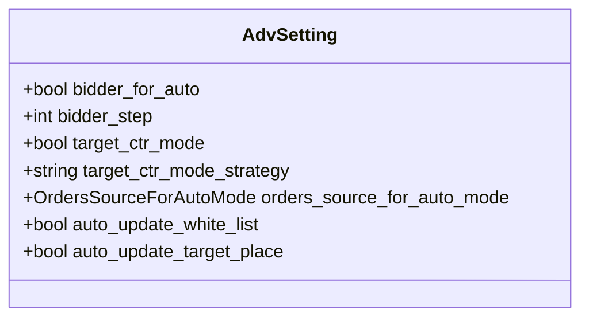
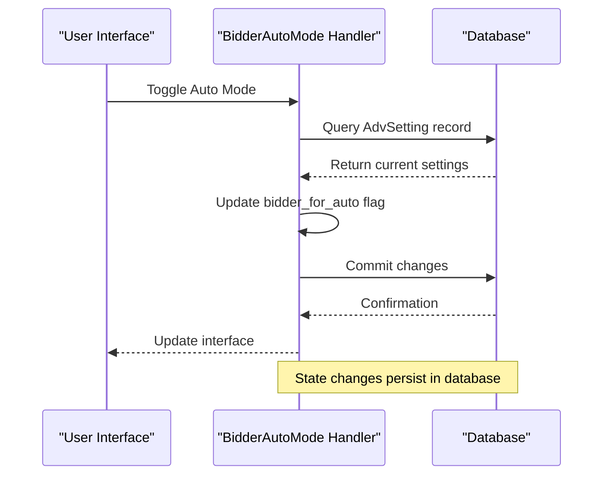
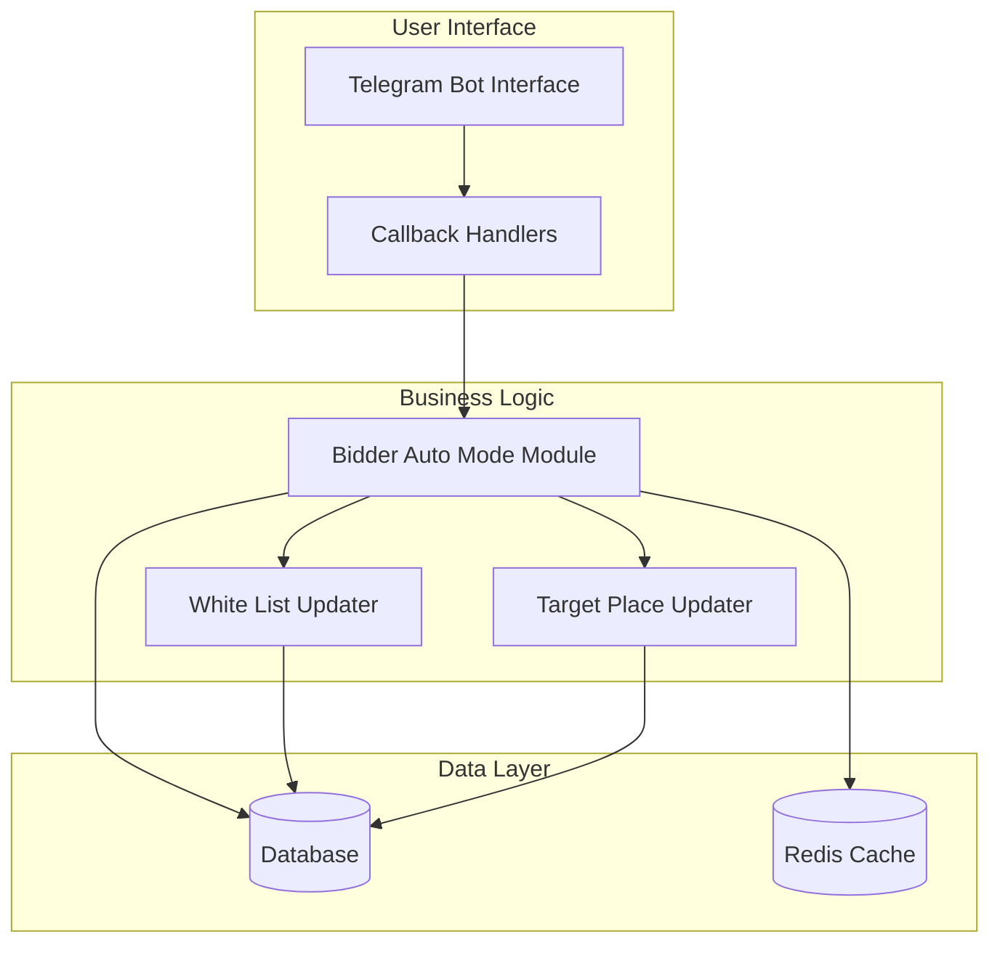
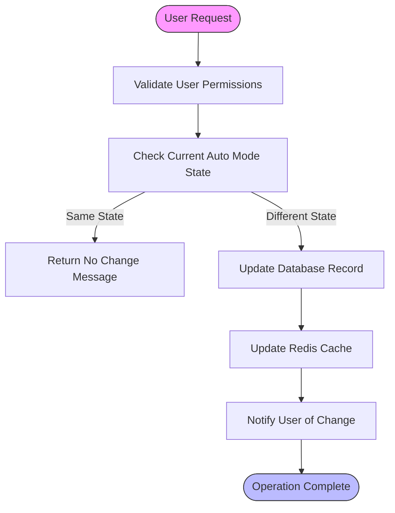
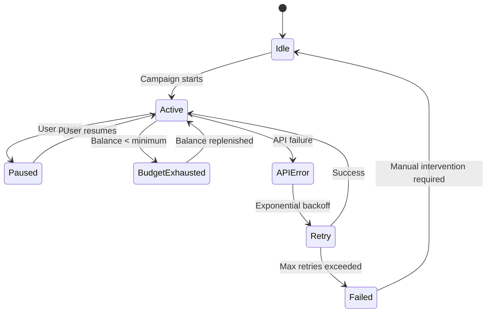

# Auto Mode Management

<cite>
**Referenced Files in This Document**   
- [handlers.py](file://app/modules/bidder_auto_mode/handlers.py)
- [adv_setting.py](file://app/client_bot/user_interface/handlers/adv_setting.py)
- [models.py](file://app/modules/common_slaves/wildberries/models/models.py)
- [auto_white_list_updater.py](file://app/modules/shop_runner/service_manager/old_modules/setting_auto_updater/modules/white_list_updater/auto_white_list_updater/auto_white_list_updater.py)
- [target_place_updater.py](file://app/modules/shop_runner/service_manager/old_modules/setting_auto_updater/modules/target_place_updater/target_place_updater.py)
- [data_classes.py](file://app/modules/shop_runner/service_manager/old_modules/setting_auto_updater/data_classes.py)
- [update_adv_setting.py](file://app/modules/shop_runner/service_manager/old_modules/setting_auto_updater/update_adv_setting.py)
</cite>

## Table of Contents
1. [Introduction](#introduction)
2. [Auto Mode Overview](#auto-mode-overview)
3. [Configuration Options](#configuration-options)
4. [State Management](#state-management)
5. [System Architecture](#system-architecture)
6. [Interaction Flow](#interaction-flow)
7. [Performance Monitoring](#performance-monitoring)
8. [Edge Case Handling](#edge-case-handling)
9. [Troubleshooting Guide](#troubleshooting-guide)
10. [Optimization Tips](#optimization-tips)

## Introduction
The Auto Mode Bidding Strategy Management system enables automated bidding for advertising campaigns, allowing users to optimize their advertising performance through intelligent, rule-based bid adjustments. This document provides comprehensive documentation on the auto mode functionality, including its configuration, state management, and integration with the core bidding engine.

## Auto Mode Overview
Auto mode represents a sophisticated bidding strategy that automatically adjusts campaign parameters based on performance metrics and predefined rules. Unlike manual bidding, where users set fixed bid amounts, auto mode dynamically optimizes bidding behavior by analyzing real-time performance data and making adjustments to maximize campaign effectiveness.

The key benefits of auto mode include:
- **Efficiency**: Automated adjustments reduce the need for constant manual monitoring
- **Optimization**: Data-driven decisions improve campaign performance over time
- **Scalability**: Single configuration can manage multiple campaigns simultaneously
- **Consistency**: Rules-based approach ensures consistent bidding behavior

Trade-offs to consider:
- **Less direct control**: Users relinquish granular control over individual bid amounts
- **Learning period**: System requires time to gather sufficient data for optimal performance
- **Complexity**: Configuration options can be overwhelming for new users

**Section sources**
- [handlers.py](file://app/modules/bidder_auto_mode/handlers.py#L1-L57)
- [models.py](file://app/modules/common_slaves/wildberries/models/models.py#L350-L549)

## Configuration Options
The auto mode system provides several configurable parameters that allow users to customize bidding behavior according to their specific requirements.

### Bidder Activation
The primary toggle for auto mode is the `bidder_for_auto` field in the AdvSetting model, which enables or disables the automatic bidding functionality for a specific campaign.

### Bidding Steps
The `bidder_step` parameter determines the increment size for bid adjustments. This value is used when the system needs to modify bid amounts, ensuring that changes are made in controlled increments rather than large, potentially disruptive jumps.

### Target Metrics
Several target metrics guide the auto mode bidding strategy:
- **Target CTR Mode**: When enabled, the system focuses on achieving a specific click-through rate
- **Target CTR Strategy**: Defines the approach for CTR optimization, with options like "forward" or "keep"
- **Orders Source for Auto Mode**: Specifies the data source used to determine order metrics for auto mode calculations

**Diagram sources**
- [models.py](file://app/modules/common_slaves/wildberries/models/models.py#L350-L549)

**Section sources**
- [models.py](file://app/modules/common_slaves/wildberries/models/models.py#L350-L549)

## State Management
The system maintains auto mode state through the AdvSetting model, which stores all configuration parameters and operational state for each advertising campaign.

### Enabling/Disabling Auto Mode
Users can enable or disable auto mode through the bidder_auto_mode handlers, which process user interface interactions and update the database accordingly. The `on_bidder_for_auto` and `off_bidder_for_auto` callback handlers in the bidder_auto_mode module handle these state transitions.

### Persistent State Storage
The AdvSetting model in the database serves as the single source of truth for auto mode configuration. Key fields include:
- `bidder_for_auto`: Boolean flag indicating whether auto mode is active
- `auto_update_white_list`: Controls automatic management of the keyword white list
- `auto_update_target_place`: Enables automatic adjustment of target placement

When a user modifies auto mode settings, the system updates the corresponding AdvSetting record in the database, ensuring that the state persists across sessions and system restarts.

**Diagram sources**
- [handlers.py](file://app/modules/bidder_auto_mode/handlers.py#L1-L57)
- [models.py](file://app/modules/common_slaves/wildberries/models/models.py#L350-L549)

**Section sources**
- [handlers.py](file://app/modules/bidder_auto_mode/handlers.py#L1-L57)
- [models.py](file://app/modules/common_slaves/wildberries/models/models.py#L350-L549)

## System Architecture
The auto mode bidding system follows a modular architecture with clear separation of concerns between user interface, business logic, and data storage components.

**Diagram sources**
- [handlers.py](file://app/modules/bidder_auto_mode/handlers.py#L1-L57)
- [auto_white_list_updater.py](file://app/modules/shop_runner/service_manager/old_modules/setting_auto_updater/modules/white_list_updater/auto_white_list_updater/auto_white_list_updater.py#L1-L140)
- [target_place_updater.py](file://app/modules/shop_runner/service_manager/old_modules/setting_auto_updater/modules/target_place_updater/target_place_updater.py#L1-L70)

## Interaction Flow
The interaction between the bidder_auto_mode handlers and the core bidding engine follows a well-defined flow that ensures reliable operation and proper state management.

When a user requests to enable auto mode:
1. The Telegram bot receives a callback from the user interface
2. The bidder_auto_mode handler processes the request
3. The system retrieves the current AdvSetting record from the database
4. The handler updates the `bidder_for_auto` flag to True
5. The changes are committed to the database
6. The user interface is updated to reflect the new state

The core bidding engine periodically checks the `bidder_for_auto` status and, when enabled, applies the configured auto mode rules to adjust bidding behavior. This separation ensures that user interface operations are decoupled from the bidding execution logic.

**Diagram sources**
- [handlers.py](file://app/modules/bidder_auto_mode/handlers.py#L1-L57)
- [adv_setting.py](file://app/client_bot/user_interface/handlers/adv_setting.py#L1-L327)

**Section sources**
- [handlers.py](file://app/modules/bidder_auto_mode/handlers.py#L1-L57)
- [adv_setting.py](file://app/client_bot/user_interface/handlers/adv_setting.py#L1-L327)

## Performance Monitoring
Monitoring auto mode performance involves tracking key metrics and analyzing the effectiveness of automated bidding decisions.

### Configuration Example
To configure auto mode parameters:
1. Set `bidder_for_auto=True` to enable automatic bidding
2. Configure `bidder_step` to control the size of bid adjustments
3. Set `target_ctr_mode=True` to focus on click-through rate optimization
4. Choose between "forward" or "keep" strategy for CTR optimization
5. Specify the `orders_source_for_auto_mode` to determine which data source to use for order calculations

### Performance Metrics
Key performance indicators to monitor include:
- **Bid adjustment frequency**: How often the system modifies bid amounts
- **Conversion rate**: Effectiveness of auto mode in generating desired outcomes
- **Cost per acquisition**: Efficiency of spending under auto mode
- **Impression share**: Visibility of ads in the marketplace

Regular review of these metrics helps users assess whether auto mode is achieving their campaign objectives and whether configuration adjustments are needed.

**Section sources**
- [models.py](file://app/modules/common_slaves/wildberries/models/models.py#L350-L549)
- [data_classes.py](file://app/modules/shop_runner/service_manager/old_modules/setting_auto_updater/data_classes.py#L1-L27)

## Edge Case Handling
The auto mode system includes specific handling for various edge cases that may occur during operation.

### Campaign Pauses
When a campaign is paused, the auto mode system respects the pause state and does not make bid adjustments. The `bot_active` flag in the AdvSetting model controls overall campaign activity, and auto mode operations are suspended when this flag is False.

### Budget Exhaustion
When campaign budgets are exhausted, the auto mode system stops bidding activities. The system monitors balance levels through the cabinet's calculated_balance property and ceases bid adjustments when insufficient funds are available.

### API Failures
During API failures in the auto bidding process, the system implements retry logic with exponential backoff. Failed operations are logged, and the system attempts to recover gracefully without compromising data integrity. The use of database transactions ensures that partial updates do not leave the system in an inconsistent state.

**Diagram sources**
- [models.py](file://app/modules/common_slaves/wildberries/models/models.py#L350-L549)
- [update_adv_setting.py](file://app/modules/shop_runner/service_manager/old_modules/setting_auto_updater/update_adv_setting.py#L1-L68)

**Section sources**
- [models.py](file://app/modules/common_slaves/wildberries/models/models.py#L350-L549)
- [update_adv_setting.py](file://app/modules/shop_runner/service_manager/old_modules/setting_auto_updater/update_adv_setting.py#L1-L68)

## Troubleshooting Guide
This section addresses common issues encountered with auto mode bidding and provides guidance for resolution.

### Common Issues
1. **Auto mode not activating**: Verify that the `bidder_for_auto` flag is properly set in the database and that the user has appropriate permissions.
2. **Unexpected bid changes**: Check the `bidder_step` configuration and review the target metrics to ensure they align with campaign goals.
3. **Performance degradation**: Examine the balance between exploration and exploitation in the bidding strategy, and consider adjusting the learning rate parameters.

### Diagnostic Steps
1. Check database records to verify current auto mode configuration
2. Review system logs for error messages related to auto mode operations
3. Validate API connectivity and authentication credentials
4. Confirm that sufficient budget is available for bidding activities

### Recovery Procedures
For persistent issues, consider temporarily disabling auto mode and reverting to manual bidding while investigating the root cause. After resolving the issue, gradually re-enable auto mode with conservative settings to ensure stable operation.

**Section sources**
- [handlers.py](file://app/modules/bidder_auto_mode/handlers.py#L1-L57)
- [adv_setting.py](file://app/client_bot/user_interface/handlers/adv_setting.py#L1-L327)
- [models.py](file://app/modules/common_slaves/wildberries/models/models.py#L350-L549)

## Optimization Tips
To maximize the effectiveness of auto mode bidding, consider the following optimization strategies:

1. **Start with conservative settings**: Begin with small `bidder_step` values and gradually increase as confidence in the system grows.
2. **Monitor learning periods**: Allow sufficient time for the system to gather data before making significant configuration changes.
3. **Balance automation with oversight**: Regularly review auto mode decisions to ensure they align with business objectives.
4. **Use historical data**: Leverage past campaign performance to inform initial auto mode configuration.
5. **Implement gradual rollout**: Enable auto mode for a small subset of campaigns initially, then expand to additional campaigns as performance is validated.

Regular performance reviews and incremental adjustments will help optimize auto mode bidding for maximum return on advertising spend.

**Section sources**
- [models.py](file://app/modules/common_slaves/wildberries/models/models.py#L350-L549)
- [auto_white_list_updater.py](file://app/modules/shop_runner/service_manager/old_modules/setting_auto_updater/modules/white_list_updater/auto_white_list_updater/auto_white_list_updater.py#L1-L140)
- [target_place_updater.py](file://app/modules/shop_runner/service_manager/old_modules/setting_auto_updater/modules/target_place_updater/target_place_updater.py#L1-L70)