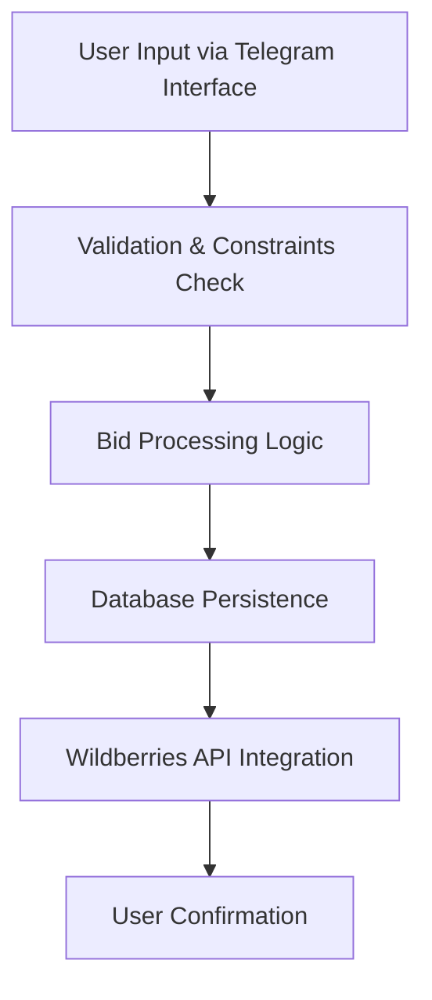
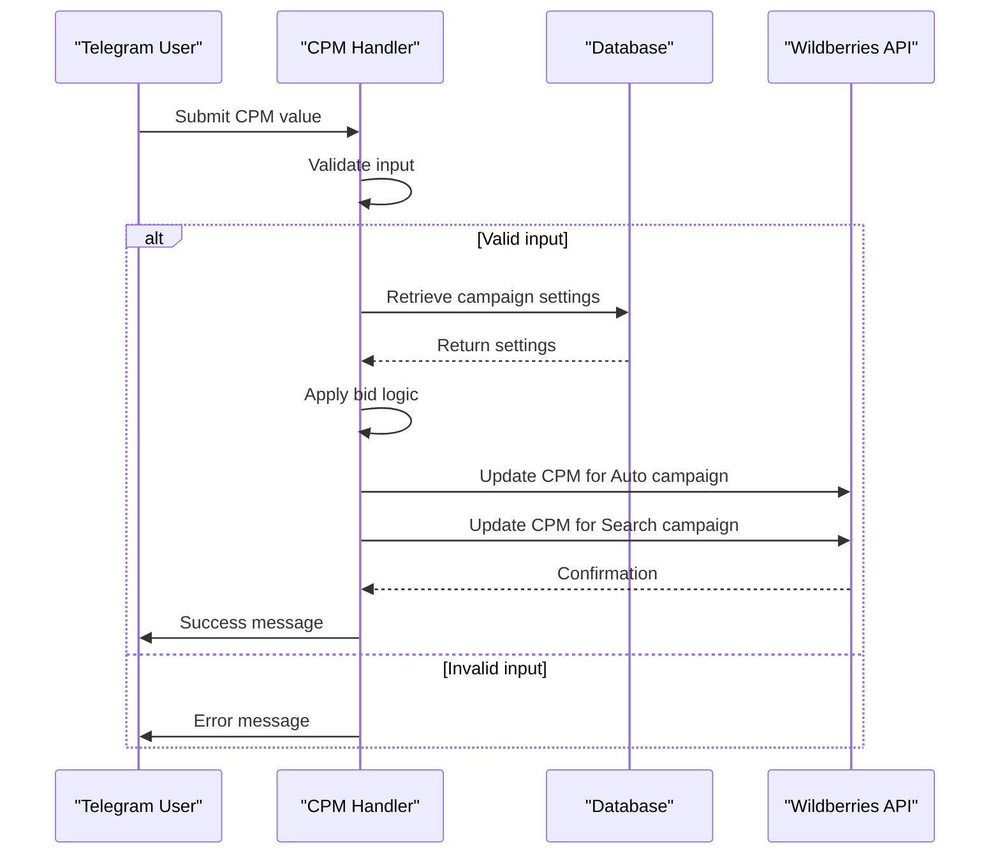
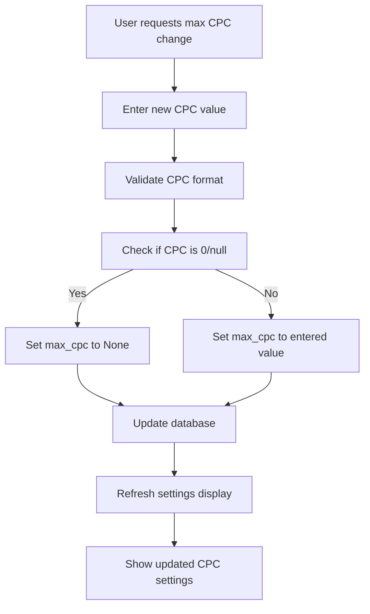
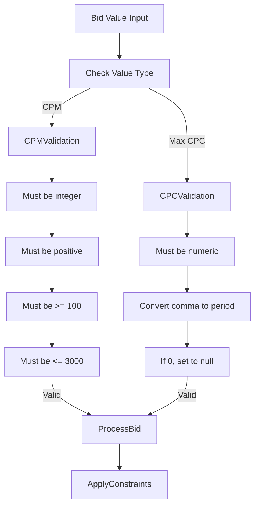
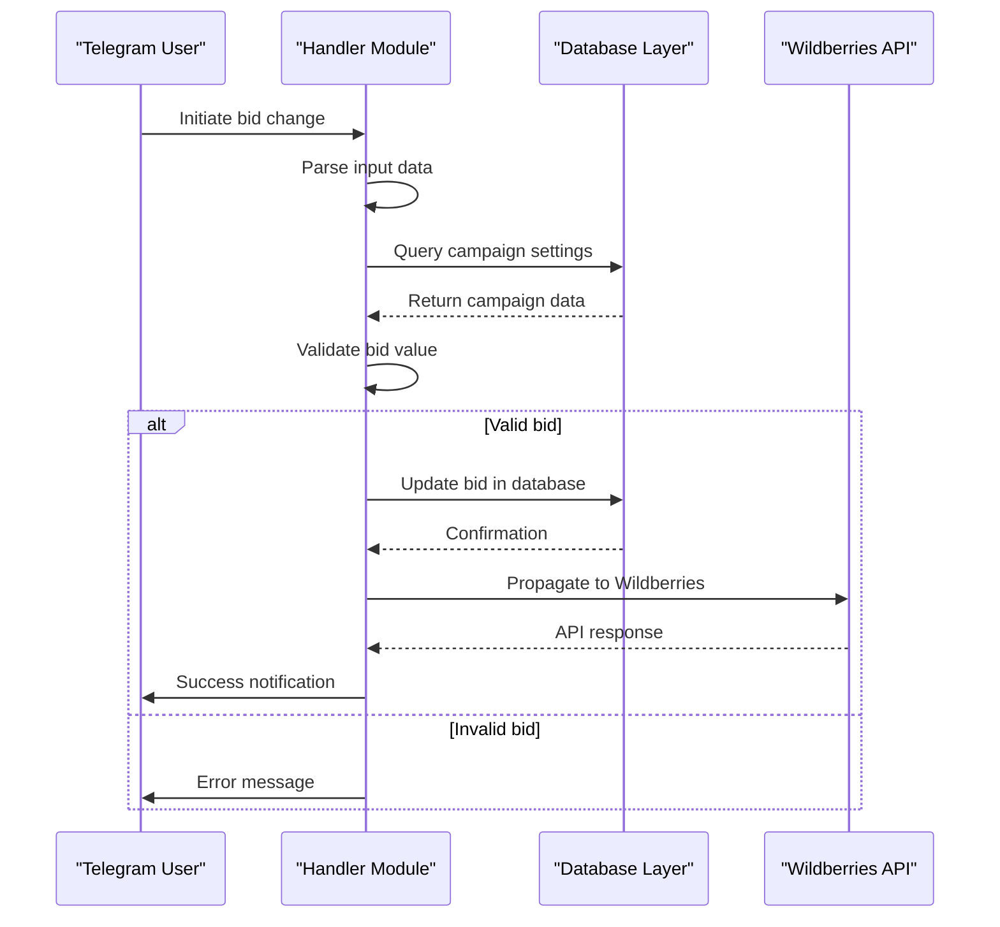
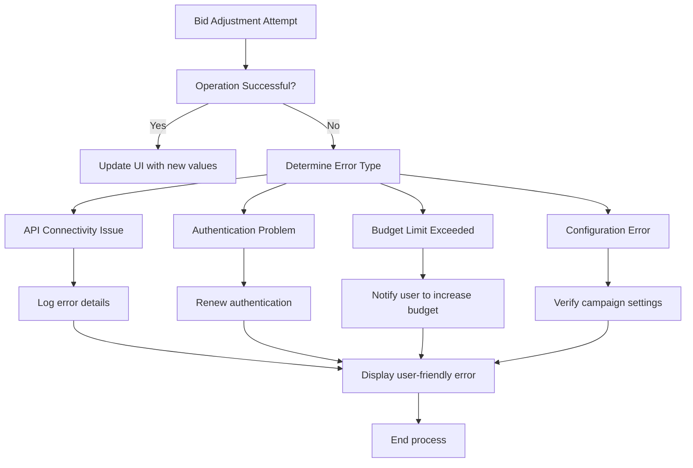

# Bid Adjustment

<cite>
**Referenced Files in This Document**   
- [change_cpm.py](file://app/client_bot/user_interface/handlers/change_cpm.py)
- [change_max_cpc.py](file://app/client_bot/user_interface/handlers/change_max_cpc.py)
- [cpm_builder.py](file://app/client_bot/user_interface/handlers/cpm_builder.py)
- [bidder_func.py](file://app/modules/shop_runner/bidder/bidder_func.py)
- [adv.py](file://app/core/wb_api/mixins/adv.py)
- [models.py](file://app/modules/common_slaves/wildberries/models/models.py)
- [messages.py](file://app/client_bot/user_interface/views/messages/messages.py)
- [callbacks.py](file://app/client_bot/user_interface/views/callbacks.py)
- [states.py](file://app/client_bot/user_interface/states.py)
- [adv_manager.py](file://app/modules/shop_runner/service_manager/modules/adv_manager/adv_manager.py)
</cite>

## Table of Contents
1. [Introduction](#introduction)
2. [Bid Adjustment Mechanisms](#bid-adjustment-mechanisms)
3. [CPM Bid Adjustment](#cpm-bid-adjustment)
4. [Max CPC Bid Adjustment](#max-cpc-bid-adjustment)
5. [Validation Rules and Constraints](#validation-rules-and-constraints)
6. [Data Flow and Processing](#data-flow-and-processing)
7. [Error Handling and Troubleshooting](#error-handling-and-troubleshooting)
8. [Performance Considerations](#performance-considerations)

## Introduction
This document provides comprehensive documentation for bid adjustment mechanisms in both CPM (cost per thousand impressions) and CPC (cost per click) models within the advertising management system. The system enables users to modify bid values through a Telegram interface, with changes propagated to the Wildberries API. The document covers the purpose, use cases, validation rules, data flow, and error handling for bid adjustments, focusing on the technical implementation and user experience.

**Section sources**
- [messages.py](file://app/client_bot/user_interface/views/messages/messages.py#L1000-L1200)
- [callbacks.py](file://app/client_bot/user_interface/views/callbacks.py#L1-L222)

## Bid Adjustment Mechanisms
The bid adjustment system supports two primary models: CPM for cost per thousand impressions and max CPC for maximum cost per click. These mechanisms allow advertisers to control their advertising costs and optimize campaign performance. The system provides both manual and automated bid management options, with different validation rules and constraints for each model.

The bid adjustment process begins with user input through the Telegram interface and flows through multiple components before reaching the Wildberries API. The system validates bid values against predefined constraints and ensures data consistency throughout the process. Bid changes are applied to both automatic and search advertising campaigns when applicable.

**Diagram sources**
- [change_cpm.py](file://app/client_bot/user_interface/handlers/change_cpm.py#L0-L83)
- [change_max_cpc.py](file://app/client_bot/user_interface/handlers/change_max_cpc.py#L0-L76)

**Section sources**
- [change_cpm.py](file://app/client_bot/user_interface/handlers/change_cpm.py#L0-L83)
- [change_max_cpc.py](file://app/client_bot/user_interface/handlers/change_max_cpc.py#L0-L76)

## CPM Bid Adjustment
The CPM bid adjustment mechanism allows users to modify the cost per thousand impressions for their advertising campaigns. Users can set CPM values through the Telegram interface, with options for both manual and automated bid management. The system supports bid adjustments for both automatic and search advertising campaigns.

For manual CPM adjustments, users input a specific bid value that is validated against system constraints. The automated bid management system dynamically adjusts CPM values based on campaign performance and target positions. When a user modifies the CPM value, the system updates both the automatic and search campaign bids if both are configured for the advertising campaign.

The CPM adjustment process includes validation to ensure bid values are within acceptable ranges and meet system requirements. The system also implements rate limiting to prevent excessive bid updates that could impact performance or violate API constraints.

**Diagram sources**
- [change_cpm.py](file://app/client_bot/user_interface/handlers/change_cpm.py#L0-L83)
- [bidder_func.py](file://app/modules/shop_runner/bidder/bidder_func.py#L0-L154)

**Section sources**
- [change_cpm.py](file://app/client_bot/user_interface/handlers/change_cpm.py#L0-L83)
- [cpm_builder.py](file://app/client_bot/user_interface/handlers/cpm_builder.py#L69-L104)

## Max CPC Bid Adjustment
The max CPC bid adjustment mechanism enables users to set the maximum cost per click for their advertising campaigns. Unlike CPM adjustments which affect impression costs, max CPC settings control the upper limit for individual click costs. This provides advertisers with greater control over their spending per conversion.

Users can set or modify the max CPC value through the Telegram interface using specific commands. The system allows setting a numerical value or disabling the max CPC limit entirely by setting it to zero or null. When a max CPC value is set, the system applies this limit to the advertising campaign and displays relevant information about keywords that exceed or comply with the threshold.

The max CPC adjustment interface provides users with visibility into keyword performance, showing keywords that exceed the set CPC limit and those that are within acceptable ranges. This helps users make informed decisions about their bid strategies and optimize campaign performance.

**Diagram sources**
- [change_max_cpc.py](file://app/client_bot/user_interface/handlers/change_max_cpc.py#L0-L76)
- [messages.py](file://app/client_bot/user_interface/views/messages/messages.py#L800-L1000)

**Section sources**
- [change_max_cpc.py](file://app/client_bot/user_interface/handlers/change_max_cpc.py#L0-L76)
- [messages.py](file://app/client_bot/user_interface/views/messages/messages.py#L800-L1000)

## Validation Rules and Constraints
The bid adjustment system implements strict validation rules and constraints to ensure bid values are appropriate and within acceptable ranges. These rules prevent invalid inputs and protect against excessive spending or technical issues.

For CPM adjustments, the system validates that input values are positive integers and do not exceed system-defined limits. The maximum allowable CPM is capped at 3000, with a warning displayed if users attempt to set values above 1500. Additionally, CPM values must be at least 100, ensuring a minimum bid threshold. The system also enforces minimum and maximum bounds based on campaign-specific parameters, ensuring new bids fall within the range defined by min_cpm and max_cpm values.

For max CPC adjustments, the system accepts floating-point values and validates them as numeric inputs. Users can disable the max CPC limit by setting the value to zero, which translates to null in the database. The system converts comma separators to periods to accommodate different regional number formats.

**Diagram sources**
- [change_cpm.py](file://app/client_bot/user_interface/handlers/change_cpm.py#L59-L82)
- [change_max_cpc.py](file://app/client_bot/user_interface/handlers/change_max_cpc.py#L59-L76)

**Section sources**
- [change_cpm.py](file://app/client_bot/user_interface/handlers/change_cpm.py#L59-L82)
- [change_max_cpc.py](file://app/client_bot/user_interface/handlers/change_max_cpc.py#L59-L76)

## Data Flow and Processing
The bid adjustment data flow follows a structured process from user input through validation, database persistence, and API integration. When a user submits a bid adjustment request through the Telegram interface, the system captures the input and initiates the processing pipeline.

The data flow begins with user interaction through callback queries or direct messages in the Telegram interface. The system routes these inputs to appropriate handlers based on the action type. For CPM adjustments, the `change_cpm` handler processes the request, while max CPC adjustments are handled by the `set_max_cpc` function.

After initial validation, the system retrieves the relevant advertising campaign settings from the database using the provided campaign ID. This includes critical information such as current bid values, campaign type, and associated product IDs (nmids). With the campaign data loaded, the system applies the new bid value and updates the database record.

**Diagram sources**
- [change_cpm.py](file://app/client_bot/user_interface/handlers/change_cpm.py#L0-L83)
- [adv_manager.py](file://app/modules/shop_runner/service_manager/modules/adv_manager/adv_manager.py#L0-L9)

**Section sources**
- [change_cpm.py](file://app/client_bot/user_interface/handlers/change_cpm.py#L0-L83)
- [adv_manager.py](file://app/modules/shop_runner/service_manager/modules/adv_manager/adv_manager.py#L0-L9)

## Error Handling and Troubleshooting
The bid adjustment system implements comprehensive error handling to manage various failure scenarios and provide meaningful feedback to users. When bid adjustments fail, the system captures the error, logs diagnostic information, and communicates appropriate messages to users.

Common error scenarios include API connectivity issues, invalid authentication credentials, and budget limitations. For API-related errors, the system distinguishes between different exception types such as `ApiForbiddenError` and general exceptions, applying appropriate handling strategies for each. When API access is forbidden, the system raises the specific exception to trigger authentication renewal processes.

Budget-related errors occur when bid adjustments would exceed available funds or daily spending limits. In such cases, the system prevents the bid change and notifies users to increase their budget before attempting the adjustment again. The system also handles cases where campaign settings cannot be found, providing clear error messages to help users troubleshoot configuration issues.

**Diagram sources**
- [change_cpm.py](file://app/client_bot/user_interface/handlers/change_cpm.py#L70-L82)
- [bidder_func.py](file://app/modules/shop_runner/bidder/bidder_func.py#L94-L125)

**Section sources**
- [change_cpm.py](file://app/client_bot/user_interface/handlers/change_cpm.py#L70-L82)
- [bidder_func.py](file://app/modules/shop_runner/bidder/bidder_func.py#L94-L125)

## Performance Considerations
The bid adjustment system incorporates several performance optimization strategies to handle frequent updates efficiently while maintaining system stability. Given the potential for high-frequency bid modifications, especially in automated bidding scenarios, the system implements various techniques to minimize resource consumption and prevent performance degradation.

Rate limiting is applied to prevent excessive API calls to Wildberries, which could lead to throttling or service disruption. The system also employs caching mechanisms to reduce database queries and improve response times for frequently accessed campaign data. When processing bid updates, the system batches operations where possible to minimize the number of database transactions.

For automated bidding processes, the system implements intelligent update logic that only modifies bids when necessary, based on campaign performance and target metrics. This reduces unnecessary API calls and database updates, conserving system resources and API rate limits. The system also uses asynchronous processing for non-critical operations, ensuring that user-facing responses remain fast and responsive.

**Section sources**
- [bidder_func.py](file://app/modules/shop_runner/bidder/bidder_func.py#L94-L154)
- [adv.py](file://app/core/wb_api/mixins/adv.py#L0-L406)