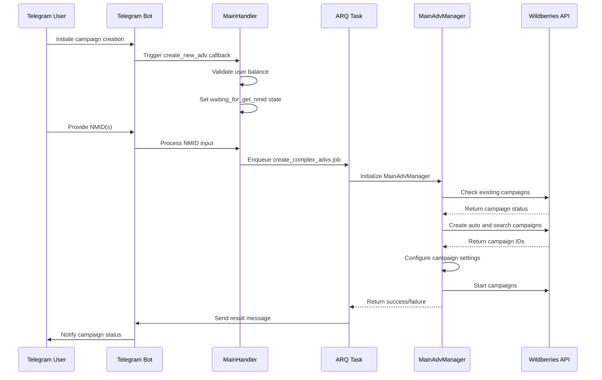
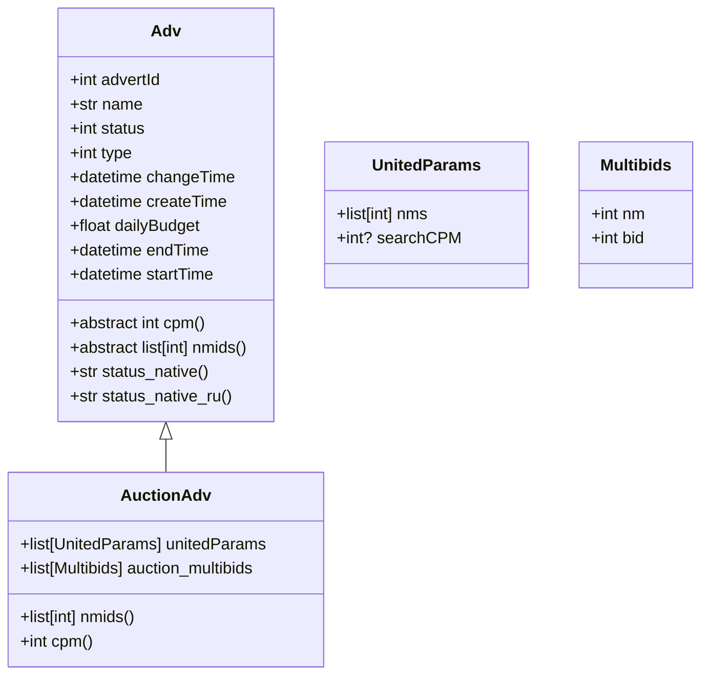
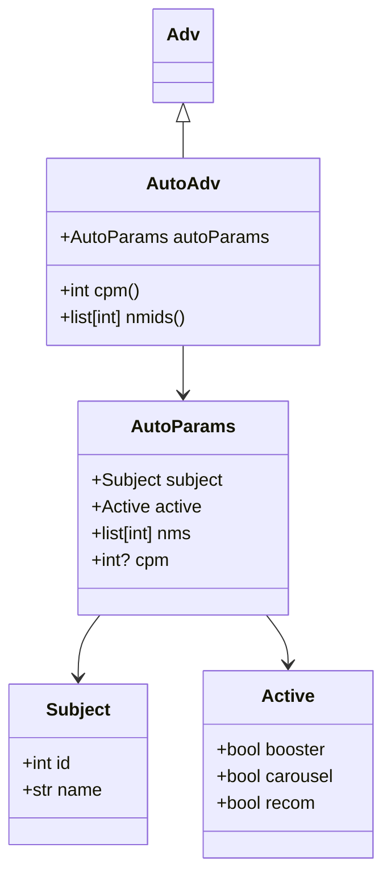
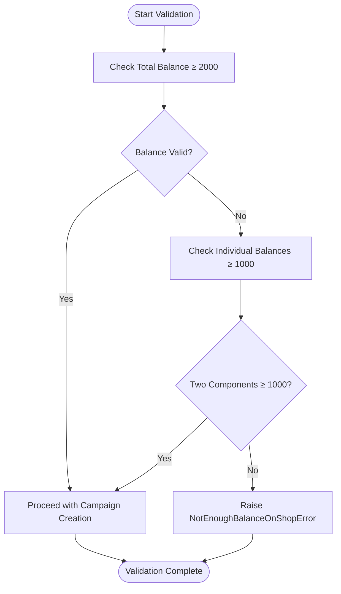
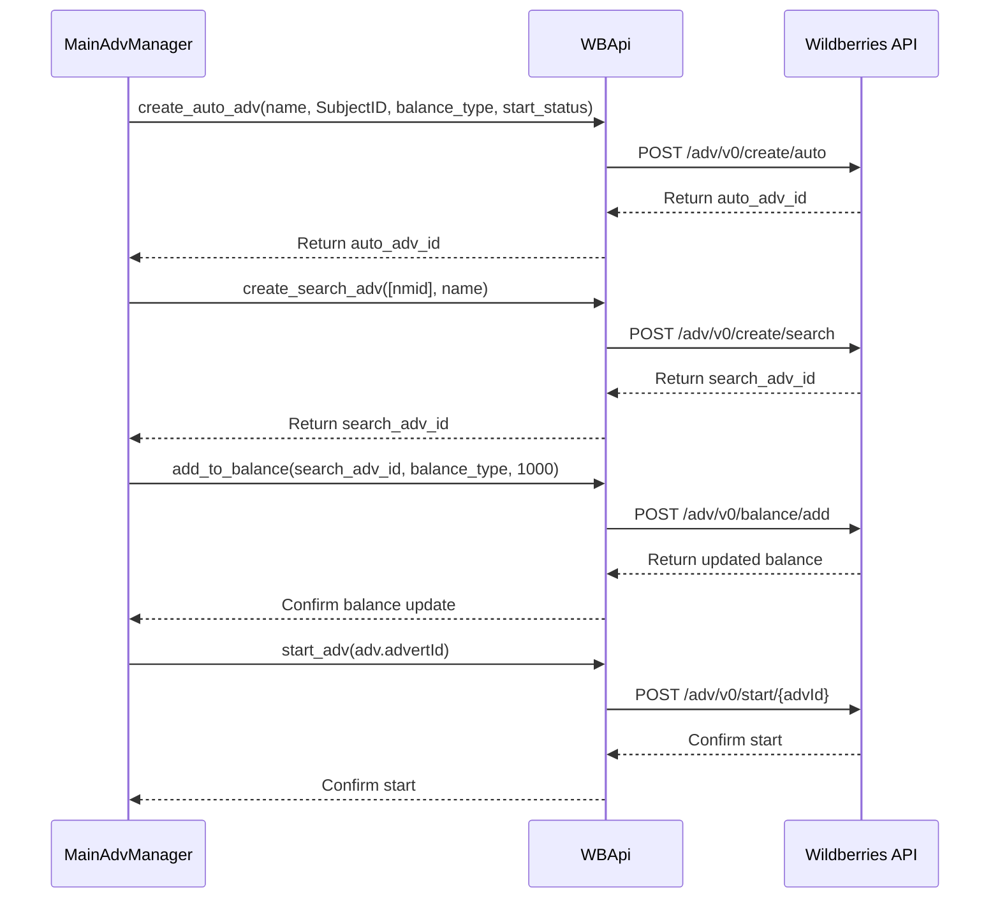
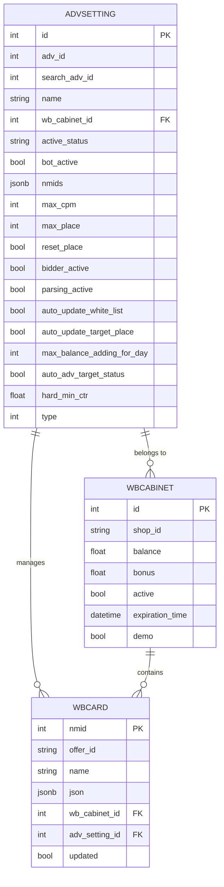
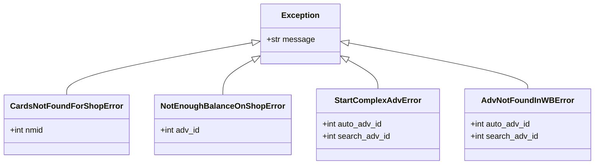

# Campaign Creation

<cite>
**Referenced Files in This Document**   
- [main_manager.py](file://app/modules/adv_creator/backend/main_manager.py)
- [wb_api.py](file://app/modules/adv_creator/backend/wb_api.py)
- [main_handler.py](file://app/modules/adv_creator/telegram/handlers/main_handler.py)
- [tasks.py](file://app/modules/adv_creator/backend/tasks.py)
- [models.py](file://app/modules/common_slaves/wildberries/models/models.py)
- [auction_adv.py](file://app/core/wb_api/data_classes/advs/auction_adv.py)
- [auto_adv.py](file://app/core/wb_api/data_classes/advs/auto_adv.py)
- [base_adv.py](file://app/core/wb_api/data_classes/advs/base_adv.py)
- [messages.py](file://app/modules/adv_creator/telegram/handlers/messages.py)
- [states.py](file://app/modules/adv_creator/telegram/handlers/states.py)
</cite>

## Table of Contents
1. [Introduction](#introduction)
2. [Campaign Creation Workflow](#campaign-creation-workflow)
3. [Campaign Types](#campaign-types)
4. [Configuration Requirements](#configuration-requirements)
5. [Validation Rules and Default Values](#validation-rules-and-default-values)
6. [Wildberries API Integration](#wildberries-api-integration)
7. [Campaign Metadata Storage](#campaign-metadata-storage)
8. [Error Handling](#error-handling)
9. [Troubleshooting Guide](#troubleshooting-guide)

## Introduction
This document details the campaign creation process in the adv-bot system. It explains how users initiate campaign creation through the Telegram interface, the orchestration of the creation workflow by main_manager.py, and the interaction with the Wildberries API for campaign provisioning. The document covers supported campaign types, configuration requirements, validation rules, metadata storage, and error handling procedures.

**Section sources**
- [main_manager.py](file://app/modules/adv_creator/backend/main_manager.py#L1-L306)
- [main_handler.py](file://app/modules/adv_creator/telegram/handlers/main_handler.py#L1-L109)

## Campaign Creation Workflow

The campaign creation process begins when a user interacts with the Telegram bot interface. The workflow is orchestrated by the MainAdvManager class in main_manager.py, which coordinates between the Telegram interface, database operations, and Wildberries API calls.



**Diagram sources**
- [main_handler.py](file://app/modules/adv_creator/telegram/handlers/main_handler.py#L1-L109)
- [tasks.py](file://app/modules/adv_creator/backend/tasks.py#L1-L107)
- [main_manager.py](file://app/modules/adv_creator/backend/main_manager.py#L1-L306)

**Section sources**
- [main_handler.py](file://app/modules/adv_creator/telegram/handlers/main_handler.py#L1-L109)
- [tasks.py](file://app/modules/adv_creator/backend/tasks.py#L1-L107)
- [main_manager.py](file://app/modules/adv_creator/backend/main_manager.py#L1-L306)

## Campaign Types

The system supports two primary campaign types: auction (search) campaigns and auto campaigns. These are implemented as separate classes inheriting from the base Adv class.

### Auction Campaigns
Auction campaigns (AuctionAdv) are manual bidding campaigns where advertisers set specific bids for keywords. These campaigns provide granular control over bidding strategies and keyword targeting.



**Diagram sources**
- [auction_adv.py](file://app/core/wb_api/data_classes/advs/auction_adv.py#L1-L35)
- [base_adv.py](file://app/core/wb_api/data_classes/advs/base_adv.py#L1-L55)

### Auto Campaigns
Auto campaigns (AutoAdv) use automated bidding strategies where Wildberries optimizes ad placement based on campaign goals. These campaigns require less manual intervention and are suitable for advertisers seeking automated optimization.



**Diagram sources**
- [auto_adv.py](file://app/core/wb_api/data_classes/advs/auto_adv.py#L1-L47)
- [base_adv.py](file://app/core/wb_api/data_classes/advs/base_adv.py#L1-L55)

**Section sources**
- [auto_adv.py](file://app/core/wb_api/data_classes/advs/auto_adv.py#L1-L47)
- [auction_adv.py](file://app/core/wb_api/data_classes/advs/auction_adv.py#L1-L35)

## Configuration Requirements

When creating campaigns, specific configuration parameters are required for each campaign type. The system validates these parameters before provisioning campaigns through the Wildberries API.

### Required Fields
- **NMID**: The Wildberries product identifier (required for both campaign types)
- **Campaign Name**: Descriptive name for the campaign
- **Subject ID**: Category identifier for auto campaigns
- **Balance Type**: Specifies which balance type to use (balance, net, or bonus)

### Default Values
The system applies default values for various campaign parameters when not explicitly specified:

| Field | Default Value | Description |
|-------|---------------|-------------|
| max_cpm | 250 | Maximum cost per thousand impressions |
| max_place | 1 | Target placement position |
| reset_place | true | Whether to reset placement settings |
| bot_active | true | Whether the bot manages this campaign |
| type | 8 | Campaign type identifier (8 for auto, 9 for auction) |
| hard_min_ctr | 0.1 | Minimum click-through rate threshold |
| bidder_active | false | Whether automated bidding is active |
| parsing_active | false | Whether keyword parsing is active |

**Section sources**
- [main_manager.py](file://app/modules/adv_creator/backend/main_manager.py#L1-L306)
- [models.py](file://app/modules/common_slaves/wildberries/models/models.py#L1-L660)

## Validation Rules and Default Values

The campaign creation process includes comprehensive validation rules to ensure data integrity and proper campaign configuration.

### Balance Validation
Before creating campaigns, the system validates that sufficient funds are available in the user's account:



**Diagram sources**
- [main_manager.py](file://app/modules/adv_creator/backend/main_manager.py#L1-L306)

### NMID Validation
The system validates that the provided NMID corresponds to an existing product on Wildberries:

```python
try:
    target_card = await self.wb_api.get_card_by_text(nmid)
except CardNotFoundInWB:
    raise CardsNotFoundForShopError(f"Card with NMID {nmid} not found on Wildberries")
```

The validation process also checks for existing campaigns associated with the NMID to prevent duplication:

```python
exist_adv: AdvSetting = await self.get_adv_setting_by_nmid(nmid)
if not exist_adv or hard_mode is True or exist_adv.active_status in ["refused", "done"]:
    # Create new campaign
else:
    # Use existing campaign
```

**Section sources**
- [main_manager.py](file://app/modules/adv_creator/backend/main_manager.py#L1-L306)

## Wildberries API Integration

The system interacts with the Wildberries API through the WBApi class, which handles all API communications for campaign creation and management.

### API Workflow
The campaign creation process involves multiple API calls to create and configure campaigns:



**Diagram sources**
- [wb_api.py](file://app/modules/adv_creator/backend/wb_api.py#L1-L12)
- [main_manager.py](file://app/modules/adv_creator/backend/main_manager.py#L1-L306)

### API Error Handling
The system implements robust error handling for API interactions:

```python
try:
    advs = await self.wb_api.get_advs([auto_adv_id])
except AdvNotFoundInWBError:
    logger.info(f"Campaign {auto_adv_id} not found after creation")
    await asyncio.sleep(start_delay)
    start_delay *= 2
```

The WBApi class inherits from multiple mixins to provide comprehensive API functionality:

```python
class WBApi(
    BaseAPI,
    AdvMixin,
    ContentMixin,
):
    pass
```

**Section sources**
- [wb_api.py](file://app/modules/adv_creator/backend/wb_api.py#L1-L12)
- [main_manager.py](file://app/modules/adv_creator/backend/main_manager.py#L1-L306)

## Campaign Metadata Storage

Campaign metadata is stored in the database using the AdvSetting model, which maintains relationships with WBCabinet and WBCard entities.

### Data Model
The AdvSetting model stores comprehensive campaign configuration data:



**Diagram sources**
- [models.py](file://app/modules/common_slaves/wildberries/models/models.py#L1-L660)

### Field Descriptions
| Field | Type | Description |
|-------|------|-------------|
| adv_id | int | Auto campaign identifier |
| search_adv_id | int | Auction campaign identifier |
| wb_cabinet_id | int | Foreign key to WBCabinet |
| nmids | jsonb | Array of product NMIDs associated with campaign |
| active_status | string | Current campaign status (created_by_bot, started, refused, done) |
| max_cpm | int | Maximum cost per thousand impressions |
| max_place | int | Target placement position |
| reset_place | bool | Whether to reset placement settings |
| auto_update_white_list | bool | Whether to automatically update white list |
| auto_update_target_place | bool | Whether to automatically update target place |
| max_balance_adding_for_day | int | Maximum daily balance addition |
| hard_min_ctr | float | Minimum click-through rate threshold |
| type | int | Campaign type (8 for auto, 9 for auction) |

**Section sources**
- [models.py](file://app/modules/common_slaves/wildberries/models/models.py#L1-L660)

## Error Handling

The system implements comprehensive error handling for various failure scenarios during campaign creation.

### Error Types
The campaign creation process can encounter several specific error types:



**Diagram sources**
- [main_manager.py](file://app/modules/adv_creator/backend/main_manager.py#L1-L306)
- [exc.py](file://app/modules/adv_creator/backend/exc.py)

### Error Recovery
The system implements retry logic and user notifications for error conditions:

```python
async def _create_complex_advs(
    ctx: dict[str, Any], nmid: int, shop_id: str, hard_mode: bool, user_telegram_id: int
) -> None:
    try:
        # Campaign creation logic
    except CardsNotFoundForShopError:
        await bot.send_message(
            user_telegram_id,
            f"Card with NMID {nmid} not found on Wildberries"
        )
    except NotEnoughBalanceOnShopError as exc:
        await bot.send_message(
            user_telegram_id,
            f"Insufficient funds on shop id: {shop_id}"
        )
    except AdvNotFoundInWBError as exc:
        await bot.send_message(
            user_telegram_id,
            f"Auto campaign {exc.auto_adv_id} not found after creation"
        )
    except StartComplexAdvError as exc:
        await bot.send_message(
            user_telegram_id,
            f"Error starting campaigns (Auto: {exc.auto_adv_id}, Auction: {exc.search_adv_id})"
        )
```

**Section sources**
- [tasks.py](file://app/modules/adv_creator/backend/tasks.py#L1-L107)
- [main_manager.py](file://app/modules/adv_creator/backend/main_manager.py#L1-L306)

## Troubleshooting Guide

This section provides guidance for resolving common issues encountered during campaign creation.

### API Limit Issues
When encountering API rate limits or authentication issues:

1. **Verify API token validity**: Ensure the Wildberries API token has the necessary permissions (specifically "Продвижение" - Promotion)
2. **Check token expiration**: Tokens may expire and need renewal
3. **Verify rate limits**: Monitor API usage to avoid exceeding rate limits
4. **Check network connectivity**: Ensure stable connection to Wildberries API endpoints

### Authentication Issues
For authentication-related problems:

1. **Validate token format**: Ensure the token is properly formatted JWT
2. **Check permissions**: Verify the token has bit 6 set for promotion rights
3. **Confirm shop association**: Ensure the token is associated with the correct shop ID
4. **Test token independently**: Use external tools to validate token functionality

### Campaign Creation Failures
Common campaign creation issues and solutions:

| Issue | Possible Cause | Solution |
|------|---------------|----------|
| "Card not found" | Invalid NMID or product not on Wildberries | Verify NMID and product existence |
| "Insufficient funds" | Low balance in all account types | Deposit funds into the account |
| "Campaign not found after creation" | API synchronization delay | Wait and retry, or check manually in Wildberries cabinet |
| "Failed to start campaign" | Campaign configuration issues | Verify campaign settings and retry |
| "Duplicate campaign" | Existing campaign for NMID | Use existing campaign or force recreate with hard_mode |

**Section sources**
- [main_manager.py](file://app/modules/adv_creator/backend/main_manager.py#L1-L306)
- [tasks.py](file://app/modules/adv_creator/backend/tasks.py#L1-L107)
- [messages.py](file://app/modules/adv_creator/telegram/handlers/messages.py#L1-L38)