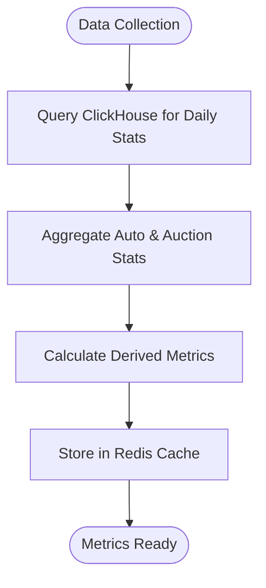
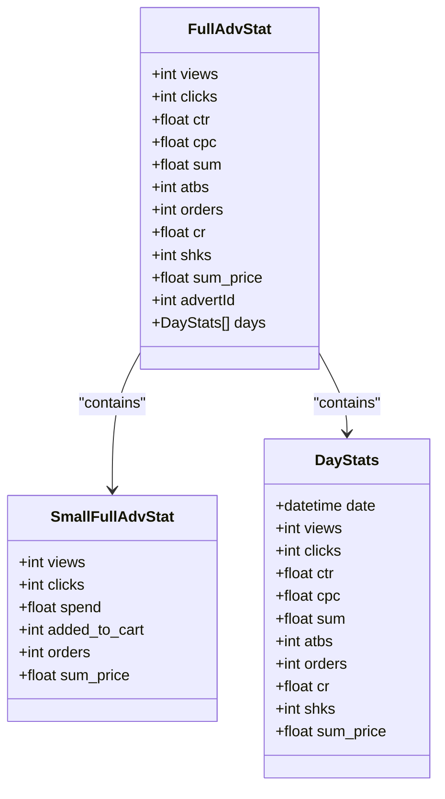
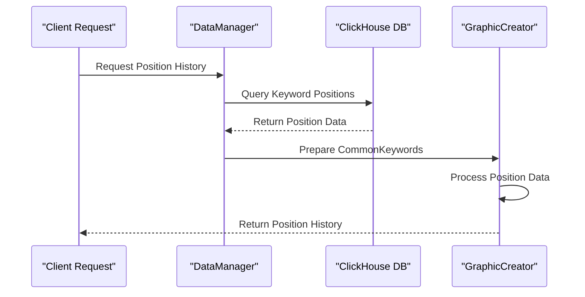
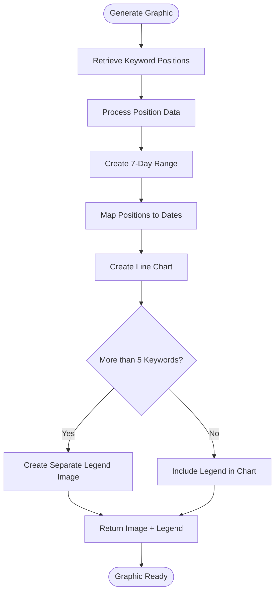
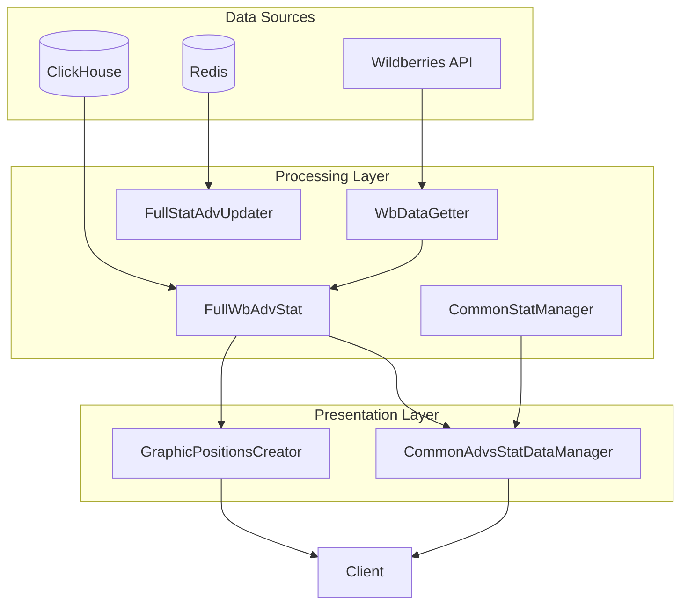
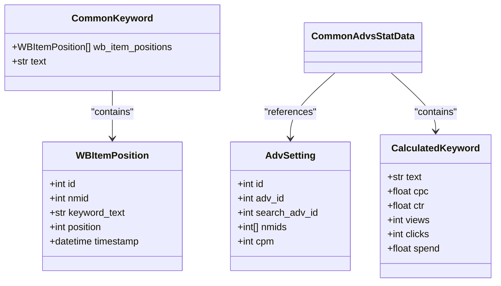
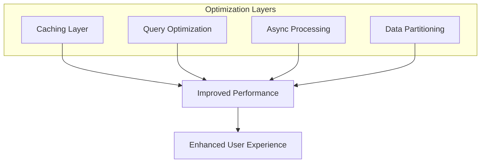

# Analytics and Reporting

<cite>
**Referenced Files in This Document**   
- [main.py](file://app/modules/full_stat_adv_updater/main.py)
- [full_adv_stat.py](file://app/modules/full_stat_adv_updater/types/full_adv_stat.py)
- [wb_data_getter.py](file://app/modules/full_stat_adv_updater/wb_data_getter.py)
- [graphic_positions_creator.py](file://app/utils/graphic_positions_creator/graphic_positions_creator.py)
- [classes.py](file://app/utils/graphic_positions_creator/classes.py)
- [common_advs_stat.py](file://app/modules/common_advs_stat/data_manager.py)
- [full_wb_adv_stat.py](file://app/modules/shop_runner/wb_stat_manager/clickhouse_manager/full_wb_adv_stat.py)
- [common_stat_manager.py](file://app/modules/shop_runner/wb_statistic_manager/backend/common_stat_manager.py)
- [adv_stat_classes.py](file://app/core/wb_api/data_classes/adv_stat_classes.py)
</cite>

## Table of Contents
1. [Introduction](#introduction)
2. [Performance Metrics Calculation](#performance-metrics-calculation)
3. [Spending Reports Generation](#spending-reports-generation)
4. [Position History Tracking](#position-history-tracking)
5. [Graphical Representations](#graphical-representations)
6. [Data Aggregation Architecture](#data-aggregation-architecture)
7. [Domain Models and Interfaces](#domain-models-and-interfaces)
8. [Common Issues and Solutions](#common-issues-and-solutions)
9. [Performance Considerations](#performance-considerations)
10. [Conclusion](#conclusion)

## Introduction
The Analytics and Reporting feature in the adv-bot system provides comprehensive insights into advertising campaign performance, spending patterns, and position history. This documentation details the implementation of statistical processing, report generation, and data visualization components that enable users to monitor and optimize their advertising strategies. The system aggregates data from multiple sources including ClickHouse, Redis, and Wildberries API to deliver accurate and timely analytics.

## Performance Metrics Calculation
The system calculates key performance metrics through a multi-layered approach that combines data from various sources. The core metrics include clicks, views, CTR (Click-Through Rate), CPC (Cost Per Click), and conversion rates. These calculations are primarily handled in the `full_stat_adv_updater` module, which processes data from both auto and auction advertising campaigns.

The metrics calculation follows a structured workflow:
1. Data collection from ClickHouse database for historical statistics
2. Aggregation of daily statistics across multiple advertising campaigns
3. Computation of derived metrics such as mean order value and conversion rates
4. Storage of processed statistics in Redis for quick access

**Diagram sources**
- [full_wb_adv_stat.py](file://app/modules/shop_runner/wb_stat_manager/clickhouse_manager/full_wb_adv_stat.py#L150-L250)
- [common_advs_stat.py](file://app/modules/common_advs_stat/data_manager.py#L60-L90)

**Section sources**
- [full_wb_adv_stat.py](file://app/modules/shop_runner/wb_stat_manager/clickhouse_manager/full_wb_adv_stat.py#L150-L300)
- [common_advs_stat.py](file://app/modules/common_advs_stat/data_manager.py#L60-L140)

## Spending Reports Generation
Spending reports are generated by aggregating financial data from advertising campaigns across different time periods. The system calculates total expenditures, cost distribution between auto and auction campaigns, and additional spending on specific keywords.

The spending report generation process involves:
- Retrieving campaign statistics from ClickHouse using the `get_keywords_spend` function
- Calculating total spend by combining auto and auction campaign expenditures
- Computing additional spending on keywords beyond direct campaign costs
- Generating comprehensive spending summaries with breakdowns

**Diagram sources**
- [full_adv_stat.py](file://app/modules/full_stat_adv_updater/types/full_adv_stat.py#L70-L109)
- [full_wb_adv_stat.py](file://app/modules/shop_runner/wb_stat_manager/clickhouse_manager/full_wb_adv_stat.py#L150-L200)

**Section sources**
- [full_wb_adv_stat.py](file://app/modules/shop_runner/wb_stat_manager/clickhouse_manager/full_wb_adv_stat.py#L250-L350)
- [common_advs_stat.py](file://app/modules/common_advs_stat/data_manager.py#L70-L90)

## Position History Tracking
Position history tracking monitors the organic search ranking of products over time. This feature captures keyword positions from ClickHouse and organizes them for visualization and analysis. The system tracks positions for specific keywords associated with products and provides historical data for trend analysis.

The position tracking workflow:
1. Retrieve keyword positions from ClickHouse using `get_keyword_positions_from_click_house`
2. Group positions by keyword text
3. Create CommonKeyword objects containing position history
4. Prepare data for graphical representation

**Diagram sources**
- [graphic_positions_creator.py](file://app/utils/graphic_positions_creator/graphic_positions_creator.py#L20-L50)
- [classes.py](file://app/utils/graphic_positions_creator/classes.py#L1-L10)

**Section sources**
- [graphic_positions_creator.py](file://app/utils/graphic_positions_creator/graphic_positions_creator.py#L20-L80)
- [classes.py](file://app/utils/graphic_positions_creator/classes.py#L1-L10)

## Graphical Representations
The system generates graphical representations of advertising performance and position history using matplotlib. The primary visualization is the keyword position history graph, which shows the organic ranking trends over a 7-day period.

The graphic generation process:
1. Retrieve position data for the specified product
2. Group positions by keyword
3. Create time series data for the last 7 days
4. Generate line charts with randomization to show position fluctuations
5. Create separate legend images for complex charts

**Diagram sources**
- [graphic_positions_creator.py](file://app/utils/graphic_positions_creator/graphic_positions_creator.py#L80-L170)
- [classes.py](file://app/utils/graphic_positions_creator/classes.py#L1-L10)

**Section sources**
- [graphic_positions_creator.py](file://app/utils/graphic_positions_creator/graphic_positions_creator.py#L20-L170)

## Data Aggregation Architecture
The analytics system employs a sophisticated data aggregation architecture that combines data from multiple sources to provide comprehensive reporting. The architecture follows a layered approach with data collection, processing, and presentation components.

**Diagram sources**
- [main.py](file://app/modules/full_stat_adv_updater/main.py#L0-L88)
- [wb_data_getter.py](file://app/modules/full_stat_adv_updater/wb_data_getter.py#L0-L15)
- [full_wb_adv_stat.py](file://app/modules/shop_runner/wb_stat_manager/clickhouse_manager/full_wb_adv_stat.py#L0-L358)

**Section sources**
- [main.py](file://app/modules/full_stat_adv_updater/main.py#L0-L88)
- [wb_data_getter.py](file://app/modules/full_stat_adv_updater/wb_data_getter.py#L0-L15)
- [full_wb_adv_stat.py](file://app/modules/shop_runner/wb_stat_manager/clickhouse_manager/full_wb_adv_stat.py#L0-L358)

## Domain Models and Interfaces
The analytics system utilizes several domain models to represent advertising statistics and position data. These models provide a structured interface for data manipulation and ensure consistency across the application.

**Diagram sources**
- [classes.py](file://app/utils/graphic_positions_creator/classes.py#L1-L10)
- [models.py](file://app/modules/common_slaves/wildberries/models.py#L1-L50)
- [data_manager.py](file://app/modules/common_advs_stat/data_manager.py#L10-L60)

**Section sources**
- [classes.py](file://app/utils/graphic_positions_creator/classes.py#L1-L10)
- [data_manager.py](file://app/modules/common_advs_stat/data_manager.py#L10-L60)

## Common Issues and Solutions
The analytics system addresses several common issues related to data processing and reporting:

### Data Inconsistencies
When data from different sources doesn't align, the system implements versioning in ClickHouse to ensure data consistency. The `version` field in database tables allows the system to retrieve the most recent data version and avoid processing stale information.

### Slow Report Generation
For large datasets, the system optimizes performance by:
- Using Redis caching for frequently accessed statistics
- Implementing asynchronous processing with asyncio
- Executing database queries with proper indexing
- Processing data in batches rather than individual records

### Missing Data
When data is missing from Wildberries API, the system gracefully handles the situation by:
- Returning default values (zeroes) for missing metrics
- Logging errors for monitoring and debugging
- Continuing processing with available data rather than failing completely

```mermaid
flowchart TD
Start([Report Generation]) --> DataCheck{"Data Available?"}
DataCheck --> |Yes| ProcessData["Process Available Data"]
DataCheck --> |No| DefaultValues["Use Default Values"]
DefaultValues --> LogError["Log Missing Data"]
ProcessData --> LogError
LogError --> CacheResult["Cache Results in Redis"]
CacheResult --> End([Report Complete])
```

**Diagram sources**
- [full_wb_adv_stat.py](file://app/modules/shop_runner/wb_stat_manager/clickhouse_manager/full_wb_adv_stat.py#L150-L350)
- [common_stat_manager.py](file://app/modules/shop_runner/wb_statistic_manager/backend/common_stat_manager.py#L100-L170)

**Section sources**
- [full_wb_adv_stat.py](file://app/modules/shop_runner/wb_stat_manager/clickhouse_manager/full_wb_adv_stat.py#L150-L350)
- [common_stat_manager.py](file://app/modules/shop_runner/wb_statistic_manager/backend/common_stat_manager.py#L100-L170)

## Performance Considerations
The analytics system is designed with performance optimization in mind, particularly for handling large datasets and frequent reporting requests.

### Large Dataset Processing
For processing large volumes of advertising data, the system implements several optimization strategies:
- Using ClickHouse's efficient columnar storage and aggregation capabilities
- Implementing query optimization with proper indexing and partitioning
- Utilizing asynchronous I/O operations to prevent blocking
- Processing data in batches to manage memory usage

### Caching Strategy
The system employs a multi-layered caching approach:
- Redis cache for frequently accessed statistics
- In-memory caching for computed metrics
- Database query result caching

### Optimization Tips
To optimize analytics performance:
1. Ensure proper indexing on ClickHouse tables for date and campaign ID fields
2. Monitor and optimize query performance using ClickHouse's query profiling
3. Implement appropriate data retention policies to manage database size
4. Use connection pooling for database access
5. Schedule intensive processing tasks during off-peak hours

**Diagram sources**
- [full_wb_adv_stat.py](file://app/modules/shop_runner/wb_stat_manager/clickhouse_manager/full_wb_adv_stat.py#L0-L358)
- [main.py](file://app/modules/full_stat_adv_updater/main.py#L0-L88)

**Section sources**
- [full_wb_adv_stat.py](file://app/modules/shop_runner/wb_stat_manager/clickhouse_manager/full_wb_adv_stat.py#L0-L358)
- [main.py](file://app/modules/full_stat_adv_updater/main.py#L0-L88)

## Conclusion
The Analytics and Reporting feature in the adv-bot system provides a comprehensive solution for monitoring and optimizing advertising campaigns. By aggregating data from multiple sources and presenting it through detailed metrics, spending reports, and visualizations, the system enables users to make data-driven decisions. The architecture is designed for performance and scalability, with robust error handling and optimization strategies to ensure reliable operation even with large datasets. The modular design allows for easy extension and maintenance, making it a powerful tool for advertising performance analysis.