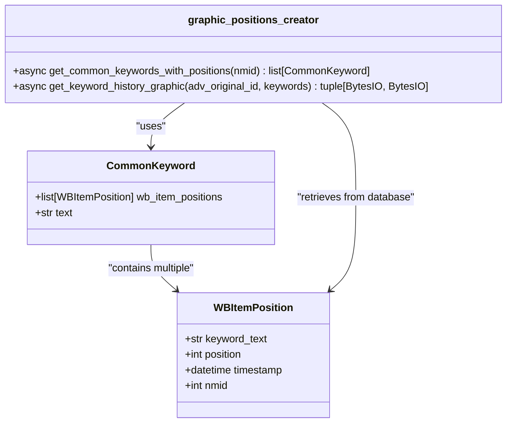
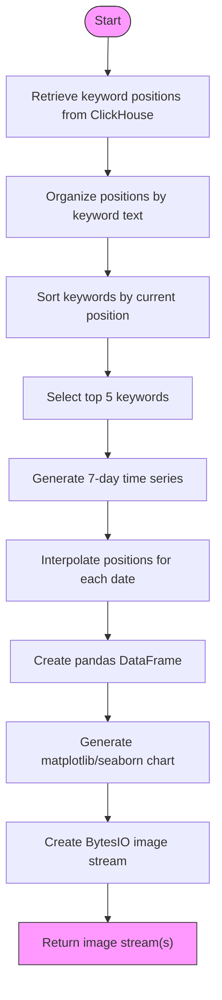
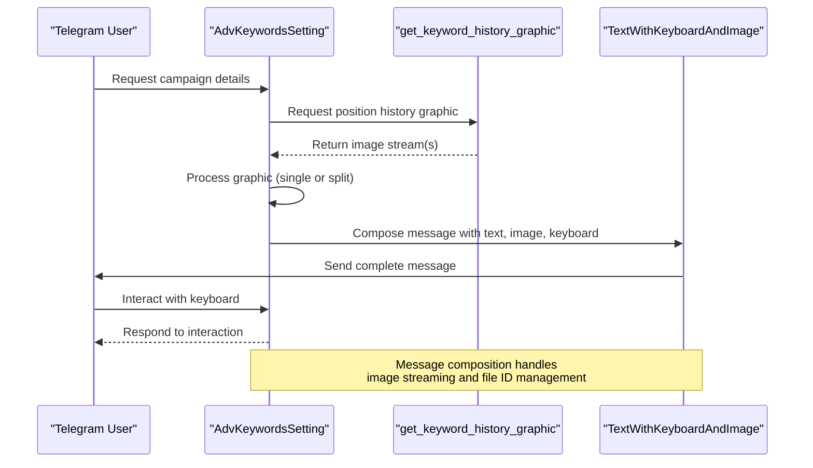
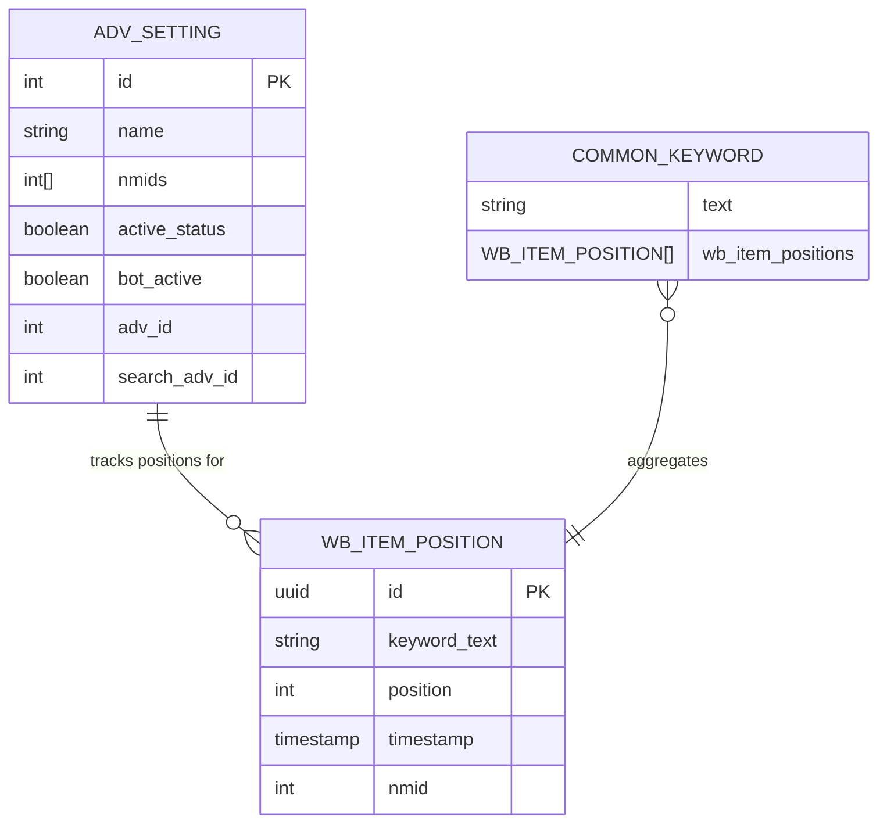
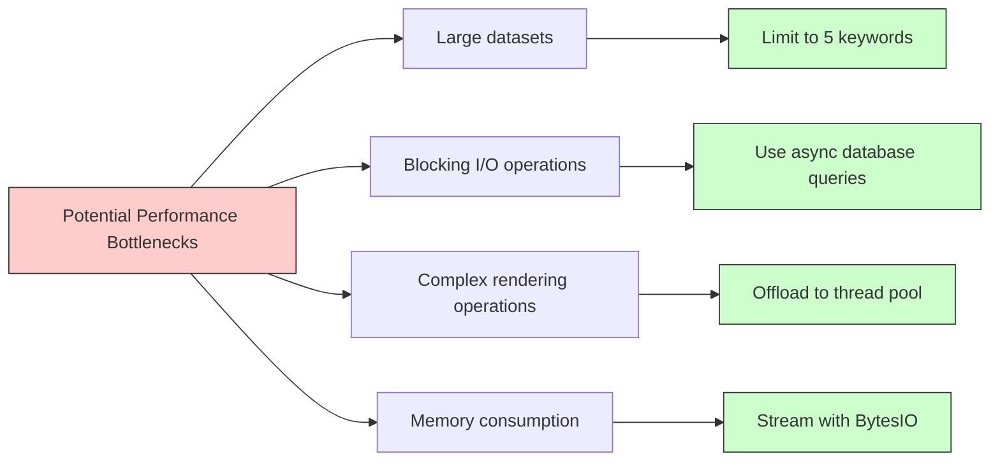

# Graphical Representations

<cite>
**Referenced Files in This Document**   
- [graphic_positions_creator.py](file://app/utils/graphic_positions_creator/graphic_positions_creator.py)
- [classes.py](file://app/utils/graphic_positions_creator/classes.py)
- [positions_graphic_messanges.py](file://app/client_bot/user_interface/views/messages/positions_graphic_messanges/positions_graphic_messanges.py)
- [adv_keyword_messages.py](file://app/client_bot/user_interface/views/messages/adv_keyword_messages/adv_keyword_messages.py)
- [base.py](file://app/client_bot/user_interface/message_templates/base.py)
- [templates.py](file://app/client_bot/user_interface/message_templates/templates.py)
</cite>

## Table of Contents
1. [Introduction](#introduction)
2. [Core Components](#core-components)
3. [Chart Generation Pipeline](#chart-generation-pipeline)
4. [Integration with Telegram Messaging](#integration-with-telegram-messaging)
5. [Data Model Integration](#data-model-integration)
6. [Performance Considerations](#performance-considerations)
7. [Troubleshooting Guide](#troubleshooting-guide)
8. [Optimization Recommendations](#optimization-recommendations)
9. [Conclusion](#conclusion)

## Introduction
The Graphical Representations sub-feature enables visual analysis of keyword performance data through dynamically generated charts. This system transforms statistical data into visual formats that illustrate keyword positions, CTR trends, and spending patterns over time. The implementation centers around the `graphic_positions_creator` module, which generates line charts for organic position tracking and integrates with Telegram messaging components to deliver these visuals to users. The system handles data retrieval, chart rendering, image streaming, and message composition in a cohesive pipeline designed for asynchronous execution in a bot environment.

**Section sources**
- [graphic_positions_creator.py](file://app/utils/graphic_positions_creator/graphic_positions_creator.py#L1-L170)

## Core Components

The graphical representation system consists of several interconnected components that handle data processing, visualization, and message delivery. The primary module `graphic_positions_creator.py` contains the core logic for generating position history graphics, while supporting classes and message templates facilitate integration with the Telegram interface.

The `CommonKeyword` dataclass in `classes.py` serves as the fundamental data structure that aggregates keyword position data from multiple time points, enabling temporal analysis and visualization. This class acts as a bridge between raw database records and the visualization layer, organizing `WBItemPosition` records by keyword text for coherent chart representation.

**Diagram sources**
- [classes.py](file://app/utils/graphic_positions_creator/classes.py#L1-L8)
- [graphic_positions_creator.py](file://app/utils/graphic_positions_creator/graphic_positions_creator.py#L1-L170)

**Section sources**
- [classes.py](file://app/utils/graphic_positions_creator/classes.py#L1-L8)
- [graphic_positions_creator.py](file://app/utils/graphic_positions_creator/graphic_positions_creator.py#L1-L170)

## Chart Generation Pipeline

The chart generation process follows a structured pipeline that transforms raw position data into visual representations. The `get_keyword_history_graphic` function orchestrates this workflow, beginning with data retrieval from ClickHouse via the `data_manager` module and concluding with image stream generation.

The pipeline first retrieves keyword position data for a specific product (nmid) and organizes it by keyword text. It then filters and sorts keywords based on relevance and current position, selecting up to five keywords for visualization. The system generates a time series for the past seven days, interpolating position values for dates without direct measurements by finding the closest available timestamp.

For visualization, the system uses matplotlib with seaborn for enhanced styling, creating line charts with circular markers that display keyword positions over time. The y-axis is inverted to reflect the intuitive "lower is better" positioning metric, and integer-only tick locators ensure position values remain whole numbers. When more than five keywords are present, the system generates separate image streams for the chart and legend to overcome Telegram's size limitations.

**Diagram sources**
- [graphic_positions_creator.py](file://app/utils/graphic_positions_creator/graphic_positions_creator.py#L50-L170)

**Section sources**
- [graphic_positions_creator.py](file://app/utils/graphic_positions_creator/graphic_positions_creator.py#L50-L170)

## Integration with Telegram Messaging

The graphical representations are delivered to users through a sophisticated messaging system that integrates charts with contextual information and interactive controls. The `adv_keyword_messages.py` module contains the `AdvKeywordsSetting` class, which orchestrates the composition of messages containing both text information and visual elements.

When generating a message, the system first retrieves comprehensive campaign statistics through the `CommonAdvsStatDataManager`, then injects the graphical component via the `_graphic_injection` method. This method calls `get_keyword_history_graphic` and handles the dual-stream response for charts with extensive legends. The message template system employs inheritance and composition patterns, with `TextWithKeyboardAndImage` providing the foundation for messages that combine text, interactive buttons, and visual content.

The `positions_graphic_messanges.py` module defines specialized message components like `KeywordGraphicPart_1` and `KeywordGraphicPart_2` that handle multi-part message delivery when charts exceed size thresholds. These components inherit from base templates in `templates.py` and implement properties for dynamic image and keyboard assignment.

**Diagram sources**
- [adv_keyword_messages.py](file://app/client_bot/user_interface/views/messages/adv_keyword_messages/adv_keyword_messages.py#L1-L262)
- [positions_graphic_messanges.py](file://app/client_bot/user_interface/views/messages/positions_graphic_messanges/positions_graphic_messanges.py#L1-L44)
- [templates.py](file://app/client_bot/user_interface/message_templates/templates.py#L1-L191)

**Section sources**
- [adv_keyword_messages.py](file://app/client_bot/user_interface/views/messages/adv_keyword_messages/adv_keyword_messages.py#L1-L262)
- [positions_graphic_messanges.py](file://app/client_bot/user_interface/views/messages/positions_graphic_messanges/positions_graphic_messanges.py#L1-L44)

## Data Model Integration

The graphical representation system integrates tightly with the application's data models, particularly the `WBItemPosition` and `AdvSetting` entities. The `get_common_keywords_with_positions` function serves as the primary integration point, retrieving position data from ClickHouse and organizing it according to the `CommonKeyword` data structure.

The system establishes relationships between advertising campaigns (via `adv_original_id`) and their associated products (nmids) through the `AdvSetting` model, which stores the nmid array. This allows the visualization system to target specific products within a campaign for position tracking. The temporal aspect of the data is preserved through the `timestamp` field in `WBItemPosition`, enabling accurate time-series analysis.

Dynamic label generation occurs through the combination of keyword text and current position, formatted as "keyword_text(current_position)" in the chart legend. This provides immediate context about each keyword's performance while maintaining visual clarity. The system also respects time-range selection through the hardcoded 7-day window, though this parameter could be made configurable for different analytical needs.

**Diagram sources**
- [graphic_positions_creator.py](file://app/utils/graphic_positions_creator/graphic_positions_creator.py#L1-L170)
- [classes.py](file://app/utils/graphic_positions_creator/classes.py#L1-L8)

**Section sources**
- [graphic_positions_creator.py](file://app/utils/graphic_positions_creator/graphic_positions_creator.py#L1-L170)
- [classes.py](file://app/utils/graphic_positions_creator/classes.py#L1-L8)

## Performance Considerations

The graphical representation system faces several performance challenges related to image rendering, data processing, and asynchronous execution. Large datasets can cause memory pressure during DataFrame creation and chart rendering, while the synchronous nature of matplotlib operations can block the event loop if not properly managed.

The system addresses these challenges through several strategies. First, it limits the number of keywords to five, preventing chart clutter and reducing computational load. Second, it uses `loop.run_in_executor` to offload matplotlib operations to a thread pool, preventing blocking of the main async loop. Third, it implements streaming with `BytesIO` objects rather than saving files to disk, reducing I/O overhead.

The interpolation algorithm for missing dates uses a simple nearest-neighbor approach rather than complex time-series forecasting, balancing accuracy with performance. The system also employs data filtering early in the pipeline, reducing the volume of data that must be processed through subsequent stages.

**Section sources**
- [graphic_positions_creator.py](file://app/utils/graphic_positions_creator/graphic_positions_creator.py#L1-L170)

## Troubleshooting Guide

Common issues in the graphical representation system typically involve image rendering failures, data retrieval problems, or message delivery errors. When image generation fails, the most common causes include missing data, timezone-aware datetime conflicts, or matplotlib backend issues.

The system includes several safeguards against these issues. It validates timezone awareness of timestamps, converting naive datetime objects to UTC-aware equivalents. It also checks for empty position data before processing, returning `None` to indicate failure rather than attempting to render empty charts. The fallback mechanism in `adv_keyword_messages.py` provides a default image when graphic generation fails.

For debugging, developers should first verify that position data exists in ClickHouse for the target nmid. They should then check the timezone handling in the data processing pipeline and ensure that the matplotlib Agg backend is properly configured. Memory issues can be addressed by reducing the number of keywords or shortening the time range.

Common error scenarios and solutions:
- **No data available**: Verify that position tracking is active and data is being written to ClickHouse
- **Image rendering failures**: Check matplotlib configuration and ensure Agg backend is available
- **Large file sizes**: Implement additional compression or reduce image dimensions
- **Async blocking**: Ensure all blocking operations are properly offloaded to executors
- **Legend truncation**: Use the split image/legend approach for charts with many keywords

**Section sources**
- [graphic_positions_creator.py](file://app/utils/graphic_positions_creator/graphic_positions_creator.py#L1-L170)
- [adv_keyword_messages.py](file://app/client_bot/user_interface/views/messages/adv_keyword_messages/adv_keyword_messages.py#L1-L262)

## Optimization Recommendations

To enhance the performance and usability of the graphical representation system, several optimization strategies can be implemented:

1. **Caching**: Implement Redis caching for generated graphics, storing image streams with keys based on nmid and time range to avoid redundant rendering.

2. **Configurable time ranges**: Replace the hardcoded 7-day window with a configurable parameter, allowing users to select different analysis periods.

3. **Image compression**: Apply additional compression to JPG output or consider WebP format for smaller file sizes without significant quality loss.

4. **Progressive loading**: For campaigns with many keywords, implement pagination or filtering to reduce the initial data load.

5. **Pre-rendering**: Generate common chart types during off-peak hours and store them for immediate delivery.

6. **Adaptive resolution**: Adjust image dimensions based on the number of keywords and date range to maintain clarity while minimizing file size.

7. **Client-side rendering**: Consider offloading chart generation to client devices using JavaScript libraries, reducing server load.

8. **Batch processing**: Group multiple graphic generation requests and process them together to improve resource utilization.

These optimizations would improve response times, reduce server load, and enhance the user experience, particularly for users with limited bandwidth or slower devices.

**Section sources**
- [graphic_positions_creator.py](file://app/utils/graphic_positions_creator/graphic_positions_creator.py#L1-L170)

## Conclusion

The Graphical Representations sub-feature provides a comprehensive system for visualizing keyword position data in the advertising platform. By integrating data retrieval, chart generation, and message delivery components, the system transforms raw position statistics into actionable insights for users. The implementation demonstrates thoughtful design patterns, including asynchronous processing, modular component architecture, and graceful error handling.

The core `graphic_positions_creator` module effectively balances visualization quality with performance constraints, producing clear line charts that illustrate organic position trends over time. The integration with Telegram messaging components ensures that these visuals are delivered in a user-friendly format with appropriate context and interactive controls.

Future enhancements could expand the visualization capabilities to include additional chart types for CTR trends and spending patterns, further enriching the analytical capabilities of the platform while maintaining the robust foundation established by the current implementation.