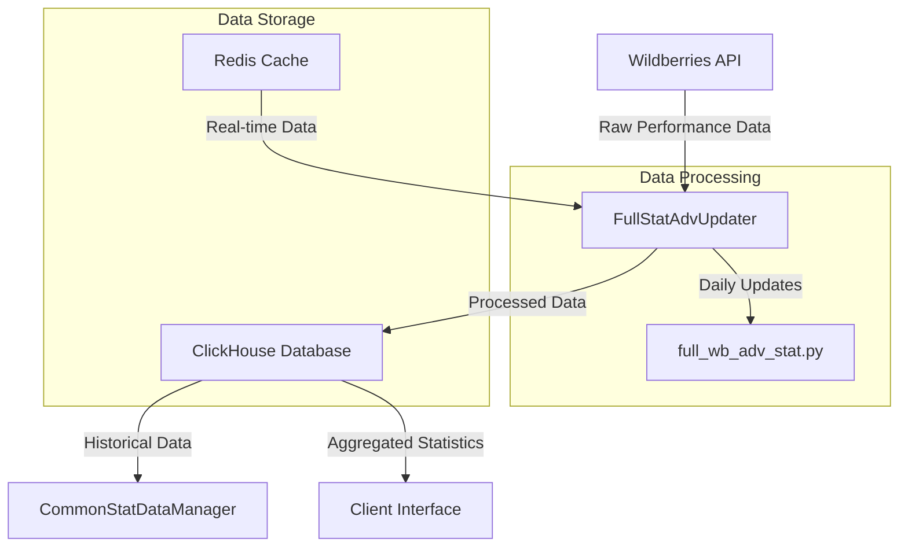
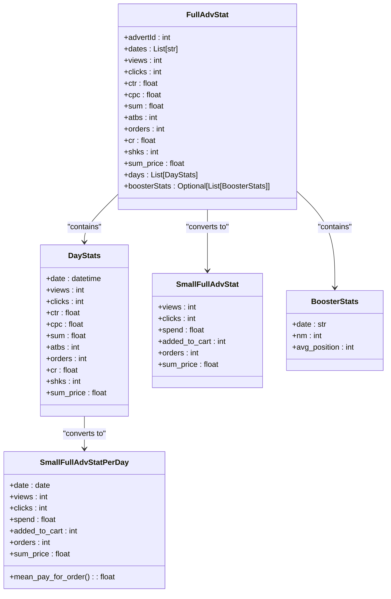
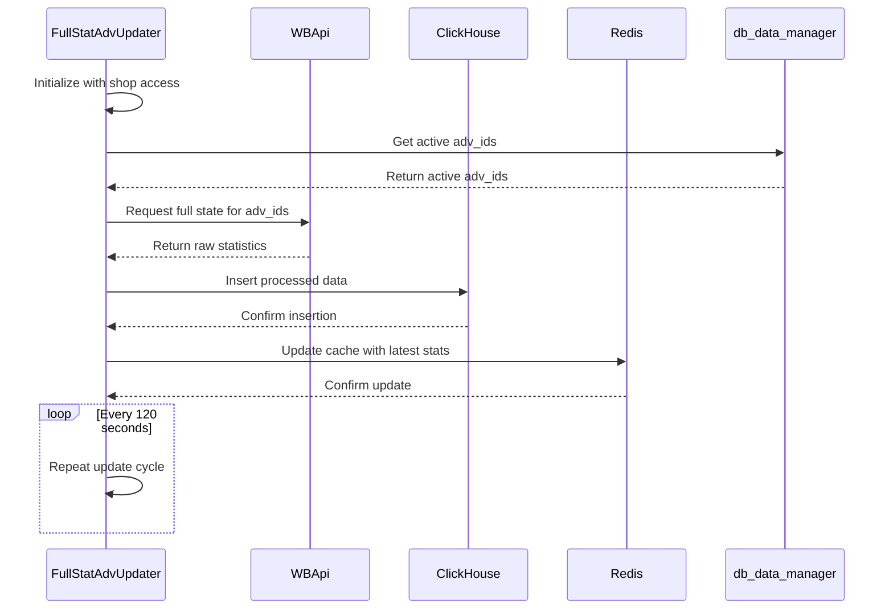
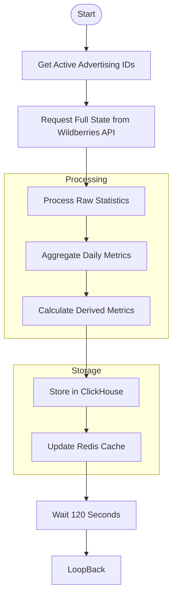

# Performance Metrics

<cite>
**Referenced Files in This Document**   
- [main.py](file://app/modules/full_stat_adv_updater/main.py)
- [full_adv_stat.py](file://app/modules/full_stat_adv_updater/types/full_adv_stat.py)
- [db_data_manager.py](file://app/modules/full_stat_adv_updater/db_data_manager.py)
- [common_stat_data_manager.py](file://app/client_bot/user_interface/views/messages/adv_keyword_messages/backend/common_stat_data_manager.py)
- [full_wb_adv_stat.py](file://app/modules/shop_runner/wb_stat_manager/clickhouse_manager/full_wb_adv_stat.py)
- [api.py](file://app/modules/common_slaves/wildberries/api.py)
- [wb_data_getter.py](file://app/modules/full_stat_adv_updater/wb_data_getter.py)
</cite>

## Table of Contents
1. [Introduction](#introduction)
2. [Data Flow Architecture](#data-flow-architecture)
3. [Core Data Structures](#core-data-structures)
4. [Statistical Aggregation Process](#statistical-aggregation-process)
5. [Domain Model for Campaign Performance](#domain-model-for-campaign-performance)
6. [Performance Considerations](#performance-considerations)
7. [Common Issues and Troubleshooting](#common-issues-and-troubleshooting)
8. [Conclusion](#conclusion)

## Introduction
The Performance Metrics sub-feature of the Analytics and Reporting system collects and processes key performance indicators (KPIs) from Wildberries API to provide comprehensive campaign analytics. This documentation details how metrics such as CTR (Click-Through Rate), CPC (Cost Per Click), impressions, clicks, and conversions are collected, aggregated, and stored through the FullStatAdvUpdater module. The system integrates data from ClickHouse and Redis into structured statistical models, enabling detailed performance analysis for advertising campaigns.

**Section sources**
- [main.py](file://app/modules/full_stat_adv_updater/main.py#L1-L88)

## Data Flow Architecture

**Diagram sources**
- [main.py](file://app/modules/full_stat_adv_updater/main.py#L1-L88)
- [full_wb_adv_stat.py](file://app/modules/shop_runner/wb_stat_manager/clickhouse_manager/full_wb_adv_stat.py#L1-L359)

**Section sources**
- [main.py](file://app/modules/full_stat_adv_updater/main.py#L1-L88)
- [full_wb_adv_stat.py](file://app/modules/shop_runner/wb_stat_manager/clickhouse_manager/full_wb_adv_stat.py#L1-L359)

## Core Data Structures

**Diagram sources**
- [full_adv_stat.py](file://app/modules/full_stat_adv_updater/types/full_adv_stat.py#L1-L110)

**Section sources**
- [full_adv_stat.py](file://app/modules/full_stat_adv_updater/types/full_adv_stat.py#L1-L110)

## Statistical Aggregation Process

**Diagram sources**
- [main.py](file://app/modules/full_stat_adv_updater/main.py#L1-L88)
- [wb_data_getter.py](file://app/modules/full_stat_adv_updater/wb_data_getter.py#L1-L16)

**Section sources**
- [main.py](file://app/modules/full_stat_adv_updater/main.py#L1-L88)
- [wb_data_getter.py](file://app/modules/full_stat_adv_updater/wb_data_getter.py#L1-L16)
- [db_data_manager.py](file://app/modules/full_stat_adv_updater/db_data_manager.py#L1-L21)

## Domain Model for Campaign Performance

The domain model for campaign performance is built around time-series aggregation of key metrics, distinguishing between daily and cumulative metrics. The system captures both auto and auction advertising campaigns, combining their statistics for comprehensive analysis.

### Time-Series Aggregation
The system implements time-series aggregation through the `get_daily_stats_by_last_days` function, which retrieves daily performance data from ClickHouse for a specified date range. This function uses window functions to ensure data consistency by selecting the most recent version of each record based on the version timestamp.

### Daily vs. Cumulative Metrics
Daily metrics are stored in the `SmallFullAdvStatPerDay` data class, capturing views, clicks, spend, added_to_cart, orders, and sum_price for each individual day. Cumulative metrics are represented by the `SmallFullAdvStat` class, which aggregates data across multiple days. The system also provides methods to calculate derived metrics such as mean pay per order.

### Data Integration
The CommonStatDataManager class integrates advertising performance data with product card statistics, providing a holistic view of campaign effectiveness. This integration enables comparison between advertising-driven metrics and organic performance metrics.

**Diagram sources**
- [full_wb_adv_stat.py](file://app/modules/shop_runner/wb_stat_manager/clickhouse_manager/full_wb_adv_stat.py#L1-L359)
- [common_stat_data_manager.py](file://app/client_bot/user_interface/views/messages/adv_keyword_messages/backend/common_stat_data_manager.py#L1-L115)

**Section sources**
- [full_wb_adv_stat.py](file://app/modules/shop_runner/wb_stat_manager/clickhouse_manager/full_wb_adv_stat.py#L1-L359)
- [common_stat_data_manager.py](file://app/client_bot/user_interface/views/messages/adv_keyword_messages/backend/common_stat_data_manager.py#L1-L115)

## Performance Considerations

### High-Frequency Data Updates
The FullStatAdvUpdater module handles high-frequency data updates through an asynchronous processing model. The main update loop runs every 120 seconds, ensuring near-real-time data availability while preventing excessive API calls that could lead to rate limiting.

### Caching Strategy
The system implements a multi-layer caching strategy:
- Redis cache for frequently accessed real-time data
- ClickHouse database for historical data storage and aggregation
- In-memory caching within the application for frequently used calculations

### Batch Processing
Batch processing is implemented at multiple levels:
- Multiple advertising IDs are processed in a single API request
- Database operations are batched to minimize round-trips
- Statistical calculations are performed on aggregated datasets rather than individual records

### Optimization Techniques
Key optimization techniques include:
- Using ClickHouse's window functions to efficiently retrieve the latest data version
- Implementing connection pooling for database access
- Using asynchronous I/O operations to maximize throughput
- Employing data compression techniques for storage efficiency

**Section sources**
- [main.py](file://app/modules/full_stat_adv_updater/main.py#L1-L88)
- [full_wb_adv_stat.py](file://app/modules/shop_runner/wb_stat_manager/clickhouse_manager/full_wb_adv_stat.py#L1-L359)

## Common Issues and Troubleshooting

### Data Latency
Data latency can occur due to:
- API rate limiting from Wildberries
- Network connectivity issues
- Database performance bottlenecks

**Troubleshooting Steps:**
1. Check the application logs for API error messages
2. Verify network connectivity to Wildberries API endpoints
3. Monitor ClickHouse performance metrics
4. Adjust the update interval in the FullStatAdvUpdater configuration

### Data Discrepancies
Discrepancies between platform data and system data may arise from:
- Different data aggregation methods
- Time zone differences in timestamp handling
- Data processing delays

**Troubleshooting Steps:**
1. Verify that the same date ranges are being compared
2. Check for timezone conversion issues in date handling
3. Validate that the latest data version is being used
4. Compare raw API responses with processed data

### Error Handling
The system implements comprehensive error handling:
- Try-catch blocks around external API calls
- Logging of all errors with stack traces
- Graceful degradation when data is unavailable
- Automatic retry mechanisms for transient failures

**Section sources**
- [main.py](file://app/modules/full_stat_adv_updater/main.py#L1-L88)
- [api.py](file://app/modules/common_slaves/wildberries/api.py#L1-L480)

## Conclusion
The Performance Metrics sub-feature provides a robust framework for collecting, aggregating, and analyzing advertising campaign data from Wildberries. By leveraging the FullStatAdvUpdater module, the system efficiently processes KPIs such as CTR, CPC, impressions, clicks, and conversions, storing them in structured formats that support both real-time monitoring and historical analysis. The integration of ClickHouse and Redis enables high-performance data processing while maintaining data consistency. The domain model supports both daily and cumulative metrics, providing comprehensive insights into campaign performance. With appropriate troubleshooting procedures in place, the system can maintain reliable operation even in the face of common issues like data latency or platform discrepancies.