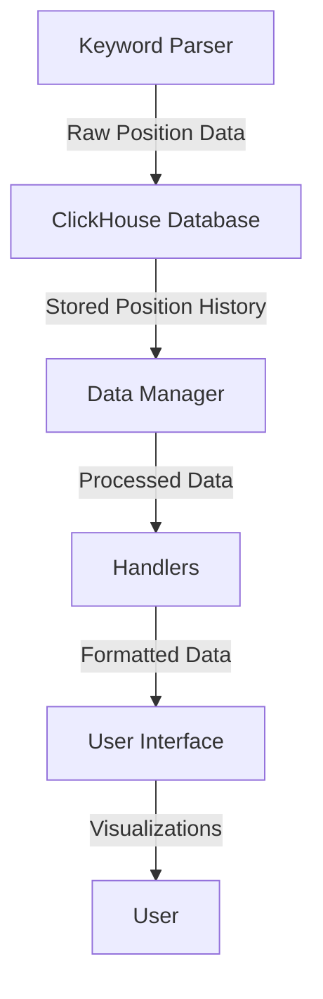
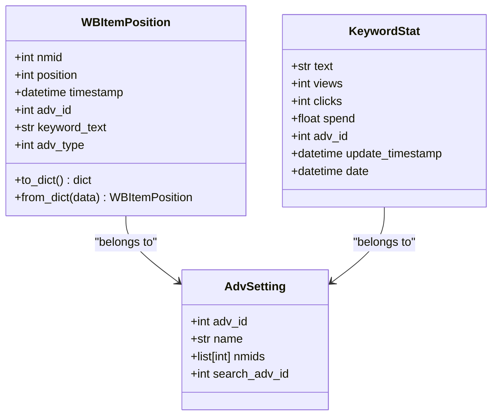
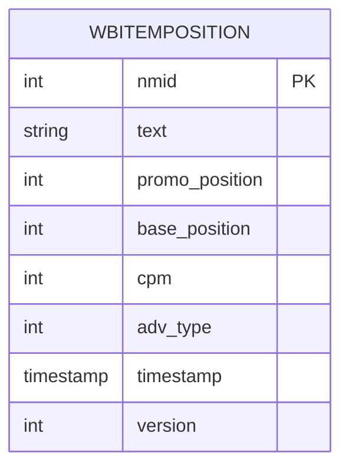
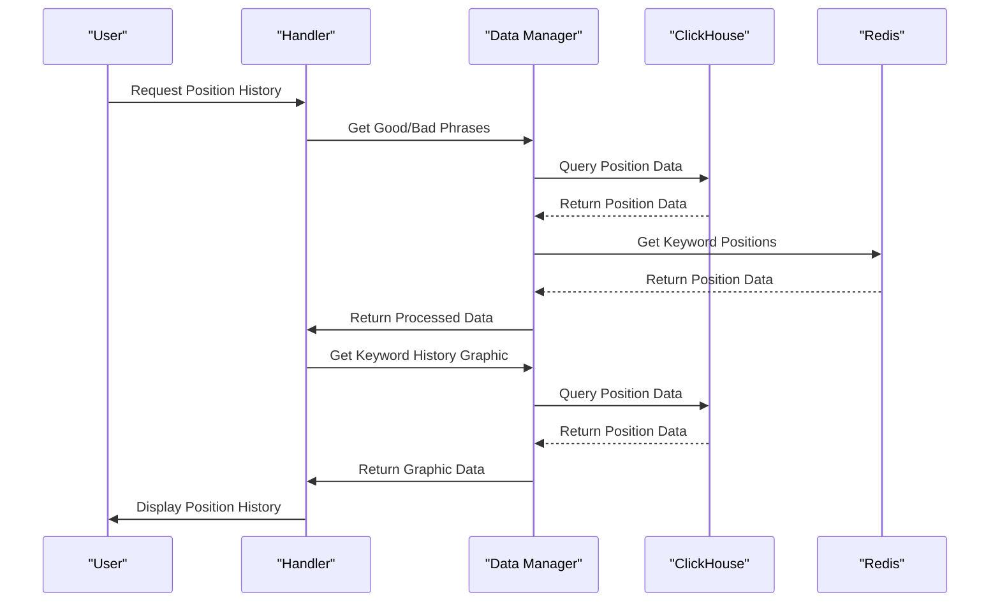
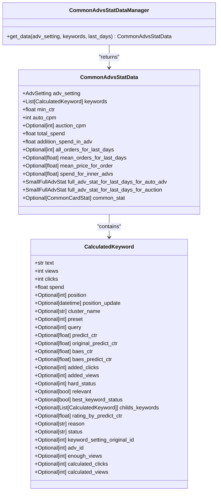

# Position History

<cite>
**Referenced Files in This Document**   
- [handlers.py](file://app/client_bot/user_interface/handlers/keywords_positions_history/handlers.py)
- [data_manager.py](file://app/modules/wb_adv_updater/data_manager.py)
- [keywordstat.py](file://app/modules/common_slaves/wildberries/data_classes/keywordstat.py)
- [models.py](file://app/modules/common_slaves/wildberries/models/models.py)
- [graphic_positions_creator.py](file://app/utils/graphic_positions_creator/graphic_positions_creator.py)
- [data_manager.py](file://app/modules/common_advs_stat/data_manager.py)
- [client.py](file://app/utils/click_house/client.py)
</cite>

## Table of Contents
1. [Introduction](#introduction)
2. [Position Tracking Architecture](#position-tracking-architecture)
3. [Data Models and Structures](#data-models-and-structures)
4. [Keyword Position Storage in ClickHouse](#keyword-position-storage-in-clickhouse)
5. [Position History Retrieval and Processing](#position-history-retrieval-and-processing)
6. [Integration with Common Reporting](#integration-with-common-reporting)
7. [Common Issues and Mitigation Strategies](#common-issues-and-mitigation-strategies)
8. [Performance Considerations](#performance-considerations)
9. [Conclusion](#conclusion)

## Introduction

The Position History sub-feature provides comprehensive tracking of keyword positions over time for Wildberries advertising campaigns. This system captures keyword performance data from Wildberries search results through a dedicated keyword parser, stores it in ClickHouse for efficient time-series analysis, and presents it to users through visual representations. The implementation enables users to monitor how their keywords' positions change over time, identify trends, and make data-driven decisions for their advertising strategies. The system integrates with various components including the keyword parser, ClickHouse database, and reporting modules to provide a unified view of keyword performance.

## Position Tracking Architecture

The position tracking system follows a multi-layered architecture that begins with data collection from Wildberries search results and ends with user-facing visualizations. The process starts with the keyword parser system that periodically queries Wildberries search results to detect keyword positions. These positions are then stored in ClickHouse, a column-oriented database optimized for time-series data and analytical queries. The data flows through several components: the parser captures raw position data, the data manager processes and enriches this data, ClickHouse stores it efficiently, and finally the handlers retrieve and format the data for user display. This architecture ensures that position data is captured accurately, stored efficiently, and presented in a meaningful way to users.

**Diagram sources**
- [data_manager.py](file://app/modules/wb_adv_updater/data_manager.py)
- [client.py](file://app/utils/click_house/client.py)

**Section sources**
- [data_manager.py](file://app/modules/wb_adv_updater/data_manager.py)
- [client.py](file://app/utils/click_house/client.py)

## Data Models and Structures

The position tracking system utilizes several key data models to represent keyword positions and related information. The primary model is `WBItemPosition`, which captures the essential attributes of a keyword's position including the nmid (product identifier), position value, timestamp, adv_id (advertisement identifier), keyword text, and adv_type. This model serves as the foundation for storing position data in ClickHouse. Additionally, the `KeywordStat` model represents keyword statistics with attributes such as text, views, clicks, spend, adv_id, update_timestamp, and date. These models are designed to support efficient querying and aggregation operations, with careful consideration given to data types and relationships to ensure optimal performance.

**Diagram sources**
- [models.py](file://app/modules/common_slaves/wildberries/models/models.py)
- [keywordstat.py](file://app/modules/common_slaves/wildberries/data_classes/keywordstat.py)

**Section sources**
- [models.py](file://app/modules/common_slaves/wildberries/models/models.py)
- [keywordstat.py](file://app/modules/common_slaves/wildberries/data_classes/keywordstat.py)

## Keyword Position Storage in ClickHouse

The system stores keyword position data in ClickHouse using a dedicated table named `wbitemposition` in the `default_db` database. The storage mechanism is designed for high-volume time-series data with efficient insertion and querying capabilities. When position data is captured by the parser, it is processed and inserted into ClickHouse through the `add_positions_to_clickhouse` function in the data manager. This function handles the insertion of multiple position records, generating appropriate versions and formatting timestamps. The ClickHouse table schema includes columns for nmid, text, promo_position, base_position, cpm, adv_type, timestamp, and version, enabling comprehensive tracking of keyword positions over time. The system uses batch processing to optimize insertion performance and ensure data consistency.

**Diagram sources**
- [data_manager.py](file://app/modules/wb_adv_updater/data_manager.py)

**Section sources**
- [data_manager.py](file://app/modules/wb_adv_updater/data_manager.py)

## Position History Retrieval and Processing

The retrieval and processing of position history data is handled by the `get_keyword_positions_from_click_house` function in the data manager module. This function executes a SQL query to retrieve position data for a specific nmid, grouping results by text and day while calculating average positions. The retrieved data is then processed into a list of `WBItemPosition` objects for further use. The system also includes functionality for retrieving position data from Redis cache, providing a faster access path for frequently requested data. The graphic positions creator module combines data from ClickHouse and Redis to generate visual representations of position history, sorting keywords by their most recent positions and creating time-series graphs that show position changes over a seven-day period.

**Diagram sources**
- [handlers.py](file://app/client_bot/user_interface/handlers/keywords_positions_history/handlers.py)
- [data_manager.py](file://app/modules/wb_adv_updater/data_manager.py)
- [graphic_positions_creator.py](file://app/utils/graphic_positions_creator/graphic_positions_creator.py)

**Section sources**
- [handlers.py](file://app/client_bot/user_interface/handlers/keywords_positions_history/handlers.py)
- [data_manager.py](file://app/modules/wb_adv_updater/data_manager.py)
- [graphic_positions_creator.py](file://app/utils/graphic_positions_creator/graphic_positions_creator.py)

## Integration with Common Reporting

The position history data is integrated with the common reporting system through the `CommonAdvsStatDataManager` class in the common_advs_stat module. This integration enables unified reporting that combines position history with other advertising metrics such as spend, orders, and CPM. The `get_data` method in the `CommonAdvsStatDataManager` class retrieves position data along with other relevant metrics to create a comprehensive view of advertising performance. This integration allows users to correlate position changes with business outcomes, providing deeper insights into the effectiveness of their advertising strategies. The system also supports the calculation of derived metrics such as mean orders per day and mean price per order, which are calculated based on position history and other advertising data.

**Diagram sources**
- [data_manager.py](file://app/modules/common_advs_stat/data_manager.py)

**Section sources**
- [data_manager.py](file://app/modules/common_advs_stat/data_manager.py)

## Common Issues and Mitigation Strategies

The position history system may encounter several common issues that can affect data completeness and accuracy. One primary issue is missing position data due to parsing failures, which can occur when the Wildberries search API is temporarily unavailable or returns unexpected results. Another issue is API rate limiting, which can prevent the parser from capturing position data at the desired frequency. To mitigate these issues, the system implements several strategies: it uses Redis as a cache to store recent position data, reducing the need for frequent API calls; it includes error handling and retry mechanisms in the data retrieval functions; and it provides fallback mechanisms that use historical data when current data is unavailable. Additionally, the system logs errors and exceptions to facilitate troubleshooting and monitoring of data collection processes.

**Section sources**
- [data_manager.py](file://app/modules/wb_adv_updater/data_manager.py)
- [client.py](file://app/utils/click_house/client.py)

## Performance Considerations

The position history system is designed with several performance optimizations to handle high-volume time-series data efficiently. ClickHouse is used as the primary storage backend due to its excellent performance characteristics for analytical queries and time-series data. The system implements data partitioning by time and nmid to optimize query performance and reduce storage overhead. Indexing strategies are employed to accelerate common query patterns, particularly those involving time ranges and nmid lookups. The system also uses connection pooling and asynchronous operations to maximize throughput and minimize latency. For data retrieval, the system leverages Redis caching to reduce the load on ClickHouse and provide faster response times for frequently accessed data. These performance considerations ensure that the system can scale to handle large volumes of position data while maintaining responsive user interactions.

**Section sources**
- [data_manager.py](file://app/modules/wb_adv_updater/data_manager.py)
- [client.py](file://app/utils/click_house/client.py)

## Conclusion

The Position History sub-feature provides a comprehensive solution for tracking and analyzing keyword positions in Wildberries advertising campaigns. By leveraging a robust architecture that combines efficient data collection, optimized storage in ClickHouse, and intuitive user interfaces, the system enables users to monitor their keyword performance over time and make data-driven decisions. The integration with common reporting modules provides a unified view of advertising performance, allowing users to correlate position changes with business outcomes. With its thoughtful design, performance optimizations, and mitigation strategies for common issues, the position history system delivers reliable and actionable insights for advertising optimization.