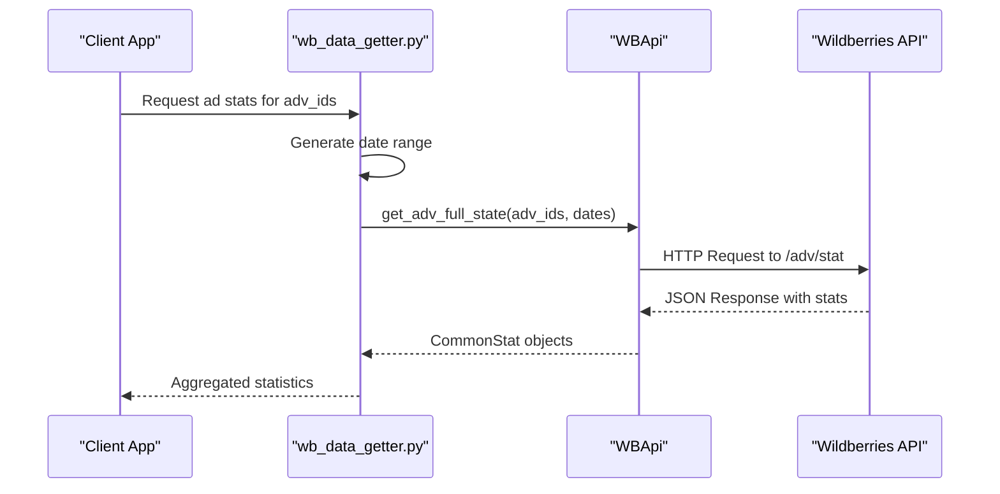
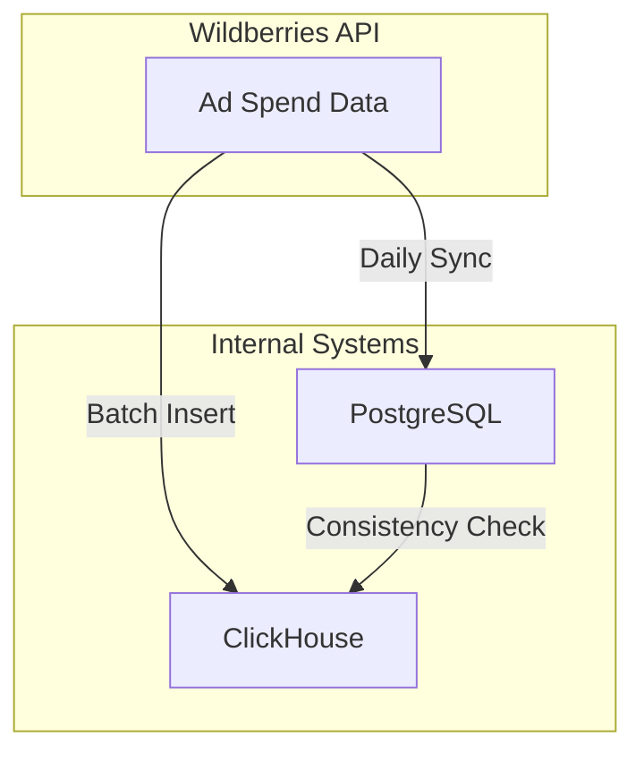
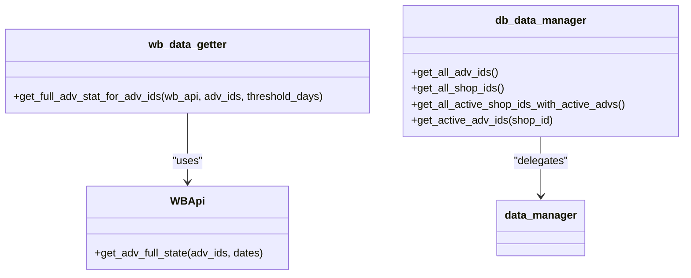
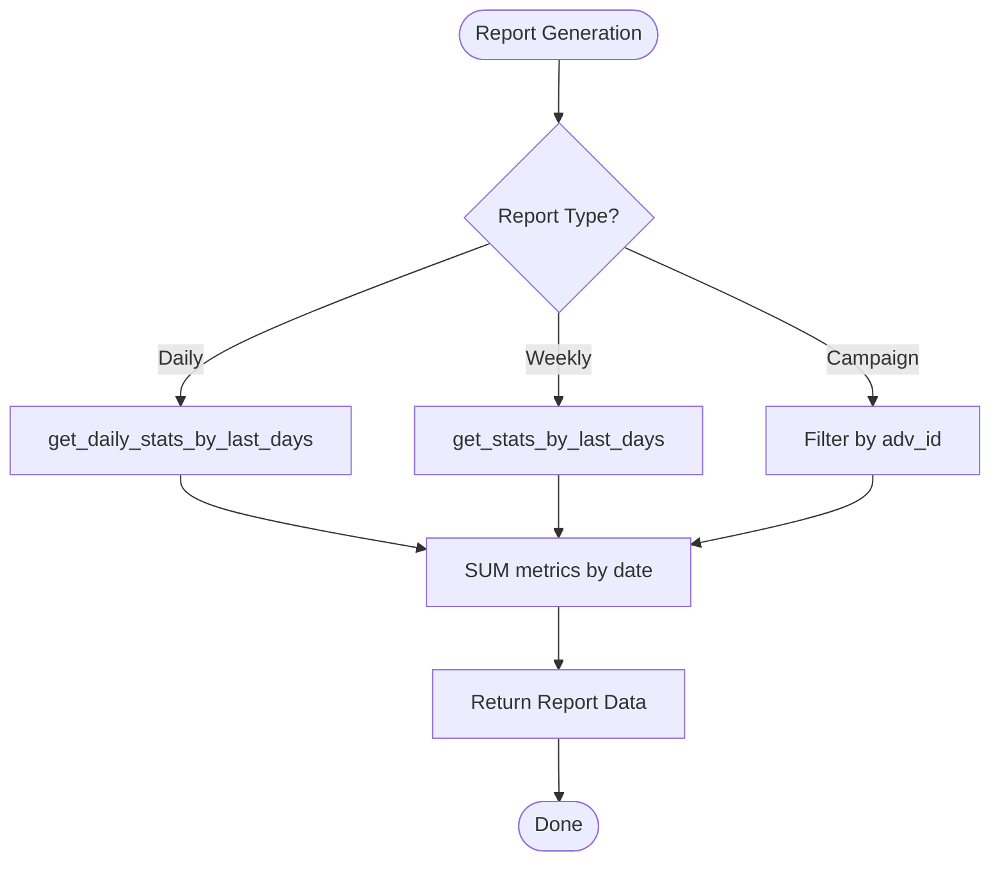
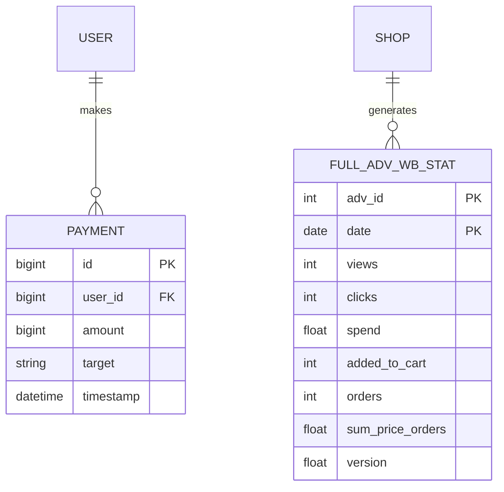

# Spending Reports

<cite>
**Referenced Files in This Document**   
- [wb_data_getter.py](file://app/modules/full_stat_adv_updater/wb_data_getter.py)
- [db_data_manager.py](file://app/modules/full_stat_adv_updater/db_data_manager.py)
- [common_stat_manager.py](file://app/modules/shop_runner/wb_statistic_manager/backend/common_stat_manager.py)
- [full_wb_adv_stat.py](file://app/modules/shop_runner/wb_stat_manager/clickhouse_manager/full_wb_adv_stat.py)
- [models.py](file://app/payments/db/models.py)
- [manager.py](file://app/payments/manager.py)
</cite>

## Table of Contents
1. [Introduction](#introduction)
2. [Data Retrieval from Wildberries Advertising API](#data-retrieval-from-wildberries-advertising-api)
3. [Synchronization with Internal Payment Records](#synchronization-with-internal-payment-records)
4. [Role of wb_data_getter.py and db_data_manager.py](#role-of-wb_data_getterpy-and-db_data_managerpy)
5. [Generation of Spending Reports](#generation-of-spending-reports)
6. [Integration with Budget Limits and Alerts](#integration-with-budget-limits-and-alerts)
7. [Data Model for Ad Spend Tracking](#data-model-for-ad-spend-tracking)
8. [Common Issues and Resolution Strategies](#common-issues-and-resolution-strategies)
9. [Performance Optimization for Financial Data Queries](#performance-optimization-for-financial-data-queries)
10. [Conclusion](#conclusion)

## Introduction
The Spending Reports sub-feature enables comprehensive tracking and analysis of advertising expenditures across Wildberries campaigns. It integrates data from the Wildberries advertising API with internal payment records to provide accurate, real-time insights into ad spend relative to user subscriptions and payment plans. This document details the architecture, data flow, and implementation strategies that support daily, weekly, and campaign-level reporting, while ensuring data consistency between PostgreSQL and ClickHouse databases.

## Data Retrieval from Wildberries Advertising API
Advertising expenditure data is retrieved through the Wildberries API using the `WBApi` client, which inherits from `BaseAPI` and incorporates the `CommonStatMinix` mixin for statistical operations. The retrieval process involves fetching full advertising statistics for specific advertisement IDs over a defined date range.

The `get_full_adv_stat_for_adv_ids` function in `wb_data_getter.py` orchestrates this process by:
- Accepting a list of advertisement IDs and a threshold for historical days
- Generating a date range from the current date backward
- Invoking the `get_adv_full_state` method of the `WBApi` instance to retrieve aggregated statistics

This ensures that all relevant metrics—such as views, clicks, orders, and spend—are collected in a structured format suitable for downstream processing.

**Diagram sources**
- [wb_data_getter.py](file://app/modules/full_stat_adv_updater/wb_data_getter.py#L5-L15)
- [common_stat_manager.py](file://app/modules/shop_runner/wb_statistic_manager/backend/common_stat_manager.py#L50-L80)

**Section sources**
- [wb_data_getter.py](file://app/modules/full_stat_adv_updater/wb_data_getter.py#L5-L15)
- [common_stat_manager.py](file://app/modules/shop_runner/wb_statistic_manager/backend/common_stat_manager.py#L50-L80)

## Synchronization with Internal Payment Records
The system synchronizes advertising spend data with internal payment records managed in the `payments` module. The `Payment` model in `models.py` defines the structure of payment entries, including fields such as `amount`, `target`, and `timestamp`. These records are linked to users via a foreign key relationship.

The synchronization process involves:
- Matching ad spend entries with corresponding payment records based on timestamps and shop identifiers
- Validating that the total ad expenditure does not exceed the user's subscription-based spending limit
- Updating internal financial ledgers in both PostgreSQL (for transactional integrity) and ClickHouse (for analytical querying)

This dual-database approach ensures ACID compliance for payments while enabling high-performance analytics on large datasets.

**Diagram sources**
- [models.py](file://app/payments/db/models.py#L5-L12)
- [full_wb_adv_stat.py](file://app/modules/shop_runner/wb_stat_manager/clickhouse_manager/full_wb_adv_stat.py#L150-L200)

**Section sources**
- [models.py](file://app/payments/db/models.py#L5-L12)
- [manager.py](file://app/payments/manager.py#L5-L10)

## Role of wb_data_getter.py and db_data_manager.py
The `wb_data_getter.py` module is responsible for retrieving raw advertising statistics from the Wildberries API. It uses the `WBApi` client to fetch full state data for a given set of advertisement IDs over a configurable number of past days.

The `db_data_manager.py` module acts as an intermediary layer between the application logic and the underlying data storage. It provides asynchronous functions to:
- Retrieve all active advertisement IDs
- Fetch shop-specific identifiers
- Query active shops with active advertisements

These functions abstract direct database access and ensure that only relevant, active campaigns are included in reporting calculations.

**Diagram sources**
- [wb_data_getter.py](file://app/modules/full_stat_adv_updater/wb_data_getter.py#L5-L15)
- [db_data_manager.py](file://app/modules/full_stat_adv_updater/db_data_manager.py#L5-L20)

**Section sources**
- [wb_data_getter.py](file://app/modules/full_stat_adv_updater/wb_data_getter.py#L5-L15)
- [db_data_manager.py](file://app/modules/full_stat_adv_updater/db_data_manager.py#L5-L20)

## Generation of Spending Reports
Spending reports are generated at multiple granularities: daily, weekly, and per campaign. The system leverages ClickHouse for efficient aggregation of large datasets.

### Daily Reports
Generated using `get_daily_stats_by_last_days`, which queries ClickHouse for summed metrics (views, clicks, spend, etc.) grouped by date. The query uses window functions to select the latest version of each record based on a `version` timestamp.

### Weekly Reports
Computed by aggregating daily results over a 7-day window. The `get_stats_by_last_days` function performs this summation and returns a consolidated `SmallFullAdvStat` object.

### Campaign-Level Reports
Built by filtering statistics for a specific `adv_id` and applying the same aggregation logic. Additional keyword-level spend data can be retrieved using `get_keyword_stats_by_last_days`, which groups spend by search term.

**Diagram sources**
- [full_wb_adv_stat.py](file://app/modules/shop_runner/wb_stat_manager/clickhouse_manager/full_wb_adv_stat.py#L50-L150)

**Section sources**
- [full_wb_adv_stat.py](file://app/modules/shop_runner/wb_stat_manager/clickhouse_manager/full_wb_adv_stat.py#L50-L150)

## Integration with Budget Limits and Alerts
The system integrates ad spend data with user subscription tiers and payment plans to enforce budget limits. When a user's cumulative ad spend approaches their allocated budget (based on subscription level), alerts are triggered.

Key components:
- **Subscription-Based Limits**: Stored in user profiles and validated during report generation
- **Real-Time Monitoring**: Background tasks periodically check spend levels against thresholds
- **Alerting Mechanism**: Uses internal messaging to notify users via Telegram when thresholds are exceeded

The `balance_service.py` in the `balance_manager` module handles these validations and triggers notifications through the `message_manager`.

**Section sources**
- [manager.py](file://app/payments/manager.py#L5-L10)
- [full_wb_adv_stat.py](file://app/modules/shop_runner/wb_stat_manager/clickhouse_manager/full_wb_adv_stat.py#L200-L250)

## Data Model for Ad Spend Tracking
The data model for tracking ad spend includes both transactional and analytical components:

### PostgreSQL (Transactional)
- `Payment` table stores individual payment records with `user_id`, `amount`, `target`, and `timestamp`
- Enforces referential integrity and supports ACID transactions

### ClickHouse (Analytical)
- `full_adv_wb_stat` table stores aggregated ad performance data including `adv_id`, `date`, `views`, `clicks`, `spend`, and `version`
- Optimized for fast read operations and time-series analysis

Data flows from Wildberries API → ClickHouse (via `insert`) → PostgreSQL (for reconciliation). The `version` field ensures that only the most recent data is used in reports.

**Diagram sources**
- [models.py](file://app/payments/db/models.py#L5-L12)
- [full_wb_adv_stat.py](file://app/modules/shop_runner/wb_stat_manager/clickhouse_manager/full_wb_adv_stat.py#L100-L120)

**Section sources**
- [models.py](file://app/payments/db/models.py#L5-L12)
- [full_wb_adv_stat.py](file://app/modules/shop_runner/wb_stat_manager/clickhouse_manager/full_wb_adv_stat.py#L100-L120)

## Common Issues and Resolution Strategies
### Currency Conversion Mismatches
**Issue**: Ad spend reported in RUB but payments processed in other currencies may cause discrepancies due to fluctuating exchange rates.

**Resolution**: Use timestamp-aligned exchange rate snapshots stored in a dedicated `currency_rates` table. All conversions use the rate valid at the time of the ad impression.

### Delayed Spend Reporting
**Issue**: Wildberries API may delay reporting of recent ad spend, leading to underreporting in daily summaries.

**Resolution**: Implement a sliding window reconciliation process that revisits the last 3 days of data every hour. The `version` field in ClickHouse ensures newer data overrides stale entries.

### Data Inconsistencies Between PostgreSQL and ClickHouse
**Issue**: Network failures or partial writes may result in divergent data states.

**Resolution**: Run periodic consistency checks using hash comparisons of daily aggregates. Re-sync discrepancies using the `insert` function with upsert logic.

**Section sources**
- [full_wb_adv_stat.py](file://app/modules/shop_runner/wb_stat_manager/clickhouse_manager/full_wb_adv_stat.py#L300-L350)
- [models.py](file://app/payments/db/models.py#L5-L12)

## Performance Optimization for Financial Data Queries
To ensure efficient querying of large financial datasets:
- **Indexing**: Use composite indexes on `(adv_id, date)` in ClickHouse for fast filtering
- **Partitioning**: Partition `full_adv_wb_stat` by month to reduce scan scope
- **Caching**: Cache frequently accessed reports (e.g., last 7 days) in Redis
- **Batch Processing**: Insert data in batches using `insert(stats: Iterable[FullAdvStat])` to minimize round trips
- **Query Optimization**: Use `WITH max_versions` CTE to filter out outdated records before aggregation

These optimizations enable sub-second response times even with millions of records.

**Section sources**
- [full_wb_adv_stat.py](file://app/modules/shop_runner/wb_stat_manager/clickhouse_manager/full_wb_adv_stat.py#L150-L200)

## Conclusion
The Spending Reports sub-feature provides a robust framework for tracking and analyzing advertising expenditures on Wildberries. By integrating API data with internal payment records and leveraging both PostgreSQL and ClickHouse, the system delivers accurate, timely insights while maintaining data integrity. The modular design of `wb_data_getter.py` and `db_data_manager.py` enables flexible report generation, and proactive alerting helps users stay within budget. With proper performance tuning and error handling, this system supports scalable, enterprise-grade financial reporting.