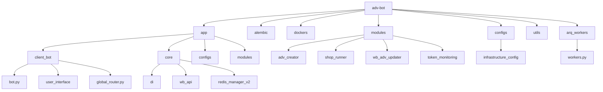
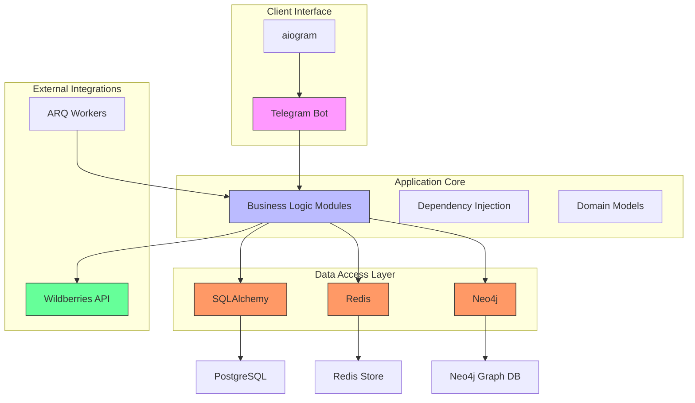
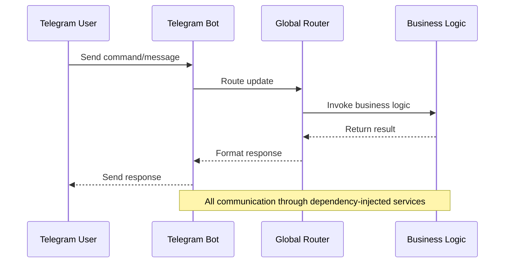
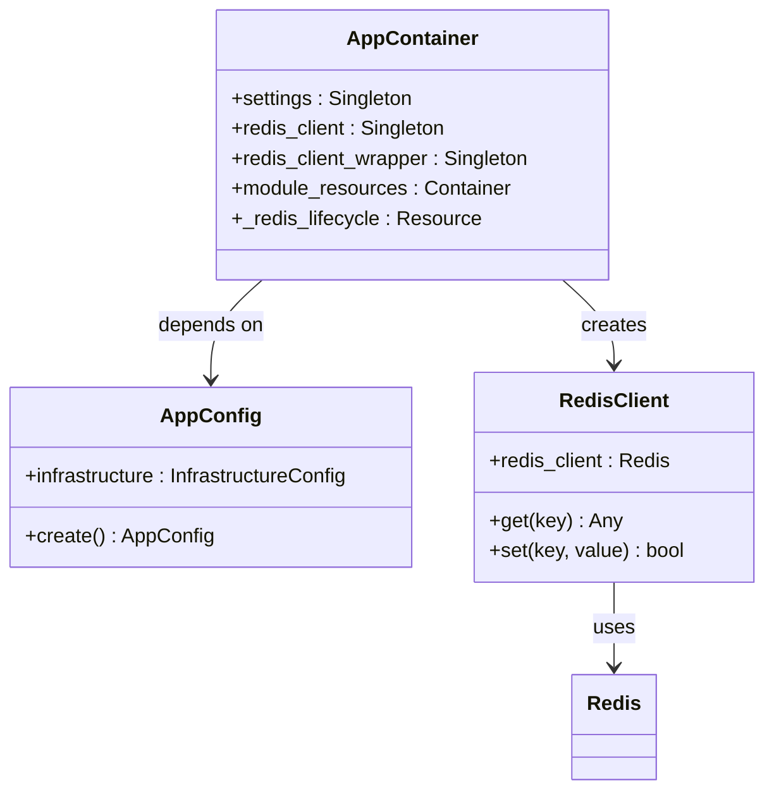
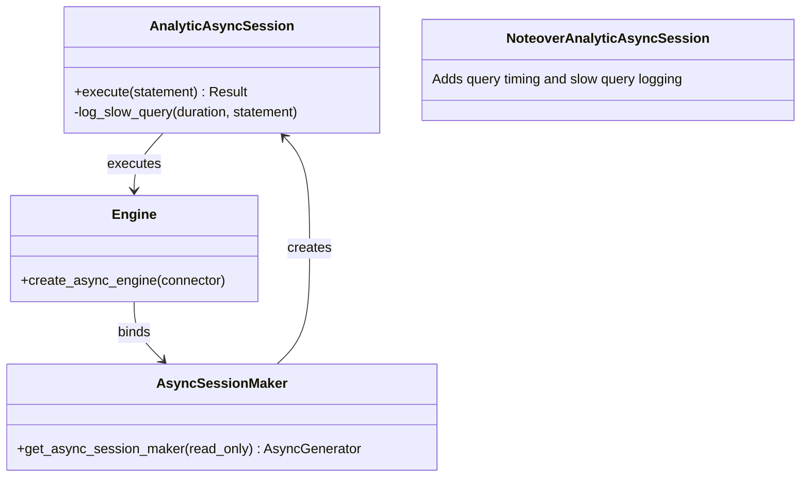
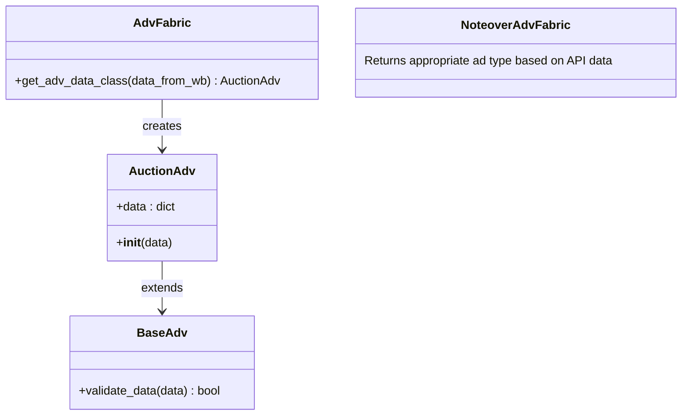
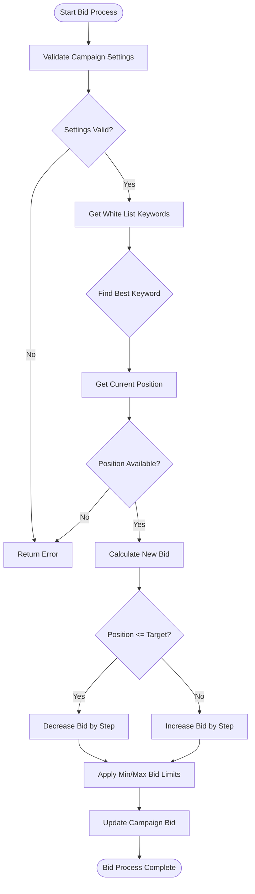
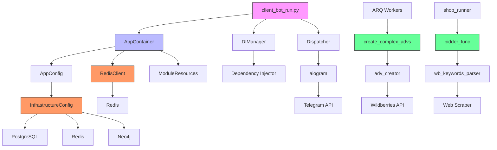

# Architecture Overview

<cite>
**Referenced Files in This Document**   
- [app_container.py](file://app/core/di/app_container.py)
- [app_config.py](file://app/configs/app_config.py)
- [bot.py](file://app/client_bot/bot.py)
- [base.py](file://app/core/wb_api/base.py)
- [redis_config.py](file://app/configs/infrastructure_config/redis_config.py)
- [neo4j_config.py](file://app/configs/infrastructure_config/neo4j_config.py)
- [adv_fabric.py](file://app/core/wb_api/data_classes/advs/adv_fabric.py)
- [bidder_func.py](file://app/modules/shop_runner/bidder/bidder_func.py)
- [session_maker.py](file://app/utils/db/session_maker.py)
- [workers.py](file://app/arq_workers/workers.py)
- [logger.py](file://python_modules/logger.py)
- [client_bot_run.py](file://client_bot_run.py)
</cite>

## Table of Contents
1. [Introduction](#introduction)
2. [Project Structure](#project-structure)
3. [Core Components](#core-components)
4. [Architecture Overview](#architecture-overview)
5. [Detailed Component Analysis](#detailed-component-analysis)
6. [Dependency Analysis](#dependency-analysis)
7. [Performance Considerations](#performance-considerations)
8. [Troubleshooting Guide](#troubleshooting-guide)
9. [Conclusion](#conclusion)

## Introduction
The adv-bot system is a modular monolith application designed for managing advertising campaigns on the Wildberries marketplace through a Telegram interface. The architecture follows a variation of Hexagonal Architecture with clear separation between core business logic and external concerns. The system integrates with multiple data stores including PostgreSQL, Redis, and Neo4j, and communicates with the Wildberries API for campaign management. This document provides a comprehensive overview of the architectural design, key patterns, and component interactions.

## Project Structure

**Diagram sources**
- [app](file://app)
- [modules](file://app/modules)
- [configs](file://app/configs)
- [arq_workers](file://app/arq_workers)

**Section sources**
- [app](file://app)
- [modules](file://app/modules)

## Core Components

The adv-bot system consists of several core components that work together to provide advertising campaign management functionality. The application is structured as a modular monolith with feature-based modules, allowing for clear separation of concerns while maintaining the benefits of a single deployable unit. Key components include the Telegram client interface, business logic modules, data access layers, and external integrations with Wildberries API.

**Section sources**
- [app](file://app)
- [modules](file://app/modules)

## Architecture Overview

**Diagram sources**
- [bot.py](file://app/client_bot/bot.py)
- [app_container.py](file://app/core/di/app_container.py)
- [session_maker.py](file://app/utils/db/session_maker.py)
- [redis_config.py](file://app/configs/infrastructure_config/redis_config.py)
- [neo4j_config.py](file://app/configs/infrastructure_config/neo4j_config.py)
- [base.py](file://app/core/wb_api/base.py)
- [workers.py](file://app/arq_workers/workers.py)

## Detailed Component Analysis

### Client Interface Layer
The client interface is implemented using the aiogram framework for Telegram bot development. The bot provides a conversational interface for users to manage their advertising campaigns on Wildberries. The architecture separates the bot logic from the business logic, allowing for easy maintenance and potential extension to other messaging platforms.

**Diagram sources**
- [bot.py](file://app/client_bot/bot.py)
- [global_router.py](file://app/client_bot/global_router.py)
- [client_bot_run.py](file://client_bot_run.py)

**Section sources**
- [bot.py](file://app/client_bot/bot.py)
- [client_bot_run.py](file://client_bot_run.py)

### Business Logic Layer
The business logic layer is organized into feature-based modules such as adv_creator, shop_runner, wb_adv_updater, and token_monitoring. Each module encapsulates specific functionality related to advertising campaign management. The architecture follows a service-oriented approach within the monolith, with clear boundaries between different business capabilities.

#### Dependency Injection System
The application uses the Dependency Injector library to manage dependencies and promote loose coupling between components. The AppContainer serves as the central dependency injection container, providing configuration, database connections, and service instances throughout the application.

**Diagram sources**
- [app_container.py](file://app/core/di/app_container.py)
- [app_config.py](file://app/configs/app_config.py)
- [redis_client.py](file://app/core/redis_manager_v2/redis_client.py)

**Section sources**
- [app_container.py](file://app/core/di/app_container.py)
- [app_config.py](file://app/configs/app_config.py)

### Data Access Layer
The data access layer implements the Repository Pattern through SQLAlchemy for PostgreSQL, with additional data stores for Redis and Neo4j. The architecture provides a consistent interface for data operations while abstracting the underlying storage mechanisms.

#### Repository Pattern Implementation
The session_maker module provides a robust implementation of database session management with support for read/write separation, connection pooling, and performance monitoring.

**Diagram sources**
- [session_maker.py](file://app/utils/db/session_maker.py)

**Section sources**
- [session_maker.py](file://app/utils/db/session_maker.py)

### External Integrations
The system integrates with external services through well-defined interfaces and adapters. The Wildberries API integration is a key component, enabling campaign management and data retrieval from the marketplace.

#### Factory Pattern for Ad Creation
The ad creation process uses a Factory Pattern to instantiate appropriate ad types based on API responses. Currently, the system supports auction campaigns (type 9) through the AuctionAdv class.

**Diagram sources**
- [adv_fabric.py](file://app/core/wb_api/data_classes/advs/adv_fabric.py)
- [auction_adv.py](file://app/core/wb_api/data_classes/advs/auction_adv.py)

**Section sources**
- [adv_fabric.py](file://app/core/wb_api/data_classes/advs/adv_fabric.py)

#### Strategy Pattern for Bidding
The bidding strategy is implemented using the Strategy Pattern, with different approaches for automatic and manual bidding modes. The bidder_func module contains the core logic for adjusting campaign bids based on keyword performance and position data.

**Diagram sources**
- [bidder_func.py](file://app/modules/shop_runner/bidder/bidder_func.py)

**Section sources**
- [bidder_func.py](file://app/modules/shop_runner/bidder/bidder_func.py)

## Dependency Analysis

**Diagram sources**
- [client_bot_run.py](file://client_bot_run.py)
- [app_container.py](file://app/core/di/app_container.py)
- [app_config.py](file://app/configs/app_config.py)
- [workers.py](file://app/arq_workers/workers.py)
- [bidder_func.py](file://app/modules/shop_runner/bidder/bidder_func.py)

**Section sources**
- [client_bot_run.py](file://client_bot_run.py)
- [app_container.py](file://app/core/di/app_container.py)
- [workers.py](file://app/arq_workers/workers.py)

## Performance Considerations
The system incorporates several performance optimization strategies. The database layer uses connection pooling with configurable pool size and overflow settings. Read/write separation is implemented to distribute database load, with read operations directed to replica instances when possible. The application includes built-in monitoring for slow queries and long-held database sessions, with warnings logged for operations exceeding one second. Redis is used extensively for caching frequently accessed data such as keyword positions and campaign settings, reducing the load on the primary database and external APIs.

**Section sources**
- [session_maker.py](file://app/utils/db/session_maker.py)
- [redis_client.py](file://app/core/redis_manager_v2/redis_client.py)

## Troubleshooting Guide
The system includes comprehensive logging through a centralized logger configuration. The logging system captures detailed information about application execution, including timestamps, log levels, source files, and line numbers. Error handling is implemented at multiple levels, with specific exception types for different failure modes such as API access errors. The application provides health check endpoints (/health, /readiness) for monitoring system status. When issues occur, the logs should be examined first, focusing on ERROR and WARNING level messages. Common issues include database connection problems, API authentication failures, and Redis connectivity issues, all of which are logged with contextual information to aid diagnosis.

**Section sources**
- [logger.py](file://python_modules/logger.py)
- [client_bot_run.py](file://client_bot_run.py)
- [base.py](file://app/core/wb_api/base.py)

## Conclusion
The adv-bot system demonstrates a well-structured modular monolith architecture with clear separation of concerns. The implementation of Hexagonal Architecture principles allows for flexible adaptation to changing requirements while maintaining testability and maintainability. Key architectural patterns including Dependency Injection, Repository Pattern, Factory Pattern, and Strategy Pattern are effectively utilized to create a robust and extensible system. The technology stack choices balance performance, reliability, and developer productivity, with Python providing a rich ecosystem for asynchronous programming and data processing. The system is well-positioned for future enhancements and scaling as needed.