# Advertising Updater Module

<cite>
**Referenced Files in This Document**
- [wb_manager.py](file://app/modules/wb_adv_updater/wb_manager.py)
- [ML.py](file://app/modules/wb_adv_updater/ML.py)
- [ml_data_manager.py](file://app/modules/wb_adv_updater/ml_data_manager.py)
- [runner.py](file://app/modules/wb_adv_updater/runner.py)
- [wb_adv_api.py](file://app/modules/wb_adv_updater/wb_adv_api.py)
- [data_manager.py](file://app/modules/wb_adv_updater/data_manager.py)
- [models.py](file://app/modules/wb_adv_updater/models.py)
- [fitter.py](file://app/modules/wb_adv_updater/fitter.py)
- [data_getter.py](file://app/modules/wb_adv_updater/data_getter.py)
- [data_setter.py](file://app/modules/wb_adv_updater/data_setter.py)
- [graph_vector_updater.py](file://app/modules/wb_adv_updater/graph_vector_updater.py)
- [ABC_manager.py](file://app/modules/wb_adv_updater/ABC_manager.py)
</cite>

## Table of Contents
1. [Introduction](#introduction)
2. [Module Architecture](#module-architecture)
3. [Core Components](#core-components)
4. [ML Integration](#ml-integration)
5. [Data Management](#data-management)
6. [API Interface](#api-interface)
7. [Execution Flow](#execution-flow)
8. [Configuration and Scheduling](#configuration-and-scheduling)
9. [Performance Considerations](#performance-considerations)
10. [Error Handling](#error-handling)
11. [Troubleshooting Guide](#troubleshooting-guide)
12. [Conclusion](#conclusion)

## Introduction

The Advertising Updater Module is a sophisticated system designed to synchronize ad campaign data between Wildberries and the internal system using machine learning-driven optimization. This module serves as the central orchestrator for managing ad state transitions, bid adjustments, and intelligent keyword optimization through advanced CTR prediction and bid optimization logic.

The module integrates seamlessly with Wildberries' API ecosystem while leveraging machine learning models to optimize advertising performance. It handles real-time data synchronization, predictive analytics, and automated optimization decisions to maximize ROI for advertising campaigns.

## Module Architecture

The Advertising Updater Module follows a modular architecture with clear separation of concerns:

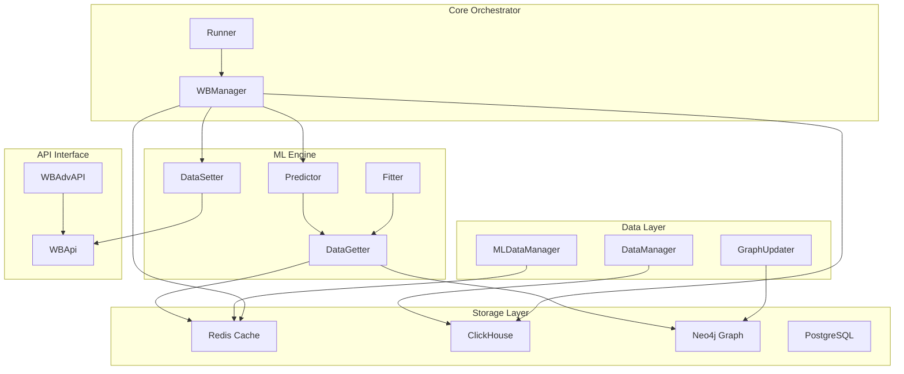

**Diagram sources**
- [wb_manager.py](file://app/modules/wb_adv_updater/wb_manager.py#L1-L50)
- [runner.py](file://app/modules/wb_adv_updater/runner.py#L1-L30)
- [ML.py](file://app/modules/wb_adv_updater/ML.py#L1-L50)

## Core Components

### WBManager - Central Orchestrator

The WBManager class serves as the central orchestrator for the entire advertising updater system. It coordinates all major operations including keyword updates, CTR predictions, and bid optimizations.

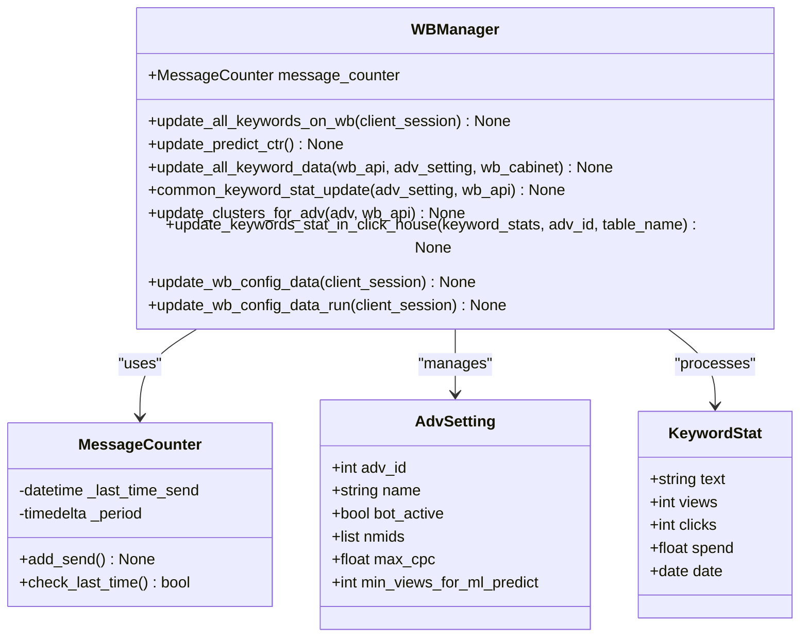

**Diagram sources**
- [wb_manager.py](file://app/modules/wb_adv_updater/wb_manager.py#L200-L250)
- [wb_manager.py](file://app/modules/wb_adv_updater/wb_manager.py#L350-L400)

Key responsibilities of WBManager include:

- **Keyword Synchronization**: Real-time updates of keyword statistics from Wildberries API
- **CTR Prediction Updates**: Periodic recalculation of click-through rates using ML models
- **Ad State Management**: Monitoring and updating ad campaign statuses
- **Cluster Management**: Managing keyword clustering for optimization
- **Configuration Updates**: Regular updates of minimum CPM data from Wildberries

**Section sources**
- [wb_manager.py](file://app/modules/wb_adv_updater/wb_manager.py#L200-L427)

### Data Management Layer

The data management layer handles complex data transformations and storage operations:

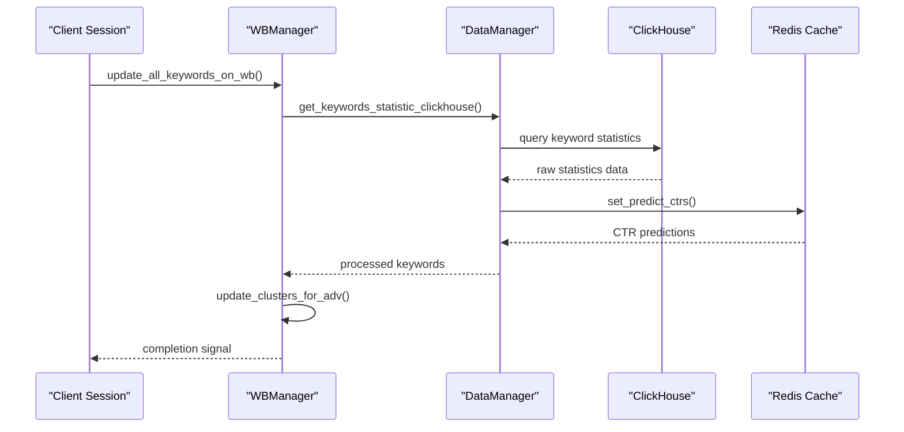

**Diagram sources**
- [wb_manager.py](file://app/modules/wb_adv_updater/wb_manager.py#L250-L350)
- [data_manager.py](file://app/modules/wb_adv_updater/data_manager.py#L100-L200)

**Section sources**
- [data_manager.py](file://app/modules/wb_adv_updater/data_manager.py#L1-L100)
- [wb_manager.py](file://app/modules/wb_adv_updater/wb_manager.py#L250-L350)

## ML Integration

### Predictor Class

The Predictor class is the heart of the ML integration, responsible for CTR prediction and bid optimization:

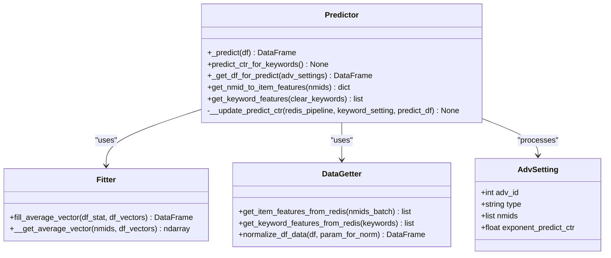

**Diagram sources**
- [ML.py](file://app/modules/wb_adv_updater/ML.py#L50-L150)
- [fitter.py](file://app/modules/wb_adv_updater/fitter.py#L1-L50)
- [data_getter.py](file://app/modules/wb_adv_updater/data_getter.py#L1-L50)

### ML Training and Model Management

The ML system includes sophisticated training and model management capabilities:

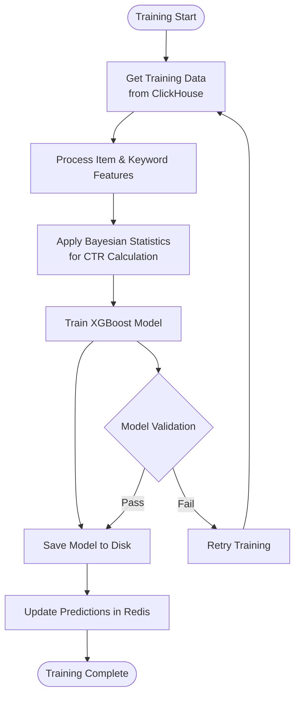

**Diagram sources**
- [fitter.py](file://app/modules/wb_adv_updater/fitter.py#L20-L100)
- [ML.py](file://app/modules/wb_adv_updater/ML.py#L80-L150)

**Section sources**
- [ML.py](file://app/modules/wb_adv_updater/ML.py#L1-L254)
- [fitter.py](file://app/modules/wb_adv_updater/fitter.py#L1-L100)

## Data Management

### Data Transformation Pipeline

The module implements a sophisticated data transformation pipeline that converts between internal models and external API formats:

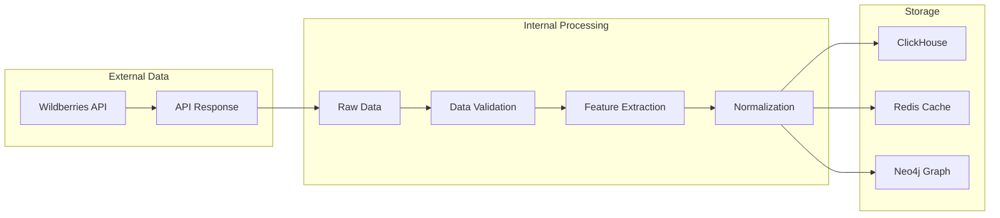

**Diagram sources**
- [data_manager.py](file://app/modules/wb_adv_updater/data_manager.py#L50-L150)
- [ml_data_manager.py](file://app/modules/wb_adv_updater/ml_data_manager.py#L50-L150)

### Vector Management

The system manages various types of vector representations for optimization:

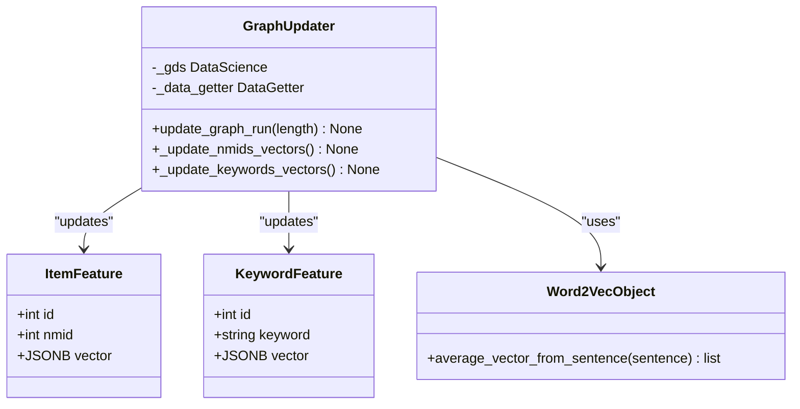

**Diagram sources**
- [graph_vector_updater.py](file://app/modules/wb_adv_updater/graph_vector_updater.py#L1-L50)
- [models.py](file://app/modules/wb_adv_updater/models.py#L1-L30)

**Section sources**
- [data_manager.py](file://app/modules/wb_adv_updater/data_manager.py#L100-L300)
- [graph_vector_updater.py](file://app/modules/wb_adv_updater/graph_vector_updater.py#L1-L128)

## API Interface

### WBAdvAPI Implementation

The WBAdvAPI class provides a clean interface to Wildberries' advertising APIs:

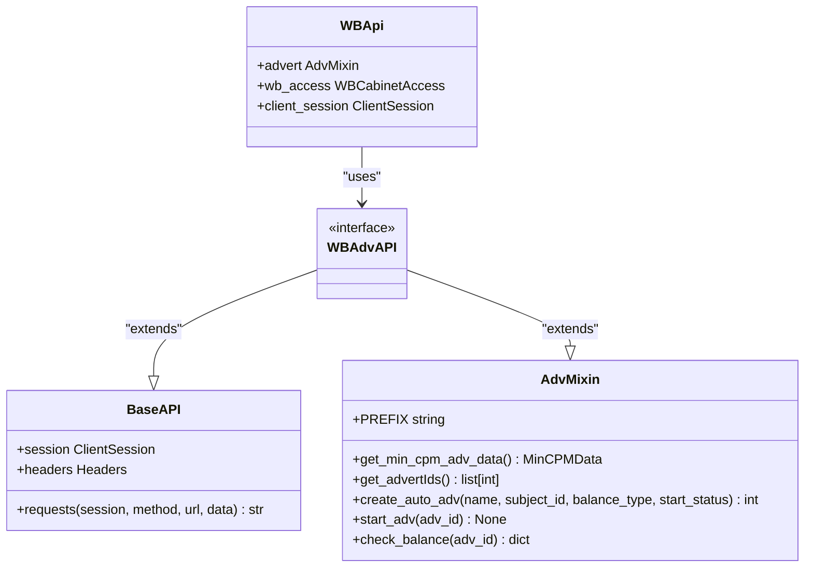

**Diagram sources**
- [wb_adv_api.py](file://app/modules/wb_adv_updater/wb_adv_api.py#L1-L6)
- [app/core/wb_api/base.py](file://app/core/wb_api/base.py)
- [app/core/wb_api/mixins/adv.py](file://app/core/wb_api/mixins/adv.py)

**Section sources**
- [wb_adv_api.py](file://app/modules/wb_adv_updater/wb_adv_api.py#L1-L6)

## Execution Flow

### Main Runner Coroutines

The runner module orchestrates all asynchronous operations:

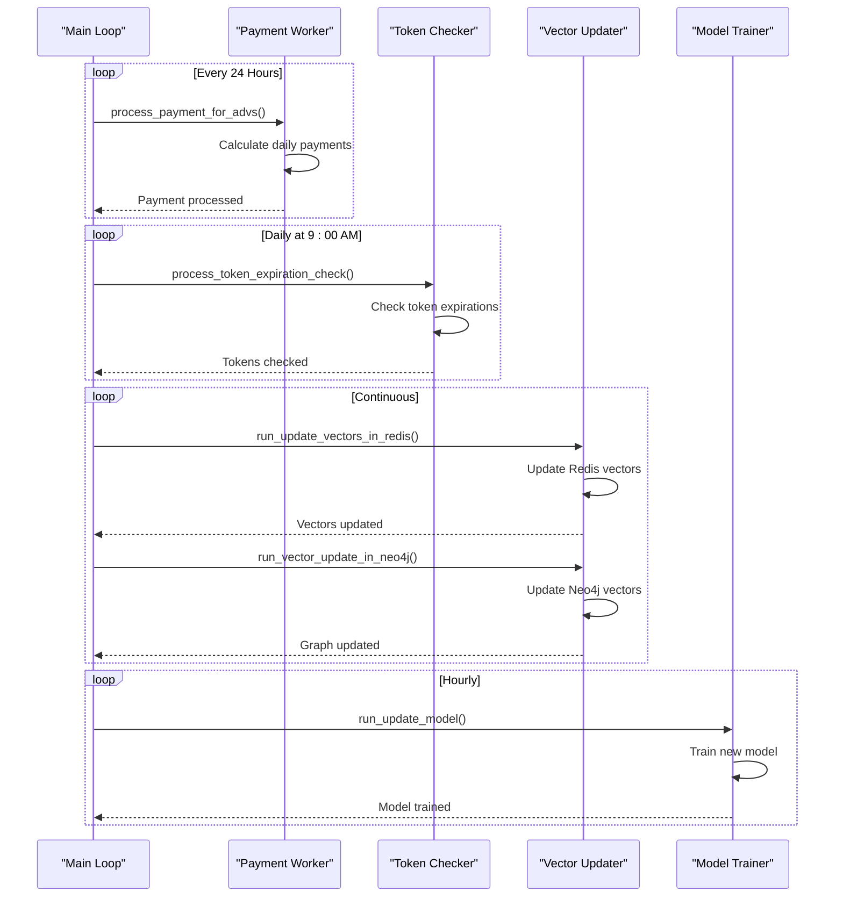

**Diagram sources**
- [runner.py](file://app/modules/wb_adv_updater/runner.py#L50-L144)

### Keyword Update Workflow

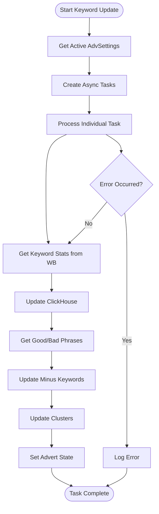

**Diagram sources**
- [runner.py](file://app/modules/wb_adv_updater/runner.py#L20-L50)
- [wb_manager.py](file://app/modules/wb_adv_updater/wb_manager.py#L250-L350)

**Section sources**
- [runner.py](file://app/modules/wb_adv_updater/runner.py#L1-L144)

## Configuration and Scheduling

### Update Intervals and Timing

The module implements sophisticated scheduling patterns for different operations:

- **Keyword Updates**: Every 5 seconds for continuous monitoring
- **CTR Predictions**: Hourly updates with semaphore control (max 10 concurrent)
- **Model Training**: Hourly training with automatic retry mechanisms
- **Vector Updates**: Continuous updates with Neo4j job coordination
- **Token Checks**: Daily at 9:00 AM
- **Payments**: Daily at 3:00 AM

### Configuration Options

The system supports extensive configuration options:

```python
# ML Model Selection
ML_MODEL_PATH = "app/keyword_async_ml_updater/data/model.ml"

# Update Intervals
KEYWORD_UPDATE_INTERVAL = 5  # seconds
CTR_PREDICT_INTERVAL = 3600  # seconds
MODEL_TRAIN_INTERVAL = 3600  # seconds

# Performance Settings
MAX_CONCURRENT_UPDATES = 10
VECTOR_UPDATE_BATCH_SIZE = 100

# Caching Strategies
REDIS_CACHE_TTL = 3600  # seconds
CLICKHOUSE_CACHE_TTL = 86400  # seconds
```

**Section sources**
- [runner.py](file://app/modules/wb_adv_updater/runner.py#L30-L80)
- [ML.py](file://app/modules/wb_adv_updater/ML.py#L20-L30)

## Performance Considerations

### High-Frequency Bidding Operations

The module is designed to handle high-frequency bidding operations efficiently:

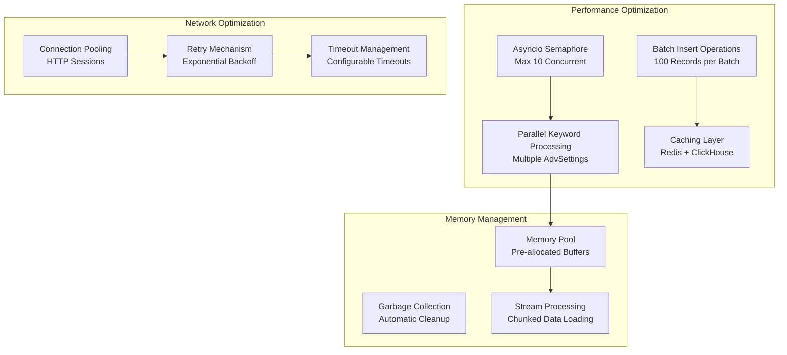

### Caching Strategies

The system implements multi-layer caching for optimal performance:

1. **Redis Cache**: Hot data caching with TTL management
2. **ClickHouse Cache**: Historical data aggregation
3. **Neo4j Cache**: Graph data for vector operations
4. **Memory Cache**: In-memory caching for frequently accessed data

**Section sources**
- [ML.py](file://app/modules/wb_adv_updater/ML.py#L20-L30)
- [wb_manager.py](file://app/modules/wb_adv_updater/wb_manager.py#L100-L150)

## Error Handling

### Distributed Update Error Handling

The module implements comprehensive error handling for distributed updates:

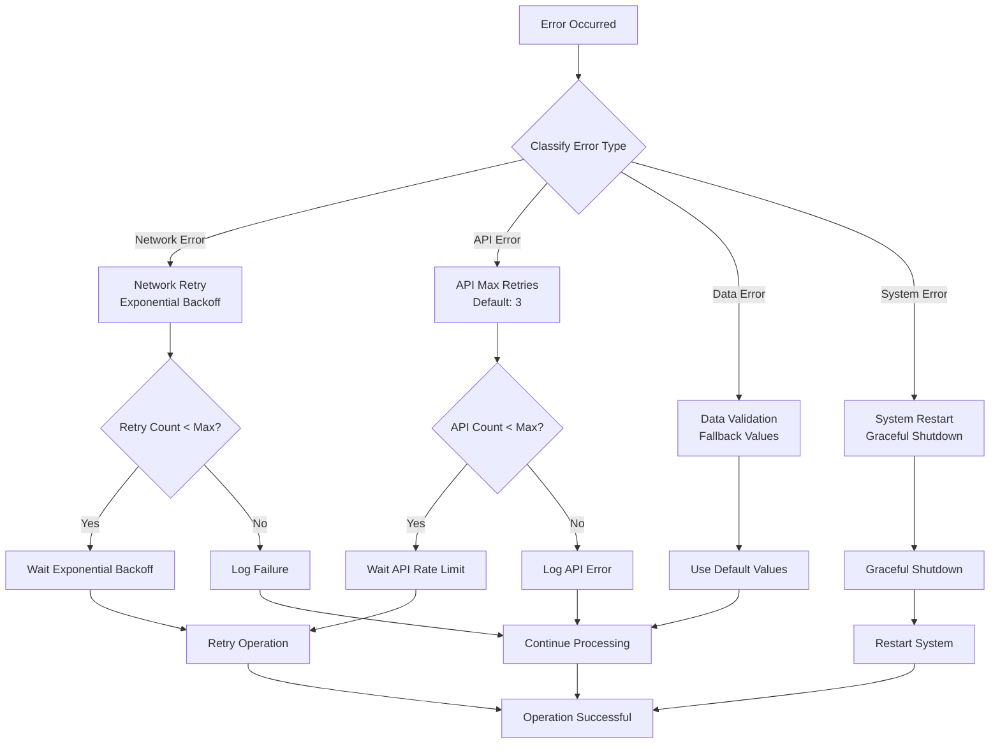

### Error Recovery Patterns

The system implements several error recovery patterns:

1. **Circuit Breaker Pattern**: Prevents cascading failures
2. **Bulkhead Pattern**: Isolates failures between different components
3. **Retry with Backoff**: Intelligent retry mechanisms
4. **Fallback Mechanisms**: Graceful degradation when primary systems fail

**Section sources**
- [wb_manager.py](file://app/modules/wb_adv_updater/wb_manager.py#L300-L400)
- [runner.py](file://app/modules/wb_adv_updater/runner.py#L100-L144)

## Troubleshooting Guide

### Common Issues and Solutions

#### 1. ML Model Training Failures

**Symptoms**: Model training fails with memory errors or convergence issues.

**Solutions**:
- Check available memory and adjust batch sizes
- Verify data quality and remove outliers
- Adjust learning rate parameters
- Monitor training progress with logging

#### 2. API Rate Limiting

**Symptoms**: Frequent API timeout errors and rate limiting responses.

**Solutions**:
- Implement exponential backoff retry mechanism
- Increase wait times between API calls
- Use connection pooling for HTTP sessions
- Monitor API usage metrics

#### 3. Redis Connection Issues

**Symptoms**: Redis connection timeouts and data inconsistency.

**Solutions**:
- Verify Redis server health and connectivity
- Implement connection retry mechanisms
- Use Redis sentinel for high availability
- Monitor Redis memory usage

#### 4. ClickHouse Performance Issues

**Symptoms**: Slow queries and high resource consumption.

**Solutions**:
- Optimize query patterns and indexing
- Implement data partitioning strategies
- Use materialized views for complex aggregations
- Monitor query execution plans

### Diagnostic Tools

The module includes several diagnostic tools:

```python
# Enable debug logging
logger.setLevel(logging.DEBUG)

# Monitor system health
async def monitor_system_health():
    # Check Redis connectivity
    # Verify API endpoints
    # Monitor memory usage
    # Track error rates
    pass

# Performance profiling
async def profile_operations():
    # Profile keyword update operations
    # Measure ML prediction times
    # Analyze data transfer rates
    pass
```

**Section sources**
- [wb_manager.py](file://app/modules/wb_adv_updater/wb_manager.py#L350-L427)
- [runner.py](file://app/modules/wb_adv_updater/runner.py#L120-L144)

## Conclusion

The Advertising Updater Module represents a sophisticated system for managing Wildberries advertising campaigns with machine learning-driven optimization. Its modular architecture, comprehensive error handling, and performance optimizations make it suitable for high-volume, mission-critical advertising operations.

Key strengths of the module include:

- **Scalable Architecture**: Modular design allows for easy extension and maintenance
- **Machine Learning Integration**: Advanced CTR prediction and bid optimization
- **High Availability**: Robust error handling and recovery mechanisms
- **Performance Optimization**: Multi-layer caching and efficient data processing
- **Real-time Capabilities**: Continuous monitoring and updates

The module continues to evolve with new features and optimizations, maintaining its position as a critical component in the advertising automation ecosystem.