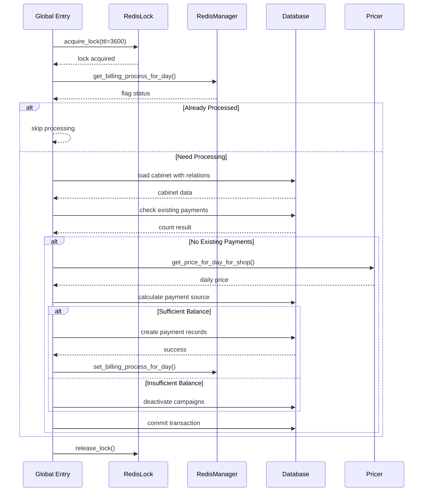
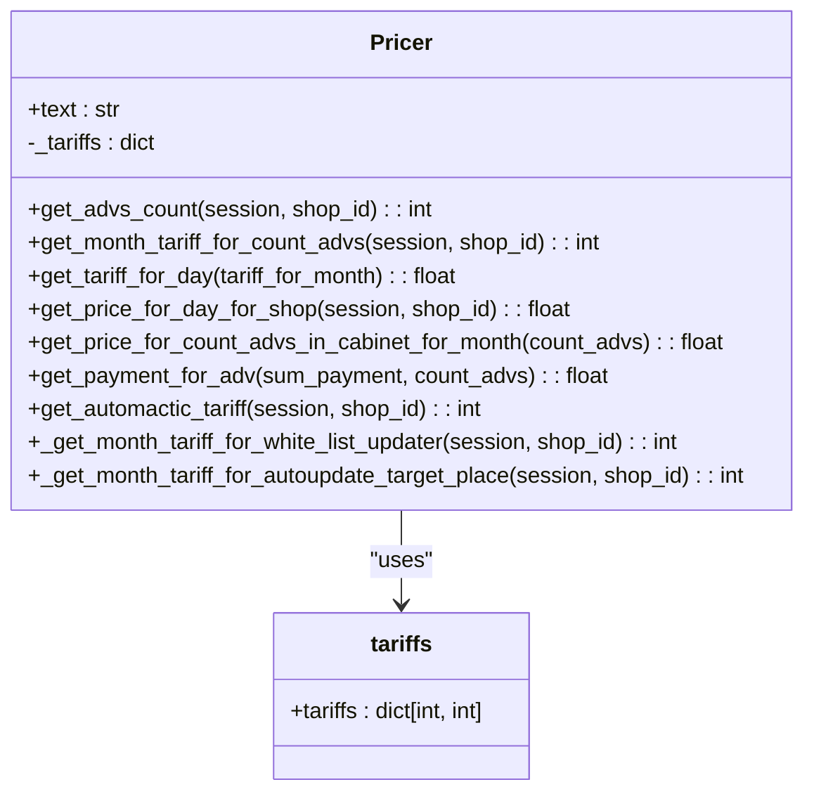
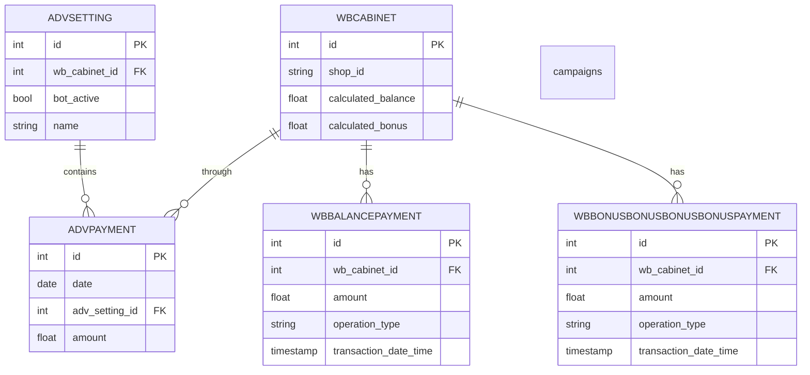
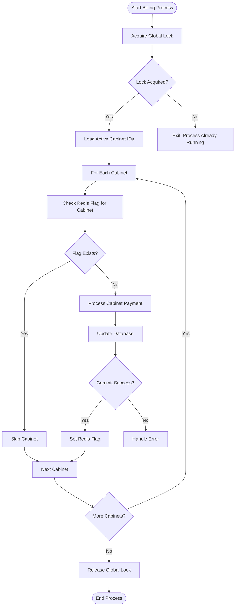
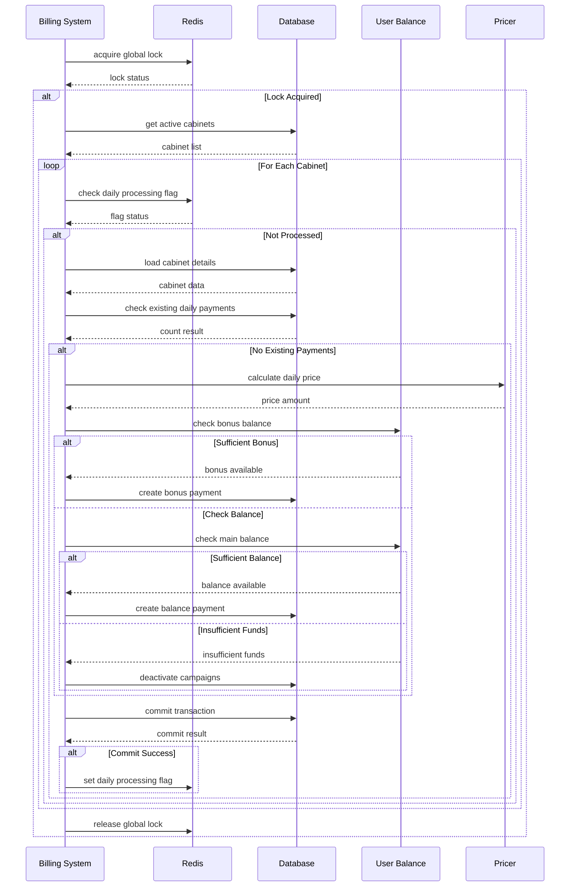

# Billing System

<cite>
**Referenced Files in This Document**   
- [billing.py](file://app/modules/billing/billing.py)
- [models.py](file://app/modules/billing/models.py)
- [pricer.py](file://app/modules/billing/pricer/pricer.py)
- [tariffs.py](file://app/modules/billing/pricer/tariffs.py)
- [redis_lock.py](file://app/modules/billing/redis_lock.py)
- [redis_manager.py](file://app/modules/billing/redis_manager.py)
- [di.py](file://app/modules/billing/di.py)
- [models.py](file://app/modules/common_slaves/wildberries/models/models.py)
</cite>

## Table of Contents
1. [Introduction](#introduction)
2. [Core Components](#core-components)
3. [Billing Class and Service Interface](#billing-class-and-service-interface)
4. [Pricer Implementation and Tariff Configuration](#pricer-implementation-and-tariff-configuration)
5. [Data Models for Balances and Usage Tracking](#data-models-for-balances-and-usage-tracking)
6. [Redis-Based Locking Mechanisms](#redis-based-locking-mechanisms)
7. [Usage Tracking and Payment Workflows](#usage-tracking-and-payment-workflows)
8. [Scalability and Data Consistency](#scalability-and-data-consistency)
9. [Configuration Options](#configuration-options)

## Introduction
The Billing System is responsible for tracking service usage and calculating costs based on consumption tiers for advertising campaigns. It manages daily charges for active cabinets, processes payments from user balances or bonuses, and ensures consistent state across distributed components. The system integrates with Redis for performance optimization and locking, while maintaining durable records in PostgreSQL. This document details the architecture, components, workflows, and design considerations of the billing implementation.

## Core Components

The billing system consists of several key components that work together to process daily charges for advertising campaigns. The main components include the Billing service interface, Pricer for tariff calculation, Redis-based locking mechanisms, and data models for tracking usage and payments. These components are orchestrated through dependency injection and follow a distributed transaction pattern with idempotency guarantees.

**Section sources**
- [billing.py](file://app/modules/billing/billing.py#L1-L367)
- [pricer.py](file://app/modules/billing/pricer/pricer.py#L1-L103)
- [redis_lock.py](file://app/modules/billing/redis_lock.py#L1-L26)

## Billing Class and Service Interface

The Billing class serves as the primary service interface for usage recording and balance management. It processes daily payments for advertising campaigns by coordinating between database transactions and Redis-based optimizations. The system follows a workflow that ensures idempotency through Redis flags and database constraints.

The main entry point `process_payment_for_advs` uses a global Redis lock to prevent concurrent execution of the billing process. Each cabinet is processed individually in `_process_single_cabinet`, which handles the complete payment workflow including price calculation, balance verification, and transaction recording.

**Diagram sources**
- [billing.py](file://app/modules/billing/billing.py#L1-L367)

**Section sources**
- [billing.py](file://app/modules/billing/billing.py#L1-L367)

## Pricer Implementation and Tariff Configuration

The Pricer implementation handles tariff-based cost calculation according to consumption tiers. It determines pricing based on the number of active advertising campaigns and additional services enabled for each shop. The pricing model follows a tiered structure where the per-campaign cost decreases as the number of campaigns increases.

The tariff configuration is defined in `tariffs.py` as a dictionary mapping campaign count thresholds to monthly prices per campaign. The Pricer class calculates the total monthly tariff by multiplying the tiered price by the number of active campaigns, then converts this to a daily rate by dividing by 30.

**Diagram sources**
- [pricer.py](file://app/modules/billing/pricer/pricer.py#L1-L103)
- [tariffs.py](file://app/modules/billing/pricer/tariffs.py#L1-L9)

**Section sources**
- [pricer.py](file://app/modules/billing/pricer/pricer.py#L1-L103)
- [tariffs.py](file://app/modules/billing/pricer/tariffs.py#L1-L9)

## Data Models for Balances and Usage Tracking

The billing system uses several data models to track user balances, campaign payments, and cabinet information. The primary model `AdvPayment` records daily charges for individual advertising campaigns, while related models in the Wildberries module track overall cabinet balances and bonus payments.

The `AdvPayment` model maintains a record of daily charges with references to specific campaign settings. It includes fields for the payment date, associated campaign, and amount charged. The model enforces uniqueness constraints to prevent duplicate payments for the same campaign on the same day.

**Diagram sources**
- [models.py](file://app/modules/billing/models.py#L1-L30)
- [models.py](file://app/modules/common_slaves/wildberries/models/models.py#L1-L718)

**Section sources**
- [models.py](file://app/modules/billing/models.py#L1-L30)
- [models.py](file://app/modules/common_slaves/wildberries/models/models.py#L1-L718)

## Redis-Based Locking Mechanisms

The billing system implements Redis-based locking mechanisms to prevent race conditions during balance updates and ensure exclusive execution of critical operations. The system uses two primary Redis components: a global lock to prevent concurrent billing runs and per-cabinet flags to ensure idempotency of daily processing.

The `RedisLock` class provides distributed locking functionality through the `BillingLockMixin`, using Redis SET commands with NX (set if not exists) and EX (expire) options. The global lock has a default TTL of 600 seconds (10 minutes) but can be configured through the `global_ttl` parameter in the main billing function.

**Diagram sources**
- [redis_lock.py](file://app/modules/billing/redis_lock.py#L1-L26)
- [redis_manager.py](file://app/modules/billing/redis_manager.py#L1-L7)

**Section sources**
- [redis_lock.py](file://app/modules/billing/redis_lock.py#L1-L26)
- [redis_manager.py](file://app/modules/billing/redis_manager.py#L1-L7)

## Usage Tracking and Payment Workflows

The billing system implements comprehensive workflows for usage tracking, payment validation, and quota enforcement. The primary workflow processes daily charges for all active advertising campaigns, following a sequence of validation, calculation, and transaction recording.

The payment workflow begins with a global lock acquisition to ensure only one billing process runs at a time. For each cabinet with active campaigns, the system checks whether billing has already been processed for the day using Redis flags. If not processed, it loads the cabinet's current state, calculates the daily price based on active campaigns and enabled features, and attempts to deduct the amount from available balances.

**Diagram sources**
- [billing.py](file://app/modules/billing/billing.py#L1-L367)

**Section sources**
- [billing.py](file://app/modules/billing/billing.py#L1-L367)

## Scalability and Data Consistency

The billing system addresses scalability considerations for high-frequency billing operations through several design patterns. The use of Redis for idempotency flags and distributed locking enables horizontal scaling while preventing race conditions. The system processes cabinets in parallel using asyncio.gather, allowing concurrent processing of multiple cabinets while maintaining transactional integrity at the individual cabinet level.

Data consistency between Redis and PostgreSQL is managed through a specific ordering of operations: first check Redis for idempotency, then perform database operations within a transaction, and finally update Redis flags as a best-effort optimization. This pattern ensures that Redis is never the source of truth, making the system resilient to Redis failures or data loss.

The system also implements read-only sessions for initial data loading to reduce database load, and uses short-lived transactions for individual cabinet processing to minimize lock contention. Error handling includes comprehensive logging and safe commit operations with rollback on failure, ensuring data integrity even in the face of unexpected errors.

**Section sources**
- [billing.py](file://app/modules/billing/billing.py#L1-L367)
- [redis_lock.py](file://app/modules/billing/redis_lock.py#L1-L26)

## Configuration Options

The billing system supports configuration options for pricing plans and billing cycles through both code-based configuration and environment variables. The tiered pricing structure is defined in `tariffs.py` as a dictionary mapping campaign count thresholds to monthly prices per campaign.

Additional services such as automatic whitelist updates and target place updates have their pricing configured through environment variables `WHITE_LIST_AUTO_UPDATER_MONTH_TARIFF` and `AUTO_UPDATE_TARGET_PLACE_MONTH_TARIFF` respectively. These values are accessed through the settings module and incorporated into the total monthly tariff calculation.

The billing cycle is configured to run daily, with idempotency ensured through date-based Redis flags and database constraints on payment records. The global lock TTL is configurable through the `global_ttl` parameter in the `process_payment_for_advs` function, allowing adjustment of the maximum execution time based on system load and cabinet count.

**Section sources**
- [tariffs.py](file://app/modules/billing/pricer/tariffs.py#L1-L9)
- [pricer.py](file://app/modules/billing/pricer/pricer.py#L1-L103)
- [settings.py](file://app/settings/settings_master.py)