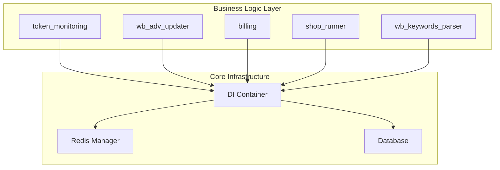
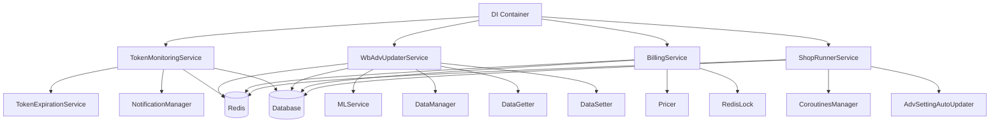
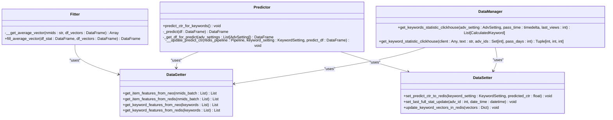
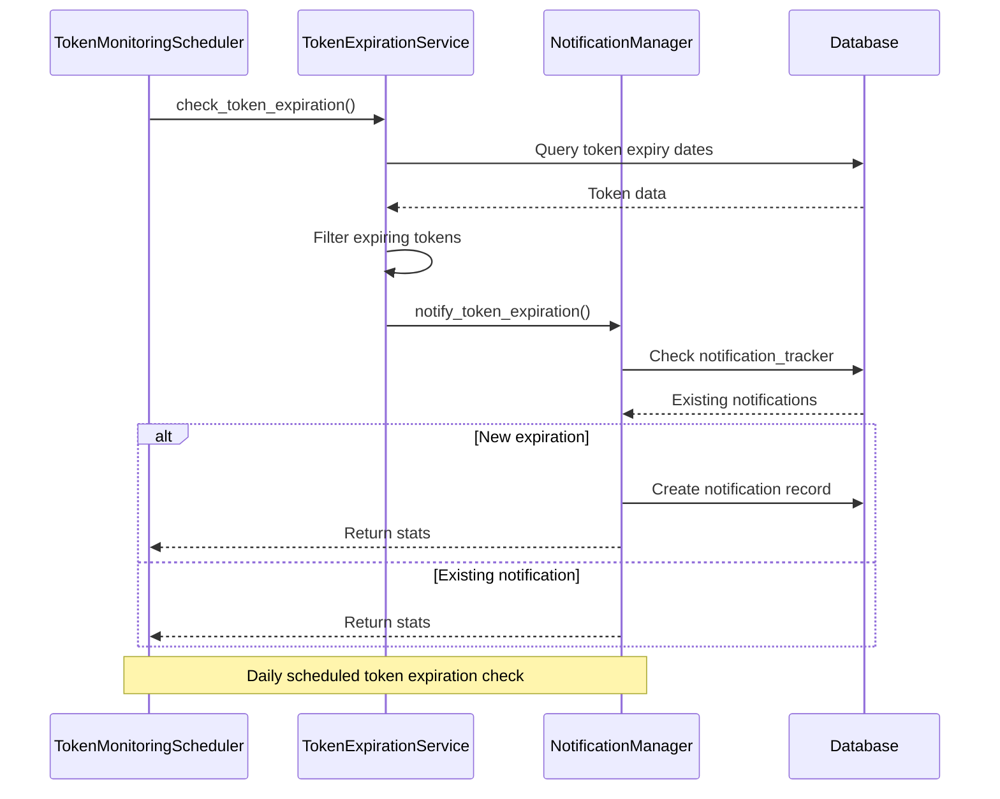
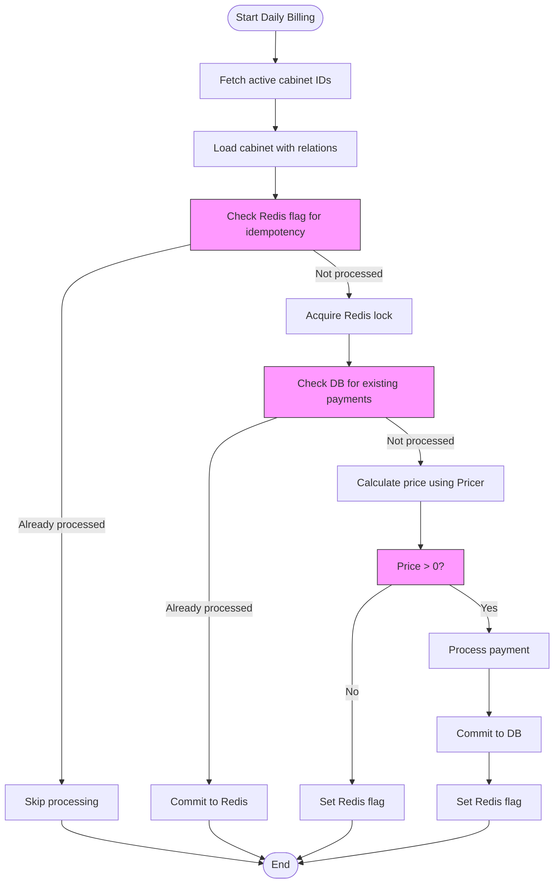
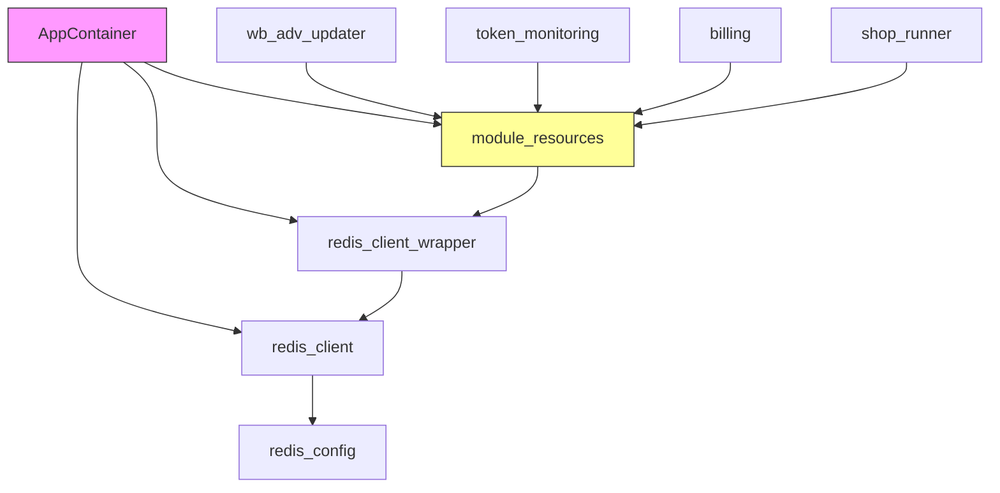

# Business Logic Layer

<cite>
**Referenced Files in This Document**   
- [app/modules/wb_adv_updater/runner.py](file://app/modules/wb_adv_updater/runner.py)
- [app/modules/wb_adv_updater/ML.py](file://app/modules/wb_adv_updater/ML.py)
- [app/modules/wb_adv_updater/data_manager.py](file://app/modules/wb_adv_updater/data_manager.py)
- [app/modules/wb_adv_updater/models.py](file://app/modules/wb_adv_updater/models.py)
- [app/modules/token_monitoring/services/token_monitoring_service.py](file://app/modules/token_monitoring/services/token_monitoring_service.py)
- [app/modules/token_monitoring/scheduler.py](file://app/modules/token_monitoring/scheduler.py)
- [app/modules/token_monitoring/models.py](file://app/modules/token_monitoring/models.py)
- [app/modules/billing/billing.py](file://app/modules/billing/billing.py)
- [app/modules/billing/pricer/pricer.py](file://app/modules/billing/pricer/pricer.py)
- [app/modules/billing/pricer/tariffs.py](file://app/modules/billing/pricer/tariffs.py)
- [app/modules/billing/models.py](file://app/modules/billing/models.py)
- [app/modules/shop_runner/service_manager/manager.py](file://app/modules/shop_runner/service_manager/manager.py)
- [app/core/di/app_container.py](file://app/core/di/app_container.py)
- [app/modules/wb_adv_updater/data_getter.py](file://app/modules/wb_adv_updater/data_getter.py)
- [app/modules/wb_adv_updater/data_setter.py](file://app/modules/wb_adv_updater/data_setter.py)
</cite>

## Table of Contents
1. [Introduction](#introduction)
2. [Project Structure](#project-structure)
3. [Core Components](#core-components)
4. [Architecture Overview](#architecture-overview)
5. [Detailed Component Analysis](#detailed-component-analysis)
6. [Dependency Analysis](#dependency-analysis)
7. [Performance Considerations](#performance-considerations)
8. [Troubleshooting Guide](#troubleshooting-guide)
9. [Conclusion](#conclusion)

## Introduction
The adv-bot system's business logic layer implements a service-oriented architecture that encapsulates specific business capabilities through modular components. This documentation details how feature modules handle token monitoring, ad updating, shop management, billing, and keyword parsing operations. Each module exposes clear interfaces for business operations while interacting with data access components and external APIs. The system leverages a dependency injection container for service orchestration and implements sophisticated business rules for transaction management and error propagation.

## Project Structure
The business logic layer is organized into feature-based modules within the `app/modules` directory, with each module encapsulating specific business capabilities. The architecture follows a service-oriented design pattern where each module provides well-defined interfaces for business operations.

**Diagram sources**
- [app/modules/token_monitoring](file://app/modules/token_monitoring)
- [app/modules/wb_adv_updater](file://app/modules/wb_adv_updater)
- [app/modules/billing](file://app/modules/billing)
- [app/core/di/app_container.py](file://app/core/di/app_container.py)

**Section sources**
- [app/modules](file://app/modules)

## Core Components
The business logic layer consists of several key components that encapsulate specific business capabilities. Each module follows a service-oriented design pattern with clear interfaces for business operations. The wb_adv_updater module implements ML-driven bid optimization, while token_monitoring handles token expiration tracking. The billing module manages subscription payments and pricing calculations, and shop_runner coordinates shop-level operations. These services interact through a dependency injection container that manages service lifecycles and dependencies.

**Section sources**
- [app/modules/wb_adv_updater](file://app/modules/wb_adv_updater)
- [app/modules/token_monitoring](file://app/modules/token_monitoring)
- [app/modules/billing](file://app/modules/billing)
- [app/modules/shop_runner](file://app/modules/shop_runner)

## Architecture Overview
The business logic layer follows a modular, service-oriented architecture where each feature module encapsulates specific business capabilities. Services are orchestrated through a dependency injection container that manages component dependencies and lifecycles. Business operations are coordinated through asynchronous coroutines that handle periodic tasks and event-driven workflows.

**Diagram sources**
- [app/core/di/app_container.py](file://app/core/di/app_container.py)
- [app/modules/token_monitoring](file://app/modules/token_monitoring)
- [app/modules/wb_adv_updater](file://app/modules/wb_adv_updater)
- [app/modules/billing](file://app/modules/billing)
- [app/modules/shop_runner](file://app/modules/shop_runner)

## Detailed Component Analysis

### wb_adv_updater Module Analysis
The wb_adv_updater module implements ML-driven bid optimization for advertising campaigns. It uses machine learning models to predict click-through rates and optimize keyword bidding strategies. The module follows a pipeline architecture with distinct components for data retrieval, model prediction, and data persistence.

**Diagram sources**
- [app/modules/wb_adv_updater/ML.py](file://app/modules/wb_adv_updater/ML.py)
- [app/modules/wb_adv_updater/data_getter.py](file://app/modules/wb_adv_updater/data_getter.py)
- [app/modules/wb_adv_updater/data_setter.py](file://app/modules/wb_adv_updater/data_setter.py)
- [app/modules/wb_adv_updater/data_manager.py](file://app/modules/wb_adv_updater/data_manager.py)

**Section sources**
- [app/modules/wb_adv_updater](file://app/modules/wb_adv_updater)
- [app/modules/wb_adv_updater/ML.py](file://app/modules/wb_adv_updater/ML.py)
- [app/modules/wb_adv_updater/data_getter.py](file://app/modules/wb_adv_updater/data_getter.py)
- [app/modules/wb_adv_updater/data_setter.py](file://app/modules/wb_adv_updater/data_setter.py)

### token_monitoring Module Analysis
The token_monitoring module implements a comprehensive system for tracking token expiration and deactivation events. It uses a scheduler to perform daily checks and notifies users of impending token expiration. The service also monitors API calls for token deactivation and sends immediate notifications when tokens are deactivated.

**Diagram sources**
- [app/modules/token_monitoring/scheduler.py](file://app/modules/token_monitoring/scheduler.py)
- [app/modules/token_monitoring/services/token_expiration_service.py](file://app/modules/token_monitoring/services/token_expiration_service.py)
- [app/modules/token_monitoring/services/notification_manager.py](file://app/modules/token_monitoring/services/notification_manager.py)

**Section sources**
- [app/modules/token_monitoring](file://app/modules/token_monitoring)
- [app/modules/token_monitoring/scheduler.py](file://app/modules/token_monitoring/scheduler.py)
- [app/modules/token_monitoring/models.py](file://app/modules/token_monitoring/models.py)

### billing Module Analysis
The billing module implements a subscription-based pricing system with tiered pricing based on the number of active advertising campaigns. The system processes daily charges and prevents duplicate payments through Redis and database deduplication mechanisms.

**Diagram sources**
- [app/modules/billing/billing.py](file://app/modules/billing/billing.py)
- [app/modules/billing/pricer/pricer.py](file://app/modules/billing/pricer/pricer.py)

**Section sources**
- [app/modules/billing](file://app/modules/billing)
- [app/modules/billing/billing.py](file://app/modules/billing/billing.py)
- [app/modules/billing/pricer/pricer.py](file://app/modules/billing/pricer/pricer.py)
- [app/modules/billing/models.py](file://app/modules/billing/models.py)

## Dependency Analysis
The business logic layer components are orchestrated through a dependency injection container that manages service dependencies and lifecycles. The DI container provides access to shared resources like Redis and database connections, ensuring consistent configuration across services.

**Diagram sources**
- [app/core/di/app_container.py](file://app/core/di/app_container.py)
- [app/core/di/module_resources.py](file://app/core/di/module_resources.py)

**Section sources**
- [app/core/di/app_container.py](file://app/core/di/app_container.py)
- [app/core/di/module_resources.py](file://app/core/di/module_resources.py)

## Performance Considerations
The business logic layer implements several performance optimizations to handle high-volume operations efficiently. The wb_adv_updater module uses Redis caching to store frequently accessed data like keyword vectors and item features, reducing database load. The billing system uses Redis flags and locks to prevent duplicate processing while maintaining idempotency. Asynchronous processing with asyncio enables concurrent execution of independent operations, improving overall throughput. The ML prediction pipeline uses thread pooling to offload CPU-intensive operations from the event loop.

## Troubleshooting Guide
Common issues in the business logic layer typically involve token expiration notifications, billing processing failures, or ML model prediction errors. For token monitoring issues, verify that the scheduler is running and check the token_notification_tracker table for existing notifications. For billing issues, examine Redis lock status and database transaction logs to identify processing bottlenecks. ML prediction failures may occur due to missing data in Redis or Neo4j databases, so verify data availability in both storage systems. All services include comprehensive logging that can be used to trace the execution flow and identify failure points.

**Section sources**
- [app/modules/token_monitoring](file://app/modules/token_monitoring)
- [app/modules/billing](file://app/modules/billing)
- [app/modules/wb_adv_updater](file://app/modules/wb_adv_updater)

## Conclusion
The business logic layer of the adv-bot system demonstrates a well-structured, service-oriented architecture that effectively encapsulates distinct business capabilities. Each module provides clear interfaces for its functionality while maintaining loose coupling through the dependency injection container. The implementation of ML-driven bid optimization in wb_adv_updater and the comprehensive token monitoring system showcase the system's sophistication. The billing module's idempotent processing ensures reliable subscription management, while the shop_runner coordinates complex shop-level operations. This architecture enables maintainable, scalable business logic that can be extended with additional feature modules as needed.