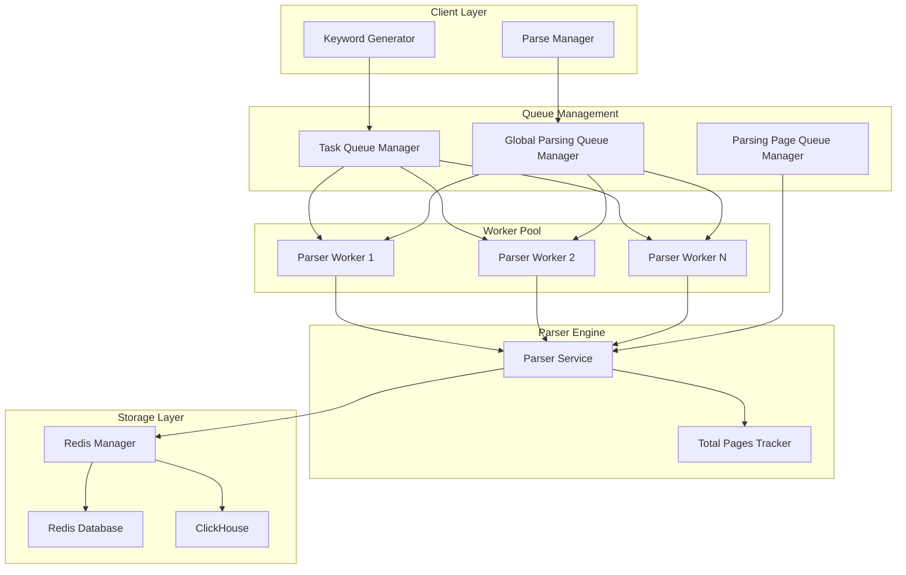
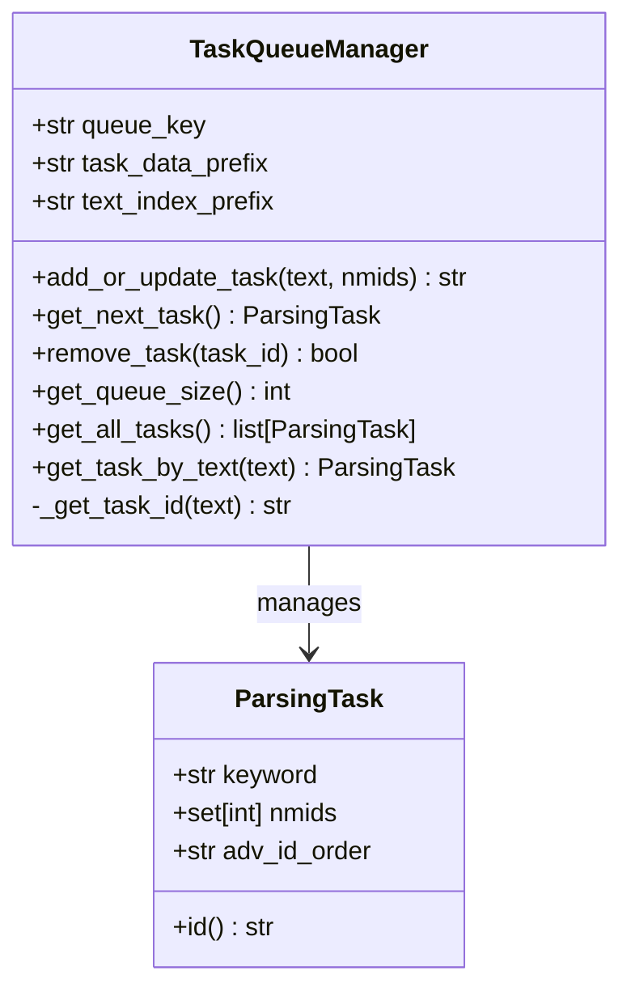
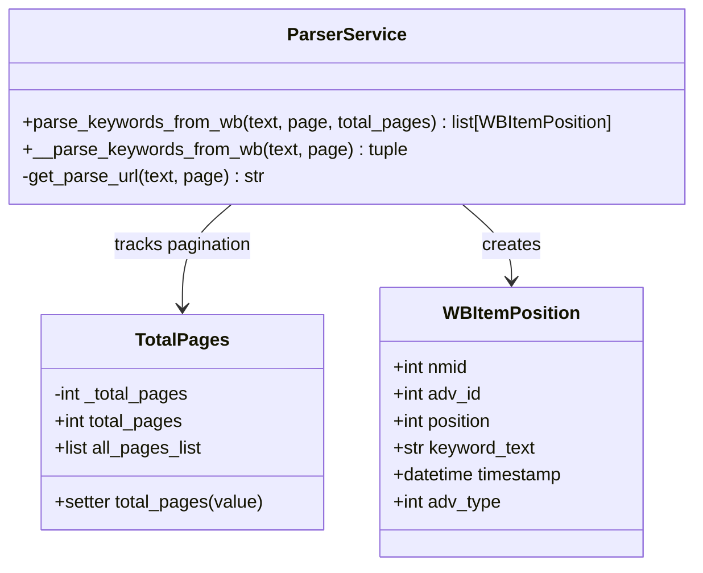
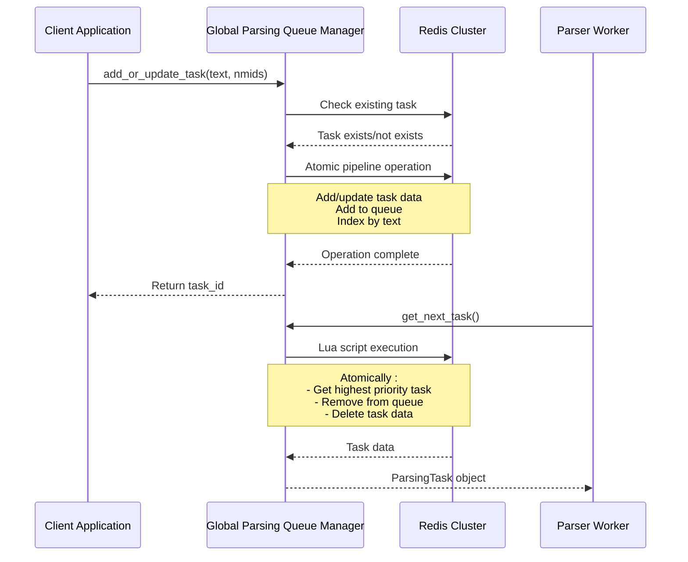
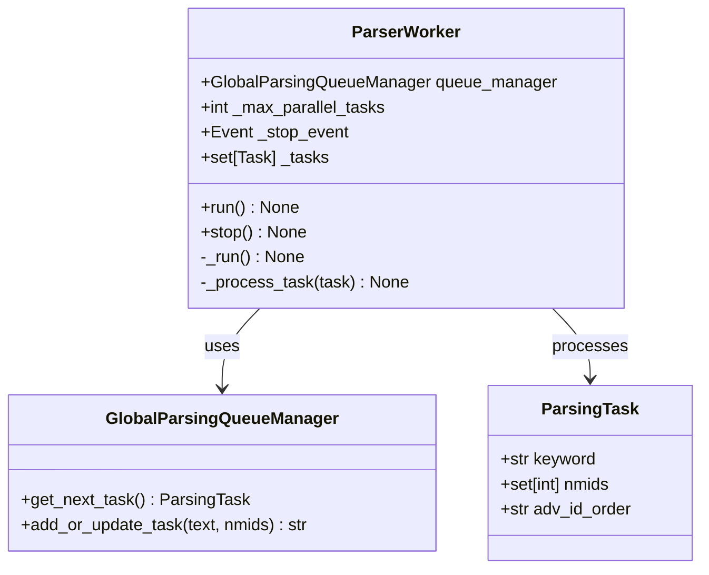
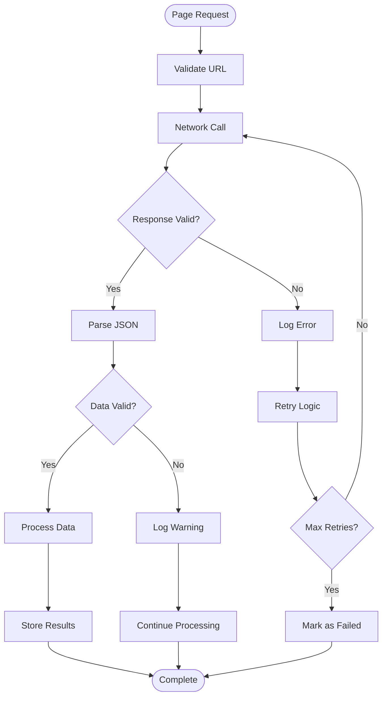
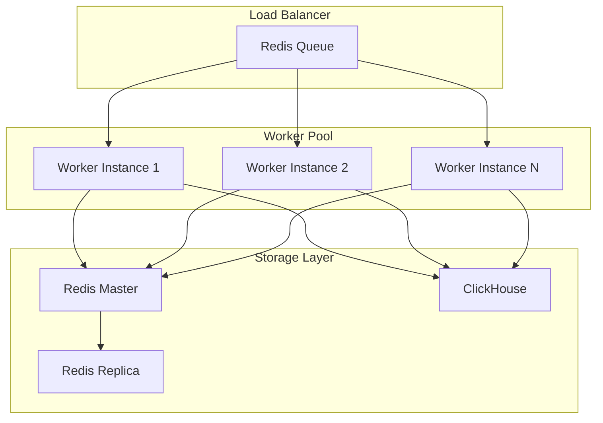

# Keyword Parser Module

<cite>
**Referenced Files in This Document**
- [parsing_task.py](file://app/modules/wb_keywords_parser/parsing_task.py)
- [parser_worker.py](file://app/modules/wb_keywords_parser/parser_worker.py)
- [global_parsing_queue_manager.py](file://app/modules/wb_keywords_parser/global_parsing_queue_manager.py)
- [parsing_found_redis_manager.py](file://app/modules/wb_keywords_parser/parsing_found_redis_manager.py)
- [parsing_page_queue_manager.py](file://app/modules/wb_keywords_parser/wb_parser/parsing_page_queue_manager.py)
- [parsing_queue_mode.py](file://app/modules/wb_keywords_parser/wb_parser/parsing_queue_mode.py)
- [parser.py](file://app/modules/wb_keywords_parser/wb_parser/parser.py)
- [task_queue_manager.py](file://app/modules/wb_keywords_parser/task_queue_manager.py)
- [settings_master.py](file://app/settings/settings_master.py)
- [__init__.py](file://app/modules/shop_runner/service_manager/services/parsing_keywords_from_wb/__init__.py)
</cite>

## Table of Contents
1. [Introduction](#introduction)
2. [Architecture Overview](#architecture-overview)
3. [Core Components](#core-components)
4. [Parser Class Implementation](#parser-class-implementation)
5. [Queue Management System](#queue-management-system)
6. [Worker Implementation](#worker-implementation)
7. [Configuration and Rate Limiting](#configuration-and-rate-limiting)
8. [Error Handling and Recovery](#error-handling-and-recovery)
9. [Scalability Considerations](#scalability-considerations)
10. [Performance Optimization](#performance-optimization)
11. [Troubleshooting Guide](#troubleshooting-guide)
12. [Conclusion](#conclusion)

## Introduction

The Keyword Parser Module is a sophisticated system designed to extract and analyze search keywords from Wildberries product pages. This module serves as the backbone for keyword position tracking and competitive analysis in the advertising platform. It implements a distributed parsing architecture with concurrent processing capabilities, intelligent queue management, and robust error handling mechanisms.

The module handles the complex task of monitoring keyword positions across multiple product pages, managing parsing queues efficiently, and ensuring reliable data collection while avoiding IP bans and maintaining optimal performance under high load conditions.

## Architecture Overview

The Keyword Parser Module follows a distributed architecture pattern with multiple specialized components working together to achieve efficient keyword parsing:



**Diagram sources**
- [task_queue_manager.py](file://app/modules/wb_keywords_parser/task_queue_manager.py#L1-L50)
- [global_parsing_queue_manager.py](file://app/modules/wb_keywords_parser/global_parsing_queue_manager.py#L1-L50)
- [parser_worker.py](file://app/modules/wb_keywords_parser/parser_worker.py#L1-L50)

## Core Components

### ParsingTask Class

The `ParsingTask` class serves as the fundamental data structure for encapsulating parsing jobs:

```python
@dataclass
class ParsingTask:
    """
    Модель задачи парсинга

    Attributes:
        keyword: Ключевая фраза для поиска
        nmids: Множество nmids для поиска
        adv_id_order: ID заказа (опционально)
    """

    keyword: str
    nmids: set[int]
    adv_id_order: str | None = None

    @property
    def id(self) -> str:
        """Генерирует уникальный ID задачи на основе ключевой фразы"""
        import hashlib
        return hashlib.sha1(self.keyword.encode()).hexdigest()[:12]
```

This class provides:
- **Immutable Data Structure**: Using `@dataclass` ensures immutability and clean serialization
- **Unique Task Identification**: SHA1 hashing creates deterministic task IDs
- **Flexible Configuration**: Optional `adv_id_order` field for advanced use cases

**Section sources**
- [parsing_task.py](file://app/modules/wb_keywords_parser/parsing_task.py#L1-L25)

### Task Queue Manager

The `TaskQueueManager` provides centralized task management with Redis-based persistence:



**Diagram sources**
- [task_queue_manager.py](file://app/modules/wb_keywords_parser/task_queue_manager.py#L10-L50)
- [parsing_task.py](file://app/modules/wb_keywords_parser/parsing_task.py#L1-L25)

**Section sources**
- [task_queue_manager.py](file://app/modules/wb_keywords_parser/task_queue_manager.py#L1-L177)

## Parser Class Implementation

### ParserService Architecture

The `ParserService` class implements the core parsing logic with sophisticated error handling and data validation:



**Diagram sources**
- [parser.py](file://app/modules/wb_keywords_parser/wb_parser/parser.py#L50-L150)

### Web Scraping Implementation

The parser implements sophisticated web scraping with multiple layers of protection:

```python
async def parse_keywords_from_wb(self, text: str, page: int, total_pages: TotalPages) -> list[WBItemPosition]:
    first_place = page * 100 - 99
    try:
        data = await self.__parse_keywords_from_wb(text, page)
        if data:
            products, cluster, preset, total_items = data
        else:
            return []
        if total_items is not None:
            max_page = (total_items + 99) // 100 if total_items else 0
            total_pages.total_pages = max_page
            if max_page and page > max_page:
                logger.info("Страница %s превышает максимальное количество страниц %s для ключа %s",
                           page, max_page, text)
                return []
    except Exception as e:
        logger.debug(f"Ошибка при парсинге страницы {page} ключа {text} {e}", exc_info=True)
        del e
        return []
```

Key features:
- **Intelligent Pagination**: Calculates maximum pages based on total items
- **Error Resilience**: Graceful handling of network failures and invalid responses
- **Data Validation**: Comprehensive checks for response integrity
- **Logging Integration**: Detailed debug information for troubleshooting

**Section sources**
- [parser.py](file://app/modules/wb_keywords_parser/wb_parser/parser.py#L50-L150)

### Position Tracking and Data Normalization

The parser implements sophisticated position tracking with automatic data normalization:

```python
async def add_wb_positions(text: str, need_nmids: set[int], delay, page_limit=60) -> None:
    total_pages = TotalPages()
    stop_event = asyncio.Event()
    catch_any_position = asyncio.Event()
    checked_pages: set[int] = set()
    parsing_pages_queue = await parsing_queue_manager.get_parsing_queue(text, need_nmids, 60)
    
    for page in parsing_pages_queue:
        if page not in total_pages.all_pages_list:
            continue
        if page in checked_pages:
            continue
        if len(set(total_pages.all_pages_list) - checked_pages) == 0:
            break
        if len(checked_pages) >= page_limit:
            break
        if len(need_nmids) == 0:
            break
            
        await add_positions_from_page(stop_event, catch_any_position, text, page, need_nmids, total_pages, checked_pages)
        checked_pages.add(page)
        await asyncio.sleep(delay)
```

**Section sources**
- [parser.py](file://app/modules/wb_keywords_parser/wb_parser/parser.py#L250-L350)

## Queue Management System

### Global Parsing Queue Manager

The `GlobalParsingQueueManager` implements a distributed queue system with Redis-based coordination:



**Diagram sources**
- [global_parsing_queue_manager.py](file://app/modules/wb_keywords_parser/global_parsing_queue_manager.py#L20-L80)

### Smart Queue Management

The parsing queue manager implements intelligent page prioritization:

```python
async def get_parsing_queue(self, text: str, need_nmids: set[int], max_pages: int) -> list[int]:
    found_pages_all = []
    not_found_pages_all = []
    remaining_pages_all = set(range(1, max_pages + 1))
    
    if settings.PARSING_QUEUE_MODE == ParsingQueueMode.SIMPLE_QUEUE:
        return list(range(1, max_pages + 1))
        
    for nmid in need_nmids:
        found_pages = await self.redis_manager.get_found_pages_for_text_nmid(text, nmid)
        not_found_pages = await self.redis_manager.get_not_found_pages_for_text_nmid(text, nmid)
        
        found_pages_all.extend(found_pages)
        not_found_pages_all.extend(not_found_pages)
        
        remaining_pages_all -= set(found_pages)
        remaining_pages_all -= set(not_found_pages)
    
    # Priority: found pages -> unknown pages -> not found pages
    final_queue = list(OrderedDict.fromkeys(found_pages_all + remaining_pages_all + not_found_pages_all))
    return final_queue
```

**Section sources**
- [parsing_page_queue_manager.py](file://app/modules/wb_keywords_parser/wb_parser/parsing_page_queue_manager.py#L30-L85)

## Worker Implementation

### ParserWorker Architecture

The `ParserWorker` implements a concurrent processing system with graceful shutdown capabilities:



**Diagram sources**
- [parser_worker.py](file://app/modules/wb_keywords_parser/parser_worker.py#L15-L50)

### Concurrent Processing Logic

The worker implements sophisticated concurrent processing with rate limiting:

```python
async def _run(self) -> None:
    """Основной цикл воркера"""
    logger.info("Starting parser worker")
    while not self._stop_event.is_set():
        try:
            async with lock:
                task: ParsingTask | None = await self.queue_manager.get_next_task()
                
            if task:
                logger.debug(f"Processing task: {task}")
                try:
                    await self._process_task(task)
                    logger.debug(f"Finished task: {task}")
                except Exception as e:
                    logger.error(f"Error processing task {task}: {e}", exc_info=True)
            else:
                # If no tasks, wait a bit
                await asyncio.sleep(1)
                
        except Exception as e:
            logger.error(f"Error in worker main loop: {e}")
            await asyncio.sleep(30)  # Wait before retry
```

**Section sources**
- [parser_worker.py](file://app/modules/wb_keywords_parser/parser_worker.py#L40-L80)

## Configuration and Rate Limiting

### Environment Configuration

The module supports extensive configuration through environment variables:

```python
@property
def MAX_PARSING_PARALLEL_JOBS(self) -> int:
    value = os.getenv("MAX_PARSING_PARALLEL_JOBS")
    if not value:
        return 10
    return int(value)

@property
def MAX_PAGE_LIMIT_PARSER_WORKER(self) -> int:
    value = os.getenv("MAX_PAGE_LIMIT_PARSER_WORKER")
    if not value:
        return 60
    return int(value)

@property
def PARALLER_PARSE_TASKS(self) -> int:
    value = os.environ.get("PARALLER_PARSE_TASKS")
    if not value:
        return 50
    return int(value)
```

**Section sources**
- [settings_master.py](file://app/settings/settings_master.py#L250-L300)

### Rate Limiting Strategies

The parser implements multiple layers of rate limiting:

1. **Per-Task Delay**: Configurable delay between task processing
2. **Page-Level Throttling**: Delay between page requests
3. **Global Concurrency Control**: Maximum parallel workers
4. **Queue-Based Backpressure**: Automatic throttling based on queue depth

```python
async def add_wb_positions(text: str, need_nmids: set[int], delay, page_limit=60) -> None:
    # Apply configured delays
    await asyncio.sleep(delay)
    
    # Process pages with built-in throttling
    for page in parsing_pages_queue:
        # Page processing logic with timing controls
        await asyncio.sleep(settings.PARSING_KEYWORDS_DELAY_BETWEEN_TASKS)
```

**Section sources**
- [parser.py](file://app/modules/wb_keywords_parser/wb_parser/parser.py#L300-L350)

## Error Handling and Recovery

### Multi-Layer Error Handling

The parser implements comprehensive error handling at multiple levels:



**Diagram sources**
- [parser.py](file://app/modules/wb_keywords_parser/wb_parser/parser.py#L100-L150)

### Redis-Based Recovery

The system implements persistent state recovery through Redis:

```python
async def add_last_found_page_for_text_nmid(self, text: str, nmid: int, page: int) -> None:
    key = f"found_pages:{text}:{nmid}"
    score: int = int(time())
    await self._client.zadd(key, {page: score})

async def get_found_pages_for_text_nmid(self, text: str, nmid: int) -> list[int]:
    key = f"found_pages:{text}:{nmid}"
    pages = await self._client.zrevrange(key, 0, -1)
    return [int(page) for page in pages]
```

**Section sources**
- [parsing_found_redis_manager.py](file://app/modules/wb_keywords_parser/parsing_found_redis_manager.py#L1-L30)

## Scalability Considerations

### Horizontal Scaling Architecture

The module is designed for horizontal scaling with multiple worker instances:



### Resource Management

The system implements efficient resource management:

1. **Connection Pooling**: Reuse HTTP connections for efficiency
2. **Memory Management**: Proper cleanup of parsed data
3. **CPU Throttling**: Prevent excessive CPU usage
4. **Memory Limits**: Configurable memory thresholds

```python
@property
def MAX_THREAD_PARSER(self) -> int:
    value = os.environ.get("MAX_THREAD_PARSER")
    if value is None:
        return 30
    return int(value)

@property
def COUNT_THREAD_SQL_KW_STAT_LOAD(self) -> int:
    value = os.environ.get("MAX_THREAD_PARSER")
    if value is None:
        return 30
    return int(value)
```

**Section sources**
- [settings_master.py](file://app/settings/settings_master.py#L70-L90)

## Performance Optimization

### Caching Strategies

The module implements multiple caching layers:

1. **Redis Caching**: Frequently accessed data stored in Redis
2. **Page-Level Caching**: Individual page results cached
3. **Cluster Caching**: Search cluster information cached
4. **Position History**: Historical position data cached

### Optimized Data Structures

```python
# Efficient set operations for NMID filtering
need_nmids = set(int(nmid) for nmid in nmids)
await redis_manager.add_positions_to_redis([
    position for position in positions if position.nmid in need_nmids
])
```

### Asynchronous Processing

The entire system is built on asyncio with:
- **Non-blocking I/O**: All network operations are asynchronous
- **Concurrent Requests**: Multiple pages processed simultaneously
- **Efficient Event Loop**: Minimal blocking operations
- **Resource Pooling**: Shared connection pools

**Section sources**
- [parser.py](file://app/modules/wb_keywords_parser/wb_parser/parser.py#L200-L250)

## Troubleshooting Guide

### Common Issues and Solutions

#### 1. IP Bans and Rate Limiting

**Symptoms**: Frequent timeouts, HTTP 429 errors, blocked requests

**Solutions**:
- Increase `PARSING_KEYWORDS_DELAY_BETWEEN_TASKS`
- Reduce `MAX_PARSING_PARALLEL_JOBS`
- Implement proxy rotation
- Use CAPTCHA solving services

#### 2. Memory Issues

**Symptoms**: Out of memory errors, slow performance

**Solutions**:
- Reduce `MAX_PAGE_LIMIT_PARSER_WORKER`
- Implement streaming for large datasets
- Use pagination more aggressively
- Monitor memory usage with profiling tools

#### 3. Queue Processing Delays

**Symptoms**: Tasks stuck in queue, long processing times

**Solutions**:
- Check Redis connectivity
- Verify queue manager configuration
- Monitor worker health
- Adjust concurrency settings

### Debugging Tools

```python
# Enable debug logging
import logging
logging.getLogger('app.modules.wb_keywords_parser').setLevel(logging.DEBUG)

# Check queue status
queue_manager = TaskQueueManager()
size = await queue_manager.get_queue_size()
tasks = await queue_manager.get_all_tasks()

# Monitor worker health
worker = ParserWorker(max_parallel_tasks=3)
await worker.run()  # Run in debug mode
```

### Monitoring and Metrics

The system provides comprehensive monitoring through:
- **Redis Metrics**: Queue sizes, task counts
- **Worker Health**: Active workers, processing rates
- **Error Rates**: Failure percentages, error types
- **Performance Metrics**: Response times, throughput

**Section sources**
- [parser_worker.py](file://app/modules/wb_keywords_parser/parser_worker.py#L1-L80)
- [global_parsing_queue_manager.py](file://app/modules/wb_keywords_parser/global_parsing_queue_manager.py#L1-L131)

## Conclusion

The Keyword Parser Module represents a sophisticated solution for keyword position tracking and competitive analysis in the Wildberries ecosystem. Its distributed architecture, comprehensive error handling, and scalable design make it suitable for high-volume production environments.

Key strengths include:

- **Robust Architecture**: Distributed design with multiple failover points
- **Intelligent Queuing**: Smart prioritization and load balancing
- **Extensive Configuration**: Fine-grained control over behavior
- **Production Ready**: Comprehensive error handling and monitoring
- **Scalable Design**: Horizontal scaling capabilities

The module successfully addresses the challenges of web scraping at scale while maintaining reliability and performance under varying load conditions. Its modular design allows for easy extension and customization to meet evolving requirements.

Future enhancements could include:
- Advanced proxy management
- Machine learning-based priority scoring
- Enhanced caching strategies
- Real-time analytics dashboards
- Integration with external monitoring systems