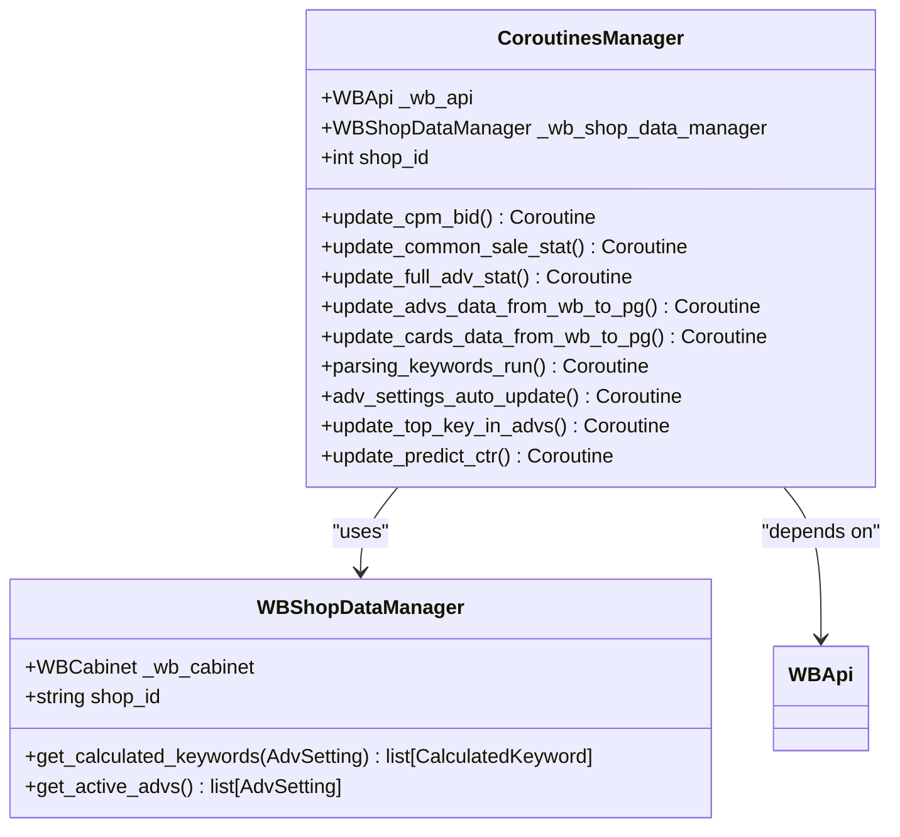
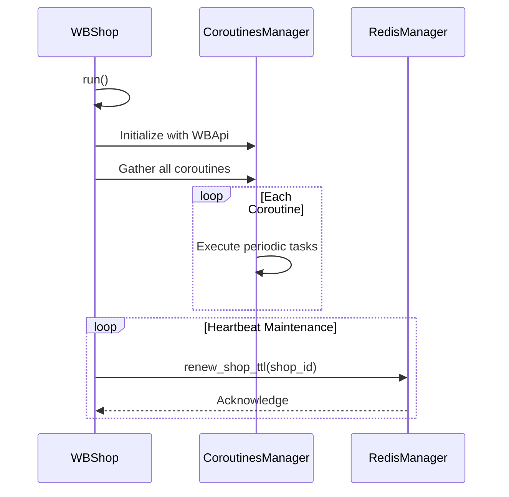
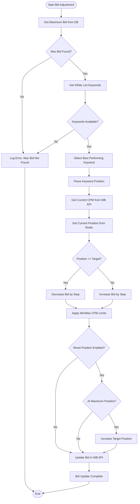
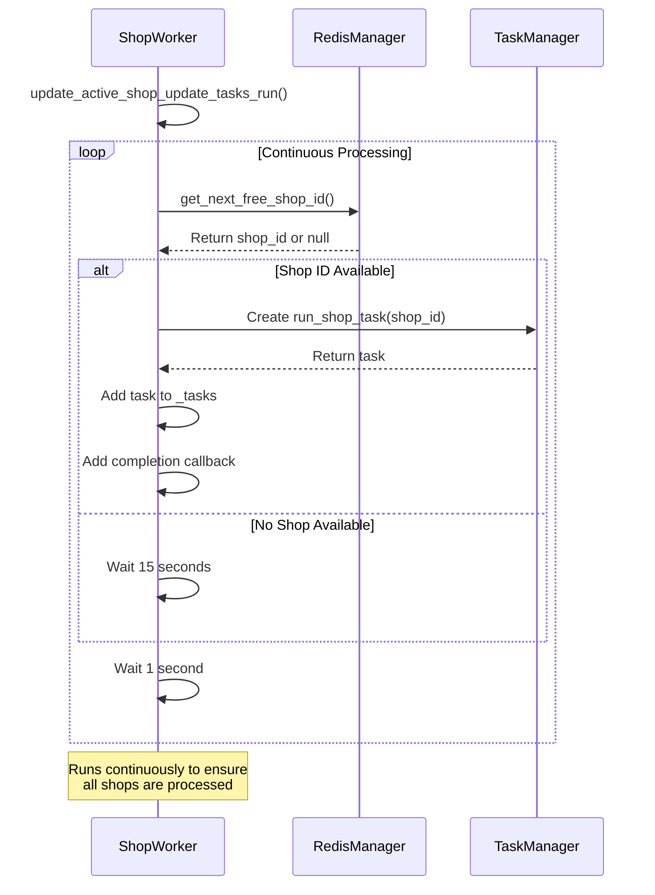
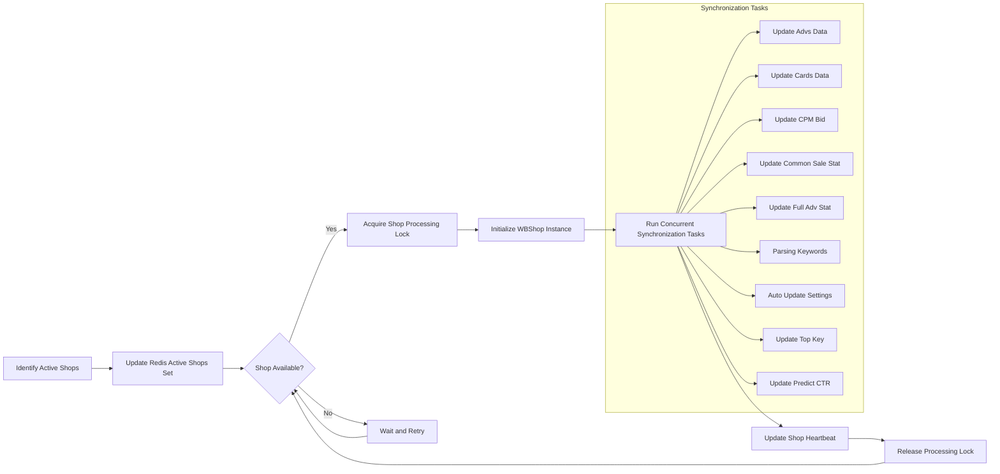
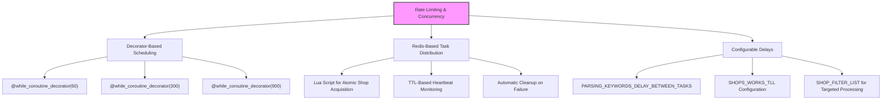
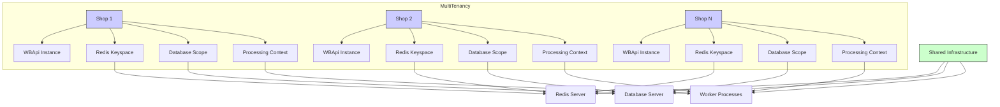

# Shop Runner Service

<cite>
**Referenced Files in This Document**   
- [wb_shop.py](file://app/modules/shop_runner/wb_shop.py)
- [manager.py](file://app/modules/shop_runner/service_manager/manager.py)
- [bidder_func.py](file://app/modules/shop_runner/bidder/bidder_func.py)
- [worker.py](file://app/modules/shop_runner/shop_run_worker/worker/worker.py)
- [run_process_func.py](file://app/modules/shop_runner/run_process_func.py)
- [wb_shop_data_manager.py](file://app/modules/shop_runner/service_manager/wb_shop_data_manager/wb_shop_data_manager.py)
- [redis_manager.py](file://app/modules/shop_runner/shop_run_worker/redis_manager/redis_manager.py)
- [update_active_shop_ids_in_redis.py](file://app/modules/shop_runner/shop_run_worker/update_active_shop_ids_in_redis.py)
- [data_classes.py](file://app/modules/shop_runner/data_classes.py)
- [exceptions.py](file://app/modules/shop_runner/exceptions.py)
</cite>

## Table of Contents
1. [Introduction](#introduction)
2. [Core Components](#core-components)
3. [Manager Class Architecture](#manager-class-architecture)
4. [WBShop Class Implementation](#wbshop-class-implementation)
5. [AdvManager and BidderFunc](#advmanager-and-bidderfunc)
6. [Worker Implementation](#worker-implementation)
7. [Shop Synchronization Workflows](#shop-synchronization-workflows)
8. [Error Recovery Mechanisms](#error-recovery-mechanisms)
9. [Rate Limiting and Concurrency](#rate-limiting-and-concurrency)
10. [Multi-tenancy and Shop Isolation](#multi-tenancy-and-shop-isolation)
11. [Configuration Options](#configuration-options)

## Introduction
The Shop Runner Service is responsible for managing multiple Wildberries shop accounts and executing campaign operations across these accounts. The service provides a comprehensive framework for automated advertising management, including bid adjustment, keyword parsing, statistics collection, and campaign optimization. It operates on a multi-tenant architecture that allows simultaneous management of multiple shop accounts while maintaining isolation between them. The service coordinates various operations through a manager-worker pattern, ensuring efficient resource utilization and fault tolerance.

## Core Components
The Shop Runner Service consists of several core components that work together to manage Wildberries shop accounts and their advertising campaigns. The architecture follows a layered approach with clear separation of concerns between coordination, execution, and data management responsibilities. The service handles multiple shops concurrently through an asynchronous processing model, with each shop's operations isolated to prevent cross-shop interference. Key components include the Manager class for service coordination, WBShop class for individual shop management, AdvManager for advertising operations, and BidderFunc for bid adjustment logic.

**Section sources**
- [wb_shop.py](file://app/modules/shop_runner/wb_shop.py#L1-L42)
- [manager.py](file://app/modules/shop_runner/service_manager/manager.py#L1-L277)
- [bidder_func.py](file://app/modules/shop_runner/bidder/bidder_func.py#L1-L163)

## Manager Class Architecture
The Manager class, implemented as CoroutinesManager, serves as the primary service interface for coordinating shop-level operations. It orchestrates multiple asynchronous tasks that run at different intervals to maintain up-to-date advertising data and optimize campaign performance. The manager initializes with a WBApi instance and creates a WBShopDataManager to handle data operations for the associated shop. It maintains references to active advertising settings and keyword data, enabling efficient processing across multiple campaigns within a single shop.



**Diagram sources**
- [manager.py](file://app/modules/shop_runner/service_manager/manager.py#L34-L277)
- [wb_shop_data_manager.py](file://app/modules/shop_runner/service_manager/wb_shop_data_manager/wb_shop_data_manager.py#L1-L49)

## WBShop Class Implementation
The WBShop class encapsulates individual shop behavior and state, serving as the main execution unit for shop-specific operations. It is initialized with a WBApi instance for Wildberries API access and a RedisShopManager for state management. The run method launches multiple concurrent coroutines that handle different aspects of shop management, including bid updates, data synchronization, and campaign optimization. The class also maintains a heartbeat through the _alive_worker_run method, which periodically updates the shop's TTL in Redis to indicate active status.



**Diagram sources**
- [wb_shop.py](file://app/modules/shop_runner/wb_shop.py#L1-L42)
- [redis_manager.py](file://app/modules/shop_runner/shop_run_worker/redis_manager/redis_manager.py#L1-L81)

## AdvManager and BidderFunc
The AdvManager module provides functionality for advertising campaign management, while BidderFunc handles bid adjustment logic. The AdvManager, implemented in adv_manager.py, creates ComplexAdv objects that combine advertising settings with their associated keywords. The BidderFunc module contains the run_bidder_process_for_adv function, which implements the core bid adjustment algorithm. This function retrieves the current maximum bid for a campaign, determines the optimal bid based on keyword performance and position data, and updates the bid accordingly. The bid adjustment process considers multiple factors including maximum allowed bid, bid step size, target position, and position reset rules.



**Diagram sources**
- [bidder_func.py](file://app/modules/shop_runner/bidder/bidder_func.py#L1-L163)
- [adv_manager.py](file://app/modules/shop_runner/service_manager/modules/adv_manager/adv_manager.py#L1-L12)

## Worker Implementation
The worker.py implementation provides asynchronous shop processing and task distribution through the ShopWorker class. This class manages a collection of active tasks, each representing a shop update process. It uses a Redis-based queue system to distribute work among available workers, ensuring that each shop is processed by only one worker at a time. The worker continuously monitors the Redis queue for new shops to process and creates tasks for them. When a task completes (successfully or with error), the worker cleans up by removing the shop from the active set in Redis and prepares to process the next available shop.



**Diagram sources**
- [worker.py](file://app/modules/shop_runner/shop_run_worker/worker/worker.py#L1-L82)
- [redis_manager.py](file://app/modules/shop_runner/shop_run_worker/redis_manager/redis_manager.py#L1-L81)

## Shop Synchronization Workflows
The shop synchronization workflow begins with the identification of shops that require processing. The system queries the database for all shops with active advertising campaigns and updates the Redis active shops set accordingly. The ShopWorker then retrieves shops from this set using a Lua script that ensures atomic acquisition of shop processing rights. For each shop, the WBShop instance executes multiple concurrent coroutines that synchronize different types of data with varying frequencies. Campaign statistics are updated every 5 minutes, bid adjustments occur every 60 seconds, and full advertising statistics are refreshed every 5 minutes. The synchronization process also includes keyword parsing, card data updates, and campaign setting auto-updates.



**Diagram sources**
- [run_process_func.py](file://app/modules/shop_runner/run_process_func.py#L1-L102)
- [update_active_shop_ids_in_redis.py](file://app/modules/shop_runner/shop_run_worker/update_active_shop_ids_in_redis.py#L1-L44)
- [wb_shop.py](file://app/modules/shop_runner/wb_shop.py#L1-L42)

## Error Recovery Mechanisms
The Shop Runner Service implements comprehensive error recovery mechanisms to ensure reliability and fault tolerance. Each shop processing task runs in a try-except block that catches and logs exceptions without terminating the entire worker process. The ShopWorker monitors task completion and handles exceptions by logging errors and cleaning up resources. The run_shop_task function includes a retry loop that attempts to process a shop multiple times, allowing recovery from transient errors such as network issues or temporary API unavailability. Critical errors that should stop processing, such as StopShopUpdateException, are handled by gracefully terminating the task. The service also implements heartbeat monitoring through Redis TTL updates, allowing external systems to detect and respond to stalled processes.

```mermaid
stateDiagram-v2
[*] --> Idle
Idle --> Processing : "New shop available"
Processing --> ErrorState : "Exception occurs"
ErrorState --> Cleanup : "Log error details"
Cleanup --> Retry : "Re-raise non-critical errors"
Cleanup --> Terminate : "Critical error detected"
Retry --> Processing : "Continue processing"
Terminate --> Idle : "Task complete"
Processing --> Success : "All operations complete"
Success --> CleanupTask : "Clean up resources"
CleanupTask --> Idle : "Return to monitoring"
note right of ErrorState
Logs error with exc_info=True
Preserves stack trace
Differentiates between
transient and critical errors
end
```

**Diagram sources**
- [run_process_func.py](file://app/modules/shop_runner/run_process_func.py#L1-L102)
- [worker.py](file://app/modules/shop_runner/shop_run_worker/worker/worker.py#L1-L82)
- [exceptions.py](file://app/modules/shop_runner/exceptions.py#L1-L15)

## Rate Limiting and Concurrency
The service implements rate limiting and concurrency controls at multiple levels to prevent overloading the Wildberries API and internal systems. The @while_coroutine_decorator decorator controls the execution frequency of each coroutine, with different intervals for different operations based on their resource requirements and API rate limits. For example, bid updates run every 60 seconds, while full advertising statistics updates occur every 5 minutes. The Redis-based shop queue system limits the number of concurrent shop processes by using atomic operations to assign shops to workers. The system also includes configurable delays between keyword parsing tasks to avoid overwhelming the parsing infrastructure. These controls ensure stable operation while maximizing throughput within system constraints.



**Diagram sources**
- [manager.py](file://app/modules/shop_runner/service_manager/manager.py#L34-L277)
- [redis_manager.py](file://app/modules/shop_runner/shop_run_worker/redis_manager/redis_manager.py#L1-L81)
- [run_process_func.py](file://app/modules/shop_runner/run_process_func.py#L1-L102)

## Multi-tenancy and Shop Isolation
The service implements a robust multi-tenancy model that allows simultaneous management of multiple Wildberries shop accounts while maintaining strict isolation between them. Each shop operates within its own context, with separate API credentials, data storage, and processing state. The Redis-based coordination system uses shop-specific keys to prevent cross-shop interference, with the shops_heartbeat:{shop_id} pattern ensuring that each shop's heartbeat is tracked independently. Database queries are scoped to specific shop IDs, preventing unauthorized access to other shops' data. The asynchronous processing model ensures that issues with one shop do not affect the processing of others, providing high availability and reliability across all managed accounts.



**Diagram sources**
- [wb_shop.py](file://app/modules/shop_runner/wb_shop.py#L1-L42)
- [redis_manager.py](file://app/modules/shop_runner/shop_run_worker/redis_manager/redis_manager.py#L1-L81)
- [run_process_func.py](file://app/modules/shop_runner/run_process_func.py#L1-L102)

## Configuration Options
The Shop Runner Service provides extensive configuration options for tuning concurrency limits and shop-specific operational parameters. These configurations are primarily managed through the settings module and can be adjusted without code changes. Key configuration options include SHOPS_WORKS_TLL for controlling the time-to-live of shop processing locks, PARSING_KEYWORDS_DELAY_BETWEEN_TASKS for regulating the rate of keyword parsing, and BIDDER_STEP for defining the increment/decrement size for bid adjustments. The system also supports shop filtering through SHOP_FILTER_LIST, allowing targeted processing of specific shops during development or maintenance. These configuration options enable fine-grained control over system behavior, allowing optimization for different operational requirements and resource constraints.

**Section sources**
- [run_process_func.py](file://app/modules/shop_runner/run_process_func.py#L1-L102)
- [settings.py](file://app/settings/settings_master.py)
- [manager.py](file://app/modules/shop_runner/service_manager/manager.py#L1-L277)