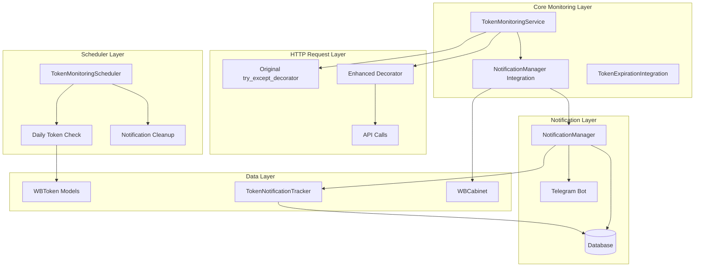
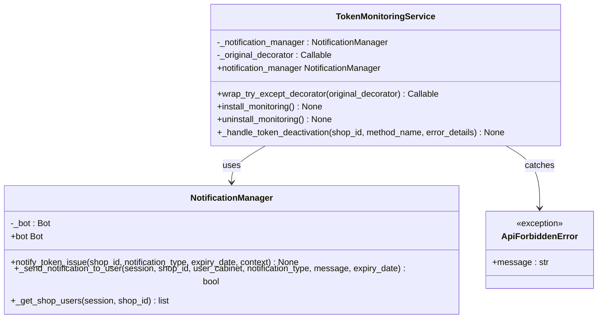
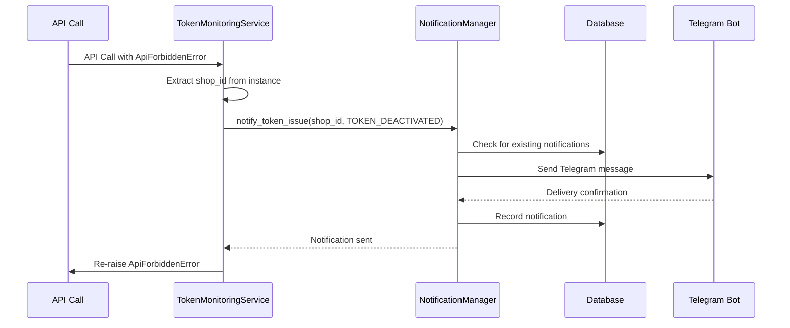
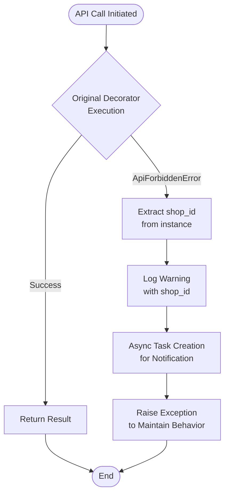
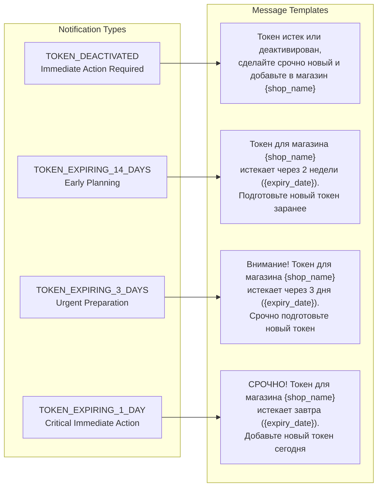
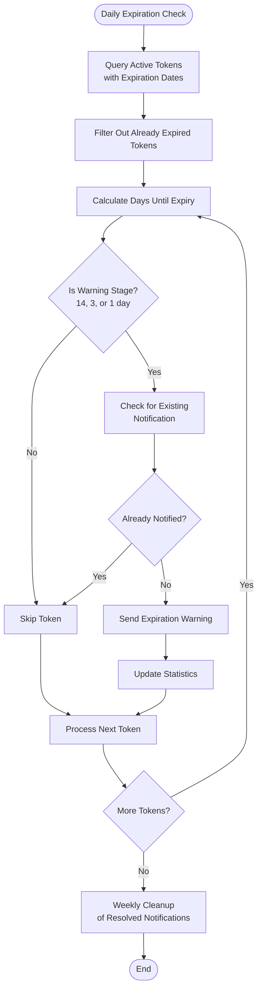
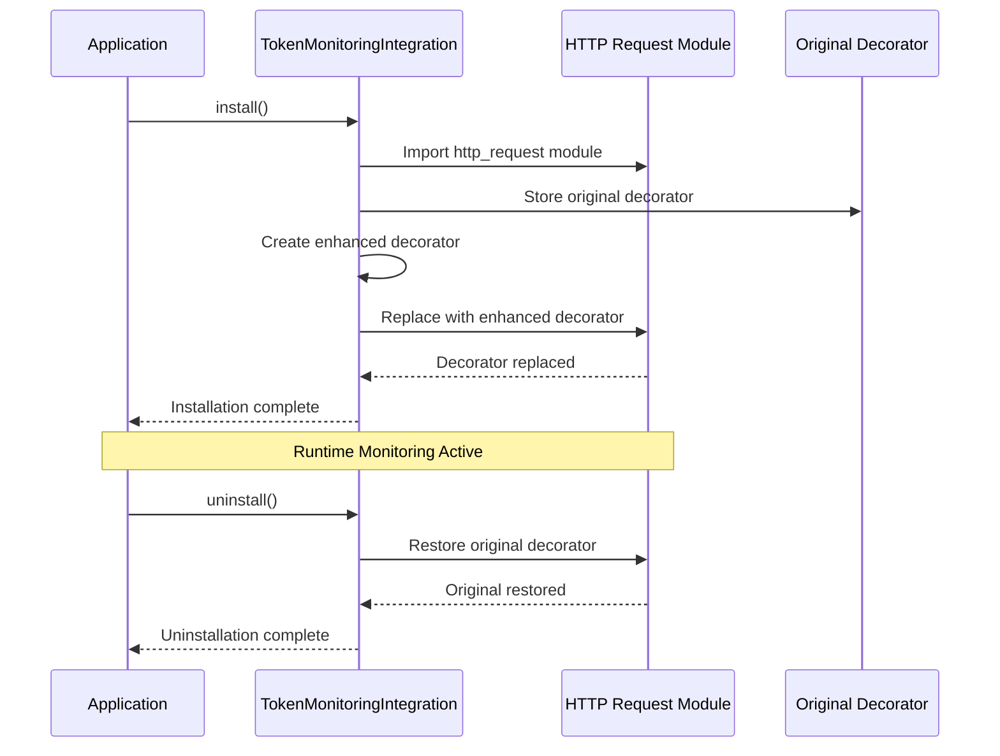
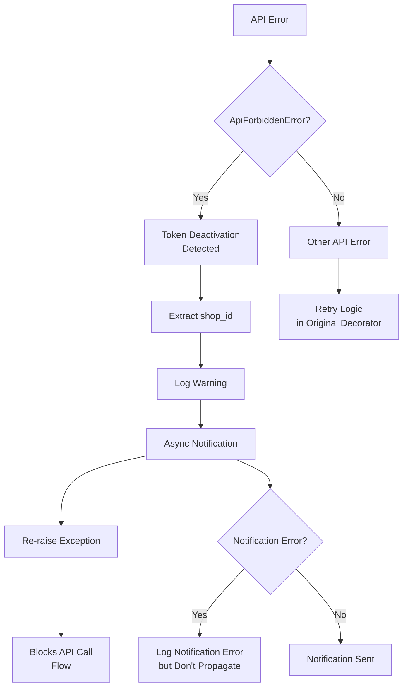

# Token Monitoring Service

<cite>
**Referenced Files in This Document**
- [token_monitoring_service.py](file://app/modules/token_monitoring/services/token_monitoring_service.py)
- [notification_manager.py](file://app/modules/token_monitoring/services/notification_manager.py)
- [token_expiration_service.py](file://app/modules/token_monitoring/services/token_expiration_service.py)
- [token_info_service.py](file://app/modules/token_monitoring/services/token_info_service.py)
- [models.py](file://app/modules/token_monitoring/models.py)
- [scheduler.py](file://app/modules/token_monitoring/scheduler.py)
- [startup.py](file://app/modules/token_monitoring/startup.py)
- [integration.py](file://app/modules/token_monitoring/integration.py)
- [http_request.py](file://app/core/wb_api/http_request.py)
- [README.md](file://app/modules/token_monitoring/README.md)
- [token_monitoring_demo.py](file://examples/token_monitoring_demo.py)
</cite>

## Table of Contents
1. [Introduction](#introduction)
2. [System Architecture](#system-architecture)
3. [Core Components](#core-components)
4. [API Call Interception](#api-call-interception)
5. [Notification Management](#notification-management)
6. [Token Expiration Monitoring](#token-expiration-monitoring)
7. [Lifecycle Management](#lifecycle-management)
8. [Configuration and Integration](#configuration-and-integration)
9. [Error Handling](#error-handling)
10. [Performance Considerations](#performance-considerations)
11. [Troubleshooting Guide](#troubleshooting-guide)
12. [Conclusion](#conclusion)

## Introduction

The Token Monitoring Service is a comprehensive system designed to detect and handle token deactivation events in real-time while providing proactive expiration monitoring for Wildberries advertising tokens. This service seamlessly integrates with the existing HTTP request infrastructure to intercept API calls and automatically detect when all tokens for a shop become invalid, triggering immediate notifications to affected users.

The system operates on two primary detection mechanisms:
- **Real-time API Monitoring**: Intercepting HTTP requests to detect token deactivation during API calls
- **Proactive Expiration Tracking**: Daily monitoring of token expiration dates with multi-stage warning notifications

## System Architecture

The Token Monitoring Service follows a modular architecture with clear separation of concerns:



**Diagram sources**
- [token_monitoring_service.py](file://app/modules/token_monitoring/services/token_monitoring_service.py#L1-L209)
- [notification_manager.py](file://app/modules/token_monitoring/services/notification_manager.py#L1-L336)
- [scheduler.py](file://app/modules/token_monitoring/scheduler.py#L1-L186)

## Core Components

### TokenMonitoringService

The central component responsible for intercepting API calls and detecting token deactivation events:



**Diagram sources**
- [token_monitoring_service.py](file://app/modules/token_monitoring/services/token_monitoring_service.py#L12-L209)
- [notification_manager.py](file://app/modules/token_monitoring/services/notification_manager.py#L25-L336)

### NotificationManager

Manages all user notifications with sophisticated error handling and duplicate prevention:



**Diagram sources**
- [token_monitoring_service.py](file://app/modules/token_monitoring/services/token_monitoring_service.py#L85-L120)
- [notification_manager.py](file://app/modules/token_monitoring/services/notification_manager.py#L65-L150)

**Section sources**
- [token_monitoring_service.py](file://app/modules/token_monitoring/services/token_monitoring_service.py#L1-L209)
- [notification_manager.py](file://app/modules/token_monitoring/services/notification_manager.py#L1-L336)

## API Call Interception

### Decorator Wrapping Mechanism

The Token Monitoring Service implements a sophisticated decorator wrapping mechanism that intercepts API calls without disrupting existing functionality:



**Diagram sources**
- [token_monitoring_service.py](file://app/modules/token_monitoring/services/token_monitoring_service.py#L45-L120)

### Implementation Details

The service wraps the original `try_except_decorator` from the HTTP request module:

```python
def wrap_try_except_decorator(self, original_decorator: Callable) -> Callable:
    """
    Wrap the existing try_except_decorator to add token monitoring capabilities.
    
    This method preserves the original decorator functionality while adding
    token deactivation detection and notification capabilities.
    """
    self._original_decorator = original_decorator
    
    def enhanced_try_except_decorator(
        requests_per_interval: int,
        interval_seconds: int | float,
        max_attempts: int = 50,
        max_delay: int = 120,
    ) -> Callable:
        
        def decorator(func: Callable) -> Callable:
            # First apply the original decorator
            original_decorated_func = original_decorator(
                requests_per_interval, 
                interval_seconds, 
                max_attempts, 
                max_delay
            )(func)
            
            async def monitoring_wrapper(instance: Any, *args: Any, **kwargs: Any) -> Any:
                """Wrapper that adds token monitoring around the original decorated function."""
                try:
                    # Call the original decorated function
                    result = await original_decorated_func(instance, *args, **kwargs)
                    return result
                    
                except ApiForbiddenError as e:
                    # Token deactivation detected - all tokens have failed
                    shop_id = getattr(instance, 'shop_id', None)
                    
                    if shop_id:
                        logger.warning(
                            f"Token deactivation detected for shop {shop_id} "
                            f"during {func.__name__} call: {e}"
                        )
                        
                        # Send notification asynchronously (don't block the main flow)
                        asyncio.create_task(
                            self._handle_token_deactivation(shop_id, func.__name__, str(e))
                        )
                    else:
                        logger.warning(
                            f"Token deactivation detected but no shop_id available "
                            f"during {func.__name__} call: {e}"
                        )
                    
                    # Re-raise the exception to maintain existing behavior
                    raise
                
            return monitoring_wrapper
        
        return decorator
    
    return enhanced_try_except_decorator
```

**Section sources**
- [token_monitoring_service.py](file://app/modules/token_monitoring/services/token_monitoring_service.py#L45-L120)

## Notification Management

### Notification Types and Templates

The system supports four distinct notification types with localized Russian messages:



**Diagram sources**
- [notification_manager.py](file://app/modules/token_monitoring/services/notification_manager.py#L25-L45)

### Asynchronous Notification Delivery

The notification system implements asynchronous delivery to prevent blocking API calls:

```python
async def _handle_token_deactivation(self, shop_id: str, method_name: str, error_details: str) -> None:
    """
    Handle token deactivation event by sending notifications.
    
    Args:
        shop_id: The shop ID where token deactivation occurred
        method_name: The API method that failed
        error_details: Details about the error
    """
    try:
        logger.info(f"Handling token deactivation for shop {shop_id}")
        
        # Send deactivation notification
        await self.notification_manager.notify_token_issue(
            shop_id=shop_id,
            notification_type=NotificationType.TOKEN_DEACTIVATED.value,
            context={
                "method_name": method_name,
                "error_details": error_details,
            }
        )
        
        logger.info(f"Token deactivation notification sent for shop {shop_id}")
        
    except Exception as notification_error:
        # Log notification errors but don't propagate them
        logger.error(
            f"Failed to send token deactivation notification for shop {shop_id}: "
            f"{notification_error}",
            exc_info=True
        )
```

**Section sources**
- [token_monitoring_service.py](file://app/modules/token_monitoring/services/token_monitoring_service.py#L121-L145)
- [notification_manager.py](file://app/modules/token_monitoring/services/notification_manager.py#L25-L150)

## Token Expiration Monitoring

### Proactive Expiration Detection

The TokenExpirationService implements a multi-stage warning system for token expiration:



**Diagram sources**
- [token_expiration_service.py](file://app/modules/token_monitoring/services/token_expiration_service.py#L45-L120)

### Warning Stages Configuration

The system implements configurable warning stages with automatic cleanup:

```python
class TokenExpirationService:
    """Service for monitoring token expiration dates and sending proactive notifications."""
    
    # Warning stages: days before expiry when to send notifications
    WARNING_STAGES = [14, 3, 1]
    
    # Map days to notification types
    DAYS_TO_NOTIFICATION_TYPE = {
        14: NotificationType.TOKEN_EXPIRING_14_DAYS.value,
        3: NotificationType.TOKEN_EXPIRING_3_DAYS.value,
        1: NotificationType.TOKEN_EXPIRING_1_DAY.value,
    }
```

### Database Constraints for Duplicate Prevention

The system uses database constraints to prevent duplicate notifications:

```python
class TokenNotificationTracker(BaseTable):
    """
    Table for tracking token-related notifications sent to users.
    
    Prevents duplicate notifications and provides audit trail for token issues.
    The unique constraint ensures only one notification per (shop_id, user_telegram_id, notification_type).
    """
    
    __table_args__ = (
        # Unique constraint prevents duplicate notifications for same shop/user/type
        UniqueConstraint(
            "shop_id", 
            "user_telegram_id", 
            "notification_type", 
            name="uq_token_notification_shop_user_type"
        ),
    )
```

**Section sources**
- [token_expiration_service.py](file://app/modules/token_monitoring/services/token_expiration_service.py#L1-L314)
- [models.py](file://app/modules/token_monitoring/models.py#L35-L81)

## Lifecycle Management

### Installation and Uninstallation

The system provides robust lifecycle management with circular import mitigation:



**Diagram sources**
- [integration.py](file://app/modules/token_monitoring/integration.py#L20-L80)

### Lazy Loading Implementation

Circular import mitigation through lazy loading:

```python
@property
def notification_manager(self):
    """Lazy-load notification manager to avoid circular imports."""
    if self._notification_manager is None:
        from app.modules.token_monitoring.services.notification_manager import NotificationManager
        self._notification_manager = NotificationManager()
    return self._notification_manager
```

### Global Instance Management

The system maintains global instances for convenient access:

```python
# Global instance for convenience
_monitoring_service = None

def get_token_monitoring_service() -> TokenMonitoringService:
    """Get or create the global token monitoring service instance."""
    global _monitoring_service
    if _monitoring_service is None:
        _monitoring_service = TokenMonitoringService()
    return _monitoring_service
```

**Section sources**
- [token_monitoring_service.py](file://app/modules/token_monitoring/services/token_monitoring_service.py#L15-L35)
- [integration.py](file://app/modules/token_monitoring/integration.py#L1-L112)

## Configuration and Integration

### Startup Configuration

The system provides flexible startup configuration with comprehensive error handling:

```python
async def initialize_token_monitoring(
    enable_decorator_monitoring: bool = True,
    enable_expiration_scheduler: bool = True,
    daily_check_time: time = time(9, 0)
) -> None:
    """
    Initialize the complete token monitoring system.
    
    Args:
        enable_decorator_monitoring: Whether to install HTTP decorator monitoring
        enable_expiration_scheduler: Whether to start the expiration scheduler
        daily_check_time: Time of day to run daily expiration checks
    """
    logger.info("Initializing token monitoring system...")
    
    try:
        # Install decorator monitoring for token deactivation detection
        if enable_decorator_monitoring:
            try:
                install_token_monitoring()
                logger.info("✓ Token deactivation monitoring installed")
            except Exception as e:
                logger.error(f"✗ Failed to install decorator monitoring: {e}")
                raise
        
        # Start expiration scheduler for proactive monitoring
        if enable_expiration_scheduler:
            try:
                await start_token_monitoring_scheduler(daily_check_time)
                logger.info(f"✓ Token expiration scheduler started (daily at {daily_check_time})")
            except Exception as e:
                logger.error(f"✗ Failed to start expiration scheduler: {e}")
                raise
        
        logger.info("Token monitoring system initialization completed successfully")
        
    except Exception as e:
        logger.error(f"Failed to initialize token monitoring system: {e}")
        raise
```

### Integration Patterns

The system supports multiple integration patterns:

1. **Quick Setup**: `install_all_token_monitoring()` for most applications
2. **Custom Configuration**: `initialize_token_monitoring()` with specific options
3. **Graceful Shutdown**: `shutdown_token_monitoring()` for clean termination

**Section sources**
- [startup.py](file://app/modules/token_monitoring/startup.py#L1-L120)
- [README.md](file://app/modules/token_monitoring/README.md#L50-L100)

## Error Handling

### Comprehensive Error Management

The system implements layered error handling across all components:



**Diagram sources**
- [token_monitoring_service.py](file://app/modules/token_monitoring/services/token_monitoring_service.py#L85-L120)

### Error Categories and Handling Strategies

1. **API Errors**: Handled by original retry logic with token rotation
2. **Notification Errors**: Logged but don't interrupt main flow
3. **Database Errors**: Handled by unique constraints and transaction rollback
4. **Telegram Errors**: Graceful handling of blocked users and delivery failures

### Exception Propagation

The system maintains proper exception propagation while providing comprehensive logging:

```python
except ApiForbiddenError as e:
    # Token deactivation detected - all tokens have failed
    shop_id = getattr(instance, 'shop_id', None)
    
    if shop_id:
        logger.warning(
            f"Token deactivation detected for shop {shop_id} "
            f"during {func.__name__} call: {e}"
        )
        
        # Send notification asynchronously (don't block the main flow)
        asyncio.create_task(
            self._handle_token_deactivation(shop_id, func.__name__, str(e))
        )
    else:
        logger.warning(
            f"Token deactivation detected but no shop_id available "
            f"during {func.__name__} call: {e}"
        )
    
    # Re-raise the exception to maintain existing behavior
    raise
```

**Section sources**
- [token_monitoring_service.py](file://app/modules/token_monitoring/services/token_monitoring_service.py#L85-L120)
- [notification_manager.py](file://app/modules/token_monitoring/services/notification_manager.py#L100-L150)

## Performance Considerations

### Asynchronous Operations

The system prioritizes non-blocking operations:

- **Async Task Creation**: Notifications are sent via `asyncio.create_task()` to avoid blocking API calls
- **Non-blocking Database Operations**: All database operations use async/await patterns
- **Efficient Querying**: Optimized database queries with proper indexing

### Memory Management

- **Lazy Loading**: Components are loaded only when needed
- **Global Instances**: Singletons prevent unnecessary object creation
- **Resource Cleanup**: Proper cleanup of scheduler tasks and database connections

### Database Optimization

- **Indexing**: Automatic indexes on frequently queried columns
- **Unique Constraints**: Prevent duplicate notifications efficiently
- **Transaction Management**: Proper transaction boundaries to prevent resource leaks

### Rate Limiting

- **Telegram API Compliance**: Respects bot API rate limits
- **Database Query Optimization**: Efficient queries with proper indexing
- **Background Task Management**: Non-blocking scheduled operations

## Troubleshooting Guide

### Common Issues and Solutions

#### No Notifications Sent

**Symptoms**: Token deactivation detected but no notifications received

**Possible Causes**:
- Shop has no associated users in `WBUserCabinet`
- Telegram bot credentials are incorrect
- Users have blocked the bot

**Diagnostic Steps**:
```python
# Check if monitoring is installed
from app.modules.token_monitoring.integration import is_token_monitoring_installed
if not is_token_monitoring_installed():
    logger.warning("Token monitoring not installed")

# Verify shop-user associations
from app.modules.token_monitoring.services.notification_manager import NotificationManager
manager = NotificationManager()
users = await manager._get_shop_users(session, shop_id)
if not users:
    logger.warning(f"No users found for shop {shop_id}")

# Check for Telegram errors in logs
# Look for TelegramForbiddenError entries
```

#### Duplicate Notifications

**Symptoms**: Same notification sent multiple times

**Cause**: Database unique constraint violation

**Solution**: The system uses database constraints to prevent duplicates:
```sql
UNIQUE CONSTRAINT uq_token_notification_shop_user_type 
ON token_notification_tracker (shop_id, user_telegram_id, notification_type)
```

#### Missing Token Data

**Symptoms**: Token expiration monitoring not working

**Possible Causes**:
- `WBToken` records lack `shop_id` values
- Token expiration dates are not set
- Database connection issues

**Diagnostic Steps**:
```python
# Verify token data
from app.modules.common_slaves.wildberries.models import WBToken
stmt = select(WBToken).where(WBToken.shop_id.is_not(None)).limit(10)
tokens = await session.execute(stmt)
for token in tokens.scalars().all():
    print(f"Token {token.id}: shop_id={token.shop_id}, expires={token.expires}")
```

### Debug Mode Configuration

Enable detailed logging for troubleshooting:

```python
import logging

# Configure logging level
logging.getLogger('app.modules.token_monitoring').setLevel(logging.DEBUG)

# Enable SQLAlchemy query logging
logging.getLogger('sqlalchemy.engine').setLevel(logging.INFO)
```

### Health Checks

Verify system status with built-in health checks:

```python
# Check if monitoring is installed
from app.modules.token_monitoring.integration import is_token_monitoring_installed

# Run manual check to verify functionality
from app.modules.token_monitoring.services.token_expiration_service import run_token_expiration_check
stats = await run_token_expiration_check()

# Monitor key metrics
total_checked = stats['total_tokens_checked']
notifications_sent = stats['notifications_sent']
error_count = stats['errors']

if error_count > 0:
    logger.warning(f"Token monitoring errors: {error_count}")
```

**Section sources**
- [README.md](file://app/modules/token_monitoring/README.md#L400-L447)
- [token_monitoring_service.py](file://app/modules/token_monitoring/services/token_monitoring_service.py#L160-L209)

## Conclusion

The Token Monitoring Service provides a comprehensive solution for detecting and handling token deactivation events while offering proactive expiration monitoring. Through its sophisticated decorator wrapping mechanism, asynchronous notification system, and robust error handling, the service ensures reliable token status monitoring without disrupting existing API functionality.

Key strengths of the system include:

- **Seamless Integration**: Non-invasive decorator wrapping that maintains backward compatibility
- **Real-time Detection**: Immediate notification of token deactivation events
- **Proactive Monitoring**: Multi-stage expiration warnings with configurable thresholds
- **Robust Error Handling**: Comprehensive error management across all components
- **Performance Optimization**: Asynchronous operations and efficient database usage
- **Flexible Configuration**: Multiple integration patterns for different deployment scenarios

The system's modular architecture allows for easy maintenance and extension, while its comprehensive logging and monitoring capabilities provide excellent observability for production environments.

For optimal results, ensure proper database migrations are applied, configure appropriate logging levels, and integrate the monitoring system during application startup with graceful shutdown procedures during application termination.