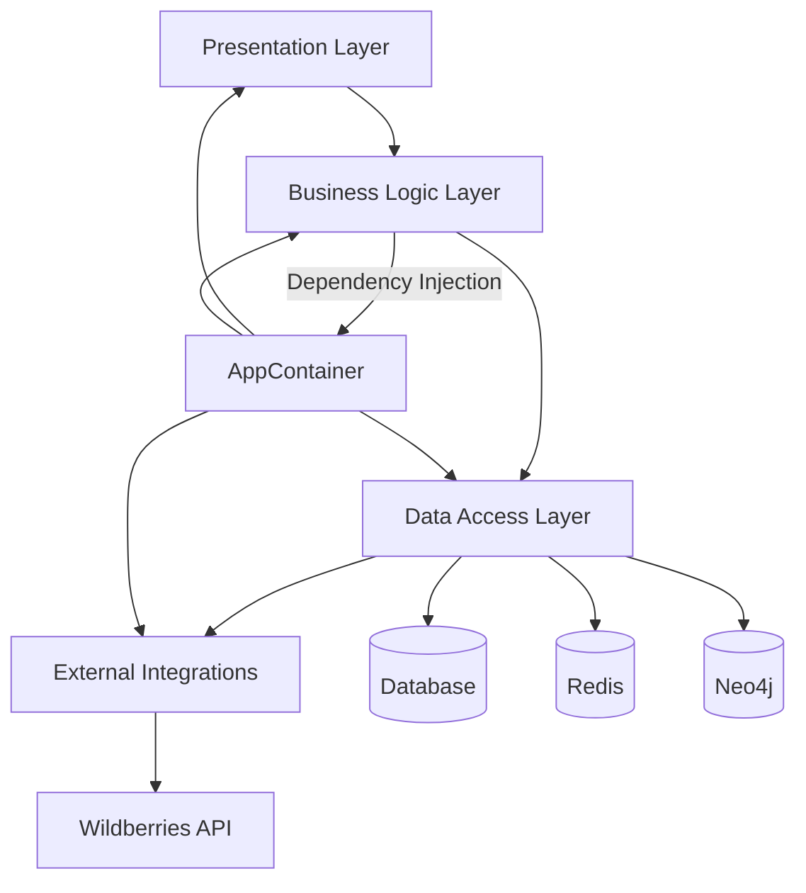
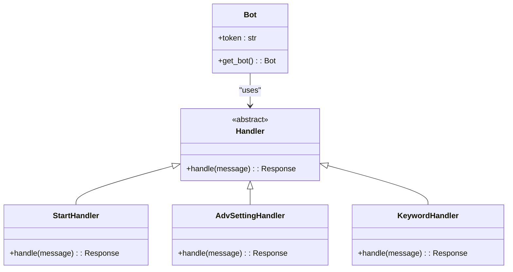
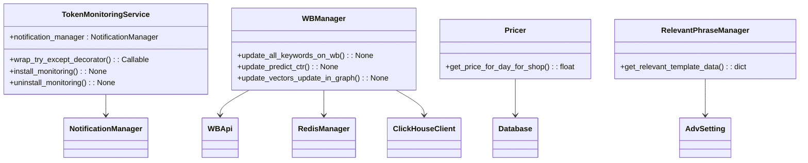
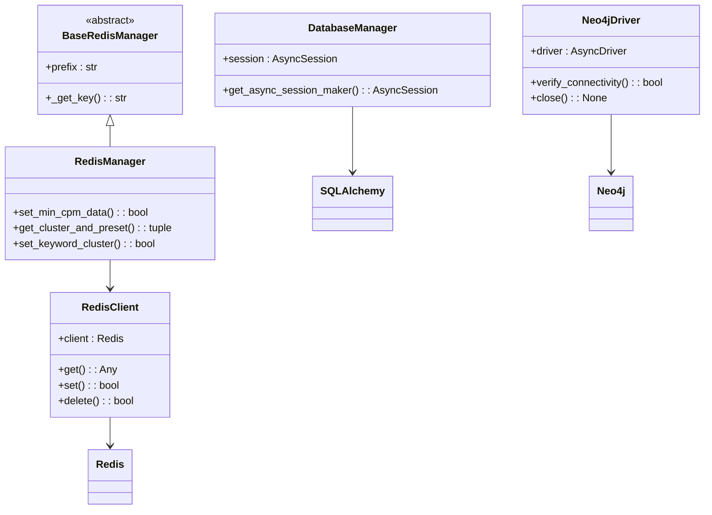
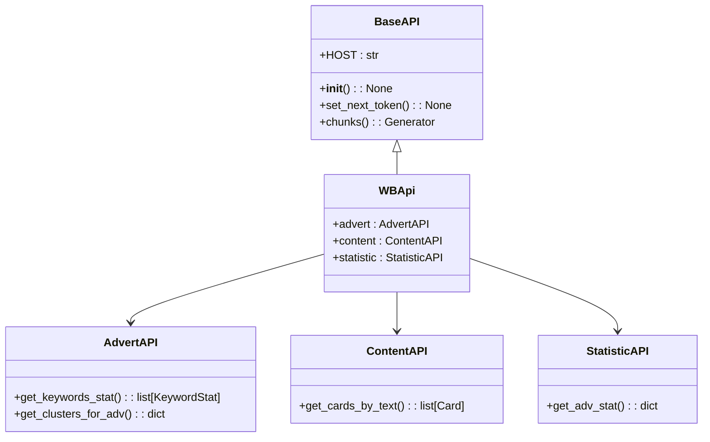
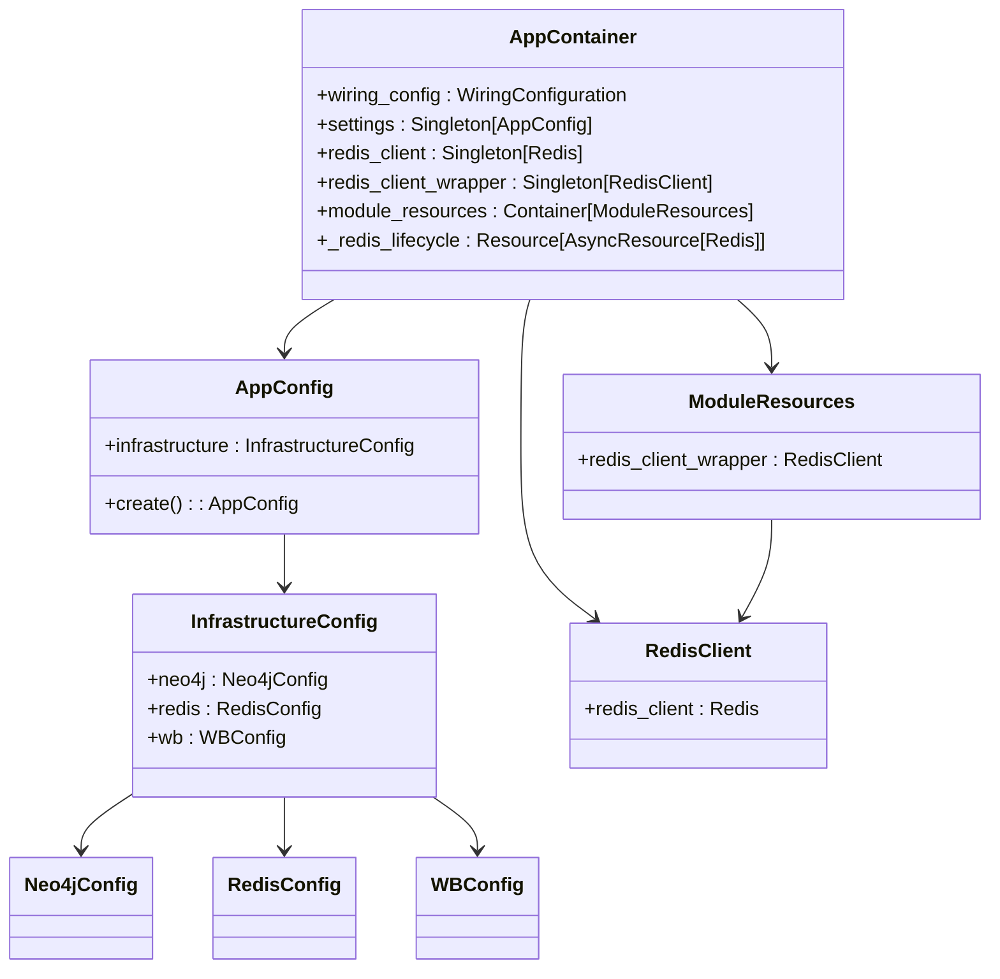
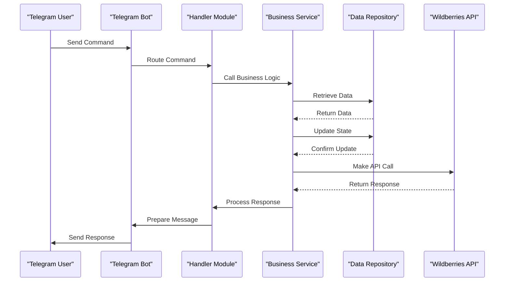
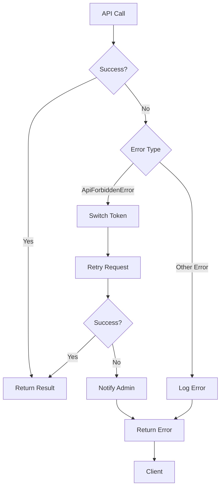
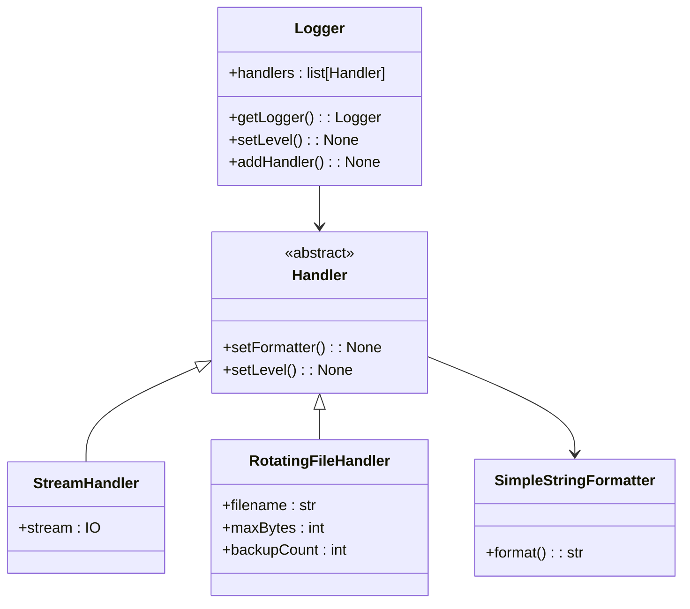

# Component Architecture

<cite>
**Referenced Files in This Document**   
- [app_container.py](file://app/core/di/app_container.py)
- [bot.py](file://app/client_bot/bot.py)
- [token_monitoring_service.py](file://app/modules/token_monitoring/services/token_monitoring_service.py)
- [base.py](file://app/core/wb_api/base.py)
- [models.py](file://app/utils/db/models.py)
- [base_redis_manager.py](file://app/core/redis_manager_v2/base_redis_manager.py)
- [neo4j.py](file://app/core/di/databases/neo4j.py)
- [logging_config.json](file://logging_config.json)
- [app_config.py](file://app/configs/app_config.py)
- [infrastructure_config.py](file://app/configs/infrastructure_config/infrastructure_config.py)
- [wb_config.py](file://app/configs/infrastructure_config/wb_config.py)
- [redis_config.py](file://app/configs/infrastructure_config/redis_config.py)
- [neo4j_config.py](file://app/configs/infrastructure_config/neo4j_config.py)
- [wb_manager.py](file://app/modules/wb_adv_updater/wb_manager.py)
</cite>

## Table of Contents
1. [Introduction](#introduction)
2. [Layered Architecture Overview](#layered-architecture-overview)
3. [Presentation Layer](#presentation-layer)
4. [Business Logic Layer](#business-logic-layer)
5. [Data Access Layer](#data-access-layer)
6. [External Integrations](#external-integrations)
7. [Dependency Injection via AppContainer](#dependency-injection-via-appcontainer)
8. [Request Flow Sequence](#request-flow-sequence)
9. [Error Handling Patterns](#error-handling-patterns)
10. [Logging Implementation](#logging-implementation)
11. [Conclusion](#conclusion)

## Introduction
The adv-bot system is a multi-layered application designed to manage Wildberries advertising campaigns through a Telegram interface. This document details the component architecture, focusing on the four main layers: Presentation Layer (Telegram bot interface using aiogram), Business Logic Layer (feature modules like token monitoring and ad updating), Data Access Layer (SQLAlchemy, Redis, Neo4j integrations), and External Integrations (Wildberries API). The architecture leverages dependency injection via AppContainer to manage component relationships and ensure loose coupling between layers.

**Section sources**
- [app_container.py](file://app/core/di/app_container.py)
- [bot.py](file://app/client_bot/bot.py)

## Layered Architecture Overview

**Diagram sources**
- [app_container.py](file://app/core/di/app_container.py)
- [bot.py](file://app/client_bot/bot.py)

**Section sources**
- [app_container.py](file://app/core/di/app_container.py)
- [bot.py](file://app/client_bot/bot.py)

## Presentation Layer

The Presentation Layer is implemented using the aiogram framework for Telegram bot interaction. The layer handles user commands, displays interfaces, and manages conversation states. The `bot.py` file initializes the Telegram Bot instance using configuration from the dependency injection container.

This layer receives user input from Telegram, processes it through appropriate handlers in the client_bot/user_interface/handlers directory, and returns responses. The layer is responsible for parsing user commands, validating input, and forwarding requests to the appropriate business logic modules.

**Diagram sources**
- [bot.py](file://app/client_bot/bot.py)

**Section sources**
- [bot.py](file://app/client_bot/bot.py)

## Business Logic Layer

The Business Logic Layer contains feature modules that implement the core functionality of the adv-bot system. These modules include token monitoring, ad updating, balance management, and various other business features. The layer orchestrates operations between the Presentation Layer and the Data Access Layer.

Key modules in this layer include:
- token_monitoring: Monitors token deactivation events and sends notifications
- wb_adv_updater: Manages advertising campaign updates and keyword optimization
- billing: Handles pricing and payment calculations
- shop_runner: Manages shop-level operations and configurations

The layer uses services to encapsulate business logic and ensure separation of concerns. For example, the TokenMonitoringService detects token deactivation during API calls and triggers appropriate notifications.

**Diagram sources**
- [token_monitoring_service.py](file://app/modules/token_monitoring/services/token_monitoring_service.py)
- [wb_manager.py](file://app/modules/wb_adv_updater/wb_manager.py)

**Section sources**
- [token_monitoring_service.py](file://app/modules/token_monitoring/services/token_monitoring_service.py)
- [wb_manager.py](file://app/modules/wb_adv_updater/wb_manager.py)

## Data Access Layer

The Data Access Layer provides integration with multiple data storage systems including relational databases (via SQLAlchemy), Redis for caching, and Neo4j for graph data. This layer abstracts the underlying data storage mechanisms and provides a consistent interface for the Business Logic Layer.

The layer uses SQLAlchemy for persistent storage of application data such as user information, advertising settings, and payment records. Redis is used for caching frequently accessed data and managing temporary states. Neo4j is used for storing and querying graph-based data related to keyword relationships and advertising hierarchies.

**Diagram sources**
- [models.py](file://app/utils/db/models.py)
- [base_redis_manager.py](file://app/core/redis_manager_v2/base_redis_manager.py)
- [neo4j.py](file://app/core/di/databases/neo4j.py)

**Section sources**
- [models.py](file://app/utils/db/models.py)
- [base_redis_manager.py](file://app/core/redis_manager_v2/base_redis_manager.py)
- [neo4j.py](file://app/core/di/databases/neo4j.py)

## External Integrations

The External Integrations layer handles communication with the Wildberries API and other external services. This layer abstracts the external API details and provides a consistent interface for the Business Logic Layer.

The BaseAPI class serves as the foundation for Wildberries API integration, handling authentication, token management, and request routing. When a token becomes invalid, the system automatically switches to an alternative token and notifies administrators through the token monitoring system.

**Diagram sources**
- [base.py](file://app/core/wb_api/base.py)

**Section sources**
- [base.py](file://app/core/wb_api/base.py)

## Dependency Injection via AppContainer

The AppContainer class implements dependency injection to manage component dependencies and lifecycle. This container centralizes the creation and configuration of application components, ensuring loose coupling between layers and facilitating testing and maintenance.

The container uses the dependency_injector library to provide singleton instances of services, configuration objects, and database connections. Components declare their dependencies, and the container automatically resolves and injects them.

**Diagram sources**
- [app_container.py](file://app/core/di/app_container.py)
- [app_config.py](file://app/configs/app_config.py)
- [infrastructure_config.py](file://app/configs/infrastructure_config/infrastructure_config.py)

**Section sources**
- [app_container.py](file://app/core/di/app_container.py)
- [app_config.py](file://app/configs/app_config.py)
- [infrastructure_config.py](file://app/configs/infrastructure_config/infrastructure_config.py)

## Request Flow Sequence

The following sequence diagram illustrates the flow of a request from a Telegram message to a Wildberries API call, demonstrating the interaction between layers:

**Diagram sources**
- [bot.py](file://app/client_bot/bot.py)
- [token_monitoring_service.py](file://app/modules/token_monitoring/services/token_monitoring_service.py)
- [base.py](file://app/core/wb_api/base.py)

**Section sources**
- [bot.py](file://app/client_bot/bot.py)
- [token_monitoring_service.py](file://app/modules/token_monitoring/services/token_monitoring_service.py)
- [base.py](file://app/core/wb_api/base.py)

## Error Handling Patterns

The system implements comprehensive error handling across all layers. The token monitoring service detects API access issues and automatically handles token deactivation events. When a token becomes invalid, the system switches to an alternative token and notifies administrators.

The error handling strategy includes:
- Centralized exception handling in API clients
- Automatic token rotation when access is denied
- Asynchronous notification of critical issues
- Graceful degradation when services are unavailable
- Comprehensive logging of all errors

The system uses specific exception types like ApiForbiddenError to distinguish between different error conditions and apply appropriate handling strategies.

**Diagram sources**
- [token_monitoring_service.py](file://app/modules/token_monitoring/services/token_monitoring_service.py)
- [base.py](file://app/core/wb_api/base.py)

**Section sources**
- [token_monitoring_service.py](file://app/modules/token_monitoring/services/token_monitoring_service.py)
- [base.py](file://app/core/wb_api/base.py)

## Logging Implementation

The system uses Python's logging module with a comprehensive configuration that includes both console and file output. The logging configuration is defined in logging_config.json and includes handlers for different log levels.

Key features of the logging implementation:
- Structured log format with timestamp, logger name, line number, and message
- Console output for all log levels
- File output for error-level messages only
- Rotating file handler to prevent log files from growing indefinitely
- Custom log level normalization
- Integration with application settings for log level configuration

The logging system is initialized through the setup_logging function in python_modules/logger.py, which configures the root logger with the specified handlers and format.

**Diagram sources**
- [logging_config.json](file://logging_config.json)
- [logger.py](file://python_modules/logger.py)

**Section sources**
- [logging_config.json](file://logging_config.json)
- [logger.py](file://python_modules/logger.py)

## Conclusion
The adv-bot system employs a well-structured layered architecture with clear separation of concerns between presentation, business logic, data access, and external integration layers. The use of dependency injection via AppContainer ensures loose coupling between components and facilitates testing and maintenance. The system effectively handles communication with the Wildberries API while providing a user-friendly Telegram interface. Comprehensive error handling and logging mechanisms ensure system reliability and facilitate troubleshooting. This architecture provides a solid foundation for the system's core functionality of managing Wildberries advertising campaigns.