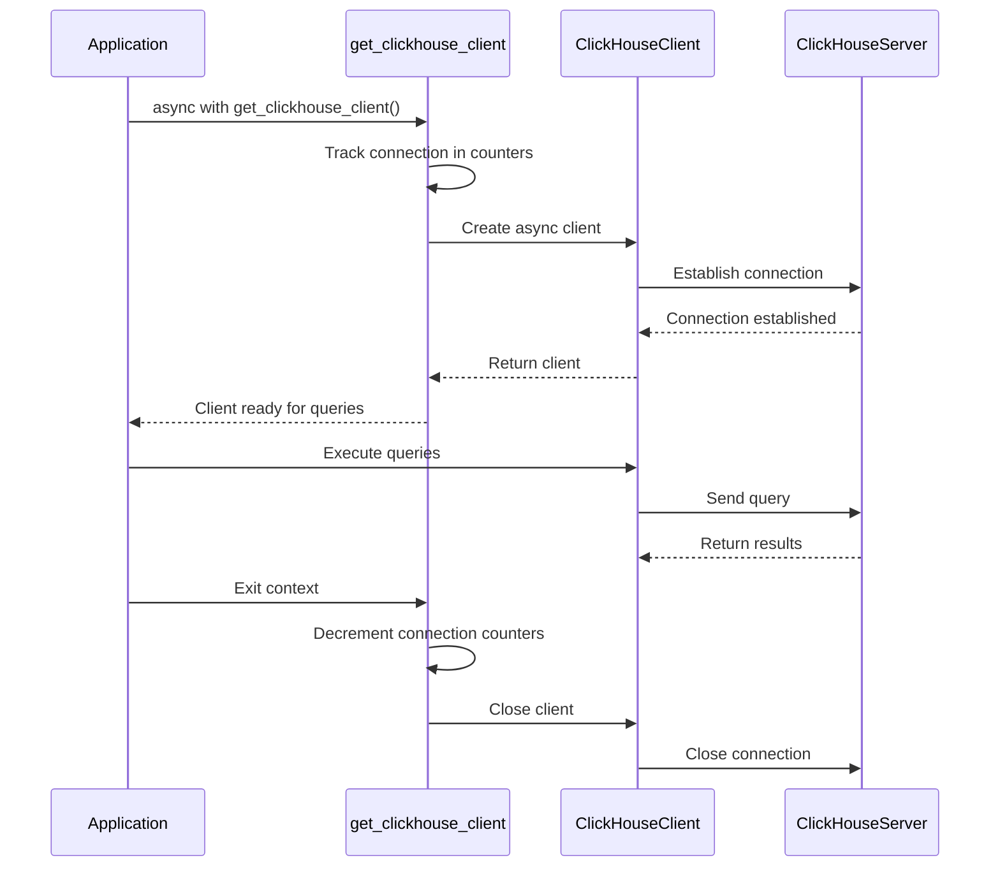
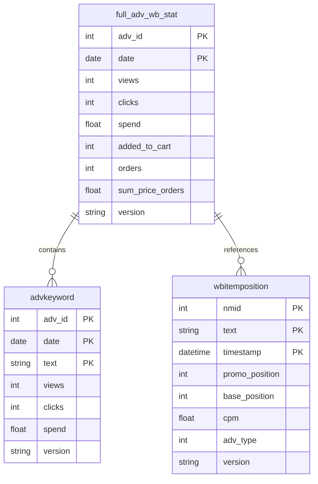
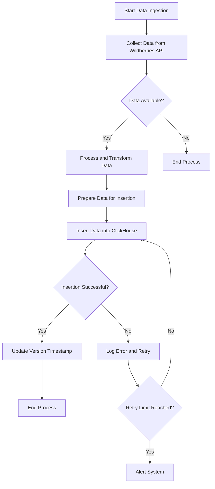
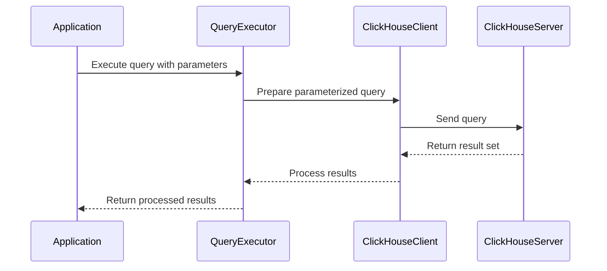
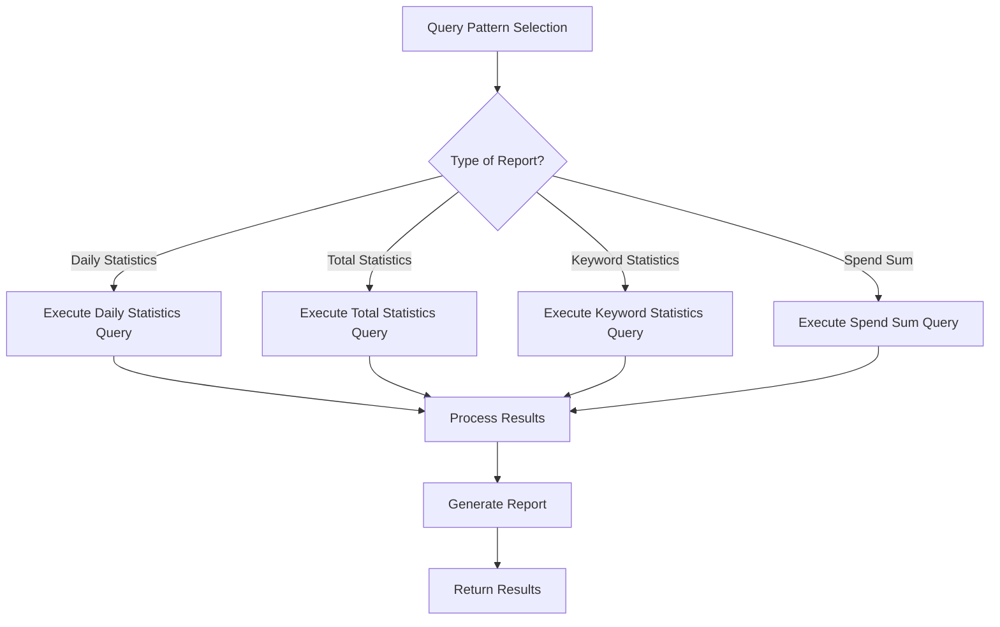
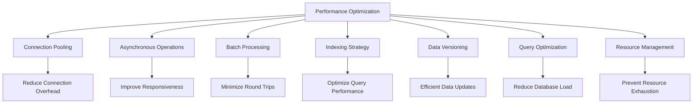
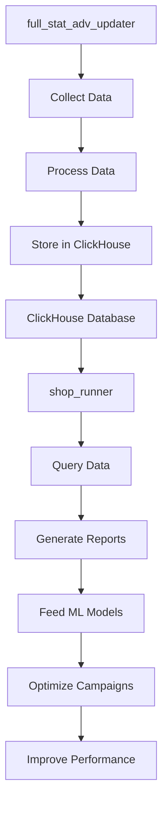

# ClickHouse Data Access

<cite>
**Referenced Files in This Document**   
- [client.py](file://app/utils/click_house/client.py)
- [full_wb_adv_stat.py](file://app/modules/shop_runner/wb_stat_manager/clickhouse_manager/full_wb_adv_stat.py)
- [click_house_control_spend_sum.py](file://app/modules/shop_runner/service_manager/old_modules/setting_auto_updater/click_house_control_spend_sum.py)
- [data_manager.py](file://app/modules/wb_adv_updater/data_manager.py)
- [settings_master.py](file://app/settings/settings_master.py)
- [full_adv_stat.py](file://app/modules/full_stat_adv_updater/types/full_adv_stat.py)
</cite>

## Table of Contents
1. [Introduction](#introduction)
2. [ClickHouse Client Configuration and Connection Handling](#clickhouse-client-configuration-and-connection-handling)
3. [Schema Design for Advertising Statistics](#schema-design-for-advertising-statistics)
4. [Data Ingestion Workflows](#data-ingestion-workflows)
5. [Query Execution Patterns](#query-execution-patterns)
6. [Common Query Patterns for Performance Reports](#common-query-patterns-for-performance-reports)
7. [Retention Policies and Performance Optimization](#retention-policies-and-performance-optimization)
8. [Integration with full_stat_adv_updater and shop_runner Modules](#integration-with-full_stat_adv_updater-and-shop_runner-modules)
9. [Conclusion](#conclusion)

## Introduction
The ClickHouse analytics database integration in the adv-bot system serves as the central repository for storing and querying large volumes of advertising performance data. This document provides comprehensive documentation on the ClickHouse integration, focusing on its role in the system architecture, client configuration, connection handling, query execution patterns, schema design for advertising statistics, common query patterns for generating performance reports, data ingestion workflows, retention policies, and performance optimization strategies. The integration is primarily utilized by the full_stat_adv_updater and shop_runner modules to collect, store, and analyze advertising performance metrics.

## ClickHouse Client Configuration and Connection Handling
The ClickHouse client configuration and connection handling in the adv-bot system are implemented through a sophisticated connection management system that ensures efficient resource utilization and proper connection tracking. The system uses the clickhouse_connect library to create asynchronous clients for interacting with the ClickHouse database.

The connection configuration is managed through environment variables accessed via the settings object from settings_master.py. Key configuration parameters include:
- **clickhouse_host**: The hostname of the ClickHouse server
- **clickhouse_user**: The username for authentication
- **clickhouse_password**: The password for authentication
- **CLICKHOUSE_PORT**: The port number for the ClickHouse server
- **CH_MAX_THREAD**: The maximum number of threads for ClickHouse operations

The connection handling is implemented through the get_clickhouse_client class, which acts as a context manager for managing ClickHouse client connections. This class provides automatic connection management with proper opening and closing of connections, ensuring that resources are properly released. The implementation includes connection tracking functionality that monitors the number of open connections at different levels of the call stack, which is particularly useful for debugging and performance monitoring in production environments.

A key feature of the connection handling system is the track_connections decorator, which simplifies the process of acquiring and releasing ClickHouse clients. This decorator automatically manages the client lifecycle, allowing developers to focus on query execution rather than connection management.



**Diagram sources**
- [client.py](file://app/utils/click_house/client.py#L1-L223)

**Section sources**
- [client.py](file://app/utils/click_house/client.py#L1-L223)
- [settings_master.py](file://app/settings/settings_master.py#L1-L433)

## Schema Design for Advertising Statistics
The schema design for advertising statistics in ClickHouse is optimized for time-series data organization and efficient aggregation operations. The primary tables used for storing advertising performance data are:

1. **default_db.full_adv_wb_stat**: This table stores comprehensive advertising statistics with the following columns:
   - adv_id: Identifier for the advertising campaign
   - date: Date of the statistics
   - views: Number of views
   - clicks: Number of clicks
   - spend: Total spending
   - added_to_cart: Number of items added to cart
   - orders: Number of orders
   - sum_price_orders: Total price of orders
   - version: Version timestamp for conflict resolution

2. **default_db.advkeyword**: This table stores keyword-level statistics with columns for:
   - adv_id: Advertising campaign identifier
   - date: Date of the statistics
   - text: Keyword text
   - views: Number of views for the keyword
   - clicks: Number of clicks for the keyword
   - spend: Spending associated with the keyword
   - version: Version timestamp

3. **default_db.wbitemposition**: This table stores item position data with columns for:
   - nmid: Item identifier
   - text: Keyword text
   - timestamp: Timestamp of the position data
   - promo_position: Promotional position
   - base_position: Base position
   - cpm: Cost per thousand impressions
   - adv_type: Type of advertisement
   - version: Version timestamp

The schema design follows a time-series pattern with date-based partitioning, which enables efficient querying of data over specific time periods. The use of a version column in each table allows for handling of data updates and conflicts, with the most recent version being selected through window functions in queries.

The data model is designed to support both detailed keyword-level analysis and aggregated campaign-level reporting. The schema supports the storage of historical data for trend analysis and performance comparison over time.



**Diagram sources**
- [full_wb_adv_stat.py](file://app/modules/shop_runner/wb_stat_manager/clickhouse_manager/full_wb_adv_stat.py#L1-L359)
- [data_manager.py](file://app/modules/wb_adv_updater/data_manager.py#L1-L1600)

**Section sources**
- [full_wb_adv_stat.py](file://app/modules/shop_runner/wb_stat_manager/clickhouse_manager/full_wb_adv_stat.py#L1-L359)
- [data_manager.py](file://app/modules/wb_adv_updater/data_manager.py#L1-L1600)

## Data Ingestion Workflows
The data ingestion workflows in the adv-bot system follow a structured process for collecting advertising performance data from external sources and storing it in ClickHouse. The primary data ingestion workflow is implemented in the full_stat_adv_updater module, which is responsible for periodically updating advertising statistics.

The data ingestion process consists of the following steps:

1. **Data Collection**: The system collects advertising performance data from the Wildberries API through the full_stat_adv_updater module. This data includes views, clicks, spending, orders, and other performance metrics.

2. **Data Processing**: The collected data is processed and transformed into the appropriate format for storage in ClickHouse. This includes calculating derived metrics and ensuring data consistency.

3. **Data Storage**: The processed data is stored in ClickHouse using the insert function in the full_wb_adv_stat.py module. The insertion process uses parameterized queries to prevent SQL injection and ensure data integrity.

4. **Version Management**: Each data insertion includes a version timestamp, which allows for handling of data updates and conflicts. The system uses the most recent version of data when querying.

The ingestion workflow is designed to handle large volumes of data efficiently, with batch processing capabilities to minimize the number of database operations. The system also includes error handling and logging to ensure data integrity and facilitate troubleshooting.



**Diagram sources**
- [full_wb_adv_stat.py](file://app/modules/shop_runner/wb_stat_manager/clickhouse_manager/full_wb_adv_stat.py#L218-L252)
- [main.py](file://app/modules/full_stat_adv_updater/main.py#L1-L89)

**Section sources**
- [full_wb_adv_stat.py](file://app/modules/shop_runner/wb_stat_manager/clickhouse_manager/full_wb_adv_stat.py#L218-L252)
- [main.py](file://app/modules/full_stat_adv_updater/main.py#L1-L89)

## Query Execution Patterns
The query execution patterns in the adv-bot system are designed to efficiently retrieve advertising performance data from ClickHouse while minimizing resource usage. The system uses a combination of synchronous and asynchronous queries, with a preference for asynchronous operations to improve performance and responsiveness.

Key query execution patterns include:

1. **Aggregation Queries**: The system frequently uses aggregation queries to calculate summary statistics over specific time periods. These queries use GROUP BY clauses with date-based grouping and aggregate functions like SUM, AVG, and COUNT.

2. **Window Function Queries**: The system uses window functions, particularly ROW_NUMBER(), to handle data versioning and select the most recent version of data. This is implemented through CTEs (Common Table Expressions) with partitioning by adv_id and date.

3. **Parameterized Queries**: All queries use parameterized inputs to prevent SQL injection and improve query plan caching. Parameters are passed using the parameters argument in the query method.

4. **Batch Queries**: For operations that require multiple queries, the system uses batch processing to minimize the number of database round trips.

The query execution system is designed to handle the high-volume, time-series nature of advertising performance data. The use of asynchronous queries allows the system to handle multiple concurrent requests efficiently, while the connection pooling and management system ensures that database resources are used optimally.



**Diagram sources**
- [full_wb_adv_stat.py](file://app/modules/shop_runner/wb_stat_manager/clickhouse_manager/full_wb_adv_stat.py#L68-L109)
- [client.py](file://app/utils/click_house/client.py#L1-L223)

**Section sources**
- [full_wb_adv_stat.py](file://app/modules/shop_runner/wb_stat_manager/clickhouse_manager/full_wb_adv_stat.py#L68-L109)
- [client.py](file://app/utils/click_house/client.py#L1-L223)

## Common Query Patterns for Performance Reports
The adv-bot system implements several common query patterns for generating performance reports and feeding ML models. These query patterns are optimized for the time-series nature of advertising performance data and support various analytical use cases.

### Daily Statistics Query
This query pattern retrieves daily statistics for a specified period, aggregating data from multiple advertising campaigns. It uses a CTE with ROW_NUMBER() to select the most recent version of data for each day and campaign combination.

```sql
WITH max_versions AS (
    SELECT *, 
           ROW_NUMBER() OVER (PARTITION BY adv_id, date ORDER BY version DESC) AS row_num
    FROM default_db.full_adv_wb_stat
    WHERE date BETWEEN toDate(%(start_date)s) AND toDate(%(end_date)s)
    AND adv_id IN %(adv_ids)s
)
SELECT 
    date,
    SUM(views) AS views, 
    SUM(clicks) AS clicks, 
    SUM(spend) AS spend, 
    SUM(added_to_cart) AS added_to_cart, 
    SUM(orders) AS orders, 
    SUM(sum_price_orders) AS sum_price_orders
FROM max_versions
WHERE row_num = 1
GROUP BY date
ORDER BY date
```

### Total Statistics Query
This query pattern calculates total statistics over a specified period by summing the daily statistics. It provides a high-level overview of advertising performance.

```sql
WITH max_versions AS (
    SELECT *, 
           ROW_NUMBER() OVER (PARTITION BY adv_id, date ORDER BY version DESC) AS row_num
    FROM default_db.full_adv_wb_stat
    WHERE date BETWEEN toDate(%(start_date)s) AND toDate(%(end_date)s) 
    AND adv_id IN %(adv_ids)s
)
SELECT 
    SUM(views) AS views, 
    SUM(clicks) AS clicks, 
    SUM(spend) AS spend, 
    SUM(added_to_cart) AS added_to_cart, 
    SUM(orders) AS orders, 
    SUM(sum_price_orders) AS sum_price_orders
FROM max_versions
WHERE row_num = 1
```

### Keyword Statistics Query
This query pattern retrieves statistics for specific keywords, aggregating data across multiple campaigns and days. It is used for keyword performance analysis and optimization.

```sql
WITH max_versions AS (
    SELECT *, 
           ROW_NUMBER() OVER (PARTITION BY adv_id, date, text ORDER BY version DESC) AS row_num
    FROM default_db.advkeyword
    WHERE date BETWEEN toDate(%(start_date)s) AND toDate(%(end_date)s)
    AND adv_id IN %(adv_ids)s
)
SELECT 
    text as keyword,
    SUM(views) AS views, 
    SUM(clicks) AS clicks, 
    SUM(spend) AS spend
FROM max_versions
WHERE row_num = 1
GROUP BY keyword
```

### Spend Sum Query
This query pattern calculates the total spending for a set of advertising campaigns, grouped by date. It is used for budget tracking and financial reporting.

```sql
WITH max_versions AS (
    SELECT 
        spend, 
        date,
        ROW_NUMBER() OVER (PARTITION BY adv_id, date ORDER BY version DESC) AS row_num
    FROM default_db.full_adv_wb_stat
    WHERE adv_id IN %(adv_ids)s
)
SELECT  
    SUM(spend) AS spend
FROM max_versions
WHERE row_num = 1
GROUP BY date
ORDER BY date
```

These query patterns are implemented as reusable functions in the system, allowing for consistent and efficient data retrieval across different modules.



**Diagram sources**
- [full_wb_adv_stat.py](file://app/modules/shop_runner/wb_stat_manager/clickhouse_manager/full_wb_adv_stat.py#L68-L357)
- [click_house_control_spend_sum.py](file://app/modules/shop_runner/service_manager/old_modules/setting_auto_updater/click_house_control_spend_sum.py#L1-L31)

**Section sources**
- [full_wb_adv_stat.py](file://app/modules/shop_runner/wb_stat_manager/clickhouse_manager/full_wb_adv_stat.py#L68-L357)
- [click_house_control_spend_sum.py](file://app/modules/shop_runner/service_manager/old_modules/setting_auto_updater/click_house_control_spend_sum.py#L1-L31)

## Retention Policies and Performance Optimization
The ClickHouse integration in the adv-bot system implements several retention policies and performance optimization strategies to ensure efficient data storage and query performance.

### Retention Policies
The system uses time-based data retention policies to manage the volume of stored data. While the specific retention period is not explicitly defined in the code, the queries suggest that data is retained for at least 30 days, as indicated by the FULL_STAT_THRESHOLD_DATES setting in settings_master.py. The system likely implements automated data cleanup or archiving processes to remove or compress older data that is no longer needed for daily operations.

### Performance Optimization
The system employs several performance optimization techniques:

1. **Connection Pooling**: The system uses a connection pool (PoolManager) with configurable size parameters to reduce the overhead of establishing new connections.

2. **Asynchronous Operations**: The use of asynchronous client operations allows for concurrent query execution and improved responsiveness.

3. **Batch Processing**: Data insertion is performed in batches to minimize the number of database round trips.

4. **Indexing Strategy**: While not explicitly defined in the code, the query patterns suggest that the database is likely indexed on key columns such as adv_id, date, and text to optimize query performance.

5. **Data Versioning**: The use of a version column and ROW_NUMBER() window function allows for efficient handling of data updates without requiring complex merge operations.

6. **Query Optimization**: The system uses CTEs and window functions to optimize complex queries, reducing the need for multiple round trips to the database.

7. **Resource Management**: The system includes connection tracking and monitoring to prevent resource exhaustion and ensure optimal performance.

These optimization strategies work together to ensure that the ClickHouse integration can handle the high-volume, time-series nature of advertising performance data while maintaining responsive query performance.



**Diagram sources**
- [client.py](file://app/utils/click_house/client.py#L1-L223)
- [settings_master.py](file://app/settings/settings_master.py#L1-L433)

**Section sources**
- [client.py](file://app/utils/click_house/client.py#L1-L223)
- [settings_master.py](file://app/settings/settings_master.py#L1-L433)

## Integration with full_stat_adv_updater and shop_runner Modules
The ClickHouse integration is deeply embedded in the full_stat_adv_updater and shop_runner modules, which are responsible for collecting, processing, and analyzing advertising performance data.

### full_stat_adv_updater Module
The full_stat_adv_updater module is responsible for periodically updating advertising statistics in ClickHouse. It uses the following components:

1. **db_data_manager.py**: This module provides functions for retrieving advertising campaign IDs and shop information from the database.

2. **main.py**: This module contains the main logic for the full_stat_adv_updater, which runs as a continuous process that periodically updates statistics for all active advertising campaigns.

3. **types/full_adv_stat.py**: This module defines the data structures used for representing advertising statistics, including FullAdvStat, SmallFullAdvStat, and related classes.

The full_stat_adv_updater module follows a workflow where it retrieves active advertising campaign IDs, collects performance data from the Wildberries API, and stores the data in ClickHouse using the insert function from full_wb_adv_stat.py.

### shop_runner Module
The shop_runner module uses ClickHouse data for various analytical and operational purposes:

1. **wb_stat_manager/clickhouse_manager/full_wb_adv_stat.py**: This module provides functions for querying advertising statistics from ClickHouse, including daily statistics, total statistics, and keyword statistics.

2. **service_manager/old_modules/setting_auto_updater/click_house_control_spend_sum.py**: This module provides functions for calculating total spending for advertising campaigns, which is used for budget tracking and financial reporting.

3. **service_manager/old_modules/setting_auto_updater/modules/white_list_updater/auto_white_list_updater/click_house_manager.py**: This module provides functions for retrieving spending data for specific advertising campaigns, which is used for white list management and optimization.

The integration between these modules and ClickHouse enables the system to provide real-time performance reporting, support data-driven decision making, and feed machine learning models with up-to-date advertising performance data.



**Diagram sources**
- [full_wb_adv_stat.py](file://app/modules/shop_runner/wb_stat_manager/clickhouse_manager/full_wb_adv_stat.py#L1-L359)
- [main.py](file://app/modules/full_stat_adv_updater/main.py#L1-L89)
- [db_data_manager.py](file://app/modules/full_stat_adv_updater/db_data_manager.py#L1-L21)

**Section sources**
- [full_wb_adv_stat.py](file://app/modules/shop_runner/wb_stat_manager/clickhouse_manager/full_wb_adv_stat.py#L1-L359)
- [main.py](file://app/modules/full_stat_adv_updater/main.py#L1-L89)
- [db_data_manager.py](file://app/modules/full_stat_adv_updater/db_data_manager.py#L1-L21)

## Conclusion
The ClickHouse analytics database integration in the adv-bot system provides a robust and efficient solution for storing and querying large volumes of advertising performance data. The integration is characterized by a well-designed schema optimized for time-series data, sophisticated connection management, and efficient query patterns that support both detailed analysis and high-level reporting.

Key strengths of the integration include:
- Asynchronous client operations for improved performance and responsiveness
- Comprehensive connection tracking and management
- Efficient data ingestion workflows with version control
- Optimized query patterns for common analytical use cases
- Integration with core modules for data collection and analysis

The system effectively supports the needs of the full_stat_adv_updater and shop_runner modules, enabling real-time performance reporting, data-driven decision making, and machine learning model training. The retention policies and performance optimization strategies ensure that the system can handle the high-volume, time-series nature of advertising performance data while maintaining responsive query performance.

Future improvements could include more explicit documentation of retention policies, enhanced monitoring and alerting for data ingestion processes, and further optimization of query performance through advanced indexing strategies.