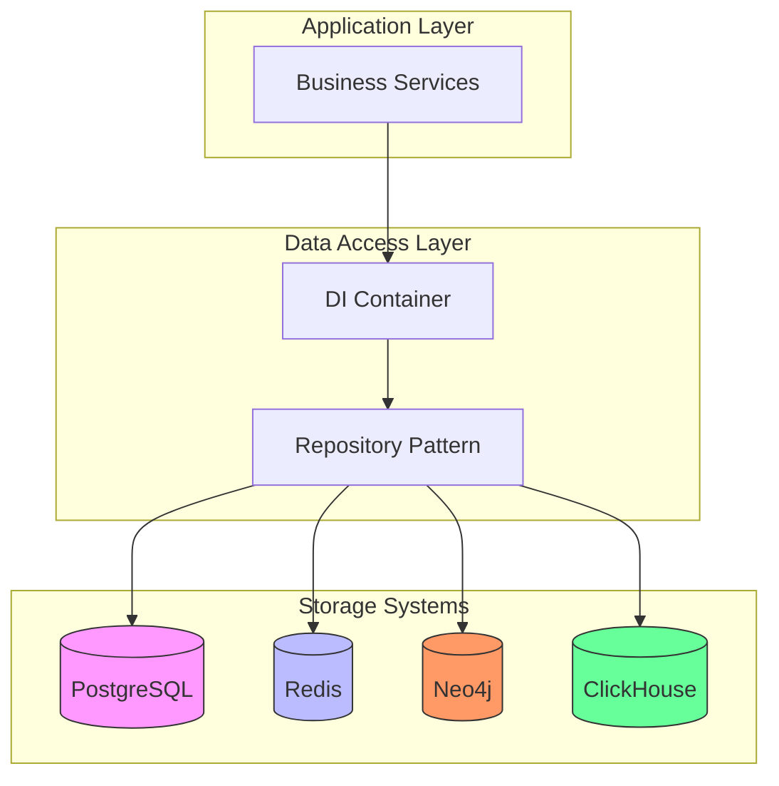
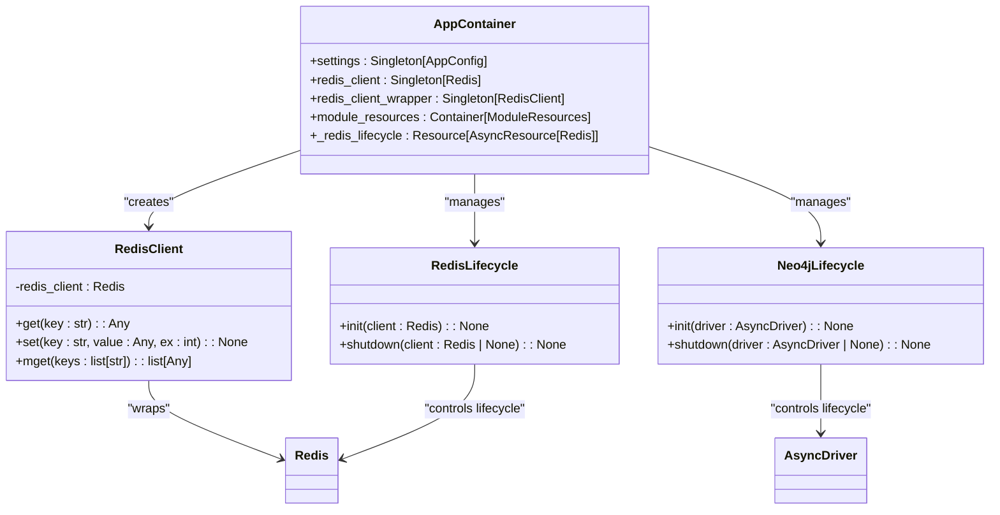
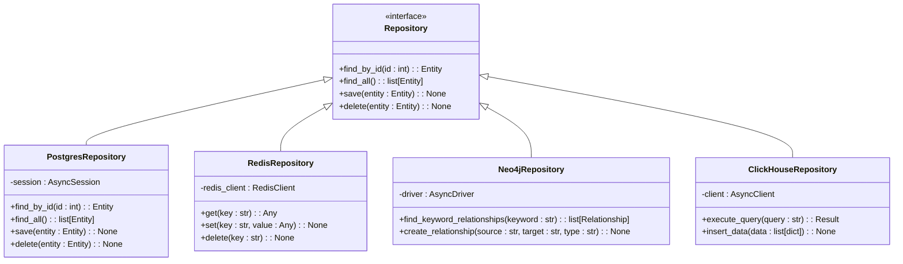
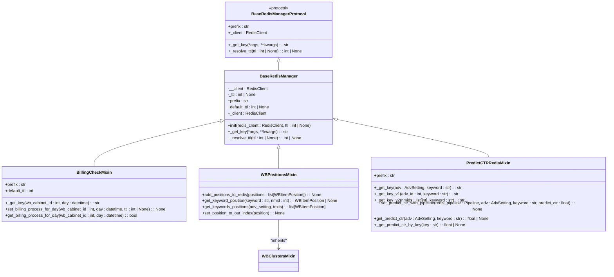
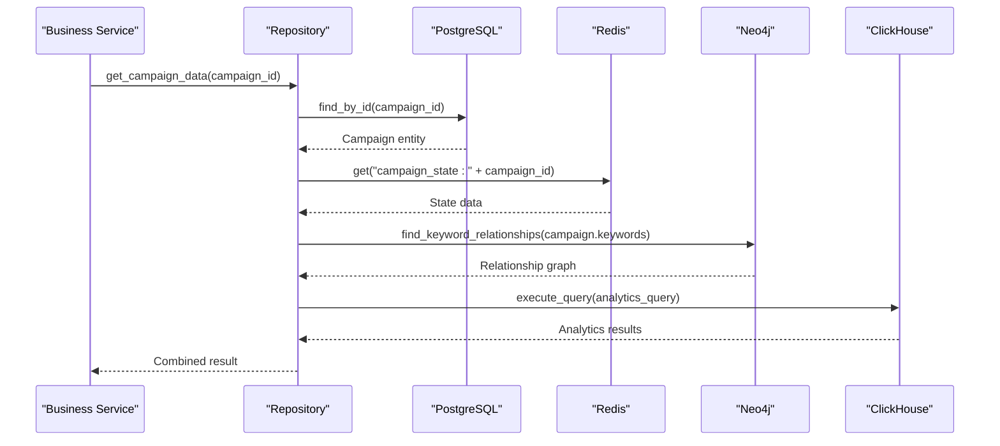

# Data Access Layer

<cite>
**Referenced Files in This Document**   
- [app_container.py](file://app/core/di/app_container.py)
- [redis.py](file://app/core/di/databases/redis.py)
- [neo4j.py](file://app/core/di/databases/neo4j.py)
- [base_redis_manager.py](file://app/core/redis_manager_v2/base_redis_manager.py)
- [base_protocol.py](file://app/core/redis_manager_v2/base_protocol.py)
- [billing_check.py](file://app/core/redis_manager_v2/mixins/billing_check.py)
- [wb_positions.py](file://app/core/redis_manager_v2/mixins/wb_positions.py)
- [predict_ctr.py](file://app/core/redis_manager_v2/mixins/predict_ctr.py)
- [models.py](file://app/modules/common_slaves/wildberries/models/models.py)
- [session_maker.py](file://app/utils/db/session_maker.py)
- [client.py](file://app/utils/click_house/client.py)
</cite>

## Table of Contents
1. [Introduction](#introduction)
2. [Multi-Storage Architecture](#multi-storage-architecture)
3. [Dependency Injection Container](#dependency-injection-container)
4. [Repository Pattern Implementation](#repository-pattern-implementation)
5. [Redis Manager V2 Architecture](#redis-manager-v2-architecture)
6. [Data Access Patterns](#data-access-patterns)
7. [Data Consistency Across Stores](#data-consistency-across-stores)
8. [Conclusion](#conclusion)

## Introduction
The adv-bot system implements a sophisticated multi-storage architecture designed to handle diverse data requirements across PostgreSQL, Redis, Neo4j, and ClickHouse. This documentation provides a comprehensive overview of the data access layer, focusing on how these different storage systems are integrated through dependency injection, how the repository pattern is implemented, and how data consistency is maintained across distributed data stores.

## Multi-Storage Architecture
The adv-bot system leverages multiple specialized databases to optimize performance and functionality:

- **PostgreSQL**: Primary relational database for persistent storage of application data, managed via SQLAlchemy ORM
- **Redis**: In-memory data store used for caching, real-time state management, and temporary data
- **Neo4j**: Graph database for managing complex relationships between keywords and other entities
- **ClickHouse**: Column-oriented database optimized for analytical queries and performance metrics

Each storage system serves a specific purpose within the application, allowing for optimized data access patterns based on the use case.

**Diagram sources**
- [app_container.py](file://app/core/di/app_container.py)
- [session_maker.py](file://app/utils/db/session_maker.py)
- [client.py](file://app/utils/click_house/client.py)

**Section sources**
- [app_container.py](file://app/core/di/app_container.py)
- [session_maker.py](file://app/utils/db/session_maker.py)

## Dependency Injection Container
The system uses a dependency injection (DI) container to manage database connections and provide them to services. The AppContainer class serves as the central DI container, configuring and providing access to all database clients.

The container creates and manages connections to Redis and Neo4j through dedicated lifecycle resources that handle initialization and cleanup. PostgreSQL connections are managed through SQLAlchemy's async session maker, while ClickHouse connections are handled through a custom client wrapper.

**Diagram sources**
- [app_container.py](file://app/core/di/app_container.py)
- [redis.py](file://app/core/di/databases/redis.py)
- [neo4j.py](file://app/core/di/databases/neo4j.py)

**Section sources**
- [app_container.py](file://app/core/di/app_container.py)
- [redis.py](file://app/core/di/databases/redis.py)
- [neo4j.py](file://app/core/di/databases/neo4j.py)

## Repository Pattern Implementation
The data access layer implements the repository pattern to abstract the underlying data storage mechanisms. Each data store has specialized repositories that provide a consistent interface for data operations while encapsulating store-specific logic.

PostgreSQL repositories use SQLAlchemy models to represent entities, with the session maker providing transaction management. Redis repositories leverage the Redis manager v2 architecture with mixins for specific functionality. Neo4j repositories handle graph relationships between keywords and other entities, while ClickHouse repositories optimize for analytical queries.

**Diagram sources**
- [models.py](file://app/modules/common_slaves/wildberries/models/models.py)
- [session_maker.py](file://app/utils/db/session_maker.py)
- [client.py](file://app/utils/click_house/client.py)

**Section sources**
- [models.py](file://app/modules/common_slaves/wildberries/models/models.py)
- [session_maker.py](file://app/utils/db/session_maker.py)

## Redis Manager V2 Architecture
The Redis Manager V2 architecture implements a protocol-based design with a mixin system for extensible functionality. The base class defines the core interface, while mixins provide specific functionality for different use cases.

The architecture uses a protocol to ensure structural compatibility across different manager implementations. Each mixin focuses on a specific domain, such as billing checks, position tracking, or CTR prediction, allowing for modular composition of functionality.

**Diagram sources**
- [base_protocol.py](file://app/core/redis_manager_v2/base_protocol.py)
- [base_redis_manager.py](file://app/core/redis_manager_v2/base_redis_manager.py)
- [billing_check.py](file://app/core/redis_manager_v2/mixins/billing_check.py)
- [wb_positions.py](file://app/core/redis_manager_v2/mixins/wb_positions.py)
- [predict_ctr.py](file://app/core/redis_manager_v2/mixins/predict_ctr.py)

**Section sources**
- [base_protocol.py](file://app/core/redis_manager_v2/base_protocol.py)
- [base_redis_manager.py](file://app/core/redis_manager_v2/base_redis_manager.py)
- [billing_check.py](file://app/core/redis_manager_v2/mixins/billing_check.py)

## Data Access Patterns
Business services access data through well-defined patterns that leverage the appropriate storage system based on the use case. Real-time state is retrieved from Redis, relational data from PostgreSQL, graph relationships from Neo4j, and analytics from ClickHouse.

The system uses async/await patterns for all database operations, ensuring non-blocking execution. Transactions are used for PostgreSQL operations that require atomicity, while Redis operations leverage pipelines for efficiency when multiple commands are executed together.

**Diagram sources**
- [models.py](file://app/modules/common_slaves/wildberries/models/models.py)
- [session_maker.py](file://app/utils/db/session_maker.py)
- [client.py](file://app/utils/click_house/client.py)

**Section sources**
- [models.py](file://app/modules/common_slaves/wildberries/models/models.py)
- [session_maker.py](file://app/utils/db/session_maker.py)

## Data Consistency Across Stores
The system maintains data consistency across stores through several mechanisms:

1. **Event-driven updates**: Changes to core entities in PostgreSQL trigger events that update corresponding data in Redis, Neo4j, and ClickHouse
2. **Transaction boundaries**: Related changes across multiple stores are coordinated within transaction boundaries when possible
3. **Cache invalidation**: Redis caches are invalidated or updated when underlying data changes
4. **Background synchronization**: Periodic jobs ensure eventual consistency between stores

The system prioritizes availability and performance over strict consistency, accepting eventual consistency for non-critical data while maintaining strong consistency for financial and operational data.

**Section sources**
- [app_container.py](file://app/core/di/app_container.py)
- [session_maker.py](file://app/utils/db/session_maker.py)

## Conclusion
The adv-bot system's data access layer demonstrates a sophisticated multi-storage architecture that leverages the strengths of different database technologies. Through the use of dependency injection, the repository pattern, and a modular Redis manager architecture, the system provides a flexible and maintainable approach to data access. The careful separation of concerns and well-defined data access patterns ensure that each storage system is used appropriately for its intended purpose, resulting in a robust and scalable data architecture.