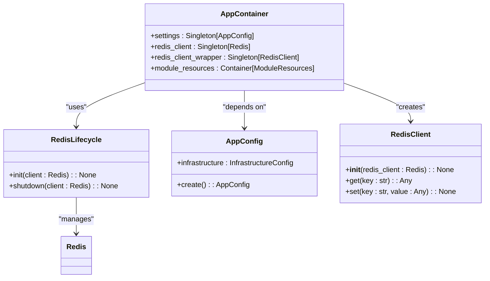
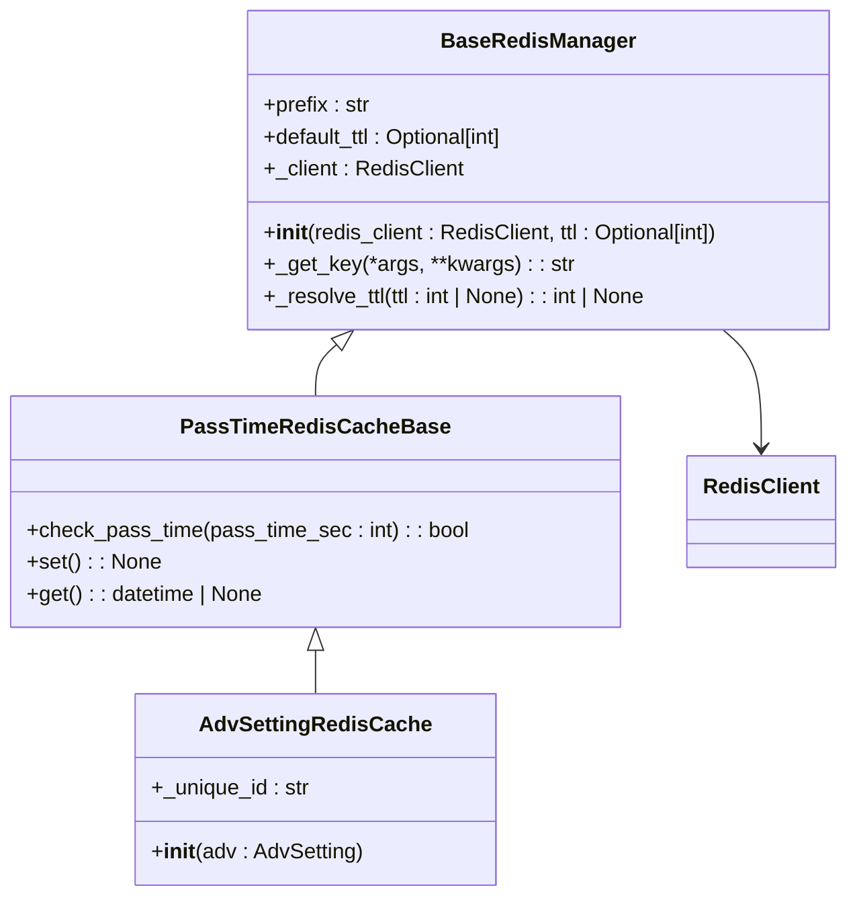
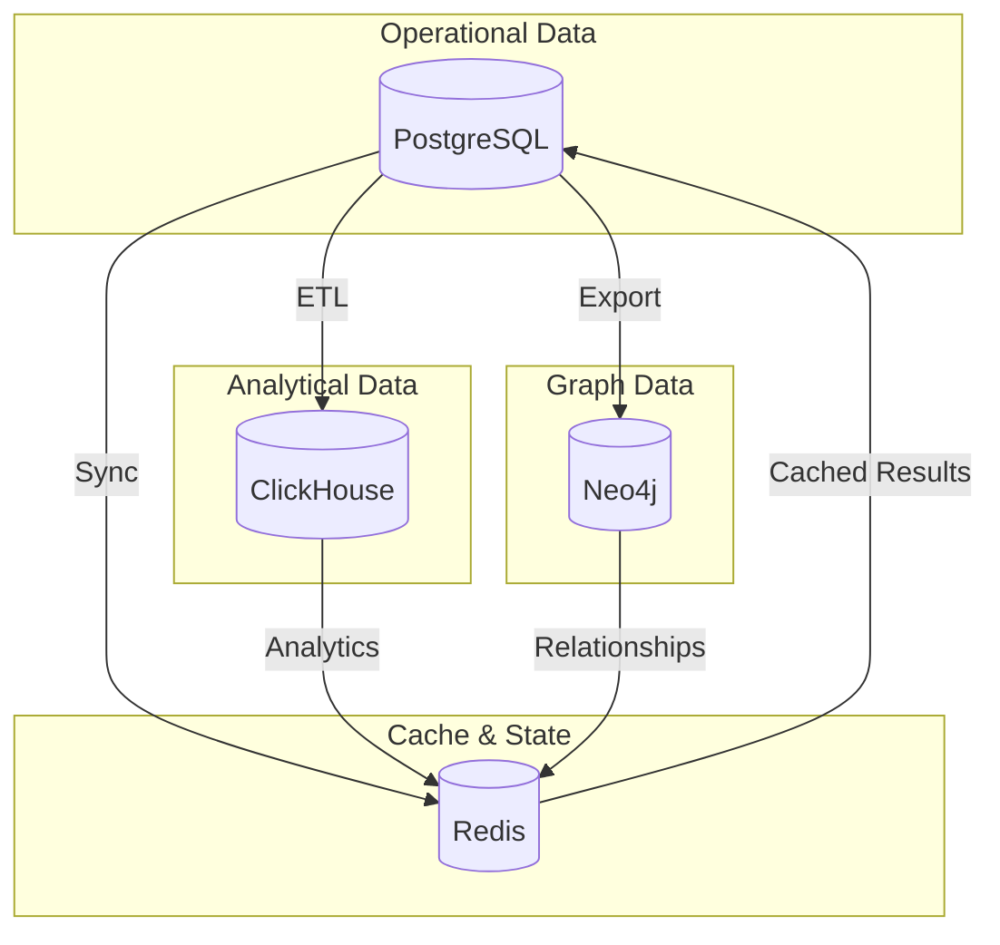

# Data Access Patterns

<cite>
**Referenced Files in This Document**   
- [app_container.py](file://app/core/di/app_container.py)
- [redis.py](file://app/core/di/databases/redis.py)
- [redis_cache_base.py](file://app/core/redis_cache/redis_cache_base.py)
- [base_redis_manager.py](file://app/core/redis_manager/base_redis_manager.py)
- [data_manager.py](file://app/modules/common_advs_stat/data_manager.py)
- [adv_keyword_update.py](file://app/modules/wb_update_state_manager/state_managers/adv_keyword_update.py)
- [session_maker.py](file://app/utils/db/session_maker.py)
- [client.py](file://app/utils/click_house/client.py)
- [pass_time_redis_cache_base.py](file://app/core/redis_cache/mixins/data_types/pass_time_redis_cache_base.py)
- [adv_setting_redis_cache.py](file://app/core/redis_cache/mixins/main_objects_mixins/adv_setting_redis_cache.py)
- [base_redis_manager.py](file://app/core/redis_manager_v2/base_redis_manager.py)
</cite>

## Table of Contents
1. [Introduction](#introduction)
2. [Repository Pattern Implementation](#repository-pattern-implementation)
3. [Dependency Injection for Database Connections](#dependency-injection-for-database-connections)
4. [Caching Strategies with Redis](#caching-strategies-with-redis)
5. [Cross-Store Data Consistency](#cross-store-data-consistency)
6. [Service-Level Data Access Examples](#service-level-data-access-examples)
7. [Error Handling and Retry Mechanisms](#error-handling-and-retry-mechanisms)
8. [Monitoring of Data Access Operations](#monitoring-of-data-access-operations)
9. [Conclusion](#conclusion)

## Introduction
The adv-bot system implements a sophisticated multi-store data access architecture that integrates PostgreSQL, Redis, Neo4j, and ClickHouse to support its advertising optimization functionality. This document details the data access patterns used throughout the system, focusing on the repository pattern implementation, dependency injection approach, caching strategies, and cross-store consistency mechanisms. The system abstracts storage details from business logic through well-defined interfaces and managers, enabling maintainable and testable code.

## Repository Pattern Implementation
The system implements a repository pattern through specialized data managers that abstract storage details from business logic. These managers encapsulate data access operations and provide a clean interface for services to interact with various data stores without knowledge of the underlying implementation details.

The repository pattern is implemented through multiple layers of abstraction:
- **Data Managers**: Handle specific domain entities and their persistence logic
- **Session Factories**: Manage database connections and transactions
- **Base Classes**: Provide common functionality for data access operations

The pattern separates concerns by isolating data access logic from business rules, making the system more maintainable and testable. Each manager typically focuses on a specific domain concept, such as advertising settings, keyword statistics, or campaign performance metrics.

**Section sources**
- [data_manager.py](file://app/modules/common_advs_stat/data_manager.py#L1-L160)
- [base_redis_manager.py](file://app/core/redis_manager/base_redis_manager.py#L1-L21)

## Dependency Injection for Database Connections
The adv-bot system uses a comprehensive dependency injection (DI) framework to manage database connections and provide them to services. The DI container, implemented in `AppContainer`, centralizes the creation and lifecycle management of database clients.

The dependency injection system follows these key principles:
- **Singleton Pattern**: Database clients are created once and reused throughout the application
- **Configuration-Driven**: Connection parameters are derived from application configuration
- **Lifecycle Management**: Proper initialization and shutdown of database connections
- **Abstraction**: Services depend on interfaces rather than concrete implementations

The DI container creates Redis clients based on configuration settings and wraps them with a `RedisClient` wrapper that provides a unified API. This approach ensures consistent connection handling across the application and simplifies testing by allowing easy substitution of mock implementations.

**Diagram sources**
- [app_container.py](file://app/core/di/app_container.py#L1-L50)
- [redis.py](file://app/core/di/databases/redis.py#L1-L37)

**Section sources**
- [app_container.py](file://app/core/di/app_container.py#L1-L50)
- [redis.py](file://app/core/di/databases/redis.py#L1-L37)

## Caching Strategies with Redis
The system employs multiple Redis caching strategies to optimize performance and reduce load on primary data stores. These strategies include TTL-based caching and timestamped patterns for different use cases.

### TTL-Based Caching
The system implements TTL (Time-To-Live) based caching through the `BaseRedisManager` class, which allows specifying default TTL values for cache entries. This approach ensures that cached data automatically expires after a specified period, preventing stale data from persisting indefinitely.

**Diagram sources**
- [base_redis_manager.py](file://app/core/redis_manager_v2/base_redis_manager.py#L1-L35)
- [pass_time_redis_cache_base.py](file://app/core/redis_cache/mixins/data_types/pass_time_redis_cache_base.py#L1-L30)
- [adv_setting_redis_cache.py](file://app/core/redis_cache/mixins/main_objects_mixins/adv_setting_redis_cache.py#L1-L15)

### Timestamped Caching
For scenarios requiring precise time-based invalidation, the system uses timestamped caching patterns. The `AdvActiveKeywordUpdateStateManager` stores timestamped entries that record when specific advertising campaigns were last updated. This allows the system to track the freshness of data and make decisions based on when updates occurred.

The timestamped approach provides more granular control over cache invalidation compared to simple TTL mechanisms, enabling complex business logic that depends on the timing of operations.

**Section sources**
- [base_redis_manager.py](file://app/core/redis_manager_v2/base_redis_manager.py#L1-L35)
- [pass_time_redis_cache_base.py](file://app/core/redis_cache/mixins/data_types/pass_time_redis_cache_base.py#L1-L30)
- [adv_setting_redis_cache.py](file://app/core/redis_cache/mixins/main_objects_mixins/adv_setting_redis_cache.py#L1-L15)
- [adv_keyword_update.py](file://app/modules/wb_update_state_manager/state_managers/adv_keyword_update.py#L1-L47)

## Cross-Store Data Consistency
The adv-bot system maintains data consistency across multiple storage systems including PostgreSQL, Redis, Neo4j, and ClickHouse. Each store serves a specific purpose in the overall architecture:

- **PostgreSQL**: Primary relational database for structured data and transactional operations
- **Redis**: In-memory cache for frequently accessed data and state management
- **Neo4j**: Graph database for relationship-heavy data like keyword hierarchies
- **ClickHouse**: Columnar database for analytical queries and large-scale data processing

The system ensures cross-store consistency through several mechanisms:
- **Event-Driven Updates**: Changes in one store trigger updates in others
- **Synchronization Workers**: Background processes that reconcile data across stores
- **Atomic Operations**: Critical updates are performed atomically when possible
- **Compensation Mechanisms**: Rollback or correction logic for failed operations

Data flows from operational systems (PostgreSQL) to analytical systems (ClickHouse) through ETL-like processes, while Redis serves as a caching layer for frequently accessed data from all stores. Neo4j maintains complex relationships that would be difficult to model efficiently in relational format.

**Diagram sources**
- [session_maker.py](file://app/utils/db/session_maker.py#L1-L178)
- [client.py](file://app/utils/click_house/client.py#L1-L224)

**Section sources**
- [session_maker.py](file://app/utils/db/session_maker.py#L1-L178)
- [client.py](file://app/utils/click_house/client.py#L1-L224)

## Service-Level Data Access Examples
The system demonstrates service-level data access patterns through modules like `common_advs_stat` and `wb_update_state_manager`, which integrate data from multiple sources to provide comprehensive functionality.

### Common Advs Stat Module
The `CommonAdvsStatDataManager` class exemplifies a service that aggregates data from multiple sources to provide a unified view of advertising campaign performance. It combines data from:
- PostgreSQL (advertising settings)
- ClickHouse (detailed campaign statistics)
- Internal calculations (derived metrics)

The service orchestrates queries to different data stores, processes the results, and returns a comprehensive data structure that applications can use directly without understanding the underlying data architecture.

### WB Update State Manager
The `AdvActiveKeywordUpdateStateManager` demonstrates state management using Redis. It stores timestamps of when advertising campaigns were last updated, allowing the system to track processing progress and avoid redundant operations. This pattern enables distributed coordination of update processes across multiple workers.

**Section sources**
- [data_manager.py](file://app/modules/common_advs_stat/data_manager.py#L1-L160)
- [adv_keyword_update.py](file://app/modules/wb_update_state_manager/state_managers/adv_keyword_update.py#L1-L47)

## Error Handling and Retry Mechanisms
The system implements robust error handling and retry mechanisms for data access operations. These mechanisms ensure reliability in the face of transient failures and network issues.

Key aspects of the error handling strategy include:
- **Connection Pooling**: Managed through SQLAlchemy's async engine with pre-ping validation
- **Timeout Monitoring**: Sessions and queries are monitored for excessive duration
- **Graceful Degradation**: Fallback mechanisms when primary data sources are unavailable
- **Retry Logic**: Automatic retry of failed operations with exponential backoff

The `AnalyticAsyncSession` class extends SQLAlchemy's AsyncSession to add query timing and logging, enabling detection of slow queries that might indicate performance issues. The system also implements connection limits and semaphores to prevent resource exhaustion under high load.

**Section sources**
- [session_maker.py](file://app/utils/db/session_maker.py#L1-L178)
- [client.py](file://app/utils/click_house/client.py#L1-L224)

## Monitoring of Data Access Operations
The system incorporates comprehensive monitoring of data access operations to ensure performance and reliability. Monitoring is implemented at multiple levels:

- **Query Performance**: Slow queries are logged with stack traces to identify problematic code
- **Connection Management**: Open connection counts are tracked and logged
- **Session Duration**: Long-held sessions are monitored to prevent resource leaks
- **Error Tracking**: Exceptions during data access are logged with full context

The monitoring system uses structured logging to capture detailed information about each data access operation, including duration, source location, and query details. This information enables proactive identification of performance bottlenecks and capacity planning.

For ClickHouse operations, the system tracks connections by function call hierarchy, providing insights into which parts of the application generate the most database load. This granular monitoring helps optimize resource allocation and identify inefficient data access patterns.

**Section sources**
- [session_maker.py](file://app/utils/db/session_maker.py#L1-L178)
- [client.py](file://app/utils/click_house/client.py#L1-L224)

## Conclusion
The adv-bot system implements a sophisticated multi-store data access architecture that effectively separates concerns through the repository pattern and dependency injection. By leveraging Redis for caching and state management, PostgreSQL for transactional data, ClickHouse for analytics, and Neo4j for graph relationships, the system optimizes performance and scalability. The comprehensive error handling, retry mechanisms, and monitoring ensure reliability and maintainability. This architecture enables the system to handle complex advertising optimization workflows while maintaining data consistency across multiple storage systems.