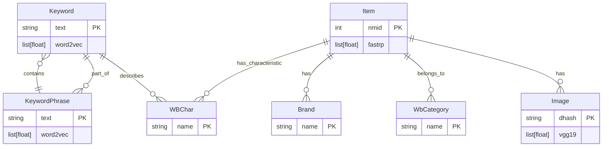
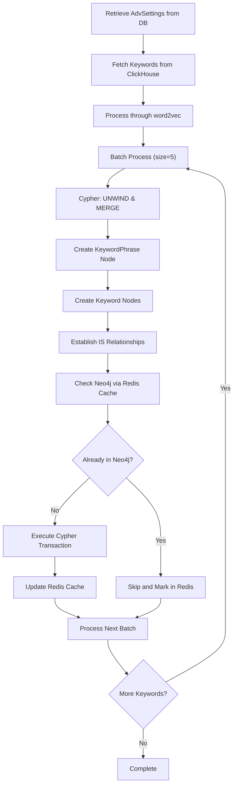
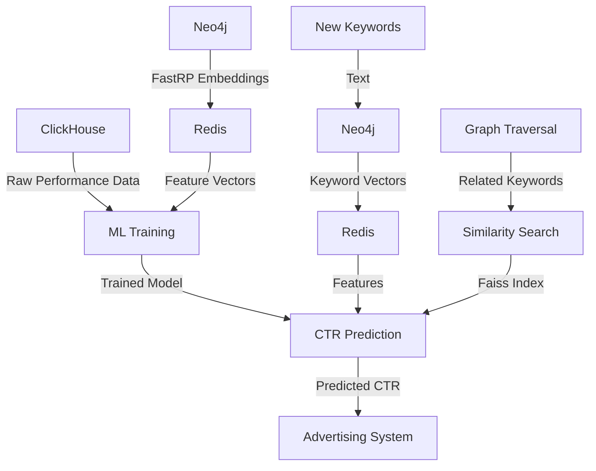

# Neo4j Data Access

<cite>
**Referenced Files in This Document**   
- [neo4j_config.py](file://app/configs/infrastructure_config/neo4j_config.py)
- [neo4j_container.py](file://app/core/di/containers/neo4j_container.py)
- [neo4j.py](file://app/core/di/databases/neo4j.py)
- [driver.py](file://app/utils/NeoDataScience/driver.py)
- [gds_object.py](file://app/modules/wb_adv_updater/gds_object.py)
- [update_wb_adv_phrases_in_neo.py](file://app/modules/wb_adv_updater/update_wb_adv_phrases_in_neo.py)
- [ml_data_manager.py](file://app/modules/wb_adv_updater/ml_data_manager.py)
- [data_manager.py](file://app/modules/wb_adv_updater/data_manager.py)
- [fitter.py](file://app/modules/wb_adv_updater/fitter.py)
- [data_getter.py](file://app/modules/wb_adv_updater/data_getter.py)
- [ML.py](file://app/modules/wb_adv_updater/ML.py)
- [graph_vector_updater.py](file://app/modules/wb_adv_updater/graph_vector_updater.py)
</cite>

## Table of Contents
1. [Introduction](#introduction)
2. [Neo4j Configuration and Connection Management](#neo4j-configuration-and-connection-management)
3. [Data Modeling in Neo4j](#data-modeling-in-neo4j)
4. [Graph Traversal and Query Patterns](#graph-traversal-and-query-patterns)
5. [Integration with ML Components for CTR Prediction](#integration-with-ml-components-for-ctr-prediction)
6. [Performance Considerations](#performance-considerations)
7. [Conclusion](#conclusion)

## Introduction
The adv-bot system leverages Neo4j as a graph database to store and manage complex relationships between keywords, advertising hierarchies, and semantic connections. This documentation provides a comprehensive overview of the Neo4j integration, focusing on its role in enhancing advertising performance through advanced data modeling and machine learning integration. The system uses Neo4j to represent keywords and products as nodes, with relationships capturing relevance and performance metrics. This approach enables sophisticated graph traversal operations that support intelligent advertising strategies, particularly in the context of click-through rate (CTR) prediction.

## Neo4j Configuration and Connection Management
The Neo4j integration in the adv-bot system is configured through a dedicated configuration class and managed via a dependency injection (DI) container. The `Neo4jConfig` class, defined in `neo4j_config.py`, encapsulates the connection parameters including URI, username, password, and port, with environment variable binding through Pydantic settings. This configuration is injected into the `Neo4jContainer` DI container, which manages the lifecycle of the Neo4j driver. The container creates an `AsyncDriver` instance using the Neo4j Python driver, establishing a connection to the database with the provided credentials. The connection management follows an asynchronous pattern, with the `Neo4jLifecycle` class handling the initialization and shutdown of the driver. Notably, the connectivity verification is currently disabled to prevent failures in runners that don't require Neo4j, with plans to make this conditional in the future.

**Section sources**
- [neo4j_config.py](file://app/configs/infrastructure_config/neo4j_config.py#L1-L17)
- [neo4j_container.py](file://app/core/di/containers/neo4j_container.py#L1-L29)
- [neo4j.py](file://app/core/di/databases/neo4j.py#L1-L45)

## Data Modeling in Neo4j
The data modeling approach in Neo4j centers around representing keywords and products as nodes with rich semantic relationships. The system defines several node types including `Keyword`, `KeywordPhrase`, `Item`, `Image`, `WBChar` (characteristic), `Brand`, and `WbCategory`. Keywords are stored as `Keyword` nodes with properties including text and word2vec embeddings, while keyword phrases are represented as `KeywordPhrase` nodes that maintain relationships with individual keywords through `IS` relationships. Products are modeled as `Item` nodes connected to their images via `IN` relationships, and linked to categories and brands through `IS` relationships. The graph structure also captures semantic similarities between keywords through `LIKE` relationships with distance metrics. This comprehensive data model enables the system to represent complex advertising hierarchies and semantic connections, facilitating advanced analytics and machine learning applications.

**Diagram sources**
- [driver.py](file://app/utils/NeoDataScience/driver.py#L200-L250)
- [update_wb_adv_phrases_in_neo.py](file://app/modules/wb_adv_updater/update_wb_adv_phrases_in_neo.py#L50-L100)

## Graph Traversal and Query Patterns
The wb_adv_updater module implements several graph traversal operations that leverage Neo4j's Cypher query language to extract meaningful insights from the graph data. Key operations include updating keyword phrases in Neo4j, where the system retrieves advertising settings and corresponding keywords from ClickHouse, processes them through word2vec embeddings, and creates or updates nodes and relationships in the graph database. The traversal patterns follow a batch processing approach, with operations grouped into batches of five to optimize performance. The system uses UNWIND operations in Cypher to efficiently process multiple nodes, employing MERGE statements to create or update nodes while preserving existing relationships. For similarity calculations, the system leverages Neo4j's Graph Data Science library, creating temporary graphs for k-nearest neighbors (KNN) calculations using cosine similarity on word2vec embeddings. These traversal operations are orchestrated through the `DataScience` class, which provides a comprehensive API for graph operations including node creation, relationship establishment, and vector similarity calculations.

**Diagram sources**
- [update_wb_adv_phrases_in_neo.py](file://app/modules/wb_adv_updater/update_wb_adv_phrases_in_neo.py#L1-L100)
- [driver.py](file://app/utils/NeoDataScience/driver.py#L300-L350)

## Integration with ML Components for CTR Prediction
The Neo4j integration plays a crucial role in the machine learning pipeline for CTR prediction, serving as the primary source of feature vectors for both keywords and products. The system extracts FastRP embeddings from Neo4j nodes and stores them in Redis for rapid access by ML components. The `DataGetter` class provides methods to retrieve both item and keyword features from Neo4j, which are then used to train XGBoost models for CTR prediction. The training process combines historical advertising performance data with graph-derived features, creating a comprehensive feature set that captures both explicit performance metrics and implicit semantic relationships. During prediction, the system retrieves keyword vectors from Neo4j through Redis, combining them with product vectors to generate CTR predictions that account for semantic relevance. The integration also supports similarity-based CTR propagation, where predictions for similar keywords are used to inform predictions for keywords with insufficient historical data, leveraging the graph structure to enhance prediction accuracy.

**Diagram sources**
- [data_getter.py](file://app/modules/wb_adv_updater/data_getter.py#L1-L50)
- [ML.py](file://app/modules/wb_adv_updater/ML.py#L1-L100)
- [fitter.py](file://app/modules/wb_adv_updater/fitter.py#L1-L100)

## Performance Considerations
The Neo4j integration in the adv-bot system incorporates several performance optimization strategies to handle large-scale graph operations efficiently. The system employs batch processing for all write operations, grouping updates into batches of five to minimize transaction overhead. For read operations, the system implements a comprehensive caching strategy using Redis to store frequently accessed data, including keyword vectors, item vectors, and graph traversal results. This reduces the load on Neo4j and improves response times for ML components. The system also leverages Neo4j's Graph Data Science library for computationally intensive operations like FastRP embedding generation, which are executed asynchronously to avoid blocking the main application flow. Error handling includes retry mechanisms for transient errors, with exponential backoff to prevent overwhelming the database during periods of high load. The architecture separates concerns between data ingestion, graph processing, and ML inference, allowing each component to be scaled independently based on workload requirements.

**Section sources**
- [graph_vector_updater.py](file://app/modules/wb_adv_updater/graph_vector_updater.py#L1-L129)
- [driver.py](file://app/utils/NeoDataScience/driver.py#L1-L100)
- [ml_data_manager.py](file://app/modules/wb_adv_updater/ml_data_manager.py#L1-L100)

## Conclusion
The Neo4j integration in the adv-bot system provides a powerful foundation for managing complex advertising relationships and enabling advanced machine learning applications. By representing keywords, products, and their semantic connections as a graph, the system can capture nuanced relationships that would be difficult to model in traditional relational databases. The integration with ML components for CTR prediction demonstrates the value of graph-based feature engineering, where embeddings derived from the graph structure enhance prediction accuracy. The architecture balances performance and reliability through careful connection management, batch processing, and comprehensive caching. Future enhancements could include re-enabling connectivity verification with conditional logic, optimizing the FastRP embedding generation process, and expanding the graph model to include additional entity types and relationships for even richer advertising insights.