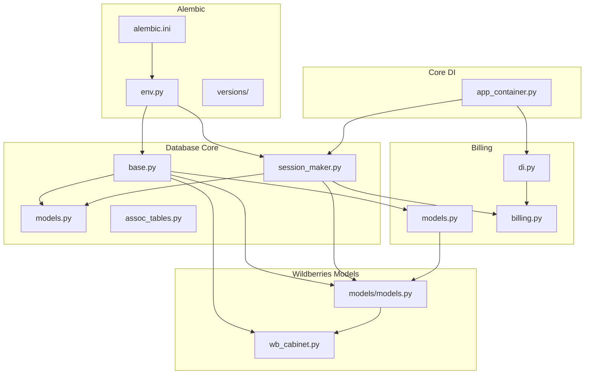
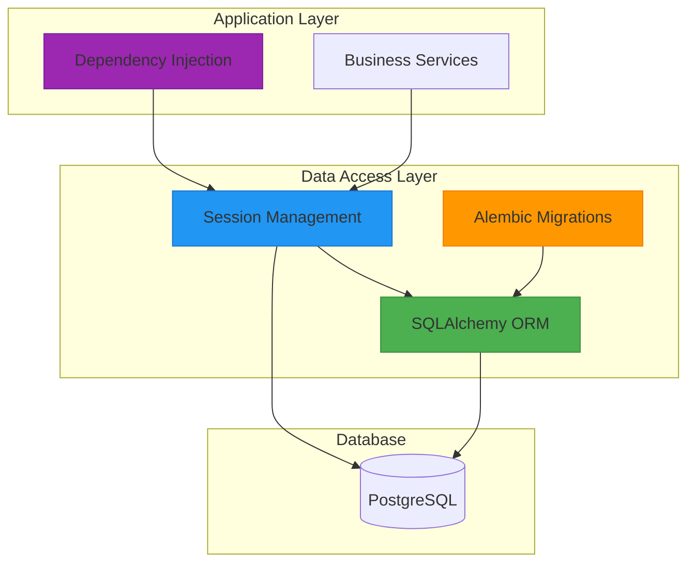
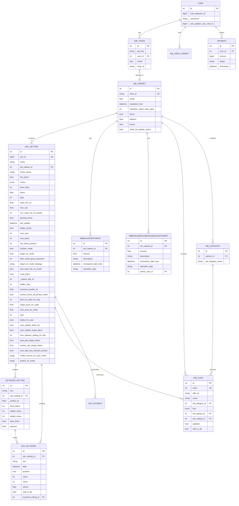
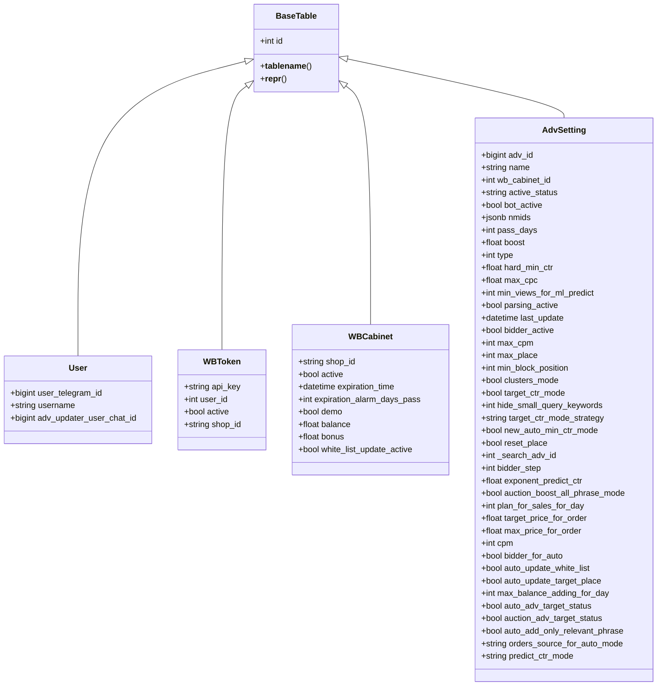
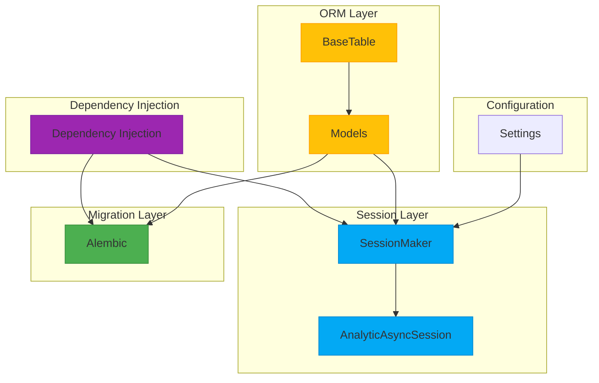

# PostgreSQL Data Access

<cite>
**Referenced Files in This Document**   
- [models.py](file://app/utils/db/models.py)
- [base.py](file://app/utils/db/base.py)
- [session_maker.py](file://app/utils/db/session_maker.py)
- [assoc_tables.py](file://app/utils/db/assoc_tables.py)
- [models.py](file://app/modules/common_slaves/wildberries/models/models.py)
- [wb_cabinet.py](file://app/modules/common_slaves/wildberries/models/wb_cabinet.py)
- [models.py](file://app/payments/db/models.py)
- [models.py](file://app/modules/billing/models.py)
- [env.py](file://alembic/env.py)
- [alembic.ini](file://alembic.ini)
- [di.py](file://app/modules/billing/di.py)
- [app_container.py](file://app/core/di/app_container.py)
- [billing.py](file://app/modules/billing/billing.py)
</cite>

## Table of Contents
1. [Introduction](#introduction)
2. [Project Structure](#project-structure)
3. [Core Components](#core-components)
4. [Architecture Overview](#architecture-overview)
5. [Detailed Component Analysis](#detailed-component-analysis)
6. [Dependency Analysis](#dependency-analysis)
7. [Performance Considerations](#performance-considerations)
8. [Troubleshooting Guide](#troubleshooting-guide)
9. [Conclusion](#conclusion)

## Introduction
This document provides comprehensive documentation for the PostgreSQL data access layer in the adv-bot system. It details the SQLAlchemy ORM models including AdvSetting, WBToken, WBCabinet, and billing-related entities. The document explains entity relationships, constraints, indexes, and inheritance patterns. It also covers the use of Alembic for database migrations and version control, session management and transaction handling patterns used across the application, examples of common query patterns from modules like token monitoring and billing, data integrity, migration strategies, and integration with the DI container for dependency injection.

## Project Structure
The project structure is organized into several key directories that support the PostgreSQL data access layer. The `app/utils/db` directory contains the core database utilities including models, base classes, session management, and association tables. The `alembic` directory manages database migrations with version control. The `app/modules/common_slaves/wildberries/models` directory contains the primary ORM models for the application. The `app/modules/billing` directory handles billing-specific models and logic. The `app/core/di` directory manages dependency injection for database components.

**Diagram sources**
- [base.py](file://app/utils/db/base.py)
- [models.py](file://app/utils/db/models.py)
- [session_maker.py](file://app/utils/db/session_maker.py)
- [assoc_tables.py](file://app/utils/db/assoc_tables.py)
- [models.py](file://app/modules/common_slaves/wildberries/models/models.py)
- [wb_cabinet.py](file://app/modules/common_slaves/wildberries/models/wb_cabinet.py)
- [models.py](file://app/payments/db/models.py)
- [models.py](file://app/modules/billing/models.py)
- [env.py](file://alembic/env.py)
- [alembic.ini](file://alembic.ini)
- [di.py](file://app/modules/billing/di.py)
- [app_container.py](file://app/core/di/app_container.py)

**Section sources**
- [models.py](file://app/utils/db/models.py)
- [base.py](file://app/utils/db/base.py)
- [session_maker.py](file://app/utils/db/session_maker.py)
- [assoc_tables.py](file://app/utils/db/assoc_tables.py)

## Core Components
The core components of the PostgreSQL data access layer include the base table class, session management, and association tables. The `BaseTable` class provides a foundation for all ORM models with common attributes like `id` and `__tablename__`. The session management system handles both read-only and read-write database connections with connection pooling and performance monitoring. Association tables define many-to-many relationships between entities.

**Section sources**
- [base.py](file://app/utils/db/base.py#L1-L18)
- [session_maker.py](file://app/utils/db/session_maker.py#L1-L178)
- [assoc_tables.py](file://app/utils/db/assoc_tables.py#L1-L26)

## Architecture Overview
The PostgreSQL data access architecture follows a layered approach with clear separation of concerns. At the foundation is the SQLAlchemy ORM layer with declarative base classes and model definitions. Above this layer is the session management system that handles database connections, transactions, and connection pooling. The Alembic migration system sits alongside the ORM layer to manage schema evolution. Dependency injection is used to wire database components throughout the application, with the AppContainer providing centralized management of database resources.

**Diagram sources**
- [base.py](file://app/utils/db/base.py)
- [session_maker.py](file://app/utils/db/session_maker.py)
- [env.py](file://alembic/env.py)
- [app_container.py](file://app/core/di/app_container.py)

## Detailed Component Analysis
This section provides a detailed analysis of the key components in the PostgreSQL data access layer, including entity relationships, constraints, indexes, and inheritance patterns.

### Entity Relationship Analysis
The data model features several key entities with well-defined relationships. The `User` entity serves as the central identity, connected to Wildberries tokens and cabinets through various relationships. The `WBToken` entity represents API tokens for Wildberries integration, linked to users and containing authentication information. The `WBCabinet` entity represents a merchant's account with balance and bonus tracking. The `AdvSetting` entity manages advertising campaigns with various configuration options.

**Diagram sources**
- [models.py](file://app/utils/db/models.py)
- [models.py](file://app/modules/common_slaves/wildberries/models/models.py)
- [wb_cabinet.py](file://app/modules/common_slaves/wildberries/models/wb_cabinet.py)
- [models.py](file://app/payments/db/models.py)
- [models.py](file://app/modules/billing/models.py)

**Section sources**
- [models.py](file://app/utils/db/models.py#L1-L51)
- [models.py](file://app/modules/common_slaves/wildberries/models/models.py#L1-L719)
- [wb_cabinet.py](file://app/modules/common_slaves/wildberries/models/wb_cabinet.py#L1-L83)

### Inheritance and Mixin Patterns
The data access layer employs a base class inheritance pattern through the `BaseTable` class, which provides common functionality to all ORM models. This includes automatic table name generation based on class name, a standard primary key pattern, and a consistent string representation. The inheritance pattern ensures consistency across all models while allowing each entity to define its specific attributes and relationships.

**Diagram sources**
- [base.py](file://app/utils/db/base.py#L1-L18)
- [models.py](file://app/utils/db/models.py#L1-L51)
- [models.py](file://app/modules/common_slaves/wildberries/models/models.py#L1-L719)
- [wb_cabinet.py](file://app/modules/common_slaves/wildberries/models/wb_cabinet.py#L1-L83)

### Index and Constraint Strategy
The data access layer implements a comprehensive indexing strategy to optimize query performance. Unique constraints are used to enforce data integrity on critical fields like `user_telegram_id`, `shop_id`, and `nmid`. Composite indexes are created on frequently queried field combinations such as `wb_cabinet_id` and `type` for `AdvSetting` entities. Specialized indexes like GIN trigram indexes are used for efficient text pattern matching on the `name` field. Check constraints and partial indexes are employed to enforce business rules and optimize queries on filtered subsets of data.

**Section sources**
- [models.py](file://app/utils/db/models.py#L1-L51)
- [models.py](file://app/modules/common_slaves/wildberries/models/models.py#L1-L719)
- [wb_cabinet.py](file://app/modules/common_slaves/wildberries/models/wb_cabinet.py#L1-L83)

## Dependency Analysis
The PostgreSQL data access layer has a well-defined dependency structure that ensures proper initialization and usage of database components. The core dependency is the `BaseTable` class which serves as the foundation for all ORM models. The session management system depends on configuration settings for database connection parameters. The Alembic migration system depends on the ORM models to generate schema changes. The dependency injection container manages the lifecycle of database connections and ensures proper resource cleanup.

**Diagram sources**
- [base.py](file://app/utils/db/base.py)
- [models.py](file://app/utils/db/models.py)
- [session_maker.py](file://app/utils/db/session_maker.py)
- [env.py](file://alembic/env.py)
- [app_container.py](file://app/core/di/app_container.py)

**Section sources**
- [base.py](file://app/utils/db/base.py#L1-L18)
- [models.py](file://app/utils/db/models.py#L1-L51)
- [session_maker.py](file://app/utils/db/session_maker.py#L1-L178)
- [env.py](file://alembic/env.py#L1-L89)
- [app_container.py](file://app/core/di/app_container.py#L1-L49)

## Performance Considerations
The PostgreSQL data access layer incorporates several performance optimization strategies. Connection pooling is implemented with configurable pool size and overflow settings to balance resource usage and performance. Query performance monitoring is built into the session layer, with warnings for slow queries exceeding one second. The session management system includes safeguards against long-held sessions that could impact database performance. Read-write separation is implemented with dedicated connection pools for read-only and read-write operations, allowing for potential database replication and load balancing.

**Section sources**
- [session_maker.py](file://app/utils/db/session_maker.py#L1-L178)

## Troubleshooting Guide
Common issues in the PostgreSQL data access layer typically relate to connection management, migration conflicts, or query performance. For connection issues, verify that the database configuration settings are correct and that the database server is accessible. For migration conflicts, ensure that Alembic migrations are applied in the correct order and that the migration history is consistent. For performance issues, check for slow queries in the logs and verify that appropriate indexes exist for frequently queried fields. Connection leaks can be identified by monitoring the number of active connections and ensuring that sessions are properly closed.

**Section sources**
- [session_maker.py](file://app/utils/db/session_maker.py#L1-L178)
- [env.py](file://alembic/env.py#L1-L89)

## Conclusion
The PostgreSQL data access layer in the adv-bot system provides a robust foundation for database operations with well-defined models, efficient session management, and comprehensive migration support. The architecture follows best practices with proper separation of concerns, dependency injection, and performance monitoring. The entity relationships are clearly defined with appropriate constraints and indexes to ensure data integrity and query performance. The integration with Alembic provides reliable schema evolution, while the dependency injection system ensures proper resource management throughout the application lifecycle.