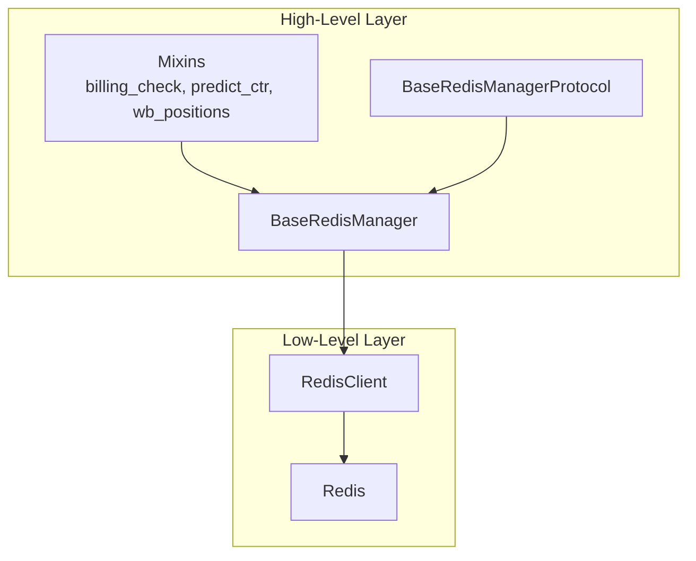
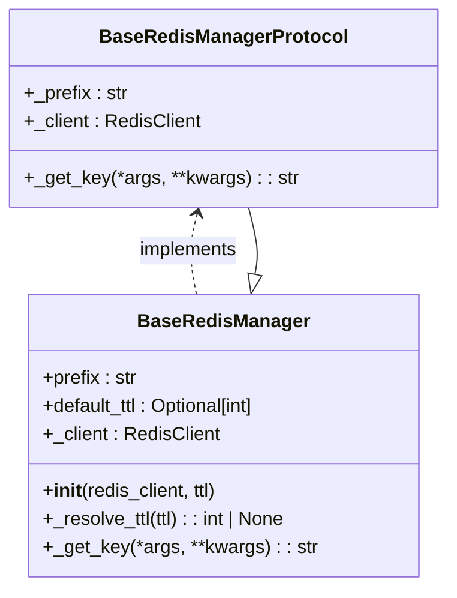
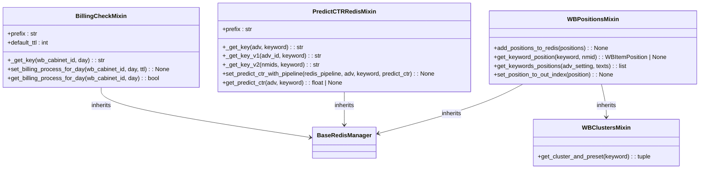
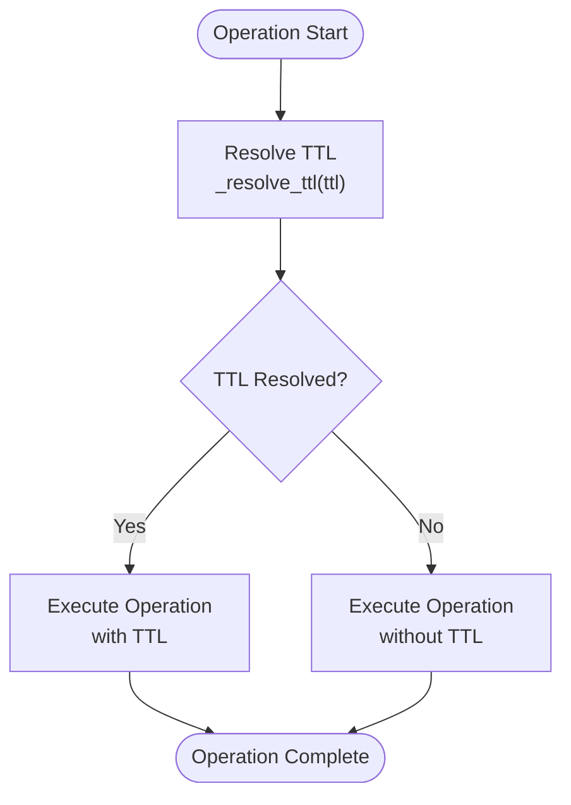
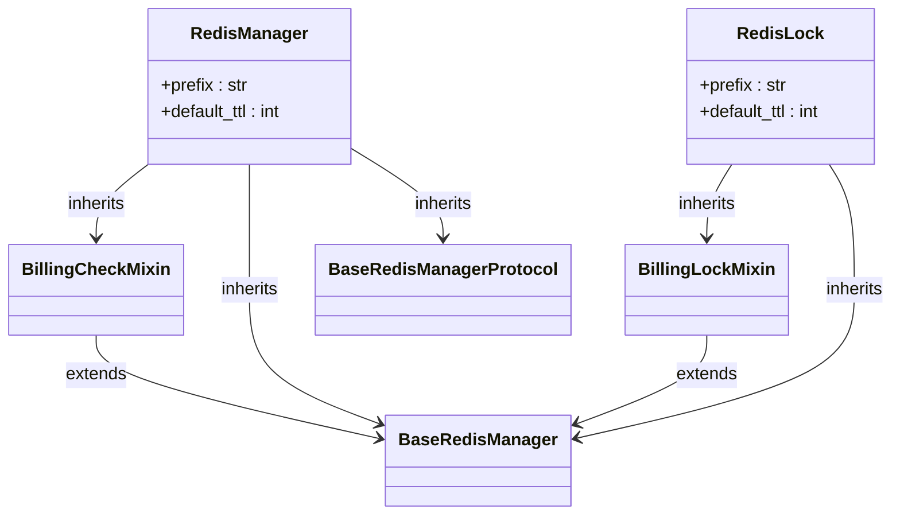
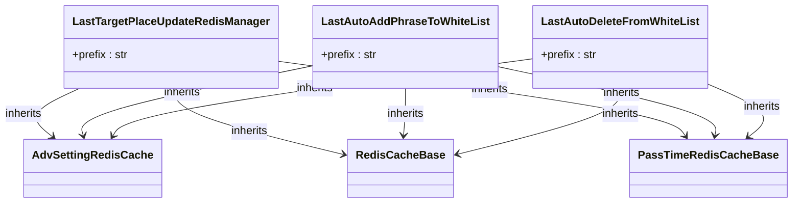
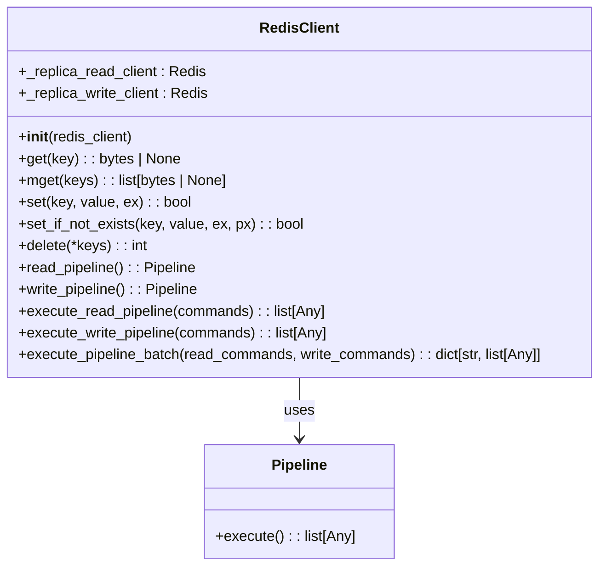

# Redis Data Access

<cite>
**Referenced Files in This Document**   
- [base_redis_manager_protocol.py](file://app/core/redis_manager_v2/base_redis_manager_protocol.py)
- [base_redis_manager.py](file://app/core/redis_manager_v2/base_redis_manager.py)
- [redis_client.py](file://app/core/redis_manager_v2/redis_client.py)
- [billing_check.py](file://app/core/redis_manager_v2/mixins/billing_check.py)
- [predict_ctr.py](file://app/core/redis_manager_v2/mixins/predict_ctr.py)
- [wb_positions.py](file://app/core/redis_manager_v2/mixins/wb_positions.py)
- [billing_lock.py](file://app/core/redis_manager_v2/mixins/billing_lock.py)
- [redis_manager.py](file://app/modules/billing/redis_manager.py)
- [redis_lock.py](file://app/modules/billing/redis_lock.py)
- [di.py](file://app/modules/billing/di.py)
- [last_target_place_update_redis_manager.py](file://app/modules/shop_runner/service_manager/old_modules/auto_updater_target_place/last_target_place_update_redis_manager.py)
- [last_auto_update_phrases_to_white_list.py](file://app/modules/shop_runner/service_manager/old_modules/setting_auto_updater/modules/white_list_updater/auto_white_list_updater/redis_cache/last_auto_update_phrases_to_white_list.py)
- [timestamp_update_redis_cache.py](file://app/modules/shop_runner/service_manager/old_modules/setting_auto_updater/modules/first_key_updater/timestamp_update_redis_cache.py)
</cite>

## Table of Contents
1. [Introduction](#introduction)
2. [Dual-Layer Architecture](#dual-layer-architecture)
3. [Protocol-Based Design](#protocol-based-design)
4. [Mixin System for Feature Composition](#mixin-system-for-feature-composition)
5. [Data Structure Patterns](#data-structure-patterns)
6. [Real-World Usage Examples](#real-world-usage-examples)
7. [Connection Pooling and Error Handling](#connection-pooling-and-error-handling)
8. [Performance Optimization Techniques](#performance-optimization-techniques)
9. [Conclusion](#conclusion)

## Introduction
The Redis data access implementation in the adv-bot system is designed with a modular, extensible architecture that separates concerns between low-level Redis operations and high-level business logic. This documentation details the dual-layer architecture, protocol-based design, mixin composition system, and key implementation patterns used throughout the system.

**Section sources**
- [base_redis_manager_protocol.py](file://app/core/redis_manager_v2/base_redis_manager_protocol.py#L1-L15)
- [base_redis_manager.py](file://app/core/redis_manager_v2/base_redis_manager.py#L1-L35)

## Dual-Layer Architecture

The Redis data access layer implements a dual-layer architecture consisting of a low-level Redis client and high-level base managers. The low-level layer provides direct access to Redis operations, while the high-level layer abstracts common patterns and provides a structured interface for business logic.

**Diagram sources**
- [base_redis_manager.py](file://app/core/redis_manager_v2/base_redis_manager.py#L1-L35)
- [redis_client.py](file://app/core/redis_manager_v2/redis_client.py#L1-L244)

**Section sources**
- [base_redis_manager.py](file://app/core/redis_manager_v2/base_redis_manager.py#L1-L35)
- [redis_client.py](file://app/core/redis_manager_v2/redis_client.py#L1-L244)

## Protocol-Based Design

The system employs a protocol-based design using the `BaseRedisManagerProtocol` to ensure type-safe interactions and structural compatibility across different Redis manager implementations. This protocol defines the contract that all Redis managers must follow, including required properties and methods.

**Diagram sources**
- [base_redis_manager_protocol.py](file://app/core/redis_manager_v2/base_redis_manager_protocol.py#L1-L15)
- [base_redis_manager.py](file://app/core/redis_manager_v2/base_redis_manager.py#L1-L35)

**Section sources**
- [base_redis_manager_protocol.py](file://app/core/redis_manager_v2/base_redis_manager_protocol.py#L1-L15)
- [base_redis_manager.py](file://app/core/redis_manager_v2/base_redis_manager.py#L1-L35)

## Mixin System for Feature Composition

The system utilizes a mixin-based approach to compose Redis functionality, allowing for flexible extension of base capabilities. Mixins such as `BillingCheckMixin`, `PredictCTRRedisMixin`, and `WBPositionsMixin` provide specialized functionality that can be combined with the base manager.

**Diagram sources**
- [billing_check.py](file://app/core/redis_manager_v2/mixins/billing_check.py#L1-L36)
- [predict_ctr.py](file://app/core/redis_manager_v2/mixins/predict_ctr.py#L1-L71)
- [wb_positions.py](file://app/core/redis_manager_v2/mixins/wb_positions.py#L1-L94)
- [wb_clusters.py](file://app/core/redis_manager_v2/mixins/wb_clusters.py#L1-L10)

**Section sources**
- [billing_check.py](file://app/core/redis_manager_v2/mixins/billing_check.py#L1-L36)
- [predict_ctr.py](file://app/core/redis_manager_v2/mixins/predict_ctr.py#L1-L71)
- [wb_positions.py](file://app/core/redis_manager_v2/mixins/wb_positions.py#L1-L94)

## Data Structure Patterns

The Redis implementation follows several key data structure patterns including TTL-based caching, atomic operations, and state tracking. These patterns ensure data consistency, performance, and proper lifecycle management.

### TTL-Based Caching
The system implements time-to-live (TTL) based caching with configurable expiration times. The `default_ttl` property in base classes and mixins defines the default expiration period, while the `_resolve_ttl` method determines the effective TTL by considering both instance-level and method-level values.

### Atomic Operations
Atomic operations are implemented using Redis primitives such as `set_if_not_exists` for lock acquisition and pipeline operations for batch processing. This ensures data integrity during concurrent access.

### State Tracking
State tracking is implemented through carefully designed key structures that encode entity relationships and temporal information. For example, billing processing state is tracked using keys that include the cabinet ID and date.

**Diagram sources**
- [base_redis_manager.py](file://app/core/redis_manager_v2/base_redis_manager.py#L25-L34)
- [billing_check.py](file://app/core/redis_manager_v2/mixins/billing_check.py#L15-L35)

**Section sources**
- [base_redis_manager.py](file://app/core/redis_manager_v2/base_redis_manager.py#L25-L34)
- [billing_check.py](file://app/core/redis_manager_v2/mixins/billing_check.py#L1-L36)

## Real-World Usage Examples

### Billing Module Implementation
The billing module demonstrates the practical application of the Redis data access patterns. It implements two specialized managers: `RedisManager` for tracking billing processing state and `RedisLock` for managing concurrent access.

**Diagram sources**
- [redis_manager.py](file://app/modules/billing/redis_manager.py#L1-L8)
- [redis_lock.py](file://app/modules/billing/redis_lock.py#L1-L25)
- [billing_check.py](file://app/core/redis_manager_v2/mixins/billing_check.py#L1-L36)
- [billing_lock.py](file://app/core/redis_manager_v2/mixins/billing_lock.py#L1-L68)

**Section sources**
- [redis_manager.py](file://app/modules/billing/redis_manager.py#L1-L8)
- [redis_lock.py](file://app/modules/billing/redis_lock.py#L1-L25)
- [di.py](file://app/modules/billing/di.py#L1-L41)

### Shop Runner Module
The shop runner module utilizes Redis for tracking various update operations, including target place updates and white list management. These implementations follow the same architectural patterns but with different domain-specific requirements.

**Diagram sources**
- [last_target_place_update_redis_manager.py](file://app/modules/shop_runner/service_manager/old_modules/auto_updater_target_place/last_target_place_update_redis_manager.py#L1-L17)
- [last_auto_update_phrases_to_white_list.py](file://app/modules/shop_runner/service_manager/old_modules/setting_auto_updater/modules/white_list_updater/auto_white_list_updater/redis_cache/last_auto_update_phrases_to_white_list.py#L1-L26)

**Section sources**
- [last_target_place_update_redis_manager.py](file://app/modules/shop_runner/service_manager/old_modules/auto_updater_target_place/last_target_place_update_redis_manager.py#L1-L17)
- [last_auto_update_phrases_to_white_list.py](file://app/modules/shop_runner/service_manager/old_modules/setting_auto_updater/modules/white_list_updater/auto_white_list_updater/redis_cache/last_auto_update_phrases_to_white_list.py#L1-L26)

## Connection Pooling and Error Handling

The Redis client implementation includes comprehensive connection pooling and error handling mechanisms. The `RedisClient` class wraps the underlying Redis connection and provides methods for both read and write operations, with appropriate error handling and type safety.

**Diagram sources**
- [redis_client.py](file://app/core/redis_manager_v2/redis_client.py#L1-L244)

**Section sources**
- [redis_client.py](file://app/core/redis_manager_v2/redis_client.py#L1-L244)

## Performance Optimization Techniques

The Redis implementation incorporates several performance optimization techniques:

1. **Pipeline Operations**: Batch operations are executed through pipelines to reduce network round trips
2. **Separate Read/Write Clients**: Read and write operations use separate client instances to optimize for replica usage
3. **Efficient Key Design**: Keys are designed to minimize length while maintaining clarity and avoiding collisions
4. **Type Hints and Protocol Enforcement**: Type safety reduces runtime errors and improves code maintainability

The system also implements TTL resolution logic that efficiently determines the appropriate expiration time for cached data, balancing between data freshness and cache efficiency.

**Section sources**
- [redis_client.py](file://app/core/redis_manager_v2/redis_client.py#L1-L244)
- [base_redis_manager.py](file://app/core/redis_manager_v2/base_redis_manager.py#L25-L34)

## Conclusion
The Redis data access implementation in the adv-bot system demonstrates a well-architected approach to managing Redis operations in a complex application. The dual-layer architecture, protocol-based design, and mixin composition system provide a flexible and maintainable foundation for Redis interactions. The implementation patterns for TTL-based caching, atomic operations, and state tracking ensure data consistency and performance. Real-world examples from the billing and shop runner modules illustrate how these patterns are applied to solve domain-specific problems. The comprehensive connection pooling and error handling mechanisms further enhance the reliability and performance of the system.