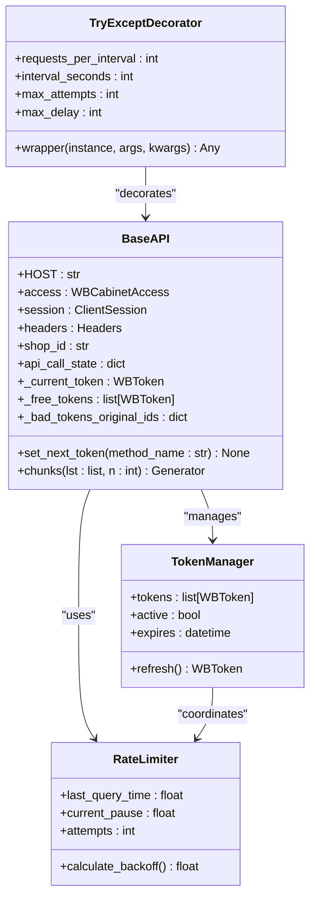
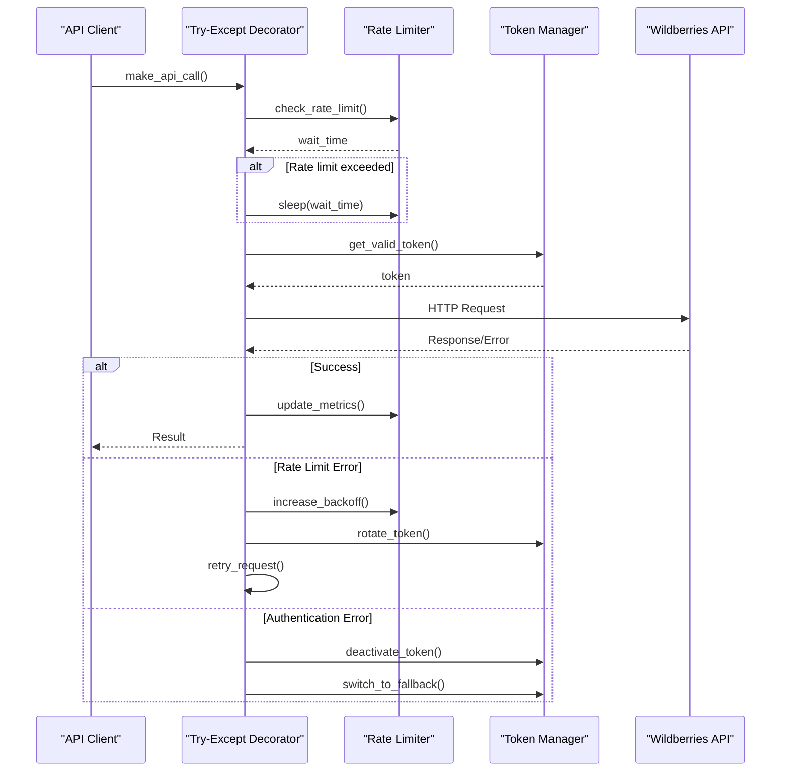
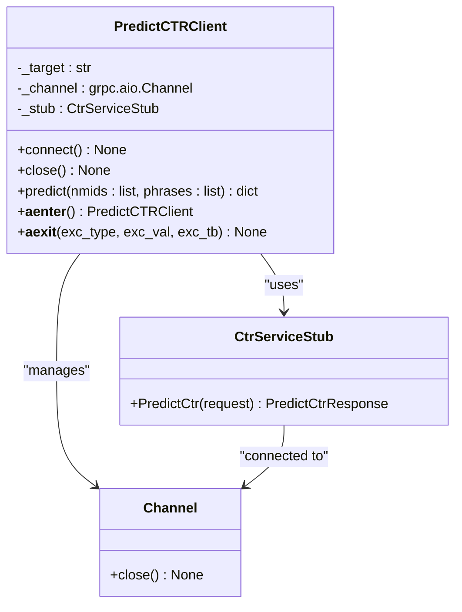
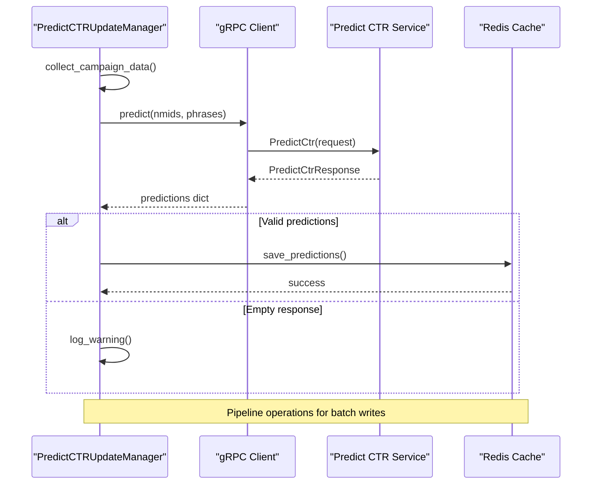
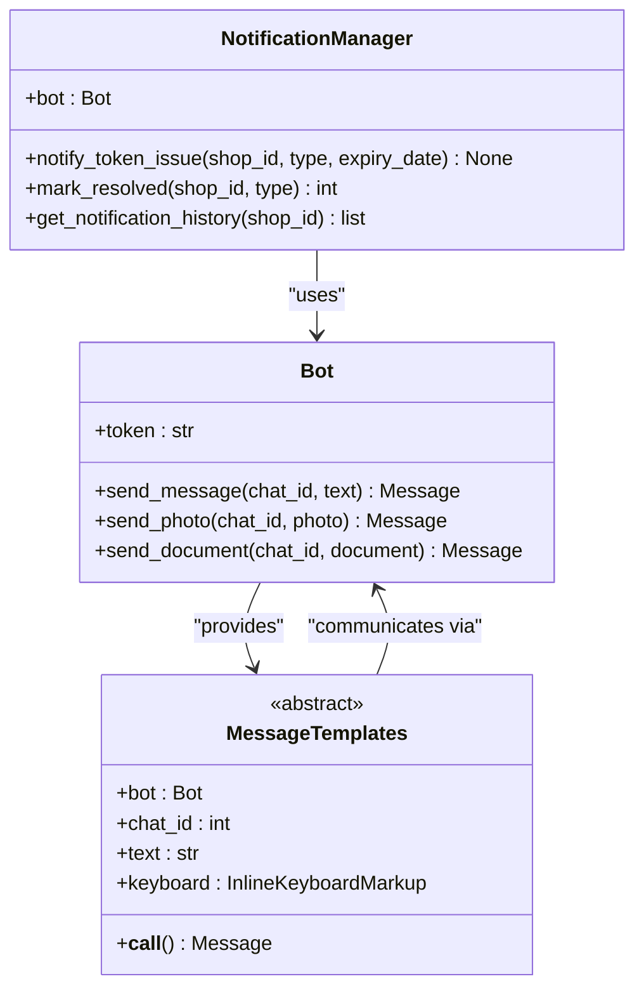
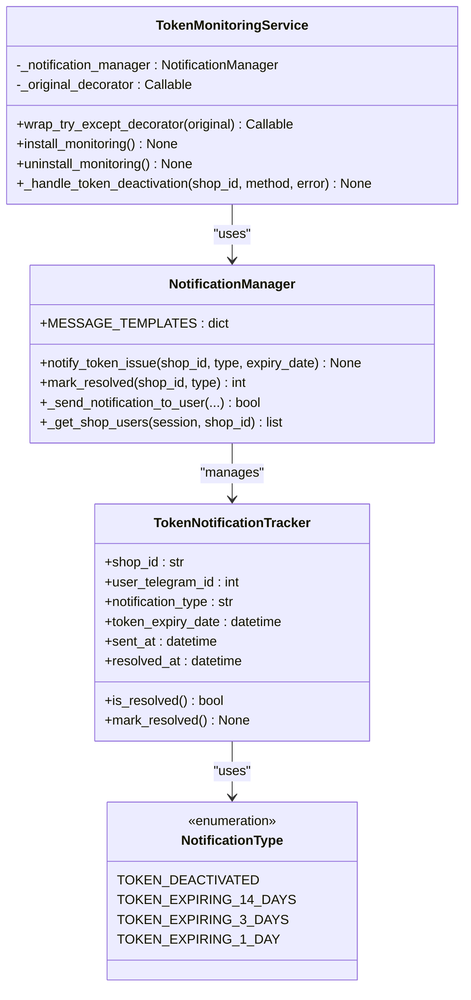
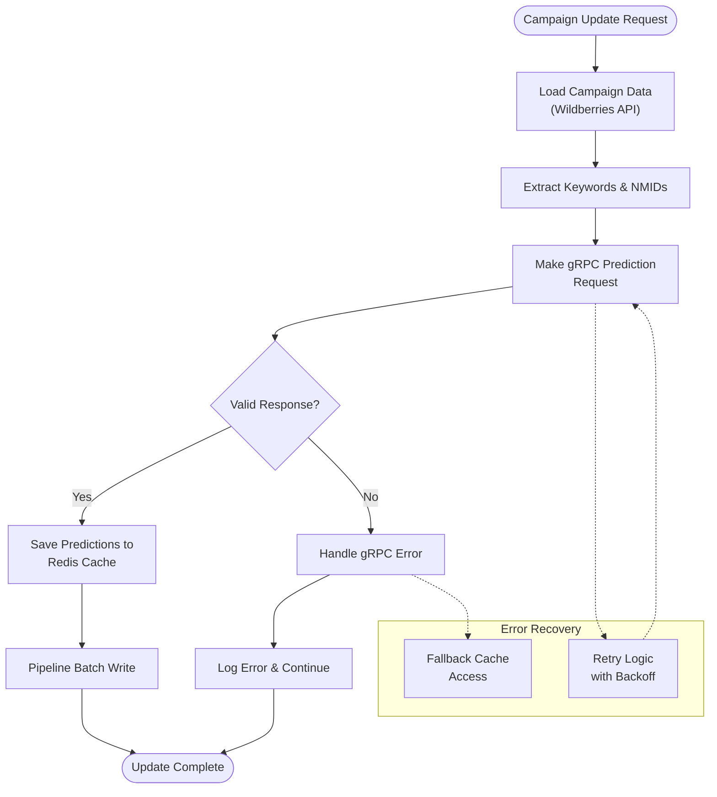

# External Integrations

<cite>
**Referenced Files in This Document**
- [app/core/wb_api/base.py](file://app/core/wb_api/base.py)
- [app/core/wb_api/http_request.py](file://app/core/wb_api/http_request.py)
- [app/core/wb_api/exceptions.py](file://app/core/wb_api/exceptions.py)
- [app/modules/grpcs/predict_ctr_service/grpc_service/predict_ctr_service.proto](file://app/modules/grpcs/predict_ctr_service/grpc_service/predict_ctr_service.proto)
- [app/modules/grpcs/predict_ctr_service/predict_ctr_client/predict_ctr_client.py](file://app/modules/grpcs/predict_ctr_service/predict_ctr_client/predict_ctr_client.py)
- [app/client_bot/bot.py](file://app/client_bot/bot.py)
- [app/client_bot/user_interface/views/messages/messages.py](file://app/client_bot/user_interface/views/messages/messages.py)
- [app/modules/token_monitoring/models.py](file://app/modules/token_monitoring/models.py)
- [app/modules/token_monitoring/services/notification_manager.py](file://app/modules/token_monitoring/services/notification_manager.py)
- [app/modules/token_monitoring/services/token_monitoring_service.py](file://app/modules/token_monitoring/services/token_monitoring_service.py)
- [app/modules/shop_runner/service_manager/services/predict_ctr_update_manager/predict_ctr_update_manager.py](file://app/modules/shop_runner/service_manager/services/predict_ctr_update_manager/predict_ctr_update_manager.py)
</cite>

## Table of Contents
1. [Introduction](#introduction)
2. [Wildberries API Integration](#wildberries-api-integration)
3. [gRPC Integration with Predict CTR Service](#grpc-integration-with-predict-ctr-service)
4. [Telegram Bot API Abstraction](#telegram-bot-api-abstraction)
5. [Token Monitoring System](#token-monitoring-system)
6. [API Composition Patterns](#api-composition-patterns)
7. [Security Considerations](#security-considerations)
8. [Integration Health Monitoring](#integration-health-monitoring)
9. [Error Handling Strategies](#error-handling-strategies)
10. [Performance Optimization](#performance-optimization)

## Introduction

The adv-bot system integrates with multiple external services to provide comprehensive advertising automation for Wildberries platform. This document details the architectural patterns, implementation strategies, and operational characteristics of these external integrations, focusing on reliability, scalability, and maintainability.

The system currently integrates with three primary external services:
- **Wildberries API**: For accessing advertising campaign data and managing ad placements
- **gRPC Predict CTR Service**: For machine learning-powered click-through rate predictions
- **Telegram Bot API**: For user communication and interface management

## Wildberries API Integration

### Architecture Overview

The Wildberries API integration is built around a robust HTTP client abstraction that handles authentication, rate limiting, error recovery, and token rotation. The system employs sophisticated retry mechanisms and adaptive backoff strategies to ensure reliable communication with the external API.



**Diagram sources**
- [app/core/wb_api/base.py](file://app/core/wb_api/base.py#L30-L116)
- [app/core/wb_api/http_request.py](file://app/core/wb_api/http_request.py#L40-L120)

### Authentication and Token Management

The system implements a sophisticated token rotation mechanism that automatically switches between available API tokens when individual tokens become invalid or reach rate limits. This ensures continuous operation even when individual tokens fail.

```python
async def set_next_token(self, method_name: str) -> None:
    current_token_original_id = self._current_token.id
    self._bad_tokens_original_ids[method_name].add(current_token_original_id)
    
    all_bad_token_original_ids: set[int] = self._bad_tokens_original_ids[method_name]
    
    free_tokens = [
        token for token in self._free_tokens 
        if token.id not in all_bad_token_original_ids
    ]
    
    if free_tokens:
        self._current_token = free_tokens[0]
        self.headers = Headers(self._current_token)
    else:
        # Deactivate shop if all tokens are exhausted
        wb_cabinet: WBCabinet | None = self.access.wb_cabinet
        if wb_cabinet is None:
            raise ApiForbiddenError("Нет WBCabinet для деактивации")
        
        # Deactivate the shop and raise error
        async with sm(read_only=False) as session:
            fresh_cabinet = await session.get(WBCabinet, wb_cabinet.id)
            if fresh_cabinet:
                fresh_cabinet.active = False
                await session.commit()
```

**Section sources**
- [app/core/wb_api/base.py](file://app/core/wb_api/base.py#L65-L116)

### HTTP Client Abstraction

The HTTP client abstraction layer provides a unified interface for making API requests with built-in retry logic, rate limiting, and error handling. The system uses aiohttp for asynchronous HTTP operations and implements sophisticated backoff strategies.



**Diagram sources**
- [app/core/wb_api/http_request.py](file://app/core/wb_api/http_request.py#L40-L120)

### Rate Limiting Strategy

The system implements adaptive rate limiting with configurable intervals and requests per interval. The rate limiter maintains per-method state to ensure compliance with API restrictions while maximizing throughput.

```python
def try_except_decorator(
    requests_per_interval: int,
    interval_seconds: int | float,
    max_attempts: int = 50,
    max_delay: int = 120,
) -> Callable[[F], F]:
    """
    Декоратор для обработки ошибок API запросов с повторными попытками и адаптивным ожиданием.
    """
    
    def decorator(func: F) -> F:
        async def wrapper(instance: TypeWBAPIProtocol, *args: Any, **kwargs: Any) -> Any:
            method_name = func.__name__
            if method_name not in instance.api_call_state:
                instance.api_call_state[method_name] = {
                    "_last_query_time": None,
                    "_current_pause": interval_seconds / requests_per_interval,
                    "_attempts": 0,
                }
            
            state = instance.api_call_state[method_name]
            # Adaptive backoff calculation
            next_pause = (interval_seconds / requests_per_interval + state["_current_pause"]) / 2
            state["_current_pause"] = next_pause
```

**Section sources**
- [app/core/wb_api/http_request.py](file://app/core/wb_api/http_request.py#L40-L120)

### Error Handling Mechanisms

The system implements comprehensive error handling that distinguishes between different types of failures and applies appropriate recovery strategies. Error categories include:

- **Rate Limiting**: Automatic backoff and retry with exponential growth
- **Authentication Errors**: Token rotation and fallback mechanisms
- **Network Issues**: Connection retries with jitter
- **Validation Errors**: Immediate failure with detailed error reporting
- **Unexpected Failures**: Generic retry with circuit breaker pattern

```python
except (
    TooManyRequests,
    BadRequestError,
    UnknownApiRequestError,
    NotValidDataError,
    ClientOSError,
    ServerDisconnectedError,
    ClientResponseError,
    ClientConnectionError,
    NotMatchWBApiError,
) as e:
    if state["_attempts"] >= max_attempts:
        raise MaxAttemptsError(f"Не удалось выполнить {method_name} за {max_attempts} попыток")
    
    state["_attempts"] += 1
    state["_current_pause"] = min(max(state["_current_pause"], 1) * 2, max_delay)
```

**Section sources**
- [app/core/wb_api/http_request.py](file://app/core/wb_api/http_request.py#L80-L120)

## gRPC Integration with Predict CTR Service

### Protocol Definition

The gRPC integration follows the standard protobuf definition pattern, providing strongly-typed communication between the main application and the prediction service.

```protobuf
syntax = "proto3";

package ctr;

// Запрос на прогноз CTR
message PredictCtrRequest {
  repeated int64 nmids = 1;     // Список nmid товаров
  repeated string phrases = 2;  // Список ключевых фраз
}

// Ответ с прогнозом CTR
message PredictCtrResponse {
  map<string, float> predictions = 1;  // Словарь прогнозов: ключ -> значение CTR
}

// Сервис для прогноза CTR
service CtrService {
  rpc PredictCtr(PredictCtrRequest) returns (PredictCtrResponse);
}
```

**Section sources**
- [app/modules/grpcs/predict_ctr_service/grpc_service/predict_ctr_service.proto](file://app/modules/grpcs/predict_ctr_service/grpc_service/predict_ctr_service.proto#L1-L20)

### gRPC Client Implementation

The gRPC client implements connection pooling, graceful shutdown, and async context management to ensure reliable communication with the prediction service.



**Diagram sources**
- [app/modules/grpcs/predict_ctr_service/predict_ctr_client/predict_ctr_client.py](file://app/modules/grpcs/predict_ctr_service/predict_ctr_client/predict_ctr_client.py#L10-L52)

### Prediction Workflow

The prediction workflow coordinates between multiple external services to provide comprehensive CTR predictions for advertising campaigns.



**Diagram sources**
- [app/modules/shop_runner/service_manager/services/predict_ctr_update_manager/predict_ctr_update_manager.py](file://app/modules/shop_runner/service_manager/services/predict_ctr_update_manager/predict_ctr_update_manager.py#L30-L100)

**Section sources**
- [app/modules/shop_runner/service_manager/services/predict_ctr_update_manager/predict_ctr_update_manager.py](file://app/modules/shop_runner/service_manager/services/predict_ctr_update_manager/predict_ctr_update_manager.py#L1-L166)

### Error Handling in gRPC Communication

The gRPC integration implements comprehensive error handling that covers network failures, service unavailability, and protocol violations.

```python
async def _handle_grpc_error(self, error: grpc.RpcError, adv_id: int) -> None:
    """Обработать ошибки gRPC"""
    if error.code() == grpc.StatusCode.INVALID_ARGUMENT:
        logger.error(f"Неверные аргументы для кампании {adv_id}: {error.details()}")
    elif error.code() in [grpc.StatusCode.UNAVAILABLE, grpc.StatusCode.INTERNAL]:
        logger.error(
            f"Сервис недоступен или внутренняя ошибка для кампании {adv_id}: "
            f"код={error.code()}, детали={error.details()}"
        )
    else:
        logger.error(
            f"gRPC ошибка для кампании {adv_id}: код={error.code()}, "
            f"детали={error.details()}",
            exc_info=True,
        )
```

**Section sources**
- [app/modules/shop_runner/service_manager/services/predict_ctr_update_manager/predict_ctr_update_manager.py](file://app/modules/shop_runner/service_manager/services/predict_ctr_update_manager/predict_ctr_update_manager.py#L140-L166)

## Telegram Bot API Abstraction

### aiogram Integration Pattern

The Telegram Bot API integration leverages aiogram framework to provide a clean abstraction layer that separates business logic from Telegram-specific implementation details.



**Diagram sources**
- [app/client_bot/bot.py](file://app/client_bot/bot.py#L1-L16)
- [app/client_bot/user_interface/views/messages/messages.py](file://app/client_bot/user_interface/views/messages/messages.py#L1-L50)

### Message Template System

The system implements a template-based approach for generating consistent Telegram messages across different contexts and notification types.

```python
class Base(ABC):
    def __init__(self, bot: aiogram.Bot, chat_id: int):
        self._bot = bot
        self._chat_id = chat_id
    
    async def __call__(self: "Base", *args: Any, **kwargs: Any) -> None:
        parse_mode = getattr(self, "parse_mode", None)
        self.parse_mode = parse_mode
        
    def get_content_type(self: "Base") -> str:
        return self.__get_parent_class_name()
```

**Section sources**
- [app/client_bot/user_interface/views/messages/messages.py](file://app/client_bot/user_interface/views/messages/messages.py#L1-L30)

### Bot Initialization and Configuration

The bot initialization follows a singleton pattern with lazy loading to avoid circular dependencies and ensure proper resource management.

```python
from aiogram import Bot
from dotenv import load_dotenv
from app.settings import settings

load_dotenv()

token = settings.TELEGRAM_BOT_TOKEN
bot = Bot(token=token)

def get_bot() -> Bot:
    return bot
```

**Section sources**
- [app/client_bot/bot.py](file://app/client_bot/bot.py#L1-L16)

## Token Monitoring System

### Comprehensive Monitoring Architecture

The token monitoring system provides real-time visibility into API token status, automatic detection of token deactivation events, and proactive expiration notifications.



**Diagram sources**
- [app/modules/token_monitoring/services/token_monitoring_service.py](file://app/modules/token_monitoring/services/token_monitoring_service.py#L15-L50)
- [app/modules/token_monitoring/services/notification_manager.py](file://app/modules/token_monitoring/services/notification_manager.py#L20-L60)
- [app/modules/token_monitoring/models.py](file://app/modules/token_monitoring/models.py#L10-L40)

### Token Status Detection

The monitoring system wraps the existing API retry decorator to intercept authentication errors and trigger appropriate notifications.

```python
async def _handle_token_deactivation(self, shop_id: str, method_name: str, error_details: str) -> None:
    """Handle token deactivation event by sending notifications."""
    try:
        logger.info(f"Handling token deactivation for shop {shop_id}")
        
        # Send deactivation notification
        await self.notification_manager.notify_token_issue(
            shop_id=shop_id,
            notification_type=NotificationType.TOKEN_DEACTIVATED.value,
            context={
                "method_name": method_name,
                "error_details": error_details,
            }
        )
        
        logger.info(f"Token deactivation notification sent for shop {shop_id}")
        
    except Exception as notification_error:
        logger.error(
            f"Failed to send token deactivation notification for shop {shop_id}: "
            f"{notification_error}",
            exc_info=True
        )
```

**Section sources**
- [app/modules/token_monitoring/services/token_monitoring_service.py](file://app/modules/token_monitoring/services/token_monitoring_service.py#L100-L130)

### Proactive Expiration Monitoring

The system implements a multi-stage notification strategy for token expiration, providing early warnings to prevent service disruption.

```python
async def notify_token_expiring(
    shop_id: str, 
    days_until_expiry: int, 
    expiry_date: datetime.datetime
) -> None:
    """Send token expiration notification based on days until expiry."""
    # Determine notification type based on days until expiry
    if days_until_expiry == 14:
        notification_type = NotificationType.TOKEN_EXPIRING_14_DAYS.value
    elif days_until_expiry == 3:
        notification_type = NotificationType.TOKEN_EXPIRING_3_DAYS.value
    elif days_until_expiry == 1:
        notification_type = NotificationType.TOKEN_EXPIRING_1_DAY.value
    else:
        logger.warning(f"Unsupported expiry notification for {days_until_expiry} days")
        return
    
    manager = NotificationManager()
    await manager.notify_token_issue(
        shop_id=shop_id,
        notification_type=notification_type,
        expiry_date=expiry_date
    )
```

**Section sources**
- [app/modules/token_monitoring/services/notification_manager.py](file://app/modules/token_monitoring/services/notification_manager.py#L300-L336)

## API Composition Patterns

### Multi-Service Coordination

The system demonstrates sophisticated API composition patterns where multiple external services are coordinated to deliver comprehensive functionality. The Predict CTR Update Manager exemplifies this pattern by combining Wildberries API data with gRPC predictions and Redis caching.



**Diagram sources**
- [app/modules/shop_runner/service_manager/services/predict_ctr_update_manager/predict_ctr_update_manager.py](file://app/modules/shop_runner/service_manager/services/predict_ctr_update_manager/predict_ctr_update_manager.py#L30-L100)

### Business Operation Orchestration

The system orchestrates multiple API calls within business operations, ensuring data consistency and handling partial failures gracefully.

```python
async def update_predict_ctr(
        self, adv: AdvSetting, keywords_coro: Awaitable[list[CalculatedKeyword]]
) -> None:
    keywords = await keywords_coro
    
    if not keywords:
        logger.debug(f"Нет ключевых слов для кампании {adv.adv_id}")
        return
    
    try:
        # Prepare data for gRPC request
        nmids = adv.nmids
        phrases = [keyword.text for keyword in keywords]
        
        # Execute gRPC request
        grpc_client = await self._get_grpc_client()
        predictions = await self._make_grpc_request(grpc_client, nmids, phrases)
        
        if predictions is None:
            logger.warning(f"Получен None от gRPC сервиса для кампании {adv.adv_id}")
            return
            
        # Save results to Redis
        await self._save_predictions_to_redis(adv, predictions)
        
    except grpc.RpcError as e:
        await self._handle_grpc_error(e, adv.adv_id)
    except Exception as e:
        logger.error(f"Неожиданная ошибка при обработке кампании {adv.adv_id}: {e}", exc_info=True)
```

**Section sources**
- [app/modules/shop_runner/service_manager/services/predict_ctr_update_manager/predict_ctr_update_manager.py](file://app/modules/shop_runner/service_manager/services/predict_ctr_update_manager/predict_ctr_update_manager.py#L30-L80)

## Security Considerations

### API Credential Protection

The system implements several security measures to protect API credentials and sensitive data:

1. **Environment-Based Configuration**: API keys and secrets are stored in environment variables
2. **Database Encryption**: Sensitive data is encrypted at rest using database-level encryption
3. **Access Control**: Role-based access control for API token management
4. **Audit Logging**: Comprehensive logging of API access and modifications

### Secure Token Rotation

The token rotation mechanism ensures that expired or compromised tokens are replaced promptly without service interruption:

```python
# Automatic token deactivation when all tokens fail
if wb_cabinet is None:
    raise ApiForbiddenError("Нет WBCabinet для деактивации, метод set_next_token не может быть использован")

try:
    async with sm(read_only=False) as session:
        fresh_cabinet = await session.get(WBCabinet, wb_cabinet.id)
        if fresh_cabinet:
            fresh_cabinet.active = False
            await session.commit()
except Exception as e:
    logger.error(f"Ошибка при отключении кабинета {wb_cabinet.shop_id}: {e}", exc_info=True)
    raise e
```

**Section sources**
- [app/core/wb_api/base.py](file://app/core/wb_api/base.py#L85-L116)

### Network Security

The gRPC integration implements secure channel establishment with proper certificate validation and connection pooling to minimize exposure to network attacks.

## Integration Health Monitoring

### Real-Time Health Checks

The system implements comprehensive health monitoring for all external integrations:

1. **Token Status Monitoring**: Continuous monitoring of token validity and expiration
2. **Service Availability**: Regular health checks for gRPC and HTTP services
3. **Performance Metrics**: Latency and throughput monitoring for all API calls
4. **Error Rate Tracking**: Automated alerting for increased error rates

### Circuit Breaker Pattern

The system implements circuit breaker patterns to prevent cascading failures and allow degraded operation during external service outages.

```python
# Adaptive backoff with circuit breaker logic
state["_current_pause"] = min(max(state["_current_pause"], 1) * 2, max_delay)
if state["_attempts"] >= max_attempts:
    raise MaxAttemptsError(f"Не удалось выполнить {method_name} за {max_attempts} попыток")
```

**Section sources**
- [app/core/wb_api/http_request.py](file://app/core/wb_api/http_request.py#L80-L120)

### Alerting and Notification

The monitoring system provides comprehensive alerting capabilities with multiple notification channels and escalation policies.

## Error Handling Strategies

### Hierarchical Error Handling

The system implements a multi-layered error handling strategy that addresses different failure modes appropriately:

1. **Application-Level Errors**: Business logic validation and recovery
2. **Transport-Level Errors**: Network connectivity and timeout handling
3. **Protocol-Level Errors**: API-specific error interpretation and response
4. **Infrastructure-Level Errors**: Resource availability and capacity management

### Graceful Degradation

When external services become unavailable, the system implements graceful degradation patterns:

- **Fallback Caching**: Use cached data when external services are unavailable
- **Partial Updates**: Update available data while skipping failed operations
- **Retry Queues**: Queue failed operations for later retry
- **User Communication**: Inform users about temporary service limitations

### Error Recovery Patterns

The system implements several error recovery patterns:

```python
# Token rotation on authentication failure
except ApiForbiddenError:
    await instance.set_next_token(method_name)
    state["_current_pause"] = 0

# Exponential backoff for rate limiting
except TooManyRequests:
    state["_attempts"] += 1
    state["_current_pause"] = min(max(state["_current_pause"], 1) * 2, max_delay)
```

**Section sources**
- [app/core/wb_api/http_request.py](file://app/core/wb_api/http_request.py#L80-L120)

## Performance Optimization

### Connection Pooling

The system implements connection pooling for HTTP and gRPC connections to minimize connection overhead and improve throughput.

### Caching Strategies

Multiple caching layers are implemented to reduce external API calls and improve response times:

1. **Redis Caching**: Predictions and frequently accessed data
2. **HTTP Caching**: API responses with appropriate TTL
3. **In-Memory Caching**: Hot data within application memory

### Batch Operations

The system optimizes external API calls through intelligent batching:

```python
@staticmethod
def chunks(lst: list[T], n: int) -> Generator[list[T], None, None]:
    for i in range(0, len(lst), n):
        yield lst[i : i + n]
```

**Section sources**
- [app/core/wb_api/base.py](file://app/core/wb_api/base.py#L55-L65)

### Asynchronous Processing

All external API calls are implemented asynchronously to maximize concurrency and resource utilization, enabling the system to handle multiple concurrent operations efficiently.