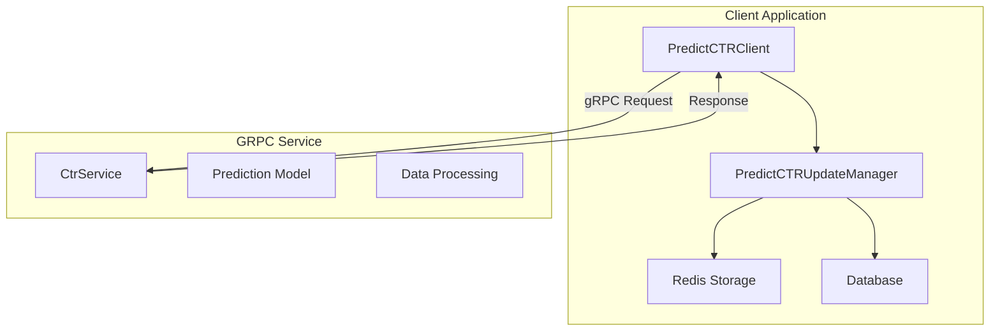
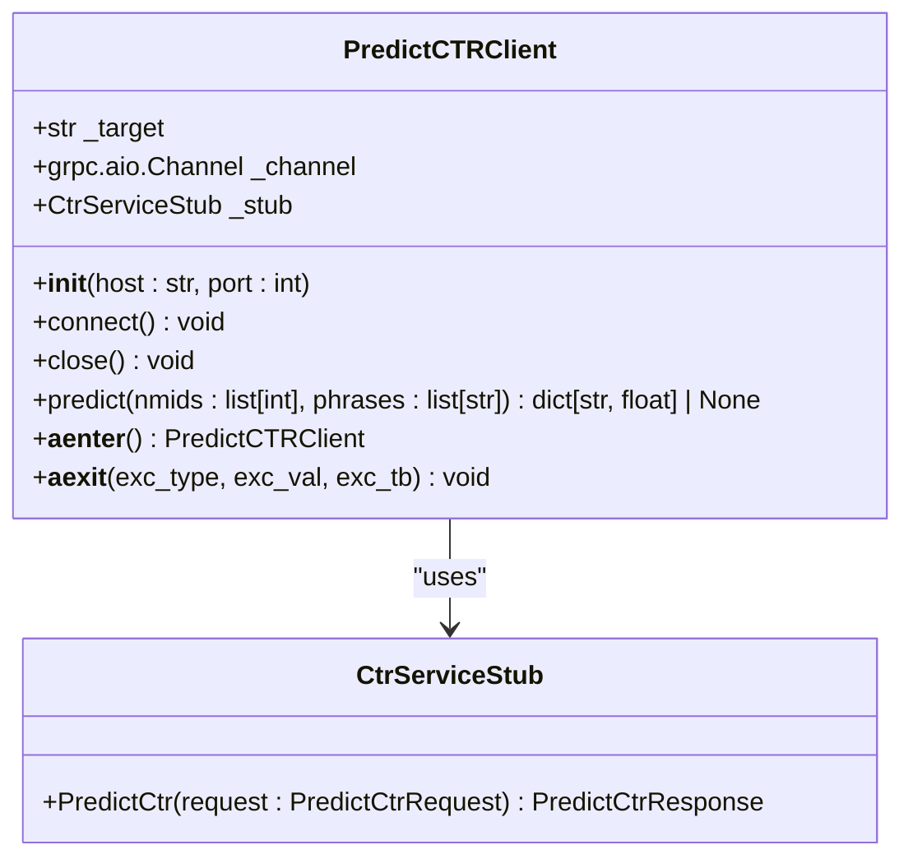
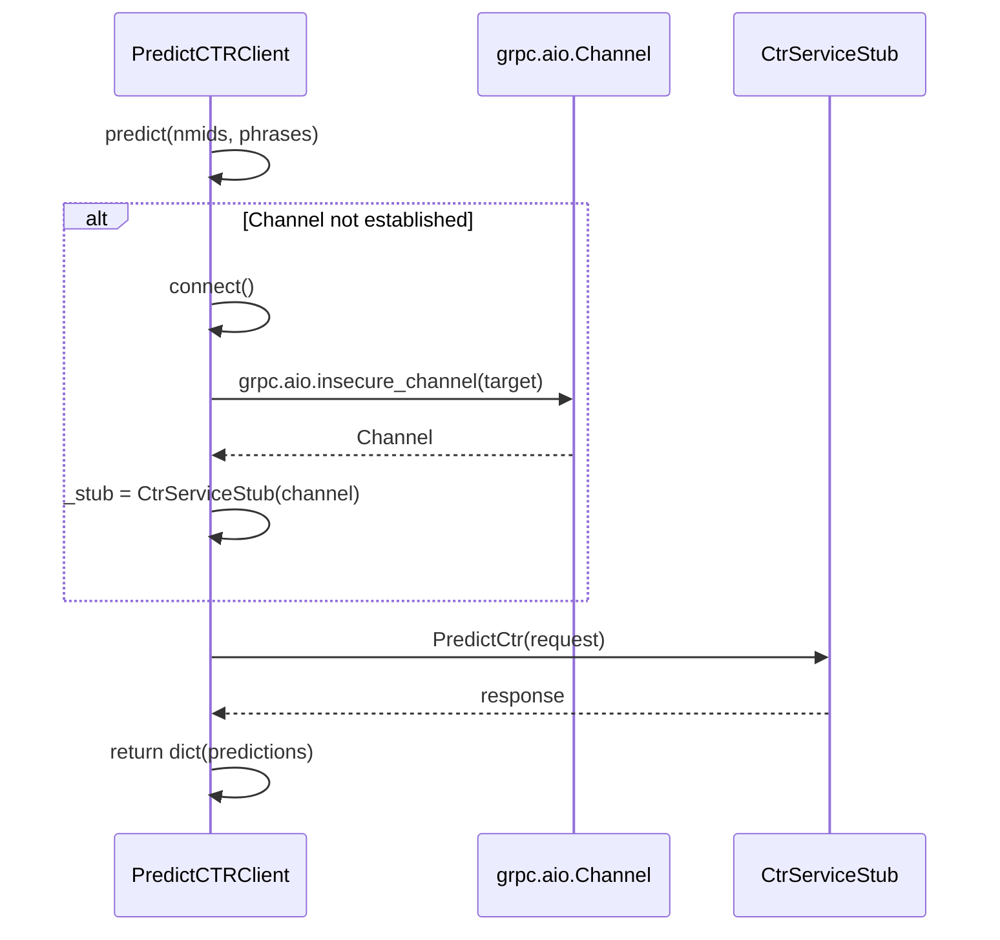
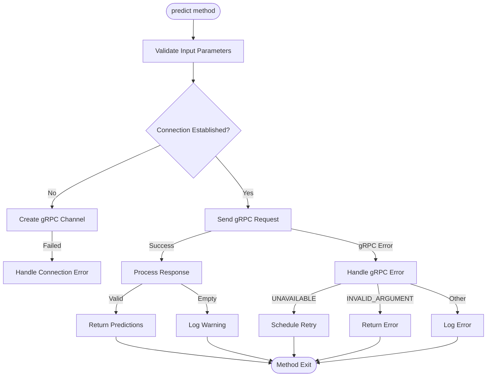
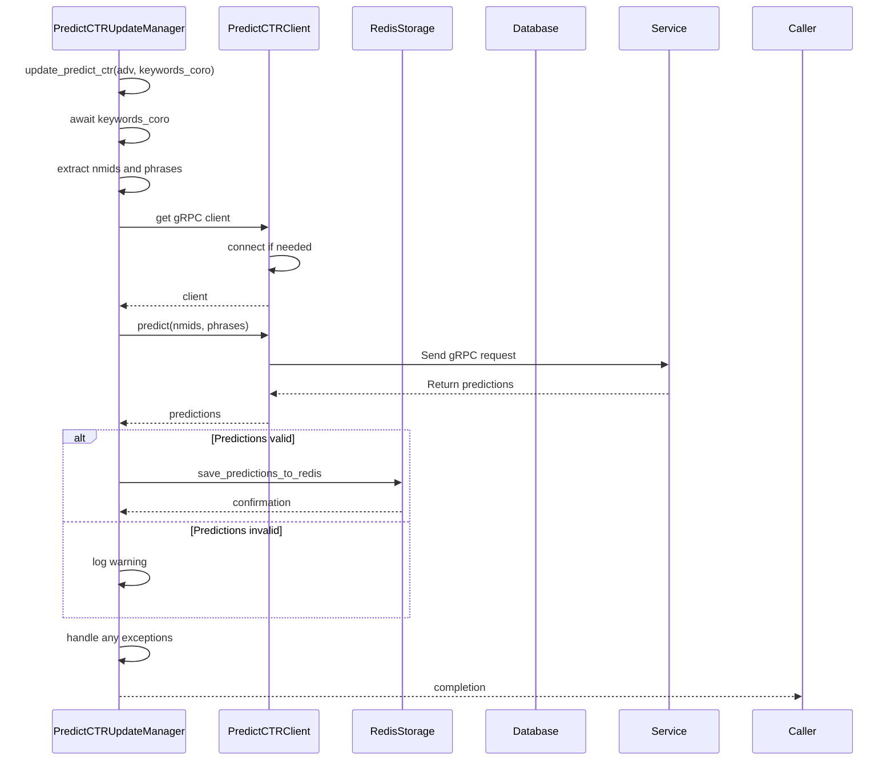
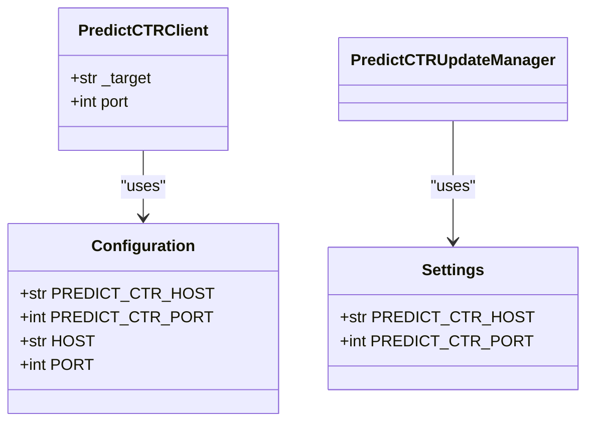
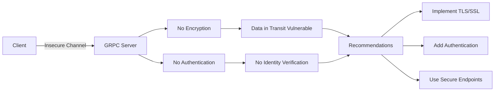
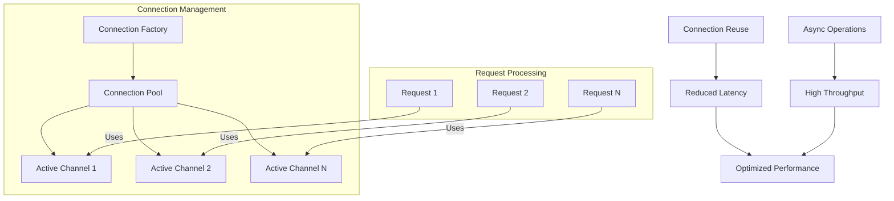

# GRPC Prediction Service Integration

<cite>
**Referenced Files in This Document**   
- [predict_ctr_client.py](file://app/modules/grpcs/predict_ctr_service/predict_ctr_client/predict_ctr_client.py)
- [config.py](file://app/modules/grpcs/predict_ctr_service/config.py)
- [predict_ctr_service.proto](file://app/modules/grpcs/predict_ctr_service/grpc_service/predict_ctr_service.proto)
- [predict_ctr_update_manager.py](file://app/modules/shop_runner/service_manager/services/predict_ctr_update_manager/predict_ctr_update_manager.py)
- [settings_master.py](file://app/settings/settings_master.py)
- [excs.py](file://app/modules/grpcs/predict_ctr_service/excs/excs.py)
</cite>

## Table of Contents
1. [Introduction](#introduction)
2. [GRPC Service Architecture](#grpc-service-architecture)
3. [PredictCTRClient Implementation](#predictctrclient-implementation)
4. [Request/Response Structure](#requestresponse-structure)
5. [Connection Management](#connection-management)
6. [Error Handling and Retry Strategies](#error-handling-and-retry-strategies)
7. [Integration with PredictCTRUpdateManager](#integration-with-predictctrupdatemanager)
8. [Configuration Parameters](#configuration-parameters)
9. [Security Considerations](#security-considerations)
10. [Performance and Connection Pooling](#performance-and-connection-pooling)

## Introduction
The GRPC Prediction Service Integration provides a high-performance interface for predicting click-through rates (CTR) for advertising campaigns. This documentation details the implementation of the PredictCTRClient, its integration with the advertising optimization system, and the underlying architecture that enables efficient communication with the prediction service. The system is designed to support asynchronous operations, robust error handling, and seamless integration with the broader advertising management platform.

## GRPC Service Architecture



**Diagram sources**
- [predict_ctr_service.proto](file://app/modules/grpcs/predict_ctr_service/grpc_service/predict_ctr_service.proto)
- [predict_ctr_client.py](file://app/modules/grpcs/predict_ctr_service/predict_ctr_client/predict_ctr_client.py)
- [predict_ctr_update_manager.py](file://app/modules/shop_runner/service_manager/services/predict_ctr_update_manager/predict_ctr_update_manager.py)

**Section sources**
- [predict_ctr_service.proto](file://app/modules/grpcs/predict_ctr_service/grpc_service/predict_ctr_service.proto)
- [predict_ctr_client.py](file://app/modules/grpcs/predict_ctr_service/predict_ctr_client/predict_ctr_client.py)

## PredictCTRClient Implementation

The PredictCTRClient class provides an asynchronous interface for communicating with the CTR prediction service. It encapsulates the gRPC channel management, request serialization, and response handling in a clean, reusable component.



**Diagram sources**
- [predict_ctr_client.py](file://app/modules/grpcs/predict_ctr_service/predict_ctr_client/predict_ctr_client.py)
- [predict_ctr_service_pb2_grpc.py](file://app/modules/grpcs/predict_ctr_service/grpc_service/predict_ctr_service_pb2_grpc.py)

**Section sources**
- [predict_ctr_client.py](file://app/modules/grpcs/predict_ctr_service/predict_ctr_client/predict_ctr_client.py)

## Request/Response Structure

The service uses Protocol Buffers for efficient serialization of requests and responses. The message structure is defined in the predict_ctr_service.proto file.

```mermaid
erDiagram
PREDICT_CTR_REQUEST {
repeated int64 nmids PK
repeated string phrases PK
}
PREDICT_CTR_RESPONSE {
map predictions PK
}
PREDICT_CTR_REQUEST ||--o{ PREDICT_CTR_RESPONSE : "generates"
```

**Diagram sources**
- [predict_ctr_service.proto](file://app/modules/grpcs/predict_ctr_service/grpc_service/predict_ctr_service.proto)

**Section sources**
- [predict_ctr_service.proto](file://app/modules/grpcs/predict_ctr_service/grpc_service/predict_ctr_service.proto)

## Connection Management

The PredictCTRClient implements asynchronous connection management with lazy initialization and proper resource cleanup. The client establishes a connection only when needed and maintains it for subsequent requests.



**Diagram sources**
- [predict_ctr_client.py](file://app/modules/grpcs/predict_ctr_service/predict_ctr_client/predict_ctr_client.py)

**Section sources**
- [predict_ctr_client.py](file://app/modules/grpcs/predict_ctr_service/predict_ctr_client/predict_ctr_client.py)

## Error Handling and Retry Strategies

The integration includes comprehensive error handling for various failure scenarios, including network issues, service unavailability, and invalid requests.



**Diagram sources**
- [predict_ctr_client.py](file://app/modules/grpcs/predict_ctr_service/predict_ctr_client/predict_ctr_client.py)
- [predict_ctr_update_manager.py](file://app/modules/shop_runner/service_manager/services/predict_ctr_update_manager/predict_ctr_update_manager.py)

**Section sources**
- [predict_ctr_client.py](file://app/modules/grpcs/predict_ctr_service/predict_ctr_client/predict_ctr_client.py)
- [predict_ctr_update_manager.py](file://app/modules/shop_runner/service_manager/services/predict_ctr_update_manager/predict_ctr_update_manager.py)
- [excs.py](file://app/modules/grpcs/predict_ctr_service/excs/excs.py)

## Integration with PredictCTRUpdateManager

The PredictCTRUpdateManager orchestrates the prediction workflow, integrating the gRPC client with Redis storage and database operations for advertising optimization.



**Diagram sources**
- [predict_ctr_update_manager.py](file://app/modules/shop_runner/service_manager/services/predict_ctr_update_manager/predict_ctr_update_manager.py)
- [predict_ctr_client.py](file://app/modules/grpcs/predict_ctr_service/predict_ctr_client/predict_ctr_client.py)

**Section sources**
- [predict_ctr_update_manager.py](file://app/modules/shop_runner/service_manager/services/predict_ctr_update_manager/predict_ctr_update_manager.py)

## Configuration Parameters

The integration uses configurable parameters for host, port, and other connection settings, allowing for flexible deployment across different environments.



**Diagram sources**
- [config.py](file://app/modules/grpcs/predict_ctr_service/config.py)
- [settings_master.py](file://app/settings/settings_master.py)
- [predict_ctr_client.py](file://app/modules/grpcs/predict_ctr_service/predict_ctr_client/predict_ctr_client.py)

**Section sources**
- [config.py](file://app/modules/grpcs/predict_ctr_service/config.py)
- [settings_master.py](file://app/settings/settings_master.py)

## Security Considerations

The current implementation uses insecure gRPC channels, which has important security implications for production deployment.



**Diagram sources**
- [predict_ctr_client.py](file://app/modules/grpcs/predict_ctr_service/predict_ctr_client/predict_ctr_client.py)
- [run_grpc_services.py](file://run_grpc_services.py)

**Section sources**
- [predict_ctr_client.py](file://app/modules/grpcs/predict_ctr_service/predict_ctr_client/predict_ctr_client.py)

## Performance and Connection Pooling

The architecture supports efficient connection management and performance optimization for high-throughput scenarios.



**Diagram sources**
- [predict_ctr_client.py](file://app/modules/grpcs/predict_ctr_service/predict_ctr_client/predict_ctr_client.py)
- [predict_ctr_update_manager.py](file://app/modules/shop_runner/service_manager/services/predict_ctr_update_manager/predict_ctr_update_manager.py)

**Section sources**
- [predict_ctr_client.py](file://app/modules/grpcs/predict_ctr_service/predict_ctr_client/predict_ctr_client.py)