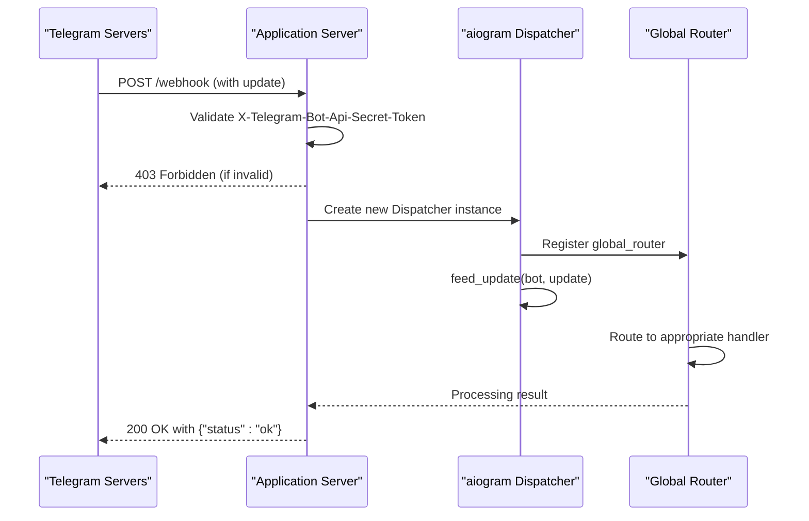
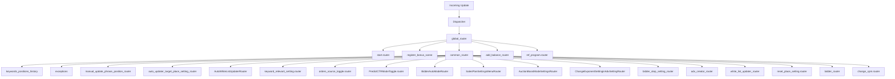
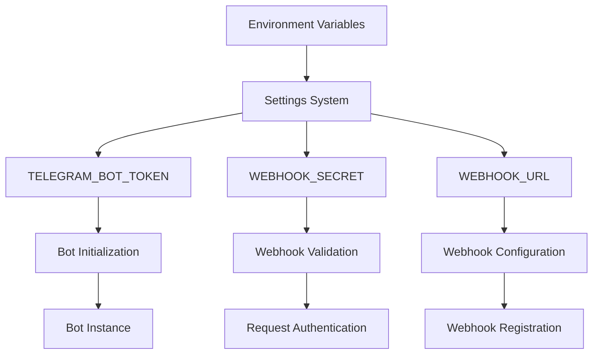
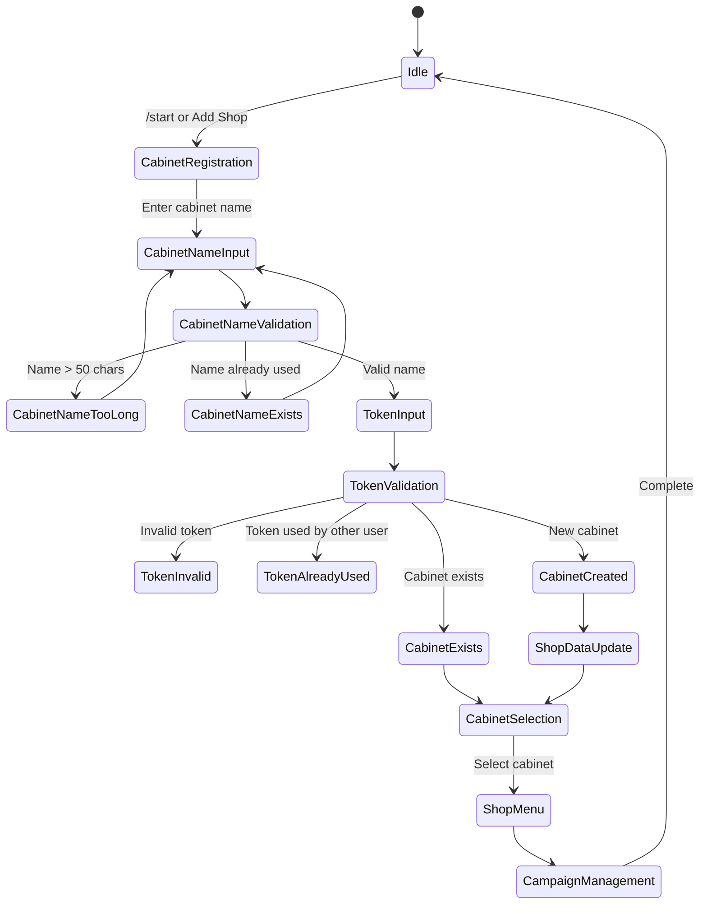
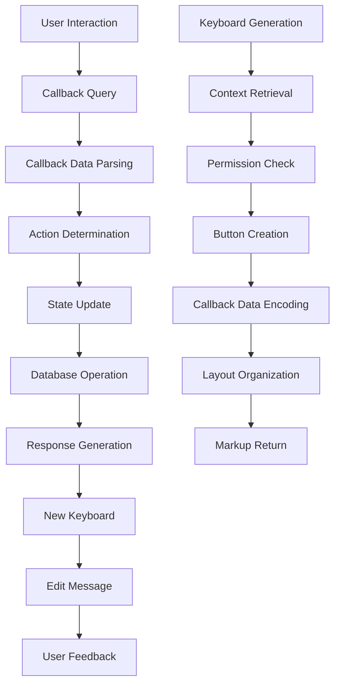
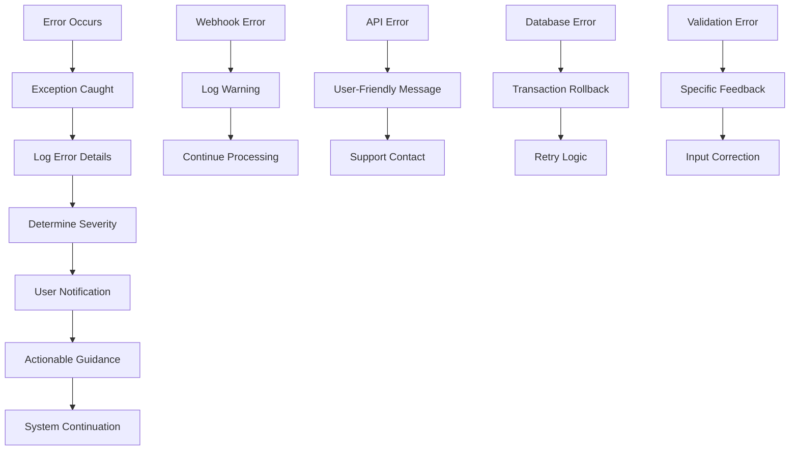

# Telegram Bot API Integration

<cite>
**Referenced Files in This Document**   
- [client_bot_run.py](file://client_bot_run.py)
- [app/client_bot/bot.py](file://app/client_bot/bot.py)
- [app/client_bot/global_router.py](file://app/client_bot/global_router.py)
- [app/client_bot/common_routers.py](file://app/client_bot/common_routers.py)
- [app/client_bot/user_interface/handlers/start/start.py](file://app/client_bot/user_interface/handlers/start/start.py)
- [app/client_bot/user_interface/views/keyboards.py](file://app/client_bot/user_interface/views/keyboards.py)
- [app/client_bot/user_interface/states.py](file://app/client_bot/user_interface/states.py)
- [app/settings/settings_master.py](file://app/settings/settings_master.py)
</cite>

## Table of Contents
1. [Introduction](#introduction)
2. [Bot Initialization Process](#bot-initialization-process)
3. [Webhook Configuration and Processing](#webhook-configuration-and-processing)
4. [Event Handling Architecture](#event-handling-architecture)
5. [Authentication Mechanisms](#authentication-mechanisms)
6. [Message Handling and State Management](#message-handling-and-state-management)
7. [Keyboard Interactions](#keyboard-interactions)
8. [Performance Considerations](#performance-considerations)
9. [Error Recovery Strategies](#error-recovery-strategies)
10. [Troubleshooting Guide](#troubleshooting-guide)

## Introduction
This document provides comprehensive documentation for the Telegram Bot API integration within the advertising management system. The bot serves as the primary interface between users and the advertising platform, enabling users to manage their Wildberries advertising campaigns through Telegram interactions. The system is built using the aiogram framework for Python, with FastAPI handling webhook endpoints and a sophisticated routing system for message processing.

The integration supports two operational modes: webhook mode for production environments and polling mode for development and testing. The architecture is designed to handle high message volumes with robust error recovery mechanisms and secure authentication practices. This documentation covers the complete lifecycle of bot operation from initialization to message processing and user interaction.

## Bot Initialization Process

The bot initialization process begins with the entry point `client_bot_run.py`, which sets up the application environment and configures the bot according to the deployment mode. The initialization follows a structured approach that ensures proper configuration and resource management.

The process starts by importing necessary dependencies including aiogram for Telegram integration, FastAPI for web endpoints, and the application's settings module. Logging is configured immediately to ensure all operations are properly recorded. The bot instance is created by calling `get_bot()` from the bot.py module, which retrieves the Telegram bot token from environment variables through the settings system.

The application supports two operational modes determined by the `POLLING_MODE` setting: webhook mode (default) and polling mode. In webhook mode, the application runs as a FastAPI server that receives updates from Telegram via HTTP POST requests. In polling mode, the bot actively retrieves updates from Telegram's servers using long polling techniques.

The initialization includes a lifespan context manager that handles startup and shutdown procedures. During startup, the dispatcher is configured with the global router, and in webhook mode, the bot's webhook is registered with Telegram. During shutdown, the webhook is properly removed and connections are closed to ensure clean termination.

**Section sources**
- [client_bot_run.py](file://client_bot_run.py#L1-L156)
- [app/client_bot/bot.py](file://app/client_bot/bot.py#L1-L15)

## Webhook Configuration and Processing

The webhook configuration is a critical component of the bot's production deployment, enabling efficient and secure communication between Telegram's servers and the application. The webhook setup is handled in the lifespan context manager within `client_bot_run.py`, which automatically configures the webhook when the application starts in webhook mode.

The webhook URL is constructed using the `WEBHOOK_URL` and `WEBHOOK_PATH` settings from the configuration, forming a complete endpoint that Telegram will use to send updates. When configuring the webhook, the application specifies several important parameters: the allowed update types are automatically resolved from the dispatcher's registered handlers, pending updates are dropped to prevent backlog, and a secret token is provided for authentication.

**Diagram sources**
- [client_bot_run.py](file://client_bot_run.py#L42-L87)

The webhook endpoint at `settings.WEBHOOK_PATH` performs several critical functions. First, it validates the `X-Telegram-Bot-Api-Secret-Token` header against the `WEBHOOK_SECRET_TOKEN` from settings, providing an additional layer of security to ensure that requests are genuinely coming from Telegram. If the token doesn't match, the request is rejected with a 403 Forbidden response.

When a valid update is received, the application creates a new Dispatcher instance with a ClientSession and registers the global_router. The update is then fed to the dispatcher using `dp.feed_update(bot, update)`, which triggers the routing mechanism to find and execute the appropriate handler. The endpoint returns a 200 OK response with a JSON status, acknowledging receipt of the update to Telegram's servers.

The application also provides several health check endpoints (`/health`, `/readiness`, and `/ready`) that can be used by monitoring systems to verify the bot's operational status. Additionally, a `/webhook-info` endpoint allows administrators to query the current webhook configuration directly from Telegram's API, providing visibility into the webhook's status, URL, and any error conditions.

**Section sources**
- [client_bot_run.py](file://client_bot_run.py#L42-L156)

## Event Handling Architecture

The event handling architecture is built around aiogram's dispatcher and router system, providing a modular and scalable approach to message processing. The architecture follows a hierarchical routing pattern that allows for organized code structure and efficient message dispatching.

At the core of the architecture is the `global_router` defined in `global_router.py`, which serves as the entry point for all incoming updates. The global router includes middleware for callback queries that provides immediate user feedback with a "Запрос в обработке" (Request being processed) message, improving user experience by acknowledging interactions promptly.

**Diagram sources**
- [app/client_bot/global_router.py](file://app/client_bot/global_router.py#L1-L30)
- [app/client_bot/common_routers.py](file://app/client_bot/common_routers.py#L1-L112)

The routing hierarchy is carefully designed with specific ordering requirements. The start command handlers are registered first in the global_router, ensuring that the `/start` command is processed correctly even when users are in other states. This is particularly important because the bonus scene registration follows, which may also handle the start command but allows it to continue processing.

The common_router, defined in `common_routers.py`, aggregates numerous specialized routers from various modules of the application. This modular approach allows different functional areas (such as balance management, bidder automation, sales plan settings, and keyword management) to maintain their own routing logic while being integrated into the main application flow. Each module can define its own router with specific handlers, reducing coupling between components.

Middleware is applied at multiple levels of the routing hierarchy. The global_router applies a callback answer middleware, while the common_router applies a `ReturnToStart` middleware for messages and an `AddingMessageTaskMiddleWare` for both messages and callback queries. This layered middleware approach enables cross-cutting concerns like state management and task queuing to be handled consistently across different parts of the application.

**Section sources**
- [app/client_bot/global_router.py](file://app/client_bot/global_router.py#L1-L30)
- [app/client_bot/common_routers.py](file://app/client_bot/common_routers.py#L1-L112)

## Authentication Mechanisms

The authentication system for the Telegram bot employs multiple layers of security to protect against unauthorized access and ensure the integrity of communications. The primary authentication mechanism uses environment variables to securely store sensitive credentials, preventing them from being exposed in the codebase.

The Telegram bot token is retrieved from the `TELEGRAM_BOT_TOKEN` environment variable through the settings system. In `bot.py`, the token is accessed via `settings.TEGRAM_BOT_TOKEN` and used to instantiate the Bot object. The settings system validates that this environment variable is present, raising a `ValueError` if it's missing, which prevents the application from starting with incomplete configuration.

**Diagram sources**
- [app/client_bot/bot.py](file://app/client_bot/bot.py#L1-L15)
- [app/settings/settings_master.py](file://app/settings/settings_master.py#L1-L433)

In addition to the bot token, the system implements webhook secret token authentication. The `WEBHOOK_SECRET` environment variable contains a secret token that is used to validate incoming webhook requests. When a request is received at the webhook endpoint, the application checks the `X-Telegram-Bot-Api-Secret-Token` header against this secret. If they don't match, the request is rejected with a 403 Forbidden response, preventing unauthorized parties from spoofing updates from Telegram.

This dual authentication approach—using both the bot token for API access and a separate webhook secret for request validation—provides defense in depth. Even if an attacker were to discover the webhook URL, they would still need to know the secret token to send valid requests. Conversely, if the bot token were compromised, the attacker would not be able to receive updates unless they also controlled the webhook endpoint.

The settings system also supports other security-related configurations such as SSL mode for database connections and Redis authentication, creating a comprehensive security posture across all components of the application. All sensitive configuration values are retrieved from environment variables rather than being hardcoded, following security best practices for application configuration.

**Section sources**
- [app/client_bot/bot.py](file://app/client_bot/bot.py#L1-L15)
- [app/settings/settings_master.py](file://app/settings/settings_master.py#L1-L433)

## Message Handling and State Management

The message handling system combines aiogram's powerful state management capabilities with a structured approach to user interactions. The bot uses Finite State Machines (FSM) to guide users through complex workflows such as cabinet registration, token management, and campaign configuration.

State definitions are organized in `states.py`, where multiple state groups are defined for different workflows. Each state group represents a specific user journey, such as `CabinetRegistration` for adding new advertising cabinets or `ChangeMinCTR` for modifying minimum CTR settings. This modular approach to state management prevents conflicts between different workflows and makes the codebase more maintainable.

**Diagram sources**
- [app/client_bot/user_interface/states.py](file://app/client_bot/user_interface/states.py#L1-L78)
- [app/client_bot/user_interface/handlers/start/start.py](file://app/client_bot/user_interface/handlers/start/start.py#L1-L462)

The start command handler in `start.py` demonstrates the complexity of state-driven interactions. When a user initiates the `/start` command, the bot checks their registration status and guides them through the appropriate workflow. For new users, this involves collecting a cabinet name and API token, with validation at each step to ensure data integrity.

The state management system handles various edge cases and validation scenarios. For example, when processing a cabinet name, the system checks for empty input, excessive length (limited to 50 characters), and duplicate names within the user's existing cabinets. Each validation failure returns the user to the appropriate state with a descriptive error message, creating a robust user experience.

Database operations are integrated throughout the message handling process, with SQLAlchemy used for ORM-based data access. The system uses async database sessions to maintain responsiveness during potentially slow database operations. Error handling is comprehensive, with specific exception types caught and handled appropriately, such as `ApiForbiddenError` and `NotValidTokenError` when validating Wildberries API tokens.

**Section sources**
- [app/client_bot/user_interface/states.py](file://app/client_bot/user_interface/states.py#L1-L78)
- [app/client_bot/user_interface/handlers/start/start.py](file://app/client_bot/user_interface/handlers/start/start.py#L1-L462)

## Keyboard Interactions

The keyboard interaction system provides users with intuitive navigation through the application's features using inline and reply keyboards. The implementation is centered around the `keyboards.py` module, which contains factory functions for generating context-specific keyboards based on the current application state and user permissions.

Inline keyboards are used extensively for navigation between different parts of the application, such as selecting advertising campaigns, managing keyword settings, and accessing configuration options. Each keyboard function accepts relevant context parameters (like the current advertising setting or user cabinet) and generates an appropriate set of buttons with callback data that encodes the necessary parameters for handling the interaction.

**Diagram sources**
- [app/client_bot/user_interface/views/keyboards.py](file://app/client_bot/user_interface/views/keyboards.py#L1-L799)

The keyboard system implements several design patterns to enhance usability. Action buttons include status indicators (like ✅ or ❌) to show the current state of features, and navigation buttons provide clear pathways back to higher-level menus. The system also supports pagination for lists that exceed the Telegram message size limits, with "⬅️" and "➡️" buttons for navigating between pages of results.

Security considerations are integrated into the keyboard system. Callback data is packed using aiogram's callback data factory system, which serializes the data and provides type safety. This prevents tampering with the callback data and ensures that only valid actions can be performed. The system also validates that users have appropriate permissions for the actions they're attempting, such as ensuring they own the advertising cabinet they're trying to modify.

The keyboard functions are designed to be reusable across different parts of the application. For example, the `get_advs_keyboard_with_paginator` function can display a paginated list of advertising campaigns with consistent navigation controls, while `get_adv_setting_keyboard` provides a comprehensive set of management options for a specific campaign. This consistency improves the user experience by providing familiar interfaces throughout the application.

**Section sources**
- [app/client_bot/user_interface/views/keyboards.py](file://app/client_bot/user_interface/views/keyboards.py#L1-L799)

## Performance Considerations

The system incorporates several performance optimizations to handle high message volumes and maintain responsiveness under load. These optimizations span multiple layers of the architecture, from the web server configuration to database access patterns and message processing strategies.

In webhook mode, the application leverages FastAPI's asynchronous capabilities to handle multiple concurrent requests efficiently. Each webhook request creates a new Dispatcher instance with its own ClientSession, allowing for isolated processing of updates without blocking other requests. This design enables the system to scale horizontally by deploying multiple instances behind a load balancer.

The settings system includes several performance-related configuration options that can be tuned based on the deployment environment. These include connection pool sizes for PostgreSQL (`PG_POOL_SIZE` and `PG_MAX_OVERFLOW`), thread counts for various operations, and timeout values for long-running processes. The ability to configure these parameters through environment variables allows for optimization without code changes.

Database operations are optimized through the use of async SQLAlchemy with carefully crafted queries that use appropriate joins and load options. The system employs `joinedload` and `load_only` to minimize the amount of data transferred from the database while ensuring that related entities are available when needed. Connection pooling is configured with reasonable defaults (200 pool size, 250 max overflow) to balance resource usage with performance.

For long-running operations, the system implements timeout mechanisms to prevent requests from hanging indefinitely. For example, shop updates are subject to a configurable timeout (`SHOP_UPDATE_TIMEOUT_MINUTES`, default 60 minutes), after which the operation is terminated and an appropriate error message is sent to the user. This prevents a single slow operation from consuming server resources indefinitely.

**Section sources**
- [client_bot_run.py](file://client_bot_run.py#L1-L156)
- [app/settings/settings_master.py](file://app/settings/settings_master.py#L1-L433)

## Error Recovery Strategies

The error recovery system is designed to provide graceful degradation and meaningful feedback when issues occur. The architecture incorporates multiple layers of error handling, from low-level API exceptions to user-facing error messages that guide users toward resolution.

At the webhook level, the system includes comprehensive error handling in the polling mode startup sequence. When starting in polling mode, the application attempts to remove any existing webhook before starting long polling. This operation includes timeout handling (5 seconds) and error logging, allowing the bot to continue starting even if the webhook removal fails. This prevents a failure in one part of the initialization process from blocking the entire application.

**Diagram sources**
- [client_bot_run.py](file://client_bot_run.py#L90-L156)
- [app/client_bot/user_interface/handlers/start/start.py](file://app/client_bot/user_interface/handlers/start/start.py#L1-L462)

The message handlers include specific exception handling for known error conditions. For example, when validating a Wildberries API token, the system catches `NotValidTokenError` and responds with a clear message asking the user to try again. Similarly, `ApiForbiddenError` is caught when a user lacks permissions for an operation, prompting them to update their token.

For unexpected errors, the system uses generic exception handlers that log the full traceback for debugging while sending a user-friendly message that includes a support contact. This approach balances the need for detailed error information for developers with a positive user experience that doesn't expose technical details to end users.

The system also implements error recovery in long-running operations. When updating shop data from Wildberries, the process is divided into stages (updating advertising data, then updating card data), with each stage having its own timeout and error handling. If one stage fails, the system can still complete subsequent stages or provide specific feedback about which part of the operation failed.

**Section sources**
- [client_bot_run.py](file://client_bot_run.py#L90-L156)
- [app/client_bot/user_interface/handlers/start/start.py](file://app/client_bot/user_interface/handlers/start/start.py#L1-L462)

## Troubleshooting Guide

This troubleshooting guide addresses common connectivity issues and operational problems that may occur with the Telegram bot integration. The solutions are organized by symptom, with diagnostic steps and resolution procedures.

### Webhook Not Receiving Updates
**Symptoms**: The bot is not responding to messages, but the application is running and accessible.

**Diagnostic Steps**:
1. Check the webhook configuration using the `/webhook-info` endpoint
2. Verify that the `WEBHOOK_URL` and `WEBHOOK_PATH` settings are correct
3. Check application logs for webhook validation failures
4. Test the webhook endpoint directly with a curl request

**Resolution**:
- Ensure the webhook secret token matches between the application and Telegram
- Verify that the server is publicly accessible on the specified port
- Check firewall rules to ensure the webhook port (8080) is open
- Restart the application to re-register the webhook

### Polling Mode Startup Failures
**Symptoms**: The bot fails to start in polling mode, or disconnects shortly after starting.

**Diagnostic Steps**:
1. Check logs for webhook deletion timeout messages
2. Verify the Telegram bot token is correct
3. Check network connectivity to Telegram's API servers

**Resolution**:
- Increase the webhook deletion timeout if consistently timing out
- Ensure the `POLLING_MODE` environment variable is set to "true"
- Verify DNS resolution is working correctly on the server

### Database Connection Issues
**Symptoms**: The bot starts but cannot retrieve user data or save changes.

**Diagnostic Steps**:
1. Check database connection settings in environment variables
2. Verify database server accessibility from the application server
3. Check database connection pool settings

**Resolution**:
- Verify `POSTGRES_HOST`, `POSTGRES_PORT`, `POSTGRES_USER`, and `POSTGRES_PASSWORD` settings
- Test database connectivity using a separate client
- Adjust `PG_POOL_SIZE` and `PG_MAX_OVERFLOW` if connection limits are being reached

### Authentication Failures
**Symptoms**: Users cannot register cabinets or access their advertising campaigns.

**Diagnostic Steps**:
1. Verify the `TELEGRAM_BOT_TOKEN` is correct
2. Check that the bot has been started and is running
3. Verify user IDs are being captured correctly

**Resolution**:
- Regenerate the Telegram bot token if compromised
- Check that the bot is not blocked by the user
- Verify the database contains the user records

**Section sources**
- [client_bot_run.py](file://client_bot_run.py#L1-L156)
- [app/client_bot/bot.py](file://app/client_bot/bot.py#L1-L15)
- [app/settings/settings_master.py](file://app/settings/settings_master.py#L1-L433)