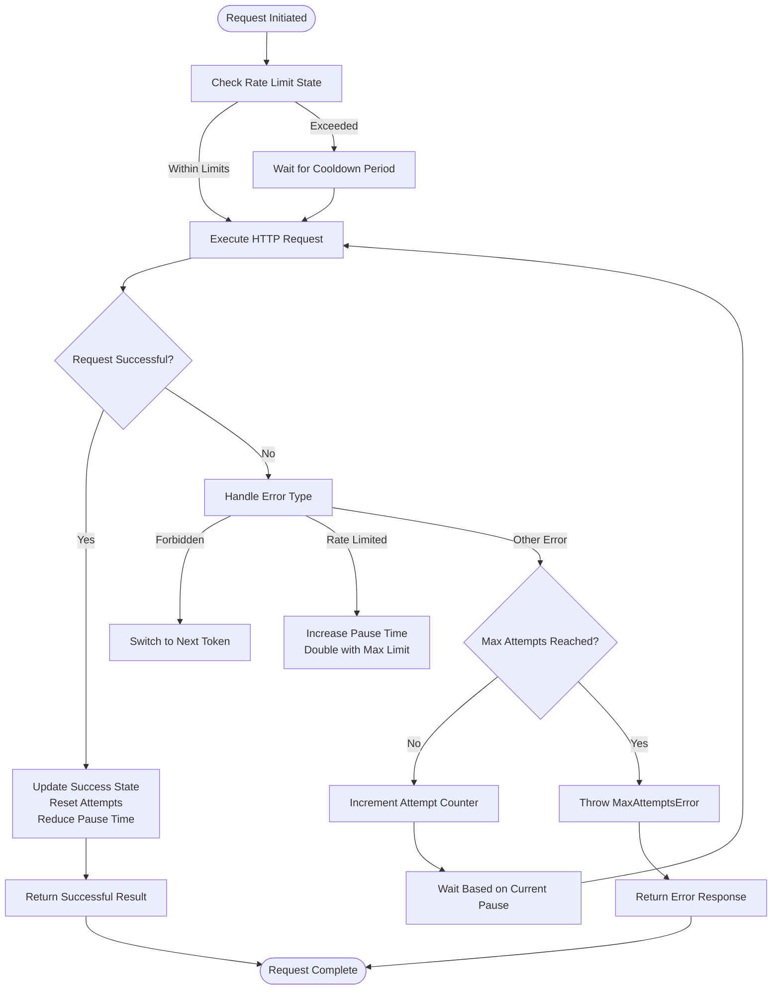
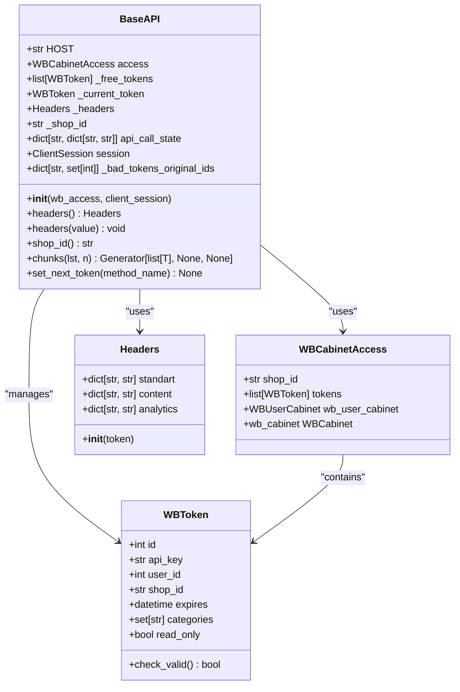
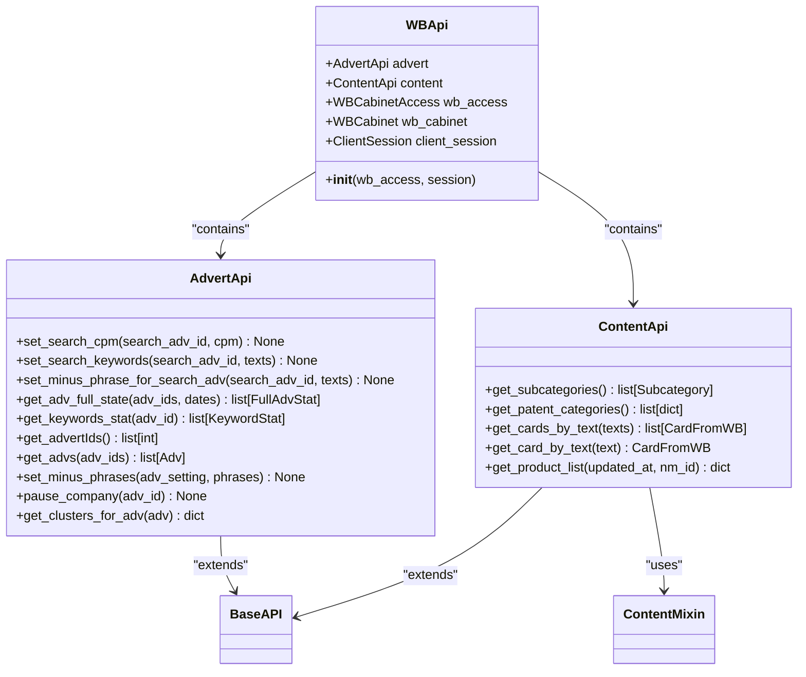
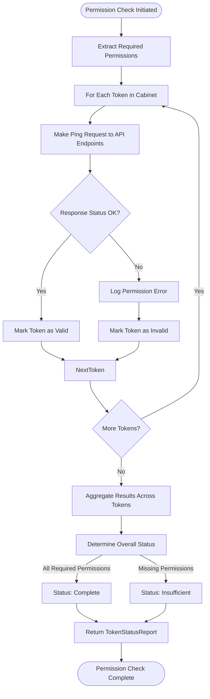
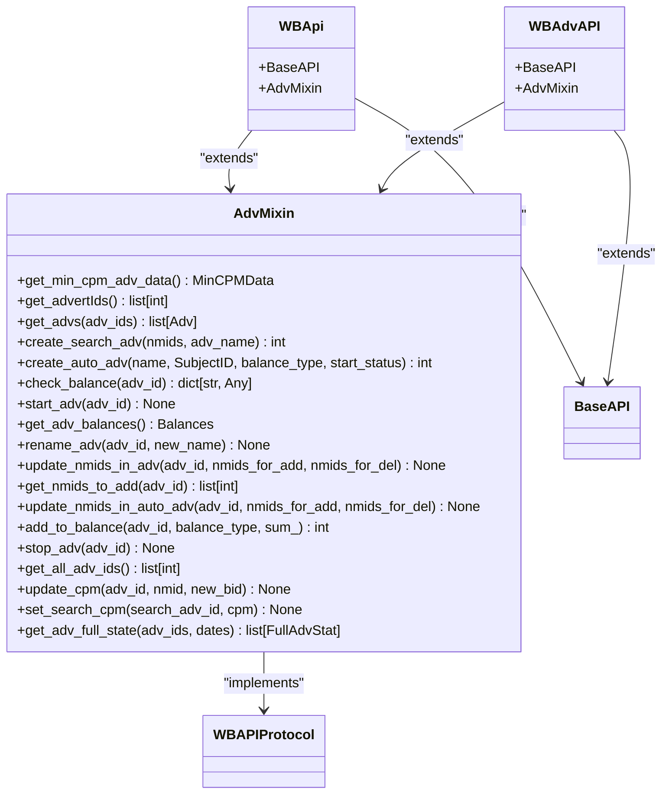
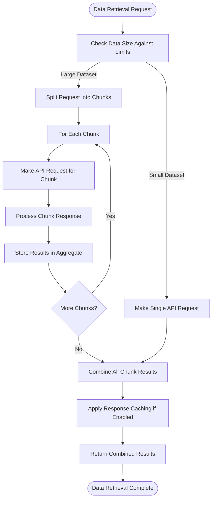
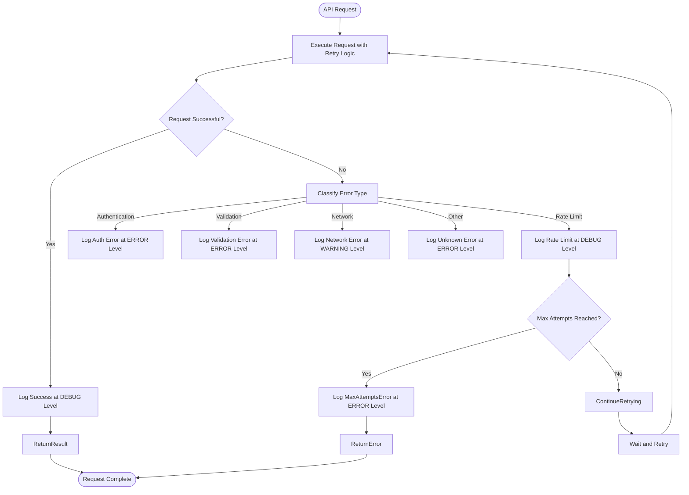

# Wildberries API Integration

<cite>
**Referenced Files in This Document**   
- [http_request.py](file://app/core/wb_api/http_request.py)
- [base.py](file://app/core/wb_api/base.py)
- [api.py](file://app/modules/common_slaves/wildberries/api/api.py)
- [adv.py](file://app/core/wb_api/mixins/adv.py)
- [shop_runner.py](file://app/modules/shop_runner/bidder/wb_api.py)
- [wb_adv_updater.py](file://app/modules/wb_adv_updater/wb_adv_api.py)
- [check_righter.py](file://app/core/wb_api/check_righter.py)
- [token_info_service.py](file://app/modules/token_monitoring/services/token_info_service.py)
</cite>

## Table of Contents
1. [Introduction](#introduction)
2. [HTTP Client Implementation](#http-client-implementation)
3. [Base API Client and Authentication](#base-api-client-and-authentication)
4. [Endpoint Abstractions](#endpoint-abstractions)
5. [Token Permission Checking](#token-permission-checking)
6. [Usage in shop_runner and wb_adv_updater](#usage-in-shop_runner-and-wb_adv_updater)
7. [Pagination and Response Caching](#pagination-and-response-caching)
8. [Debugging and Monitoring](#debugging-and-monitoring)

## Introduction
This document provides comprehensive documentation for the Wildberries API integration layer. The system is designed to manage advertising campaigns, retrieve product and sales data, and handle various aspects of Wildberries marketplace operations. The architecture follows a modular approach with clear separation of concerns between HTTP handling, API clients, and business logic. The integration handles authentication through WBToken, implements robust error recovery, and provides comprehensive monitoring capabilities.

## HTTP Client Implementation

The HTTP client implementation in `http_request.py` provides a robust foundation for interacting with the Wildberries API. It uses aiohttp for asynchronous HTTP operations and implements comprehensive retry mechanisms, timeout handling, and error recovery strategies.

The core of the HTTP client is the `try_except_decorator` which provides adaptive retry logic with exponential backoff. The decorator tracks API call state and adjusts pause times between requests based on success or failure. When a request fails, the pause time doubles up to a maximum delay, providing a backoff mechanism that prevents overwhelming the API during periods of high load or temporary unavailability.

**Diagram sources**
- [http_request.py](file://app/core/wb_api/http_request.py#L30-L150)

The `requests` function serves as a wrapper for HTTP operations, providing standardized error handling and logging. It automatically raises appropriate exceptions based on HTTP status codes:
- 401 responses trigger `ApiForbiddenError`
- 429 responses trigger `TooManyRequests` 
- 400 responses are parsed to extract specific error details from the response body

The error parsing function `get_error_from_response` examines the JSON response to identify specific error conditions and raise appropriate exception types, such as `MinAdvBidWBApiError` when a bid value is below the minimum allowed threshold.

**Section sources**
- [http_request.py](file://app/core/wb_api/http_request.py#L1-L213)

## Base API Client and Authentication

The base API client implementation in `base.py` establishes the foundation for authentication and token management. It uses the WBToken system to authenticate requests and implements a token rotation strategy to maintain continuous access to the API.

The `BaseAPI` class initializes with a `WBCabinetAccess` object containing one or more tokens. Tokens are sorted by expiration date (newest first) to prioritize the use of tokens with the longest remaining validity. The authentication headers are generated using the `Headers` class from the common slaves module, which formats the API key according to Wildberries' requirements.

**Diagram sources**
- [base.py](file://app/core/wb_api/base.py#L1-L116)

A key feature of the base client is the `set_next_token` method, which handles token rotation when a token becomes invalid or returns authorization errors. The method maintains a record of "bad" tokens that have failed for specific API methods and attempts to switch to an alternative token. If no valid tokens are available, it deactivates the associated cabinet to prevent further attempts.

The implementation also includes rate limiting considerations through the `api_call_state` dictionary, which tracks the state of API calls including the last query time and current pause duration. This allows the system to respect Wildberries' rate limits while maximizing throughput during periods of low usage.

**Section sources**
- [base.py](file://app/core/wb_api/base.py#L1-L116)

## Endpoint Abstractions

The endpoint abstractions in `api.py` provide a structured interface to Wildberries' advertising and content APIs. The implementation follows a modular approach with separate classes for different API domains, each exposing methods for specific operations.

The `AdvertApi` class handles advertising operations including campaign management, keyword settings, and performance statistics. It inherits from `ABC_WB_API` and implements the `try_except_decorator` for error handling. Key methods include:

- `set_search_cpm`: Sets the cost-per-thousand impressions for search advertising campaigns
- `get_adv_full_state`: Retrieves comprehensive campaign performance data with pagination support
- `get_keywords_stat`: Retrieves keyword performance statistics for advertising campaigns
- `get_advertIds`: Retrieves advertising campaign IDs with rate limiting considerations

**Diagram sources**
- [api.py](file://app/modules/common_slaves/wildberries/api/api.py#L1-L476)

The `ContentApi` class handles product catalog operations and inherits from both `BaseAPI` and `ContentMixin`. It provides methods for retrieving product categories, searching for product cards by text, and retrieving product lists with filtering options. The implementation includes pagination handling through offset and limit parameters, allowing retrieval of large datasets in manageable chunks.

The `WBApi` class serves as a factory that combines multiple API clients into a single interface. It initializes the `AdvertApi` and `ContentApi` instances with the same authentication context, providing a unified interface for applications that need to access multiple Wildberries API domains.

**Section sources**
- [api.py](file://app/modules/common_slaves/wildberries/api/api.py#L1-L476)

## Token Permission Checking

The token permission checking system ensures that API operations are only attempted with tokens that have the necessary permissions. This prevents authorization errors and provides clear feedback when required permissions are missing.

The `CheckRighter` class in `check_righter.py` implements permission validation by testing access to key API endpoints. It defines a list of entry points for different API domains (Content, Analytics, Promotion) and attempts to ping each endpoint with the provided token. If any required endpoint returns an authorization error, the token is considered insufficient for the intended operations.

**Diagram sources**
- [check_righter.py](file://app/core/wb_api/check_righter.py#L1-L59)
- [token_info_service.py](file://app/modules/token_monitoring/services/token_info_service.py#L1-L354)

The `TokenInfoService` in `token_info_service.py` provides a comprehensive analysis of token permissions and validity. It aggregates permissions across all tokens for a shop and determines whether all required permissions are available. The service defines `REQUIRED_RIGHTS` as a set containing "Content", "Statistics", "Analytics", and "Promotion" - the essential permissions needed for full functionality.

The service returns a `TokenStatusReport` dataclass containing detailed information about token status, including:
- Overall status (Complete or Insufficient)
- Lists of all, valid, and expired tokens
- Available and missing permissions
- Expiring tokens with days until expiry
- Service expiration date (when required permissions will be lost)

This comprehensive reporting enables proactive monitoring and management of token permissions before they impact service functionality.

**Section sources**
- [check_righter.py](file://app/core/wb_api/check_righter.py#L1-L59)
- [token_info_service.py](file://app/modules/token_monitoring/services/token_info_service.py#L1-L354)

## Usage in shop_runner and wb_adv_updater

The Wildberries API integration is utilized in both the `shop_runner` and `wb_adv_updater` modules for campaign management and optimization. These modules inherit from the base API classes and extend their functionality for specific use cases.

In `shop_runner/bidder/wb_api.py`, the `WBApi` class inherits from `BaseAPI` and `AdvMixin`, providing access to advertising campaign operations. This implementation is used for real-time bidding and campaign adjustments based on performance data.

**Diagram sources**
- [shop_runner.py](file://app/modules/shop_runner/bidder/wb_api.py#L1-L10)
- [wb_adv_updater.py](file://app/modules/wb_adv_updater/wb_adv_api.py#L1-L7)
- [adv.py](file://app/core/wb_api/mixins/adv.py#L1-L436)

In `wb_adv_updater/wb_adv_api.py`, the `WBAdvAPI` class provides similar functionality for automated campaign updates and optimizations. Both implementations leverage the `AdvMixin` which contains methods for:
- Creating and managing advertising campaigns
- Checking and updating campaign balances
- Retrieving campaign performance statistics
- Updating cost-per-thousand impressions (CPM) bids
- Managing product listings within campaigns

The `AdvMixin` also implements request signing through the inherited `BaseAPI` class, ensuring all requests are properly authenticated with the appropriate API key from the token pool.

**Section sources**
- [shop_runner.py](file://app/modules/shop_runner/bidder/wb_api.py#L1-L10)
- [wb_adv_updater.py](file://app/modules/wb_adv_updater/wb_adv_api.py#L1-L7)
- [adv.py](file://app/core/wb_api/mixins/adv.py#L1-L436)

## Pagination and Response Caching

The Wildberries API integration implements robust pagination handling to manage large datasets efficiently. Several methods in the API clients automatically handle pagination by breaking large requests into smaller chunks that comply with API limits.

For example, the `get_advs` method in `AdvertApi` and `AdvMixin` processes advertising campaign IDs in batches of 50, which is within the API's limits for POST requests. Similarly, the `get_adv_full_state` method processes campaign IDs in chunks of 100 when retrieving performance statistics.

The `get_subcategories` method in `ContentApi` implements cursor-based pagination, retrieving categories in batches of 1000 until all categories have been retrieved. This approach minimizes the number of API calls while ensuring complete data retrieval.

**Diagram sources**
- [api.py](file://app/modules/common_slaves/wildberries/api/api.py#L1-L476)
- [adv.py](file://app/core/wb_api/mixins/adv.py#L1-L436)

While the provided code does not explicitly show response caching implementation, the architecture supports caching through the `api_call_state` dictionary in the `BaseAPI` class. This state tracking could be extended to include caching of responses for idempotent requests, reducing API calls for frequently accessed data.

The pagination implementation follows best practices by:
- Using appropriate chunk sizes based on API limits
- Maintaining consistent state between requests
- Handling partial failures gracefully
- Providing complete datasets to callers regardless of pagination

**Section sources**
- [api.py](file://app/modules/common_slaves/wildberries/api/api.py#L1-L476)
- [adv.py](file://app/core/wb_api/mixins/adv.py#L1-L436)

## Debugging and Monitoring

The Wildberries API integration includes comprehensive debugging and monitoring capabilities to ensure reliable operation and facilitate troubleshooting.

The system uses structured logging with the Python logging module to record API interactions at multiple levels:
- DEBUG level logs successful requests and timing information
- INFO level logs would capture major operations (not shown in code)
- ERROR level logs capture failed requests and exceptions
- WARNING level logs warn about potential issues like expiring tokens

The `try_except_decorator` includes detailed logging of retry attempts and pause times, making it easy to diagnose rate limiting issues. When a request fails, the system logs the current pause time and the reason for the retry, providing visibility into the retry strategy.

**Diagram sources**
- [http_request.py](file://app/core/wb_api/http_request.py#L1-L213)

The token monitoring system provides proactive monitoring of integration health through the `TokenInfoService`. This service can identify:
- Expired or expiring tokens
- Missing required permissions
- Read-only tokens that cannot perform write operations
- Token rotation issues

The service returns detailed status reports that can be used to trigger alerts or automated remediation actions. For example, the `days_until_service_breaks` property calculates when the service will become non-functional due to token expiration, enabling proactive renewal.

Additionally, the system includes ping endpoints for each API domain (Content, Analytics, Promotion) that can be used to verify connectivity and permissions without making operational API calls. These lightweight checks can be incorporated into health checks and monitoring systems.

**Section sources**
- [http_request.py](file://app/core/wb_api/http_request.py#L1-L213)
- [token_info_service.py](file://app/modules/token_monitoring/services/token_info_service.py#L1-L354)