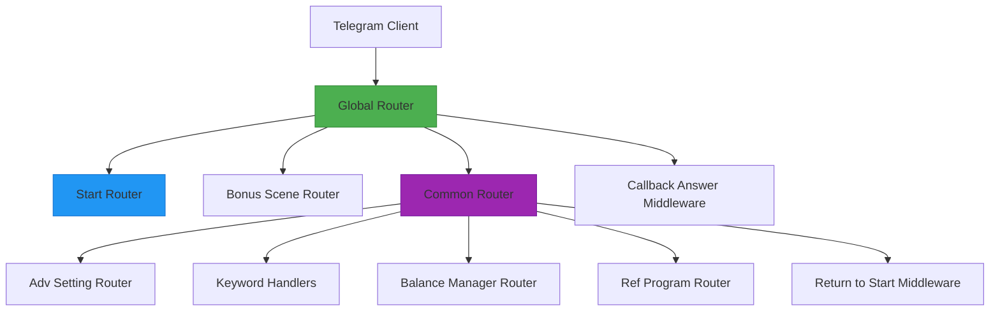
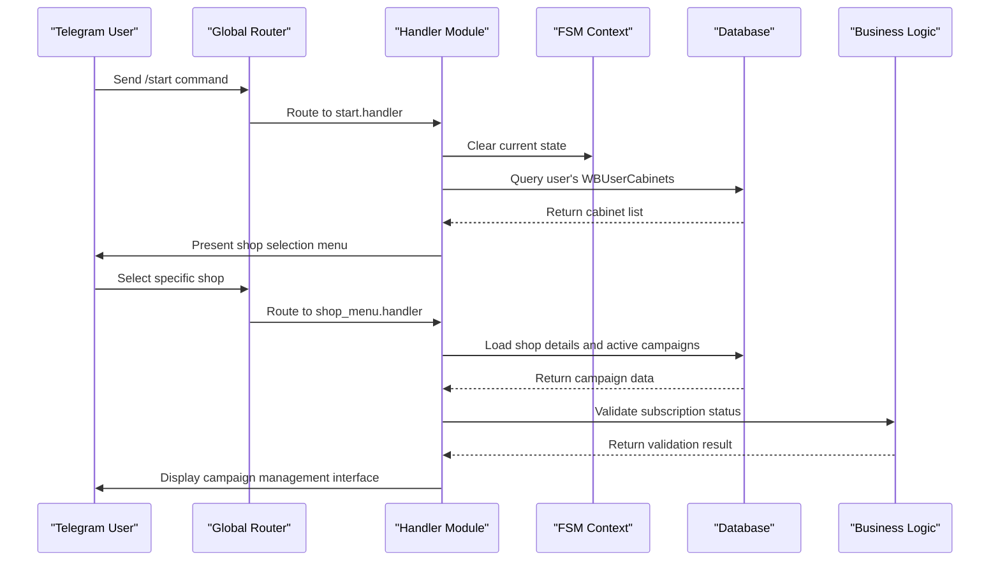
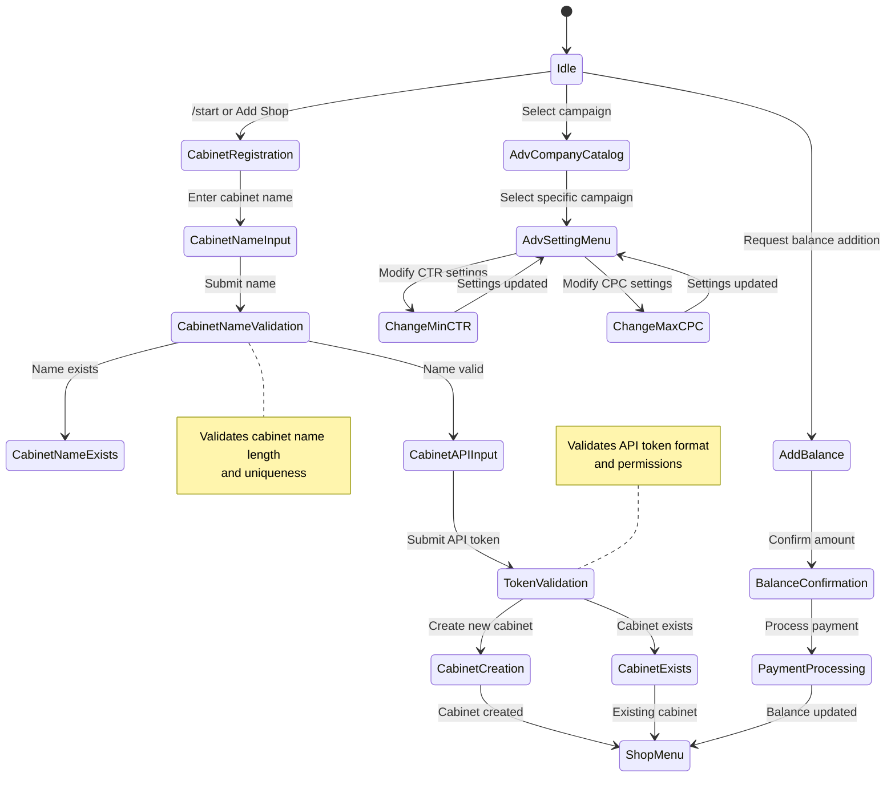

# Handlers

<cite>
**Referenced Files in This Document**   
- [start.py](file://app/client_bot/user_interface/handlers/start/start.py)
- [adv_setting.py](file://app/client_bot/user_interface/handlers/adv_setting.py)
- [global_router.py](file://app/client_bot/global_router.py)
- [common_routers.py](file://app/client_bot/common_routers.py)
- [states.py](file://app/client_bot/user_interface/states.py)
- [messages.py](file://app/client_bot/user_interface/views/messages/messages.py)
- [callbacks.py](file://app/client_bot/user_interface/views/callbacks.py)
- [shop_choice_message.py](file://app/client_bot/user_interface/handlers/shop_choice_message.py)
- [shop_menu.py](file://app/modules/shop_menu/message.py)
- [throtting.py](file://app/client_bot/middlewars/throtting.py)
- [user_data.py](file://app/client_bot/middlewars/user_data.py)
</cite>

## Table of Contents
1. [Introduction](#introduction)
2. [Handler Architecture and Routing](#handler-architecture-and-routing)
3. [Command Processing Flow](#command-processing-flow)
4. [State Management System](#state-management-system)
5. [Core Handler Components](#core-handler-components)
6. [Dependency Injection and Business Logic](#dependency-injection-and-business-logic)
7. [Error Handling and Validation](#error-handling-and-validation)
8. [Middleware Pipeline](#middleware-pipeline)
9. [Conclusion](#conclusion)

## Introduction
The handlers sub-component of the presentation layer in the Telegram bot serves as the primary interface between users and the application's business logic. This document provides a comprehensive analysis of how handlers process user commands and interactions, focusing on key functionalities such as onboarding flow, campaign configuration, keyword management, and settings modification. The system leverages aiogram's dispatcher framework to route user actions to appropriate handlers through a well-defined global router. Handlers are organized into specialized modules that handle specific user interactions, with dependency injection enabling clean separation between presentation and business logic layers. The architecture supports both message-based and callback-based interactions, maintaining user state throughout complex workflows while providing robust error handling and input validation mechanisms.

## Handler Architecture and Routing
The handler architecture is built around aiogram's Router system, which provides a hierarchical routing mechanism for Telegram bot interactions. The global router serves as the entry point for all user interactions, orchestrating the flow between different handler modules. The routing system follows a specific order of precedence that is critical for proper command handling, particularly for the /start command which initiates the onboarding process.



**Diagram sources**
- [global_router.py](file://app/client_bot/global_router.py#L1-L29)
- [common_routers.py](file://app/client_bot/common_routers.py#L1-L112)

**Section sources**
- [global_router.py](file://app/client_bot/global_router.py#L1-L29)
- [common_routers.py](file://app/client_bot/common_routers.py#L1-L112)

## Command Processing Flow
The command processing flow begins with user interaction through Telegram messages or callbacks, which are routed through the global router to specific handler modules. Each handler processes user commands by validating input, managing state transitions, and invoking business logic through dependency injection. The flow follows a consistent pattern across different handler types, with specialized implementations for onboarding, campaign configuration, and settings modification.

For the /start command, the processing flow initiates the onboarding sequence by clearing any existing state and presenting the user with shop selection options. When users interact with campaign settings, the flow involves retrieving the relevant AdvSetting entity from the database, validating permissions, and updating the configuration based on user input. Keyword management follows a similar pattern, with additional validation to ensure keyword relevance and proper formatting.



**Diagram sources**
- [start.py](file://app/client_bot/user_interface/handlers/start/start.py#L1-L462)
- [shop_menu.py](file://app/modules/shop_menu/message.py#L1-L464)
- [shop_choice_message.py](file://app/client_bot/user_interface/handlers/shop_choice_message.py#L1-L68)

**Section sources**
- [start.py](file://app/client_bot/user_interface/handlers/start/start.py#L1-L462)
- [adv_setting.py](file://app/client_bot/user_interface/handlers/adv_setting.py#L1-L363)

## State Management System
The state management system utilizes aiogram's FSM (Finite State Machine) context to maintain user interaction state across multiple messages. States are defined in a hierarchical structure that corresponds to different user workflows, such as cabinet registration, campaign configuration, and balance management. Each state group represents a specific interaction context, allowing the bot to handle multiple concurrent workflows for the same user.

The system employs state filtering to ensure that handlers only process messages when the user is in the appropriate state. This prevents command conflicts and ensures a consistent user experience. State data is stored in the FSM context and can be updated throughout the interaction flow, allowing handlers to maintain context between different stages of a workflow. The state system also supports data persistence across handler invocations, enabling complex multi-step processes like adding a new shop or configuring campaign settings.



**Diagram sources**
- [states.py](file://app/client_bot/user_interface/states.py#L1-L78)
- [start.py](file://app/client_bot/user_interface/handlers/start/start.py#L1-L462)

**Section sources**
- [states.py](file://app/client_bot/user_interface/states.py#L1-L78)

## Core Handler Components
The core handler components are organized into specialized modules that handle specific user interactions. The start handler manages the onboarding flow, guiding users through shop registration and initial configuration. The adv_setting handler provides comprehensive campaign configuration capabilities, including CTR settings, CPC limits, and automation controls. Each handler module follows a consistent pattern of defining a router instance and registering callback and message handlers for specific user actions.

Handlers are implemented as asynchronous functions that receive the appropriate Telegram update object (CallbackQuery or Message), along with the bot instance and FSM context. They interact with the database through SQLAlchemy queries to retrieve and update user data, and use message templates to generate appropriate responses. The handlers also implement input validation and error handling to ensure data integrity and provide meaningful feedback to users.

```mermaid
classDiagram
class StartHandler {
+router : Router
+callback_start_registration()
+add_shop()
+process_cabinet_name()
+process_cabinet_api()
+add_app_token()
+select_shop()
+shop_menu_process()
+update_company_from_wb()
}
class AdvSettingHandler {
+router : Router
+reset_filter()
+waiting_for_keywords_for_filter()
+choice_adv_paginator()
+adv_handler()
+turn_adv_on()
+turn_adv_off_all()
+turn_adv_off()
+turn_on_auto_min_ctr()
+turn_off_auto_min_ctr()
}
class MessageTemplates {
+ShopNameGet
+ShopAddedSuccess
+AdvCompanyChoicing
+AdvSettingMenu
+CabinetNameExists
+CabinetExistsForUser
+AddNewTokenGet
+KeywordSettingMessage
+NoMainPhotos
}
StartHandler --> MessageTemplates : "uses"
AdvSettingHandler --> MessageTemplates : "uses"
StartHandler --> DB : "queries"
AdvSettingHandler --> DB : "queries"
MessageTemplates --> DB : "retrieves data"
note right of StartHandler
Handles user onboarding and
shop registration workflow
end note
note left of AdvSettingHandler
Manages campaign configuration
and automation settings
end note
```

**Diagram sources**
- [start.py](file://app/client_bot/user_interface/handlers/start/start.py#L1-L462)
- [adv_setting.py](file://app/client_bot/user_interface/handlers/adv_setting.py#L1-L363)
- [messages.py](file://app/client_bot/user_interface/views/messages/messages.py#L1-L1312)

**Section sources**
- [start.py](file://app/client_bot/user_interface/handlers/start/start.py#L1-L462)
- [adv_setting.py](file://app/client_bot/user_interface/handlers/adv_setting.py#L1-L363)

## Dependency Injection and Business Logic
The handler system employs dependency injection to separate presentation logic from business operations, allowing handlers to focus on user interaction while delegating complex operations to specialized services. This architecture enables clean code organization and facilitates testing by allowing dependencies to be mocked during unit tests. Handlers receive necessary services through function parameters or class initialization, with the dependency injection framework managing the lifecycle and instantiation of these components.

Business logic is encapsulated in modules such as balance_manager, billing.pricer, and common_slaves.wildberries, which provide specific functionality for financial operations, pricing calculations, and Wildberries API interactions. The handlers invoke these services to perform operations like balance checking, tariff calculation, and campaign status updates. This separation ensures that the presentation layer remains lightweight and focused on user experience, while complex business rules are managed in dedicated service classes.

```mermaid
flowchart TD
Handler[Handler Module] --> DI[Dependency Injector]
DI --> Pricer[Pricer Service]
DI --> BalanceManager[Balance Manager]
DI --> WBApi[Wildberries API]
DI --> RedisManager[Redis Manager]
Handler --> Validation[Input Validation]
Validation --> BusinessLogic[Business Logic]
BusinessLogic --> Pricer
BusinessLogic --> BalanceManager
BusinessLogic --> WBApi
BusinessLogic --> RedisManager
Pricer --> Database[(Database)]
BalanceManager --> Database
WBApi --> WildberriesAPI[Wildberries API]
RedisManager --> Redis[(Redis)]
Database --> Handler
Redis --> Handler
WildberriesAPI --> Handler
subgraph "Handler Responsibilities"
Handler --> "User input processing"
Handler --> "State management"
Handler --> "Response generation"
Handler --> "Error handling"
end
subgraph "Service Responsibilities"
Pricer --> "Tariff calculation"
Pricer --> "Pricing rules"
BalanceManager --> "Balance validation"
BalanceManager --> "Payment processing"
WBApi --> "API authentication"
WBApi --> "Campaign operations"
RedisManager --> "Cache operations"
RedisManager --> "Session data"
end
```

**Diagram sources**
- [adv_setting.py](file://app/client_bot/user_interface/handlers/adv_setting.py#L1-L363)
- [shop_menu.py](file://app/modules/shop_menu/message.py#L1-L464)
- [messages.py](file://app/client_bot/user_interface/views/messages/messages.py#L1-L1312)

**Section sources**
- [adv_setting.py](file://app/client_bot/user_interface/handlers/adv_setting.py#L1-L363)
- [shop_menu.py](file://app/modules/shop_menu/message.py#L1-L464)

## Error Handling and Validation
The handler system implements comprehensive error handling and validation mechanisms to ensure data integrity and provide meaningful feedback to users. Input validation occurs at multiple levels, starting with basic format checks and progressing to business rule validation. For example, when users enter a cabinet name, the system validates both the length (maximum 50 characters) and uniqueness within the user's account. Similarly, API token validation includes format checking and permission verification through the Wildberries API.

Error handling follows a structured approach, with specific exception types for different error categories such as API errors, validation errors, and database errors. Handlers catch these exceptions and translate them into user-friendly messages that guide users toward resolution. The system also implements state conflict prevention by using middleware that can return users to the start state if they attempt to perform actions outside the expected workflow. This ensures a consistent user experience even when unexpected interactions occur.

```mermaid
flowchart LR
Input[User Input] --> FormatValidation[Format Validation]
FormatValidation --> |Valid| BusinessValidation[Business Rule Validation]
FormatValidation --> |Invalid| FormatError[Format Error Response]
BusinessValidation --> |Valid| PermissionCheck[Permission Check]
BusinessValidation --> |Invalid| BusinessError[Business Rule Error]
PermissionCheck --> |Valid| Processing[Process Request]
PermissionCheck --> |Invalid| PermissionError[Permission Error]
Processing --> |Success| SuccessResponse[Success Response]
Processing --> |Error| SystemError[System Error Handler]
FormatError --> User
BusinessError --> User
PermissionError --> User
SystemError --> User
subgraph "Validation Types"
FormatValidation --> "Length check"
FormatValidation --> "Format check"
FormatValidation --> "Required fields"
BusinessValidation --> "Uniqueness"
BusinessValidation --> "Business rules"
BusinessValidation --> "Dependencies"
PermissionCheck --> "Role-based access"
PermissionCheck --> "Subscription status"
PermissionCheck --> "Token validity"
end
style FormatError fill:#FFCDD2,stroke:#C62828
style BusinessError fill:#FFCDD2,stroke:#C62828
style PermissionError fill:#FFCDD2,stroke:#C62828
style SystemError fill:#FFCDD2,stroke:#C62828
style SuccessResponse fill:#C8E6C9,stroke:#2E7D32
```

**Diagram sources**
- [start.py](file://app/client_bot/user_interface/handlers/start/start.py#L1-L462)
- [adv_setting.py](file://app/client_bot/user_interface/handlers/adv_setting.py#L1-L363)
- [messages.py](file://app/client_bot/user_interface/views/messages/messages.py#L1-L1312)

**Section sources**
- [start.py](file://app/client_bot/user_interface/handlers/start/start.py#L1-L462)
- [adv_setting.py](file://app/client_bot/user_interface/handlers/adv_setting.py#L1-L363)

## Middleware Pipeline
The middleware pipeline processes all incoming updates before they reach the handlers, providing cross-cutting concerns such as throttling, user data loading, and state management. The throttling middleware prevents abuse by limiting the rate of user interactions, with different thresholds for different types of actions. The user data middleware ensures that user information is loaded from the database and made available to handlers, creating new user records when necessary.

The return to start middleware monitors user state and can redirect users to the start state if they attempt to perform actions outside the expected workflow, preventing state conflicts. These middleware components are registered at both the global and router levels, allowing for fine-grained control over their application. The pipeline executes in a specific order, with each middleware having the opportunity to modify the update data or terminate the processing chain.

```mermaid
flowchart TB
Update[Incoming Update] --> Throttling[Throttling Middleware]
Throttling --> |Allowed| UserData[User Data Middleware]
Throttling --> |Blocked| Terminate[Terminate Processing]
UserData --> ReturnToStart[Return to Start Middleware]
ReturnToStart --> |Normal Flow| Handler[Handler Execution]
ReturnToStart --> |State Conflict| Start[Redirect to Start]
Handler --> Response[Send Response]
subgraph "Throttling Rules"
Throttling --> "Spin actions: 1 second"
Throttling --> "Other actions: 1 second"
Throttling --> "Per-user tracking"
Throttling --> "In-memory cache"
end
subgraph "User Data Loading"
UserData --> "Load User from DB"
UserData --> "Create User if Missing"
UserData --> "Load WBUserCabinets"
UserData --> "Attach to Context"
end
subgraph "State Management"
ReturnToStart --> "Check Current State"
ReturnToStart --> "Validate Action"
ReturnToStart --> "Redirect if Invalid"
end
style Throttling fill:#FFB74D,stroke:#F57C00
style UserData fill:#FFB74D,stroke:#F57C00
style ReturnToStart fill:#FFB74D,stroke:#F57C00
style Terminate fill:#EF9A9A,stroke:#C62828
style Start fill:#42A5F5,stroke:#1565C0
```

**Diagram sources**
- [throtting.py](file://app/client_bot/middlewars/throtting.py#L1-L29)
- [user_data.py](file://app/client_bot/middlewars/user_data.py#L1-L51)
- [common_routers.py](file://app/client_bot/common_routers.py#L1-L112)

**Section sources**
- [throtting.py](file://app/client_bot/middlewars/throtting.py#L1-L29)
- [user_data.py](file://app/client_bot/middlewars/user_data.py#L1-L51)

## Conclusion
The handlers sub-component of the presentation layer provides a robust and scalable architecture for managing user interactions in the Telegram bot. By leveraging aiogram's dispatcher system, the implementation achieves clean separation between routing, state management, and business logic. The hierarchical router structure allows for organized handling of different command types, while the FSM context enables complex multi-step workflows. Dependency injection facilitates loose coupling between components, making the system more maintainable and testable. Comprehensive error handling and input validation ensure data integrity and provide a smooth user experience. The middleware pipeline addresses cross-cutting concerns efficiently, while the message template system enables consistent and localized responses. This architecture effectively balances technical sophistication with usability, supporting both simple commands and complex configuration workflows.