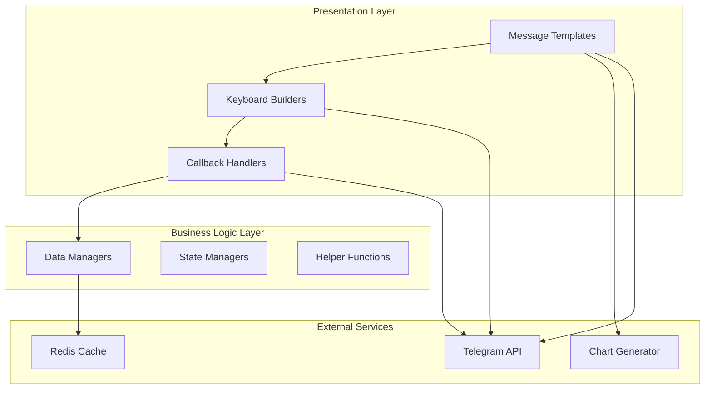
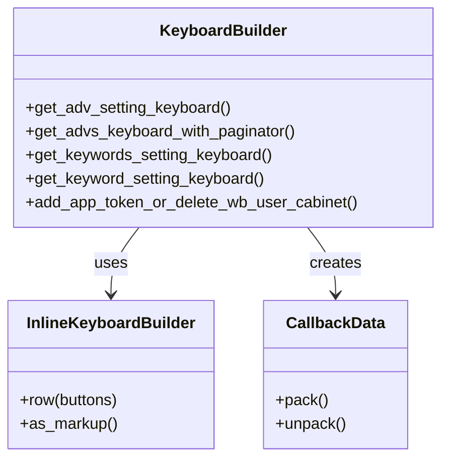
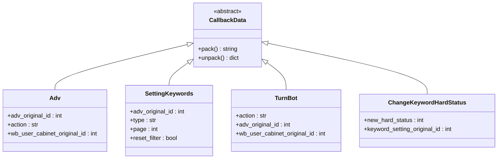
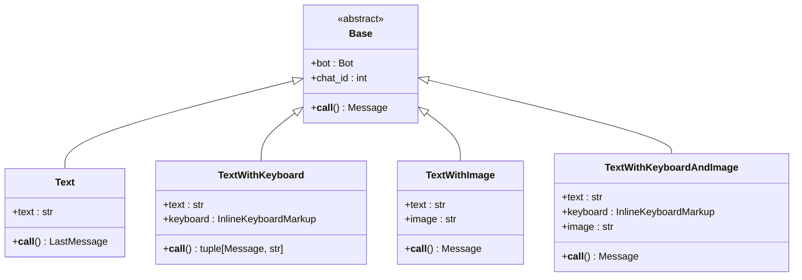
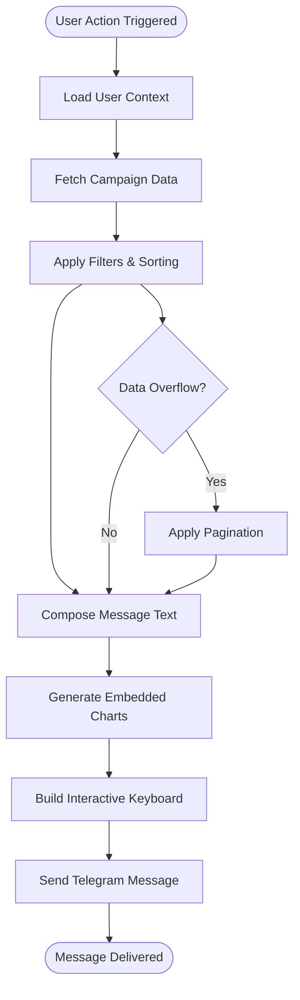

# Keyboards and Views

<cite>
**Referenced Files in This Document**
- [keyboards.py](file://app/client_bot/user_interface/views/keyboards.py)
- [callbacks.py](file://app/client_bot/user_interface/views/callbacks.py)
- [positions_graphic_messanges.py](file://app/client_bot/user_interface/views/messages/positions_graphic_messanges/positions_graphic_messanges.py)
- [adv_keyword_messages.py](file://app/client_bot/user_interface/views/messages/adv_keyword_messages/adv_keyword_messages.py)
- [last_auto_update_informer.py](file://app/client_bot/user_interface/views/messages/last_auto_update_informer/last_auto_update_informer.py)
- [templates.py](file://app/client_bot/user_interface/message_templates/templates.py)
- [wb_user_cabinet.py](file://app/client_bot/user_interface/helpers/wb_user_cabinet.py)
- [get_main_text.py](file://app/client_bot/user_interface/views/get_main_text.py)
- [errors_message.py](file://app/client_bot/user_interface/views/errors_message.py)
- [messages.py](file://app/client_bot/user_interface/views/messages/messages.py)
</cite>

## Table of Contents
1. [Introduction](#introduction)
2. [Architecture Overview](#architecture-overview)
3. [Keyboard Construction System](#keyboard-construction-system)
4. [Callback Processing Framework](#callback-processing-framework)
5. [View Component Architecture](#view-component-architecture)
6. [Dynamic Message Generation](#dynamic-message-generation)
7. [Integration Patterns](#integration-patterns)
8. [Common Issues and Solutions](#common-issues-and-solutions)
9. [Performance Optimization](#performance-optimization)
10. [Best Practices](#best-practices)

## Introduction

The keyboards and views sub-component of the presentation layer serves as the primary interface between users and the Wildberries advertising automation system. This sophisticated system enables interactive navigation through Telegram keyboards, dynamic message generation with embedded charts, and seamless callback processing for user actions.

The system is built around three core pillars:
- **Interactive Navigation**: Dynamic keyboards that adapt to user state and preferences
- **Rich Message Content**: Messages with embedded charts, statistics, and contextual information
- **State Management**: Sophisticated callback routing and state persistence

## Architecture Overview

The keyboards and views system follows a layered architecture pattern that separates concerns between keyboard construction, callback processing, and message generation.



**Diagram sources**
- [keyboards.py](file://app/client_bot/user_interface/views/keyboards.py#L1-L50)
- [callbacks.py](file://app/client_bot/user_interface/views/callbacks.py#L1-L30)
- [templates.py](file://app/client_bot/user_interface/message_templates/templates.py#L1-L50)

## Keyboard Construction System

### Core Keyboard Builder Functions

The keyboard construction system is centered around specialized functions that generate context-aware navigation interfaces. Each function is designed for specific use cases and adapts to the current user state.



**Diagram sources**
- [keyboards.py](file://app/client_bot/user_interface/views/keyboards.py#L30-L100)
- [keyboards.py](file://app/client_bot/user_interface/views/keyboards.py#L150-L250)

### Advanced Keyboard Composition Patterns

The system implements several sophisticated keyboard composition patterns:

#### 1. Adaptive State-Based Keyboards

```python
def get_adv_setting_keyboard(chat_id, wb_user_cabinet, adv_setting, in_favorites):
    builder = InlineKeyboardBuilder()
    
    # Conditional button creation based on current state
    if adv_setting.auto_update_white_list:
        text = "Выключить автообновление белого списка"
        new_status = False
    else:
        text = "Включить автообновление белого списка"
        new_status = True
    
    callback = AutoUpdateWhiteListSetting(new_status=new_status, 
                                        adv_setting_original_id=adv_setting.id).pack()
    button = InlineKeyboardButton(text=text, callback_data=callback)
    builder.row(button)
```

#### 2. Multi-Level Navigation with Pagination

```python
def get_advs_keyboard_with_paginator(wb_user_cabinet_original_id, adv_settings, page, on_page, keyword_filter):
    # Active campaigns first, then inactive
    active_part_advs = list(filter(lambda adv: adv.bot_active is True, adv_settings))
    not_active_part_advs = list(filter(lambda adv: adv.bot_active is not True, adv_settings))
    adv_settings = active_part_advs + not_active_part_advs
    
    # Pagination logic
    start_index = (page - 1) * on_page
    end_index = start_index + on_page
    
    # Navigation buttons
    if page > 1:
        prev_page = page - 1
        keyboard_buttons.append([
            InlineKeyboardButton(text="⬅️", callback_data=callbacks.ChoiceAdvPaginator(
                wb_user_cabinet_original_id=wb_user_cabinet_original_id, page=prev_page).pack())
        ])
```

**Section sources**
- [keyboards.py](file://app/client_bot/user_interface/views/keyboards.py#L30-L150)
- [keyboards.py](file://app/client_bot/user_interface/views/keyboards.py#L150-L250)

### Keyboard Layout Optimization

The system implements intelligent layout optimization to handle varying screen sizes and user preferences:

- **Responsive Design**: Keyboards automatically adjust to device capabilities
- **Overflow Prevention**: Large datasets are handled through pagination
- **Consistent Navigation**: Standardized button patterns across all interfaces

## Callback Processing Framework

### Callback Data Structure

The callback system uses structured data classes that encode all necessary information for stateless callback processing.



**Diagram sources**
- [callbacks.py](file://app/client_bot/user_interface/views/callbacks.py#L1-L50)
- [callbacks.py](file://app/client_bot/user_interface/views/callbacks.py#L50-L100)

### Callback Routing and State Management

The callback processing system implements a sophisticated routing mechanism that handles various user interactions:

```python
class Action:
    new = "new"
    select = "select"
    buy = "buy"

class TurnBot(CallbackData, prefix="turn_bot"):
    action: str  # "on" or "off"
    adv_original_id: int
    wb_user_cabinet_original_id: int
```

### Error Handling and Stale Callback Prevention

The system includes robust error handling mechanisms to deal with common issues:

```python
# Example error handler for stale callbacks
@router.errors(ExceptionTypeFilter(TelegramBadRequest))
async def stale_callback_handler(error_event: ErrorEvent, state: FSMContext, bot: aiogram.Bot):
    if error_event.update.callback_query:
        assert error_event.update.callback_query.message
        assert error_event.update.callback_query.message.chat
        chat_id = int(error_event.update.callback_query.message.chat.id)
    else:
        chat_id = message.chat.id
        
    await bot.send_message(
        chat_id=chat_id,
        text="Кнопка устарела, нажмите на нее или другую еще раз. В случае регулярного повторения "
        f"проблемы обратитесь в поддержку -> {const.SUPPORT_LINK}",
    )
```

**Section sources**
- [callbacks.py](file://app/client_bot/user_interface/views/callbacks.py#L1-L228)
- [errors_message.py](file://app/client_bot/user_interface/views/errors_message.py#L1-L31)

## View Component Architecture

### Message Template System

The view system is built around a flexible template hierarchy that supports various content types and rendering scenarios.



**Diagram sources**
- [templates.py](file://app/client_bot/user_interface/message_templates/templates.py#L50-L150)
- [templates.py](file://app/client_bot/user_interface/message_templates/templates.py#L150-L200)

### Rich Message Generation

The system generates sophisticated messages with embedded charts and contextual information:

#### Campaign Statistics Messages

```python
class AdvKeywordsSetting(TextWithKeyboardAndImage):
    def __init__(self, bot, chat_id, keywords, adv_setting, wb_user_cabinet_original_id, 
                 adv_choice_last_page, image, page, image_mode="graphic"):
        super().__init__(bot, chat_id)
        self._keywords = keywords
        self._adv_setting = adv_setting
        self._page = page
        
    @property
    def text(self) -> str:
        text = (
            "Название кампании: " + str(self._adv_setting.name) + "\n"
            f"Статус: {self._adv_setting.active_status}\n"
            f"""Бот {"Включен" if self._adv_setting.bot_active else "Выключен"}\n"""
            "ID кампании: " + str(self._adv_setting.adv_id) + "\n"
            f"Общая статистика за 2 дня:\n"
            f"Минимальный CRT для кампании: {self.min_ctr * 100:.2f}%\n"
            f"Страница: {self._page}/{total_page + 1}\n"
        )
        return text
```

#### Embedded Chart Messages

```python
class KeywordGraphicPart_2(TextWithKeyboardAndImage):
    def __init__(self, bot, chat_id, image, adv_original_id):
        self._image = image
        self._adv_original_id = adv_original_id
        super().__init__(bot, chat_id)
    
    @property
    def keyboard(self):
        return keyboards.get_return_to_adv_setting_keyboard(self._adv_original_id)
```

**Section sources**
- [adv_keyword_messages.py](file://app/client_bot/user_interface/views/messages/adv_keyword_messages/adv_keyword_messages.py#L1-L100)
- [positions_graphic_messanges.py](file://app/client_bot/user_interface/views/messages/positions_graphic_messanges/positions_graphic_messanges.py#L1-L44)

### Auto-Update Status Display

The system provides real-time status updates for automated processes:

```python
class LastAutoUpdateSettingInformer:
    def __init__(self, adv: AdvSetting):
        self._delete_from_white_list = last_auto_update_phrases_to_white_list.LastAutoDeleteFromWhiteList(adv)
        self._add_to_white_list = last_auto_update_phrases_to_white_list.LastAutoAddPhraseToWhiteList(adv)
        
    async def update_data(self) -> None:
        self.delete_from_white_list_str = self.to_str_timestamp(await self._delete_from_white_list.get())
        self.add_to_white_list_str = self.to_str_timestamp(await self._add_to_white_list.get())
        
    @staticmethod
    def to_str_timestamp(timestamp: datetime.datetime | None) -> str:
        fmt = "%H:%M:%S %d-%m-%Y"
        return timestamp.strftime(fmt) if timestamp else "Нет данных"
```

**Section sources**
- [last_auto_update_informer.py](file://app/client_bot/user_interface/views/messages/last_auto_update_informer/last_auto_update_informer.py#L1-L54)

## Dynamic Message Generation

### Context-Aware Message Composition

The system dynamically composes messages based on current user context, campaign state, and available data:



**Diagram sources**
- [adv_keyword_messages.py](file://app/client_bot/user_interface/views/messages/adv_keyword_messages/adv_keyword_messages.py#L50-L150)
- [messages.py](file://app/client_bot/user_interface/views/messages/messages.py#L100-L200)

### Message Template Patterns

The system implements several message template patterns for different use cases:

#### 1. Information Display Templates

```python
class AdvSettingMenu(TextWithKeyboardAndImage):
    @property
    def text(self):
        text = (
            f"📢 Кампания: {self.adv.name}\n"
            f"🆔 ID кампании: {self.adv.adv_id}\n"
            f"📌 Статус: {self.adv.active_status}\n"
            f"🎯 Минимальный CTR для кампании: {self._min_ctr}\n"
            f"🔢 Минимальное количество показов для прогноза CTR: {self.adv.min_views_for_ml_predict}\n"
            f"🤖 Режим прогноза CTR: {predict_ctr_mode_text}\n"
            f"Последнее обновление обобщенной статистики ключевых слов в базе: {self.last_update_keyword_stat_str}\n"
        )
        return text
```

#### 2. Interactive Setting Templates

```python
class KeywordSettingMessage(TextWithKeyboard):
    @property
    def text(self) -> str:
        text = (
            f"""Артикул: {nmids_str}\n"""
            f"""Хард-статус: {self.get_str_rus_hard_status(calculated_keyword.hard_status)}\n"""
            f"""Текущий статус ключа: {calculated_keyword.status}\n"""
            f"🔑 *Статистика и настройка ключевого слова:* \n\n {keyword_text}\n\n"
            f"📈 *Показы:* {self.views}\n"
            f"🖱 *Клики:* {self.clicks}\n"
            f"Прогнозируемый CTR: {self.original_predict_ctr * 100 if self.original_predict_ctr else 'Не просчитан'}%\n"
            f"📊 *Фактический CTR:* {self.fact_ctr * 100}%\n"
            f"💰 *Расход:* {round(self.spend, 2)} руб.\n"
        )
        return text
```

**Section sources**
- [messages.py](file://app/client_bot/user_interface/views/messages/messages.py#L200-L300)
- [messages.py](file://app/client_bot/user_interface/views/messages/messages.py#L400-L500)

## Integration Patterns

### Helper Function Integration

The system integrates seamlessly with helper functions for contextual data display:

```python
async def get_wb_user_cabinet_id_or_none(user_telegram_id: int, wb_cabinet_id: int) -> int | None:
    async with get_async_session_maker() as session:
        stmt = (
            select(WBUserCabinet)
            .join(User, User.id == WBUserCabinet.user_id)
            .join(WBCabinet, WBCabinet.id == WBUserCabinet.wb_cabinet_id)
            .options(
                selectinload(WBUserCabinet.user),
                selectinload(WBUserCabinet.wb_cabinet).selectinload(WBCabinet.adv_settings),
            )
            .where(
                and_(
                    User.user_telegram_id == user_telegram_id,
                    WBCabinet.id == wb_cabinet_id,
                )
            )
        )
        result = await session.execute(stmt)
        wb_user_cabinet = result.scalar_one_or_none()
        return wb_user_cabinet.id if wb_user_cabinet else None
```

### External Service Integration

The system integrates with various external services for enhanced functionality:

- **Chart Generation**: Real-time chart creation using matplotlib
- **Redis Caching**: Fast data retrieval and caching
- **ClickHouse Analytics**: High-performance analytics queries
- **Telegram File Management**: Efficient image handling and storage

**Section sources**
- [wb_user_cabinet.py](file://app/client_bot/user_interface/helpers/wb_user_cabinet.py#L1-L33)

## Common Issues and Solutions

### Stale Callback Prevention

One of the most common issues in Telegram bot development is stale callbacks. The system implements several strategies to prevent this:

```python
# Solution: Timeout-based callback invalidation
@router.errors(ExceptionTypeFilter(TelegramBadRequest))
async def stale_callback_handler(error_event: ErrorEvent, state: FSMContext, bot: aiogram.Bot):
    if error_event.update.callback_query:
        chat_id = int(error_event.update.callback_query.message.chat.id)
        await bot.send_message(
            chat_id=chat_id,
            text="Кнопка устарела, нажмите на нее или другую еще раз. В случае регулярного повторения "
            f"проблемы обратитесь в поддержку -> {const.SUPPORT_LINK}",
        )
```

### Keyboard Layout Overflow

Large datasets can cause keyboard layout overflow. The system implements pagination and adaptive layouts:

```python
def get_keywords_setting_keyboard(keywords, adv_setting, adv_choice_last_page, 
                                wb_user_cabinet_original_id, page, return_from_filter_bottom, 
                                on_page, min_ctr, hide_keywords_is_not_relevant, sort_mode="default", 
                                image_mode="graphic"):
    # Pagination logic prevents overflow
    start_index = (page - 1) * on_page
    end_index = start_index + on_page
    
    # Adaptive layout based on available space
    if len(keywords) > end_index:
        next_page = page + 1
        bottoms.append([
            InlineKeyboardButton(
                text="➡️",
                callback_data=callbacks.SettingKeywords(
                    adv_original_id=adv_setting.id, type=sort_mode, page=next_page
                ).pack(),
            )
        ])
```

### Inconsistent State Representation

State inconsistencies can occur when multiple users interact with the same data. The system uses atomic operations and state validation:

```python
# Solution: Atomic state updates with validation
async def update_campaign_state(adv_setting: AdvSetting, new_status: bool):
    async with get_async_session_maker() as session:
        stmt = select(AdvSetting).where(AdvSetting.id == adv_setting.id)
        result = await session.execute(stmt)
        current_adv = result.scalar_one()
        
        # Validate current state
        if current_adv.bot_active != adv_setting.bot_active:
            raise ValueError("State conflict detected")
            
        # Atomic update
        current_adv.bot_active = new_status
        await session.commit()
```

**Section sources**
- [errors_message.py](file://app/client_bot/user_interface/views/errors_message.py#L1-L31)
- [keyboards.py](file://app/client_bot/user_interface/views/keyboards.py#L200-L300)

## Performance Optimization

### Message Payload Optimization

The system implements several optimization strategies for handling large message payloads:

#### 1. Lazy Loading Pattern

```python
class AdvKeywordsSetting(TextWithKeyboardAndImage):
    @property
    def keyboard(self):
        # Keyboard is generated only when needed
        return keyboards.get_keywords_setting_keyboard(
            self._keywords, self._adv_setting, self._adv_choice_last_page,
            self._wb_user_cabinet_original_id, self._page, self._filter, 
            self._on_page, self.min_ctr, self.hide_keywords_is_not_relevant,
            sort_mode=self.sort_mode, image_mode=self.image_mode,
        )
```

#### 2. Image Streaming

```python
@manage_file_id
async def __call__(self):
    # Efficient image handling with streaming
    last_message = await self.bot.send_photo(
        chat_id=self.chat_id,
        photo=self.image,
        caption=self.text,
        reply_markup=self.keyboard,
        parse_mode=getattr(self, "parse_mode", None),
    )
    return last_message
```

#### 3. Redis Cache Integration

```python
# Cache frequently accessed data
async def get_keyword_statistic_clickhouse(client, text, adv_ids):
    # Check cache first
    cached_result = await redis_manager.get_cached_statistic(text, adv_ids)
    if cached_result:
        return cached_result
        
    # Fetch from ClickHouse if not cached
    result = await data_manager.get_keyword_statistic_clickhouse(client, text, adv_ids)
    await redis_manager.cache_statistic(text, adv_ids, result)
    return result
```

### Memory Management

The system implements efficient memory management for large datasets:

- **Generator-based Processing**: Process large lists without loading everything into memory
- **Connection Pooling**: Efficient database connection management
- **Garbage Collection**: Proper cleanup of unused resources

**Section sources**
- [adv_keyword_messages.py](file://app/client_bot/user_interface/views/messages/adv_keyword_messages/adv_keyword_messages.py#L100-L200)
- [templates.py](file://app/client_bot/user_interface/message_templates/templates.py#L50-L100)

## Best Practices

### Keyboard Design Guidelines

1. **Consistency**: Use consistent button patterns across all interfaces
2. **Clarity**: Buttons should clearly indicate their action
3. **Accessibility**: Provide alternative navigation methods
4. **Responsiveness**: Adapt to different screen sizes

### Callback Design Principles

1. **Atomicity**: Keep callback operations atomic and idempotent
2. **Validation**: Always validate input data before processing
3. **Error Handling**: Implement comprehensive error handling
4. **Logging**: Log all callback operations for debugging

### Message Generation Standards

1. **Content Organization**: Structure messages logically
2. **Visual Hierarchy**: Use formatting to guide user attention
3. **Context Preservation**: Maintain user context across interactions
4. **Performance**: Optimize for fast delivery

### State Management Best Practices

1. **Immutable Updates**: Treat state updates as immutable operations
2. **Transaction Safety**: Use database transactions for complex updates
3. **Conflict Resolution**: Implement clear conflict resolution strategies
4. **Audit Trails**: Maintain logs of all state changes

The keyboards and views system demonstrates sophisticated design patterns that enable complex user interactions while maintaining performance and reliability. By following these guidelines and understanding the underlying architecture, developers can effectively extend and maintain this powerful interface system.