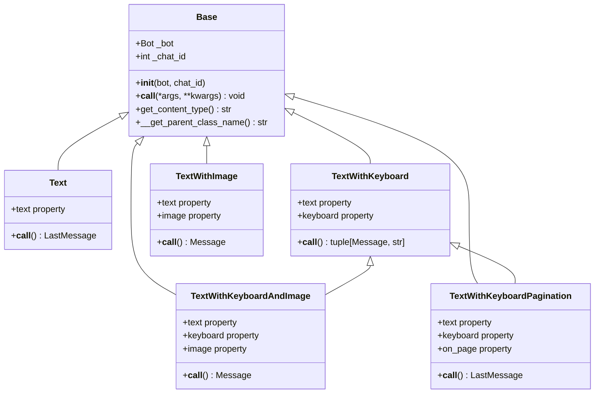
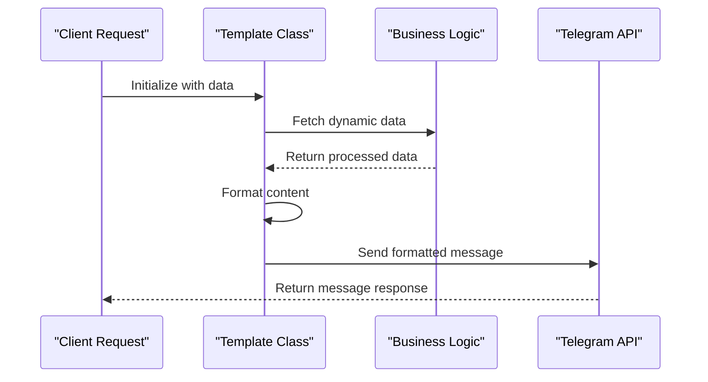
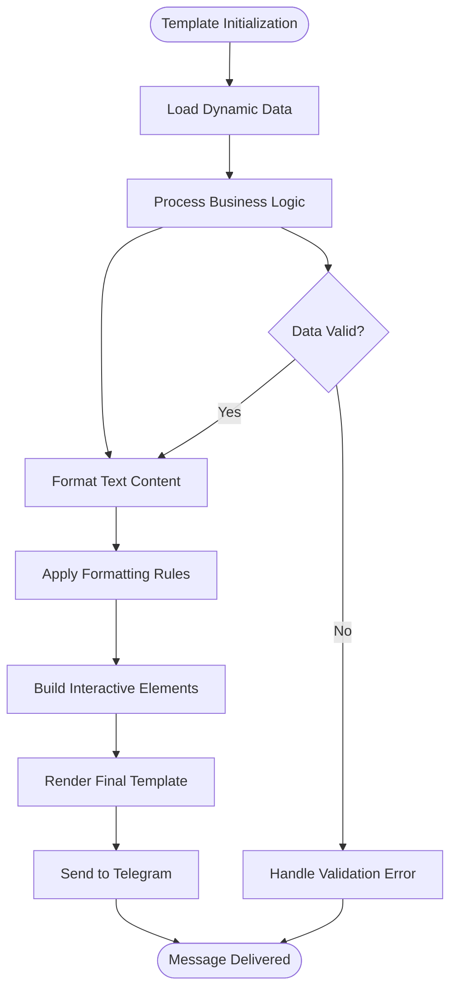
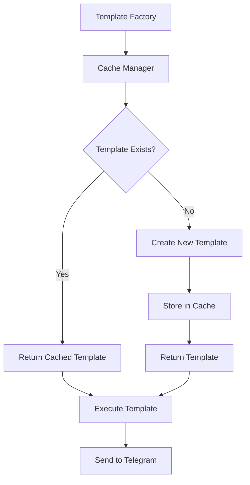

# Message Templates

<cite>
**Referenced Files in This Document**
- [base.py](file://app/client_bot/user_interface/message_templates/base.py)
- [templates.py](file://app/client_bot/user_interface/message_templates/templates.py)
- [__init__.py](file://app/client_bot/user_interface/message_templates/__init__.py)
- [messages.py](file://app/client_bot/user_interface/views/messages/messages.py)
- [errors_message.py](file://app/client_bot/user_interface/views/errors_message.py)
- [get_main_text.py](file://app/client_bot/user_interface/views/get_main_text.py)
- [single_messages.py](file://app/client_bot/single_messages.py)
- [keyboards.py](file://app/client_bot/user_interface/views/keyboards.py)
- [callbacks.py](file://app/client_bot/user_interface/views/callbacks.py)
</cite>

## Table of Contents
1. [Introduction](#introduction)
2. [Template Architecture Overview](#template-architecture-overview)
3. [Core Template Classes](#core-template-classes)
4. [Template Implementation Patterns](#template-implementation-patterns)
5. [Dynamic Content Assembly](#dynamic-content-assembly)
6. [Multi-Shop Context Support](#multi-shop-context-support)
7. [Internationalization and Localization](#internationalization-and-localization)
8. [Performance Optimization](#performance-optimization)
9. [Common Issues and Solutions](#common-issues-and-solutions)
10. [Best Practices](#best-practices)
11. [Conclusion](#conclusion)

## Introduction

The message templates sub-component of the presentation layer serves as the foundation for consistent user communication across the Telegram interface. This system provides a structured approach to templating messages, ensuring uniformity, maintainability, and extensibility in how information is presented to users.

The template system is built around three core files: `base.py` defines the foundational template structure, `templates.py` stores localized message strings and rendering logic, and integrates seamlessly with `views/messages.py` for dynamic content assembly. This architecture supports complex scenarios including multi-shop contexts, dynamic data insertion from business logic, and comprehensive error handling.

## Template Architecture Overview

The message template system follows a hierarchical inheritance pattern that promotes code reuse and maintains consistency across different types of user interactions.



**Diagram sources**
- [base.py](file://app/client_bot/user_interface/message_templates/base.py#L1-L32)
- [templates.py](file://app/client_bot/user_interface/message_templates/templates.py#L1-L188)

**Section sources**
- [base.py](file://app/client_bot/user_interface/message_templates/base.py#L1-L32)
- [templates.py](file://app/client_bot/user_interface/message_templates/templates.py#L1-L188)

## Core Template Classes

### Base Template Class

The `Base` class serves as the foundation for all template implementations, providing essential functionality for Telegram bot communication.

```python
class Base(ABC):
    def __init__(self, bot: aiogram.Bot, chat_id: int):
        self._bot = bot
        self._chat_id = chat_id

    @property
    def bot(self) -> Bot:
        return self._bot

    @property
    def chat_id(self) -> int:
        return self._chat_id

    async def __call__(self: "Base", *args: Any, **kwargs: Any) -> None:
        parse_mode = getattr(self, "parse_mode", None)
        self.parse_mode = parse_mode
```

Key features of the Base class:
- **Abstraction**: Uses ABC (Abstract Base Class) to enforce implementation requirements
- **Telegram Integration**: Provides direct access to bot and chat context
- **Parse Mode Management**: Handles text formatting modes automatically
- **Content Type Detection**: Automatically identifies template type for routing

### Text Template

The simplest template type, designed for basic text messages without additional formatting or interactive elements.

```python
class Text(Base):
    @property
    @abstractmethod
    def text(self):
        pass

    async def __call__(self) -> (LastMessage, str):
        last_message = await self.bot.send_message(
            chat_id=self.chat_id,
            text=self.text,
            parse_mode=getattr(self, "parse_mode", None),
            disable_web_page_preview=getattr(self, "DISABLE_WEBPAGE_PREVIEW", None),
        )
        return last_message
```

### TextWithKeyboard Template

Supports text messages with inline keyboard navigation, enabling interactive user experiences.

```python
class TextWithKeyboard(Base):
    @property
    @abstractmethod
    def text(self) -> str:
        pass

    @property
    @abstractmethod
    def keyboard(self) -> InlineKeyboardMarkup:
        pass

    async def __call__(self) -> tuple[Message, str]:
        text = self.text
        parse_mode = getattr(self, "parse_mode", None)
        if parse_mode == "Markdown":
            text = text.replace("_", r"\_")
        
        last_message = await self.bot.send_message(
            chat_id=self.chat_id,
            text=text,
            reply_markup=self.keyboard,
            parse_mode=self.parse_mode,
            disable_web_page_preview=True,
        )
        return (last_message, self.get_content_type())
```

**Section sources**
- [base.py](file://app/client_bot/user_interface/message_templates/base.py#L1-L32)
- [templates.py](file://app/client_bot/user_interface/message_templates/templates.py#L50-L85)

## Template Implementation Patterns

### Dynamic Content Generation

The template system supports sophisticated dynamic content generation through property-based approaches and asynchronous initialization.



**Diagram sources**
- [messages.py](file://app/client_bot/user_interface/views/messages/messages.py#L1-L100)
- [templates.py](file://app/client_bot/user_interface/message_templates/templates.py#L50-L85)

### Advanced Template Types

#### TextWithImage Template

Handles messages with embedded images, supporting both file paths and Telegram file IDs.

```python
class TextWithImage(Base):
    @property
    @abstractmethod
    def text(self):
        pass

    @property
    @abstractmethod
    def image(self):
        pass

    @manage_file_id
    async def __call__(self):
        parse_mode = getattr(self, "parse_mode", None)

        last_message = await self.bot.send_photo(
            chat_id=self.chat_id,
            photo=self.image,
            caption=self.text,
            parse_mode=parse_mode,
        )
        return last_message
```

#### TextWithKeyboardAndImage Template

Combines all three elements: text, interactive keyboard, and visual content.

```python
class TextWithKeyboardAndImage(Base):
    @property
    @abstractmethod
    def text(self):
        pass

    @property
    @abstractmethod
    def keyboard(self):
        pass

    @property
    def image(self):
        return self._image

    @image.setter
    def image(self, value):
        self._image = value

    @manage_file_id
    async def __call__(self) -> Message:
        last_message = await self.bot.send_photo(
            chat_id=self.chat_id,
            photo=self.image,
            caption=self.text,
            reply_markup=self.keyboard,
            parse_mode=getattr(self, "parse_mode", None),
        )
        return last_message
```

**Section sources**
- [templates.py](file://app/client_bot/user_interface/message_templates/templates.py#L87-L188)

## Dynamic Content Assembly

### Template Usage Examples

The system demonstrates practical implementation through various message types:

#### Error Messages

```python
class UnknownInnerError(mt.Text):
    text = (
        "Произошла неизвестная ошибка. Администратор уже уведомлен. Попробуйте позже."
    )

class AddNewToken(mt.TextWithKeyboard):
    def __init__(
        self,
        bot,
        chat_id: int,
        wb_user_cabinet: app.my_types.WBUserCabinet,
    ):
        super().__init__(bot, chat_id)
        self.wb_user_cabinet = wb_user_cabinet

    text = (
        "Произошла ошибка, необходимо добавить новый токен для магазина или, если хотите, "
        "вы можете удалить магазин из аккаунта."
    )

    @property
    def keyboard(self):
        return keyboards.add_app_token_or_delete_wb_user_cabinet(self.wb_user_cabinet)
```

#### Main Text Generation

```python
def get_main_text(user_telegram_id: int):
    text = f"""
Я бот-партнер в автоматизации рекламы на Wildberries: для агентств и крупных селлеров. 

👨🏼‍💼Я создан, чтобы сократить время на настройку и оптимизацию большого количества кампаний. В меня заложена сама логика работы алгоритмов ВБ, поэтому я могу самостоятельно выводить товары в ТОП и при этом сократить рекламные затраты. 

Как? <a href="https://drive.google.com/file/d/1ipUdoYaHT9CciWa3AclU8C8hTZ7NZ-S5/view">Смотрите в презентации</a>

...

Ваш telegram id: {user_telegram_id}
"""
    return text
```

### Content Assembly Process



**Diagram sources**
- [messages.py](file://app/client_bot/user_interface/views/messages/messages.py#L100-L200)
- [errors_message.py](file://app/client_bot/user_interface/views/errors_message.py#L1-L31)

**Section sources**
- [errors_message.py](file://app/client_bot/user_interface/views/errors_message.py#L1-L31)
- [get_main_text.py](file://app/client_bot/user_interface/views/get_main_text.py#L1-L45)

## Multi-Shop Context Support

The template system is designed to handle multiple shop contexts efficiently, allowing for personalized messaging across different user accounts and shop configurations.

### Context Management

Each template maintains its own context through the `chat_id` parameter, enabling:

- **User Isolation**: Messages are delivered to the correct user regardless of concurrent sessions
- **Shop Separation**: Different shops under the same account receive appropriate content
- **State Preservation**: Template instances maintain state across multiple interactions

### Shop-Specific Templates

```python
class AdvSettingMenu(TextWithKeyboardAndImage):
    def __init__(
            self, bot: Bot, chat_id: int, wb_user_cabinet: WBUserCabinet, adv: AdvSetting
    ):
        super().__init__(bot, chat_id)
        self._bot = bot
        self._chat_id = chat_id
        self.adv = adv
        self.wb_user_cabinet = wb_user_cabinet

    async def __call__(self) -> Message:
        # Load shop-specific data
        self._min_ctr: float | str = await data_manager.get_min_ctr(self.adv)
        self.in_favorites_user: bool = await data_manager.is_adv_in_favorites(
            self.adv.id, self.wb_user_cabinet.user_id
        )
        
        # Process shop statistics
        full_stat_update_time = await self._get_last_full_stat_update(self.adv.adv_id)
        last_update_keyword_stat = await self._get_last_update_keyword_stat(self.adv.adv_id)
        
        return await super().__call__()
```

**Section sources**
- [messages.py](file://app/client_bot/user_interface/views/messages/messages.py#L200-L300)

## Internationalization and Localization

While the current implementation primarily uses Russian text, the template system is designed to support internationalization through several mechanisms:

### Template Structure for i18n

```python
# Example of internationalized template structure
class InternationalizedTemplate(Base):
    def __init__(self, bot: Bot, chat_id: int, locale: str = "ru"):
        super().__init__(bot, chat_id)
        self.locale = locale
        self.translations = self.load_translations(locale)
    
    def load_translations(self, locale: str):
        # Load locale-specific translations
        return translation_loader.get_translations(locale)
    
    @property
    def text(self):
        return self.translations.get(self.template_key, "Default text")
```

### Markdown Compatibility

The system handles Markdown formatting consistently across languages:

```python
async def __call__(self) -> tuple[Message, str]:
    text = self.text
    parse_mode = getattr(self, "parse_mode", None)
    if parse_mode == "Markdown":
        text = text.replace("_", r"\_")  # Escape underscores for Markdown
    # Continue with message sending...
```

**Section sources**
- [templates.py](file://app/client_bot/user_interface/message_templates/templates.py#L60-L75)

## Performance Optimization

### Caching Strategies

The template system incorporates several performance optimization techniques:

#### File ID Management

```python
def manage_file_id(func) -> Callable:
    @wraps(func)
    async def wrapper(self, *args, **kwargs) -> T | None:
        logger.debug("Вызов обертки manage_file_id")
        old_image = self.image
        if old_image:
            image: io.BytesIO | str = await file_handler.get_telegram_image(
                old_image, self.bot
            )
            
            if isinstance(image, io.BytesIO):
                new_image = BufferedInputFile(image.getvalue(), filename="wbgram.png")
                self.image = new_image
            else:
                self.image = image
        
        message: T = await func(self, *args, **kwargs)
        
        # Save file ID for future use
        image_id = message.photo[-1].file_id
        if isinstance(image, io.BytesIO):
            bot: aiogram.Bot = self.bot
            bot_id = bot.id
            await file_handler.save_telegram_file(image, image_id, bot_id)
        return message
    return wrapper
```

#### Template Reuse Patterns



**Diagram sources**
- [templates.py](file://app/client_bot/user_interface/message_templates/templates.py#L20-L50)

**Section sources**
- [templates.py](file://app/client_bot/user_interface/message_templates/templates.py#L20-L50)

## Common Issues and Solutions

### Missing Translations

**Problem**: Template fails to render due to missing localization keys.

**Solution**: Implement fallback mechanisms:

```python
@property
def text(self):
    return self.translations.get(
        self.template_key, 
        f"Missing translation for {self.template_key}"
    )
```

### Formatting Errors

**Problem**: Markdown formatting causes rendering issues.

**Solution**: Comprehensive escaping:

```python
def escape_markdown(text: str) -> str:
    """Escape Markdown special characters."""
    escape_chars = r'\*_`\{\}\[\]\(\)#+\-=|\.!'
    for char in escape_chars:
        text = text.replace(char, f'\\{char}')
    return text
```

### Performance Bottlenecks

**Problem**: Slow template rendering affecting user experience.

**Solutions**:
1. **Template Caching**: Store compiled templates
2. **Lazy Loading**: Load data only when needed
3. **Async Processing**: Use asynchronous operations for data fetching

```python
async def __call__(self) -> tuple[Message, str]:
    # Lazy loading of expensive data
    if not hasattr(self, '_processed_data'):
        self._processed_data = await self._load_expensive_data()
    
    # Efficient template rendering
    return await super().__call__()
```

### Circular Dependencies

**Problem**: Template dependencies creating circular import chains.

**Solution**: Use dependency injection and factory patterns:

```python
@inject
async def __call__(
    self, 
    data_manager: DataManager = Provide[Container.data_manager]
) -> tuple[Message, str]:
    # Use injected dependencies to break cycles
    return await super().__call__()
```

## Best Practices

### Template Design Principles

1. **Single Responsibility**: Each template should handle one specific message type
2. **Consistency**: Maintain consistent formatting and structure across similar templates
3. **Extensibility**: Design templates to be easily extended for new use cases
4. **Testability**: Ensure templates can be tested independently

### Implementation Guidelines

```python
# Good: Clear, focused template
class ShopAddedSuccess(Text):
    def __init__(self, bot: Bot, chat_id, cabinet_name: str) -> None:
        super().__init__(bot, chat_id)
        self.__cabinet_name = cabinet_name

    @property
    def text(self) -> str:
        return f"Магазин {self.__cabinet_name} успешно добавлен, идет обновление данных..."

# Bad: Overloaded template with multiple responsibilities
class ComplexMessage(TextWithKeyboardAndImage):
    # Contains multiple unrelated functionalities
    pass
```

### Error Handling

```python
async def __call__(self) -> tuple[Message, str]:
    try:
        # Template rendering logic
        return await super().__call__()
    except Exception as e:
        logger.error(f"Template rendering failed: {e}")
        # Fallback to error template
        return await self._render_error_template(e)
```

### Testing Strategies

```python
def test_template_rendering():
    # Test template instantiation
    template = MyTemplate(bot, chat_id)
    
    # Verify properties are accessible
    assert template.text is not None
    assert template.keyboard is not None
    
    # Test async rendering
    result = await template()
    assert isinstance(result, tuple)
```

## Conclusion

The message templates sub-component provides a robust, scalable foundation for consistent user communication in the Telegram interface. Through its hierarchical class structure, dynamic content capabilities, and multi-shop support, the system enables efficient message delivery while maintaining code quality and user experience standards.

Key strengths of the system include:

- **Modular Architecture**: Clean separation of concerns through inheritance
- **Dynamic Content**: Sophisticated data processing and formatting capabilities
- **Scalability**: Support for multiple shop contexts and user interactions
- **Maintainability**: Well-structured code with clear abstraction layers
- **Performance**: Built-in optimization strategies and caching mechanisms

The template system serves as a critical component in the overall presentation layer, ensuring that users receive consistent, well-formatted messages regardless of the underlying business logic complexity. Future enhancements could include expanded internationalization support, advanced caching strategies, and enhanced testing frameworks to further improve reliability and maintainability.