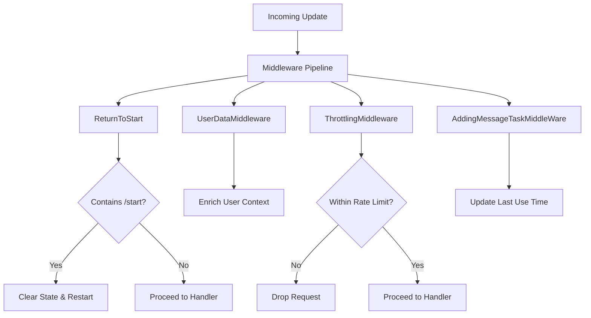
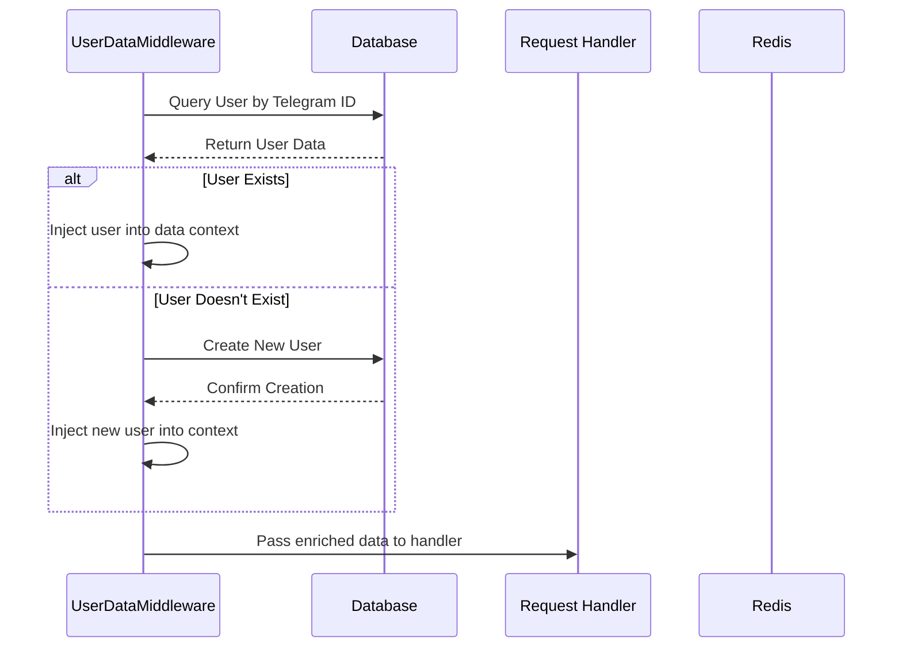
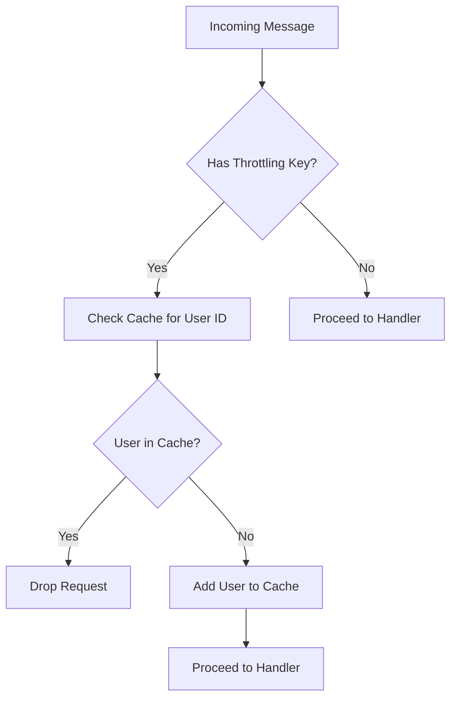
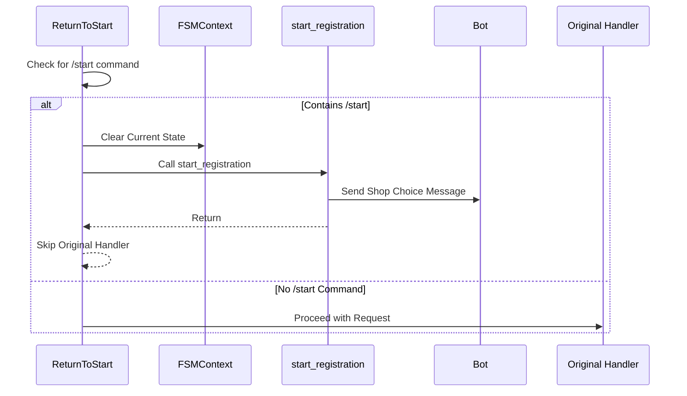
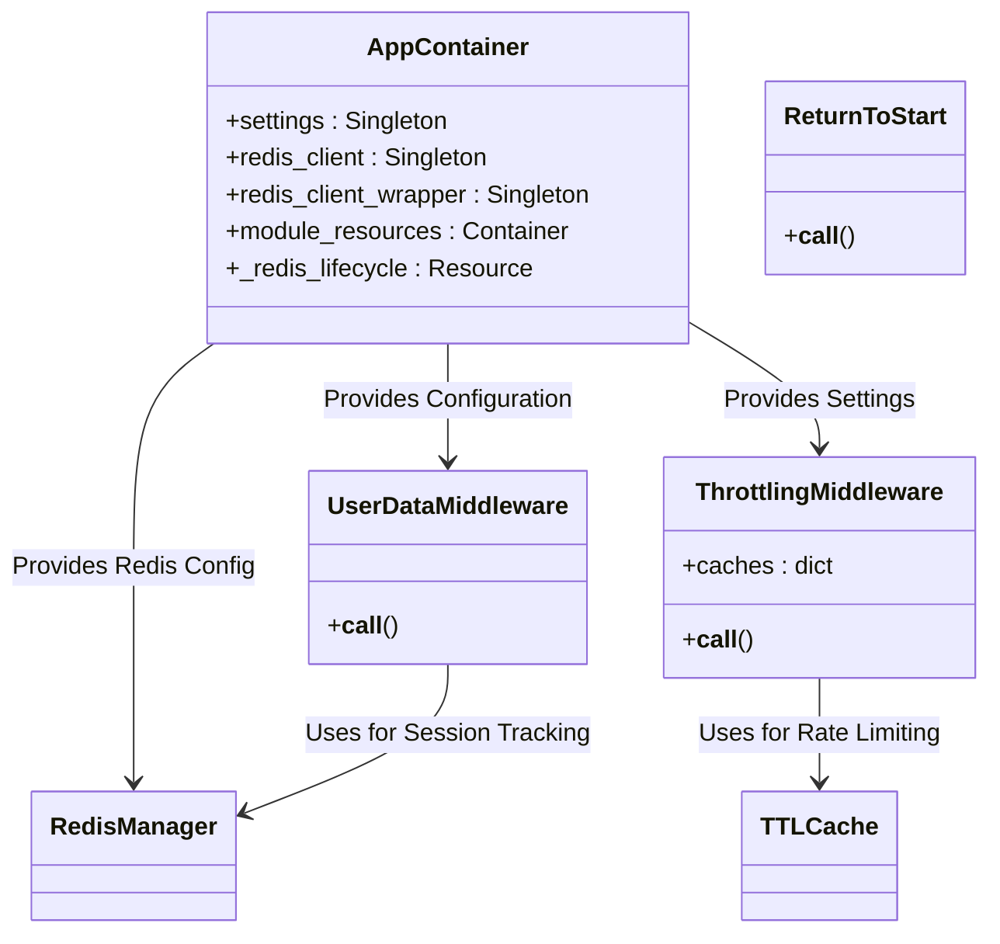
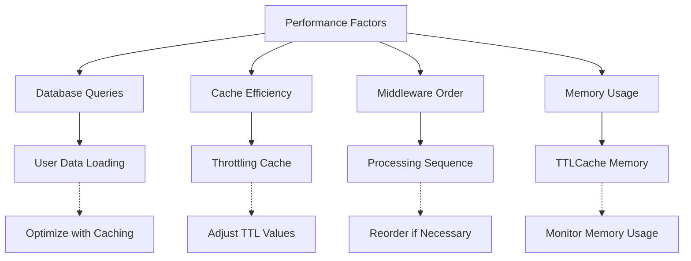

# Middleware

<cite>
**Referenced Files in This Document**   
- [user_data.py](file://app/client_bot/middlewars/user_data.py)
- [throtting.py](file://app/client_bot/middlewars/throtting.py)
- [return_to_start_from_state.py](file://app/client_bot/middlewars/return_to_start_from_state.py)
- [common_routers.py](file://app/client_bot/common_routers.py)
- [app_container.py](file://app/core/di/app_container.py)
- [redis_manager.py](file://app/client_bot/redis_manager.py)
- [start_registration_func.py](file://app/client_bot/user_interface/handlers/start_registration_func.py)
- [global_router.py](file://app/client_bot/global_router.py)
- [infrastructure_config.py](file://app/configs/infrastructure_config/infrastructure_config.py)
</cite>

## Table of Contents
1. [Introduction](#introduction)
2. [Middleware Architecture Overview](#middleware-architecture-overview)
3. [Core Middleware Components](#core-middleware-components)
4. [User Data Enrichment](#user-data-enrichment)
5. [Rate Limiting Implementation](#rate-limiting-implementation)
6. [State Recovery Mechanism](#state-recovery-mechanism)
7. [Dependency Injection Integration](#dependency-injection-integration)
8. [Middleware Ordering and Pipeline](#middleware-ordering-and-pipeline)
9. [Common Issues and Solutions](#common-issues-and-solutions)
10. [Performance Considerations](#performance-considerations)
11. [Conclusion](#conclusion)

## Introduction
The middleware sub-component in the presentation layer plays a critical role in processing incoming user updates before they reach the handlers. This document details the three primary middleware components: user_data.py for user context enrichment, throtting.py for rate limiting, and return_to_start_from_state.py for state recovery. These components work together to ensure data consistency, prevent abuse, and maintain user session integrity within the Telegram bot application.

**Section sources**
- [user_data.py](file://app/client_bot/middlewars/user_data.py#L1-L52)
- [throtting.py](file://app/client_bot/middlewars/throtting.py#L1-L30)
- [return_to_start_from_state.py](file://app/client_bot/middlewars/return_to_start_from_state.py#L1-L30)

## Middleware Architecture Overview

**Diagram sources**
- [common_routers.py](file://app/client_bot/common_routers.py#L25-L112)
- [global_router.py](file://app/client_bot/global_router.py#L1-L30)

## Core Middleware Components

The middleware system consists of three specialized components that process incoming updates in a specific order. Each middleware has a distinct responsibility in the request processing pipeline, from user context enrichment to abuse prevention and state management.

### Middleware Responsibilities
- **UserDataMiddleware**: Injects user data into the request context
- **ReturnToStart**: Handles state recovery on /start command
- **ThrottlingMiddleware**: Prevents abuse through rate limiting
- **AddingMessageTaskMiddleWare**: Tracks user activity

**Section sources**
- [user_data.py](file://app/client_bot/middlewars/user_data.py#L1-L52)
- [throtting.py](file://app/client_bot/middlewars/throtting.py#L1-L30)
- [return_to_start_from_state.py](file://app/client_bot/middlewars/return_to_start_from_state.py#L1-L30)

## User Data Enrichment

**Diagram sources**
- [user_data.py](file://app/client_bot/middlewars/user_data.py#L1-L52)
- [redis_manager.py](file://app/client_bot/redis_manager.py#L1-L23)

### Implementation Details
The UserDataMiddleware enriches the request context by injecting user data from the database. When an update arrives, it queries the database for the user associated with the Telegram ID. If the user doesn't exist, it creates a new user record. The user object is then injected into the data dictionary, making it available to all subsequent handlers.

The middleware establishes a database session using the session maker and executes a SELECT query with joined loading to fetch the user and their associated WBUserCabinets. This ensures that all necessary user context is available to handlers without requiring additional database queries.

**Section sources**
- [user_data.py](file://app/client_bot/middlewars/user_data.py#L1-L52)
- [start_registration_func.py](file://app/client_bot/user_interface/handlers/start_registration_func.py#L1-L60)

## Rate Limiting Implementation

**Diagram sources**
- [throtting.py](file://app/client_bot/middlewars/throtting.py#L1-L30)
- [common_routers.py](file://app/client_bot/common_routers.py#L69)

### Throttling Strategy
The ThrottlingMiddleware implements rate limiting using TTLCache from the cachetools library. It maintains two separate caches: one for "spin" operations with a shorter TTL and another for general operations. The middleware checks for a throttling_key flag in the request data, which handlers can set to specify the rate limiting strategy.

When a request arrives, the middleware checks if the user's chat ID is already in the appropriate cache. If present, the request is dropped to prevent abuse. If not, the user is added to the cache with a TTL, effectively creating a sliding window rate limit.

**Section sources**
- [throtting.py](file://app/client_bot/middlewars/throtting.py#L1-L30)
- [common_routers.py](file://app/client_bot/common_routers.py#L69)

## State Recovery Mechanism

**Diagram sources**
- [return_to_start_from_state.py](file://app/client_bot/middlewars/return_to_start_from_state.py#L1-L30)
- [start_registration_func.py](file://app/client_bot/user_interface/handlers/start_registration_func.py#L1-L60)

### State Management
The ReturnToStart middleware provides a state recovery mechanism that allows users to reset their conversation state by sending the /start command. When a message containing "/start" is detected, the middleware intercepts the request, clears the current FSM state, and invokes the start_registration function to restart the user journey.

This mechanism ensures that users can always return to the main menu regardless of their current state in the conversation flow. The middleware prevents the original handler from executing by returning after calling start_registration, ensuring a clean state transition.

**Section sources**
- [return_to_start_from_state.py](file://app/client_bot/middlewars/return_to_start_from_state.py#L1-L30)
- [start_registration_func.py](file://app/client_bot/user_interface/handlers/start_registration_func.py#L1-L60)

## Dependency Injection Integration

**Diagram sources**
- [app_container.py](file://app/core/di/app_container.py#L1-L50)
- [infrastructure_config.py](file://app/configs/infrastructure_config/infrastructure_config.py#L1-L20)

### DI Container Architecture
The application uses a dependency injection container (AppContainer) to manage service dependencies. The container is configured with wiring for various packages and provides singleton instances of core services like the Redis client. While the middleware components don't directly use the DI container, they rely on the same configuration system for consistent behavior across the application.

The Redis configuration is centralized in the infrastructure configuration, ensuring that all components use the same Redis connection parameters. This promotes consistency and simplifies configuration management.

**Section sources**
- [app_container.py](file://app/core/di/app_container.py#L1-L50)
- [infrastructure_config.py](file://app/configs/infrastructure_config/infrastructure_config.py#L1-L20)

## Middleware Ordering and Pipeline

**Diagram sources**
- [common_routers.py](file://app/client_bot/common_routers.py#L25-L112)
- [global_router.py](file://app/client_bot/global_router.py#L1-L30)

### Processing Order
The middleware components are registered in a specific order that determines their execution sequence:

1. **ReturnToStart**: First in the pipeline to handle /start commands immediately
2. **UserDataMiddleware**: Second to ensure user context is available to all subsequent middleware
3. **ThrottlingMiddleware**: Third to rate limit requests after user context is established
4. **AddingMessageTaskMiddleWare**: Last to track user activity regardless of other processing

The ordering is critical for proper functionality. For example, ReturnToStart must execute first to handle state recovery, while UserDataMiddleware must execute before any middleware that depends on user data.

**Section sources**
- [common_routers.py](file://app/client_bot/common_routers.py#L25-L112)
- [global_router.py](file://app/client_bot/global_router.py#L1-L30)

## Common Issues and Solutions

### Race Conditions in State Management
A potential race condition exists when multiple /start commands are sent in quick succession. The current implementation doesn't prevent concurrent execution of the start_registration function.

**Solution**: Implement request deduplication using Redis to track recently processed /start commands.

### Incorrect Throttling Thresholds
The throttling middleware uses hardcoded TTL values that may not be optimal for all use cases.

**Solution**: Configure throttling parameters through the DI container to allow dynamic adjustment based on environment and usage patterns.

### Database Connection Leaks
The UserDataMiddleware creates database sessions that could potentially leak if exceptions occur.

**Solution**: Ensure proper exception handling and session cleanup in the middleware's __call__ method.

**Section sources**
- [user_data.py](file://app/client_bot/middlewars/user_data.py#L1-L52)
- [throtting.py](file://app/client_bot/middlewars/throtting.py#L1-L30)
- [return_to_start_from_state.py](file://app/client_bot/middlewars/return_to_start_from_state.py#L1-L30)

## Performance Considerations

**Diagram sources**
- [user_data.py](file://app/client_bot/middlewars/user_data.py#L1-L52)
- [throtting.py](file://app/client_bot/middlewars/throtting.py#L1-L30)

### Optimization Opportunities
The middleware system presents several performance considerations:

- **Database Load**: UserDataMiddleware executes a database query for every incoming message, which could become a bottleneck under high load.
- **Memory Usage**: ThrottlingMiddleware uses in-memory caches that grow with user activity.
- **Processing Overhead**: Each middleware adds processing time to the request pipeline.

**Optimization Strategies**:
1. Implement Redis caching for user data to reduce database queries
2. Monitor and adjust TTLCache sizes based on actual usage patterns
3. Consider lazy loading of user data only when needed by handlers
4. Implement connection pooling for database sessions

**Section sources**
- [user_data.py](file://app/client_bot/middlewars/user_data.py#L1-L52)
- [throtting.py](file://app/client_bot/middlewars/throtting.py#L1-L30)

## Conclusion
The middleware sub-component in the presentation layer provides essential functionality for user context management, abuse prevention, and state recovery. By processing incoming updates through a pipeline of specialized middleware components, the application ensures consistent behavior, data integrity, and a reliable user experience.

The three core middleware components—UserDataMiddleware, ThrottlingMiddleware, and ReturnToStart—work together to enrich user context, prevent abuse, and maintain session integrity. Their integration with the DI system and proper ordering in the pipeline ensures efficient and reliable request processing.

Future improvements could include enhanced caching strategies, more sophisticated rate limiting algorithms, and better error handling to address potential race conditions and resource leaks.