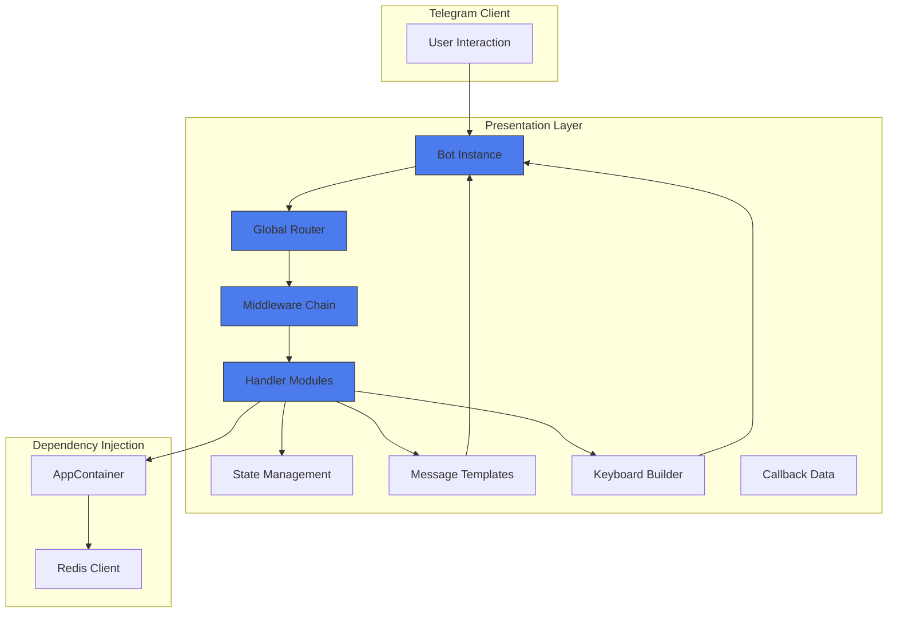
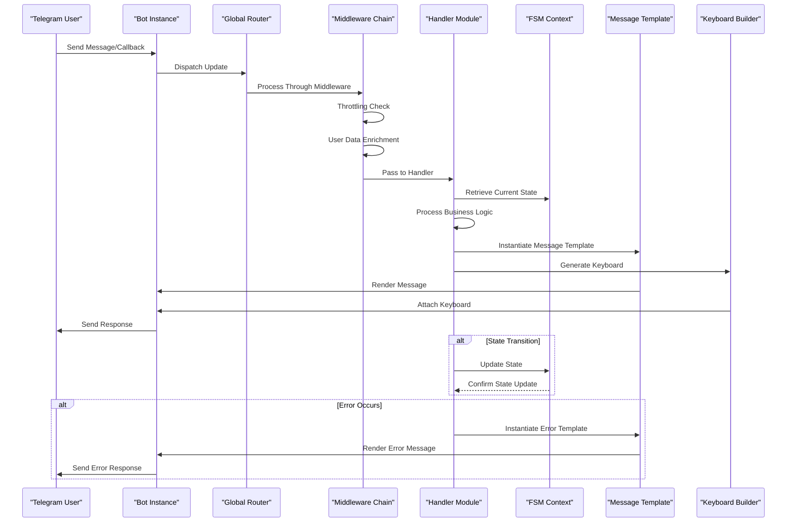
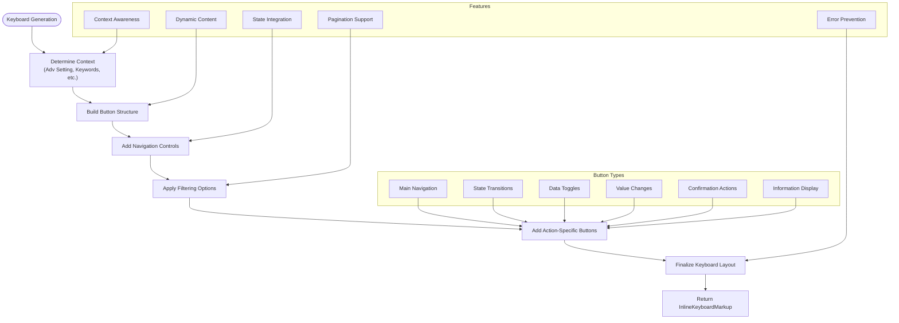

# Presentation Layer

<cite>
**Referenced Files in This Document**   
- [bot.py](file://app/client_bot/bot.py)
- [global_router.py](file://app/client_bot/global_router.py)
- [states.py](file://app/client_bot/user_interface/states.py)
- [base.py](file://app/client_bot/user_interface/message_templates/base.py)
- [templates.py](file://app/client_bot/user_interface/message_templates/templates.py)
- [start.py](file://app/client_bot/user_interface/handlers/start/start.py)
- [throtting.py](file://app/client_bot/middlewars/throtting.py)
- [user_data.py](file://app/client_bot/middlewars/user_data.py)
- [message_manager.py](file://app/client_bot/message_manager.py)
- [common_routers.py](file://app/client_bot/common_routers.py)
- [app_container.py](file://app/core/di/app_container.py)
- [errors_message.py](file://app/client_bot/user_interface/views/errors_message.py)
- [keyboards.py](file://app/client_bot/user_interface/views/keyboards.py)
- [callbacks.py](file://app/client_bot/user_interface/views/callbacks.py)
</cite>

## Table of Contents
1. [Introduction](#introduction)
2. [Architecture Overview](#architecture-overview)
3. [Core Components](#core-components)
4. [User State Management](#user-state-management)
5. [Message Templates and Formatting](#message-templates-and-formatting)
6. [Handler Processing and Routing](#handler-processing-and-routing)
7. [Middleware Implementation](#middleware-implementation)
8. [Keyboard Interactions](#keyboard-interactions)
9. [Dependency Injection with AppContainer](#dependency-injection-with-appcontainer)
10. [Error Handling](#error-handling)
11. [Conclusion](#conclusion)

## Introduction
The presentation layer of the adv-bot system is built on aiogram 3.4.1, providing a Telegram-based interface for users to manage their advertising campaigns. This documentation details the architecture of this layer, focusing on how user interactions are processed through handlers, routers, and middleware. The system implements a sophisticated state management approach, message templating system, and keyboard interaction model to provide a seamless user experience. The presentation layer serves as the entry point for all user interactions and orchestrates communication with business logic components through dependency injection.

## Architecture Overview



**Diagram sources**
- [bot.py](file://app/client_bot/bot.py)
- [global_router.py](file://app/client_bot/global_router.py)
- [middlewars/throtting.py](file://app/client_bot/middlewars/throtting.py)
- [user_interface/handlers/start/start.py](file://app/client_bot/user_interface/handlers/start/start.py)
- [user_interface/states.py](file://app/client_bot/user_interface/states.py)
- [user_interface/message_templates/templates.py](file://app/client_bot/user_interface/message_templates/templates.py)
- [user_interface/views/keyboards.py](file://app/client_bot/user_interface/views/keyboards.py)
- [core/di/app_container.py](file://app/core/di/app_container.py)

## Core Components

The presentation layer consists of several core components that work together to handle user interactions. The bot instance serves as the entry point, receiving all updates from Telegram. The global router orchestrates the flow of these updates to appropriate handlers based on the type of interaction. Middleware components process requests before they reach handlers, providing cross-cutting concerns like throttling and user data management. Message templates standardize the presentation of information to users, while keyboard builders create interactive interfaces. The system uses callback data classes to structure interaction payloads and maintain context across user actions.

**Section sources**
- [bot.py](file://app/client_bot/bot.py)
- [global_router.py](file://app/client_bot/global_router.py)
- [user_interface/message_templates/templates.py](file://app/client_bot/user_interface/message_templates/templates.py)
- [user_interface/views/keyboards.py](file://app/client_bot/user_interface/views/keyboards.py)
- [user_interface/views/callbacks.py](file://app/client_bot/user_interface/views/callbacks.py)

## User State Management

```mermaid
classDiagram
class GlobalState {
+State shop_choice
}
class CabinetRegistration {
+State cabinet_name
+State api
}
class ChangeMinCTR {
+State waiting_for_new_min_ctr
}
class AddNewToken {
+State token
}
class CreateNewAdvCompany {
+State waiting_for_name
+State waiting_for_nmids
}
class RefProgram {
+State getting_name
}
class AdvSetting {
+State waiting_for_filter_by_query
+State waiting_for_filter_keywords
}
class ChangeMaxCPC {
+State waiting_for_new_max_cpc
}
class ChangeMinViewsForPredictCTR {
+State waiting_for_new_min_views
}
class AddBalance {
+State awaiting_confirmation
+State awaiting_amount
}
class AdvCompanyCatalog {
+State waiting_for_keywords_for_filter
+State waiting_for_sort_type
}
class AddWhitePhrases {
+State waiting_for_white_phrases
}
class CPMSetting {
+State waiting_for_min_position
+State waiting_for_max_cpm
+State waiting_for_manual_cpm
+State waiting_for_max_position
}
class AddBlackPhrasesTemplates {
+State waiting_for_black_phrases
}
class AddRelevantPhrases {
+State waiting_for_relevant_phrases
}
class ChangeCPM {
+State waiting_for_cpm
}
class ShopMenuState {
+State shop_menu
}
note right of GlobalState
Manages global navigation states
end note
note right of CabinetRegistration
Handles new cabinet registration flow
end note
note right of ChangeMinCTR
Captures user input for CTR threshold
end note
```

**Diagram sources**
- [user_interface/states.py](file://app/client_bot/user_interface/states.py)

The system implements a comprehensive state management system using aiogram's FSM (Finite State Machine) functionality. Each interaction flow has its own state group, allowing the bot to maintain context during multi-step processes. State groups are defined for various user journeys including cabinet registration, token management, advertising settings modification, and balance operations. The state machine enables the bot to guide users through complex workflows while preserving context between messages. States are used to validate user input and determine the appropriate next steps in each interaction flow.

## Message Templates and Formatting

```mermaid
classDiagram
class Base {
+Bot _bot
+int _chat_id
+Bot bot
+int chat_id
+__call__(*args, **kwargs)
+__get_parent_class_name()
+get_content_type()
}
class TextWithKeyboard {
+abstractmethod text
+abstractmethod keyboard
+__call__()
}
class TextWithImage {
+abstractmethod text
+abstractmethod image
+__call__()
}
class Text {
+abstractmethod text
+__call__()
}
class TextWithKeyboardPagination {
+abstractmethod text
+abstractmethod keyboard
+abstractmethod on_page
+__call__()
}
class TextWithKeyboardAndImage {
+abstractmethod text
+abstractmethod keyboard
+image
+image(value)
+__call__()
}
Base <|-- TextWithKeyboard
Base <|-- TextWithImage
Base <|-- Text
Base <|-- TextWithKeyboardPagination
Base <|-- TextWithKeyboardAndImage
note right of TextWithKeyboard
Base template for text messages with inline keyboards
end note
note right of TextWithImage
Template for image-based messages with captions
end note
note right of Text
Simple text message template
end note
note right of TextWithKeyboardPagination
Template for paginated content with navigation
end note
note right of TextWithKeyboardAndImage
Template for rich messages with image, text, and keyboard
end note
```

**Diagram sources**
- [user_interface/message_templates/base.py](file://app/client_bot/user_interface/message_templates/base.py)
- [user_interface/message_templates/templates.py](file://app/client_bot/user_interface/message_templates/templates.py)

The message templating system provides a structured approach to message formatting and presentation. The base template class defines common functionality for all message types, including access to the bot instance and chat identifier. Specific template classes inherit from this base and implement abstract properties for content elements like text, keyboard, and image. This inheritance hierarchy enables consistent message formatting across the application while allowing for specialized behavior. The system includes decorators like `manage_file_id` to handle file caching and optimization, ensuring efficient message delivery.

## Handler Processing and Routing



**Diagram sources**
- [bot.py](file://app/client_bot/bot.py)
- [global_router.py](file://app/client_bot/global_router.py)
- [middlewars/throtting.py](file://app/client_bot/middlewars/throtting.py)
- [middlewars/user_data.py](file://app/client_bot/middlewars/user_data.py)
- [user_interface/handlers/start/start.py](file://app/client_bot/user_interface/handlers/start/start.py)
- [user_interface/message_templates/templates.py](file://app/client_bot/user_interface/message_templates/templates.py)
- [user_interface/views/keyboards.py](file://app/client_bot/user_interface/views/keyboards.py)

The routing system processes user interactions through a well-defined sequence. When a user sends a message or triggers a callback, the bot instance receives the update and dispatches it to the global router. The router passes the update through a chain of middleware components that handle cross-cutting concerns before forwarding it to the appropriate handler. Handlers process the business logic, retrieve or update user state, and instantiate message templates with appropriate content. Keyboard builders generate interactive interfaces based on the current context. The final message is rendered and sent back to the user through the bot instance.

## Middleware Implementation

```mermaid
classDiagram
class ThrottlingMiddleware {
+TTLCache caches
+__init__(throttle_time_spin, throttle_time_other)
+__call__(handler, event, data)
}
class UserDataMiddleware {
+__call__(handler, event, data)
}
class ReturnToStart {
+__call__(handler, event, data)
}
class AddingMessageTaskMiddleWare {
+__call__(handler, event, data)
}
ThrottlingMiddleware <|-- BaseMiddleware
UserDataMiddleware <|-- BaseMiddleware
ReturnToStart <|-- BaseMiddleware
AddingMessageTaskMiddleWare <|-- BaseMiddleware
note right of ThrottlingMiddleware
Prevents rapid-fire requests from users
Uses TTLCache with different timeouts
for spin vs. other actions
end note
note right of UserDataMiddleware
Enriches request context with user data
Loads user and associated cabinets
Creates user if not exists
end note
note right of ReturnToStart
Allows returning to start state
from any point in conversation
end note
note right of AddingMessageTaskMiddleWare
Manages message task queue
Handles background message processing
end note
```

**Diagram sources**
- [middlewars/throtting.py](file://app/client_bot/middlewars/throtting.py)
- [middlewars/user_data.py](file://app/client_bot/middlewars/user_data.py)
- [middlewars/return_to_start_from_state.py](file://app/client_bot/middlewars/return_to_start_from_state.py)
- [common_routers.py](file://app/client_bot/common_routers.py)

The middleware system implements several cross-cutting concerns that enhance the bot's functionality. The throttling middleware prevents users from sending requests too frequently, using TTL caches with different timeouts for different action types. The user data middleware enriches each request with the user's profile and associated cabinets, ensuring handlers have access to necessary context. The return-to-start middleware allows users to reset their state and return to the main menu from any point in the conversation. Additional middleware components handle message task queuing and other background operations.

## Keyboard Interactions



**Diagram sources**
- [user_interface/views/keyboards.py](file://app/client_bot/user_interface/views/keyboards.py)
- [user_interface/views/callbacks.py](file://app/client_bot/user_interface/views/callbacks.py)

The keyboard system provides a rich, interactive interface for users to navigate the bot's functionality. Keyboard builders generate context-specific interfaces based on the current state and available actions. The system supports pagination for lists of items like advertising campaigns and keywords. Dynamic content updates reflect the current state of settings and data. Context-aware buttons appear or disappear based on permissions and conditions. The keyboard system integrates tightly with the state management system, ensuring that user actions lead to appropriate state transitions and data updates.

## Dependency Injection with AppContainer

```mermaid
classDiagram
class AppContainer {
+Singleton settings
+Singleton redis_client
+Singleton redis_client_wrapper
+Container module_resources
+Resource _redis_lifecycle
+wiring_config
}
class AppConfig {
+create()
}
class RedisClient {
+__init__(redis_client)
}
class ModuleResources {
+redis_client_wrapper
}
class RedisLifecycle {
+__init__(client)
}
AppContainer --> AppConfig : depends on
AppContainer --> RedisClient : creates
AppContainer --> ModuleResources : contains
AppContainer --> RedisLifecycle : manages
RedisClient --> Redis : wraps
note right of AppContainer
Main DI container for the application
Configures and provides all services
Uses dependency_injector library
end note
note right of RedisClient
Wrapper around raw Redis client
Provides unified API for Redis operations
end note
note right of ModuleResources
Container for module-specific resources
Injects dependencies to modules
end note
```

**Diagram sources**
- [core/di/app_container.py](file://app/core/di/app_container.py)
- [configs/app_config.py](file://app/configs/app_config.py)
- [core/redis_manager_v2/redis_client.py](file://app/core/redis_manager_v2/redis_client.py)

The AppContainer implements dependency injection using the dependency_injector library, providing a centralized mechanism for managing application dependencies. It configures and provides access to essential services like the application settings, Redis client, and module resources. The container uses singleton providers to ensure consistent instances of services across the application. The wiring configuration allows automatic injection of dependencies into components that require them. This approach promotes loose coupling, improves testability, and simplifies configuration management.

## Error Handling

```mermaid
classDiagram
class UnknownInnerError {
+text
}
class AddNewToken {
+bot
+chat_id
+wb_user_cabinet
+text
+keyboard
}
class Text {
+abstractmethod text
+__call__()
}
class TextWithKeyboard {
+abstractmethod text
+abstractmethod keyboard
+__call__()
}
Text <|-- UnknownInnerError
TextWithKeyboard <|-- AddNewToken
note right of UnknownInnerError
Generic error message for unexpected issues
Informs user that admin has been notified
end note
note right of AddNewToken
Specific error for token-related issues
Provides options to add new token or delete cabinet
end note
```

**Diagram sources**
- [user_interface/views/errors_message.py](file://app/client_bot/user_interface/views/errors_message.py)
- [user_interface/message_templates/templates.py](file://app/client_bot/user_interface/message_templates/templates.py)

The error handling system provides user-friendly responses to various error conditions. Generic errors are handled with a standard message that informs users of the issue while assuring them that administrators have been notified. Specific error conditions, such as token validation failures, trigger more targeted responses that guide users toward resolution. Error messages often include interactive elements like keyboards that allow users to take corrective actions directly from the error message. The system balances transparency about issues with maintaining a positive user experience.

## Conclusion
The presentation layer of the adv-bot system demonstrates a well-architected approach to building a complex Telegram bot interface. By leveraging aiogram's features effectively, the system provides a rich, interactive experience for users managing their advertising campaigns. The separation of concerns between routing, handling, templating, and state management creates a maintainable codebase that can evolve with changing requirements. The integration of middleware for cross-cutting concerns, dependency injection for service management, and comprehensive error handling contributes to a robust and user-friendly application. This architecture serves as an effective foundation for the bot's functionality while allowing for future enhancements and scalability.