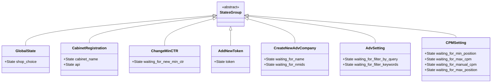
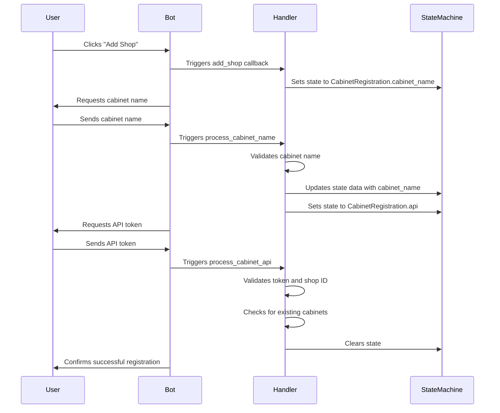
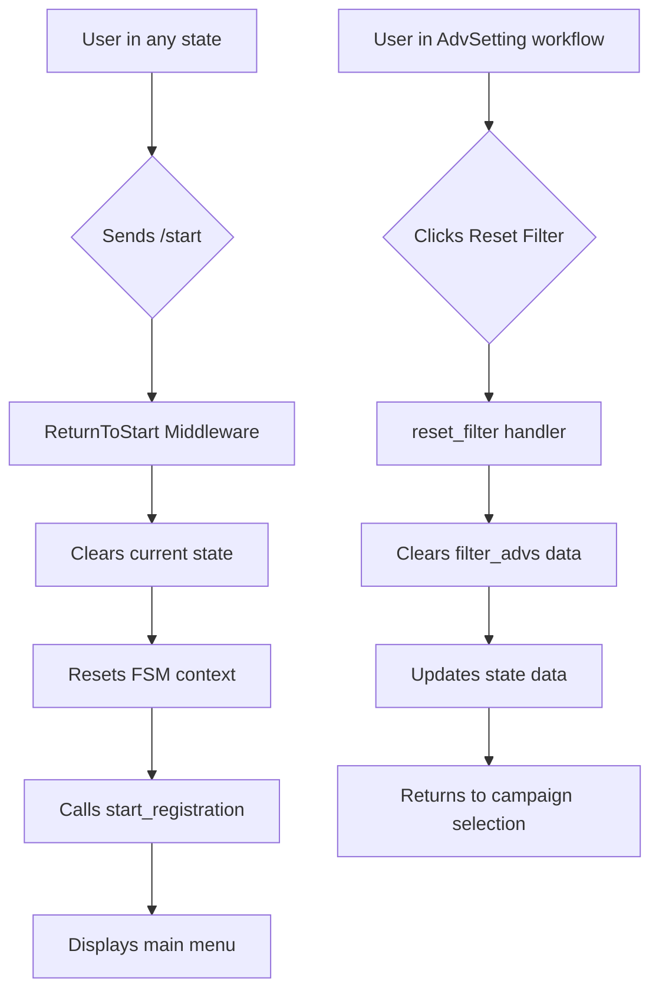
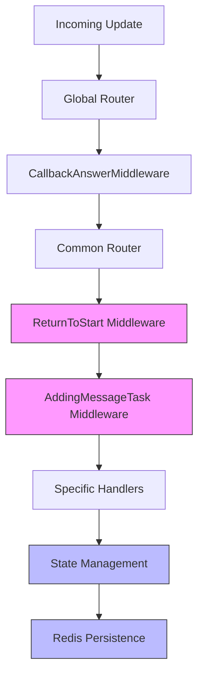

# State Management

<cite>
**Referenced Files in This Document**   
- [states.py](file://app/client_bot/user_interface/states.py)
- [start.py](file://app/client_bot/user_interface/handlers/start/start.py)
- [adv_setting.py](file://app/client_bot/user_interface/handlers/adv_setting.py)
- [redis_manager.py](file://app/client_bot/redis_manager.py)
- [common_routers.py](file://app/client_bot/common_routers.py)
- [return_to_start_from_state.py](file://app/client_bot/middlewars/return_to_start_from_state.py)
- [keyboards.py](file://app/client_bot/user_interface/views/keyboards.py)
- [callbacks.py](file://app/client_bot/user_interface/views/callbacks.py)
- [messages.py](file://app/client_bot/user_interface/views/messages/messages.py)
</cite>

## Table of Contents
1. [Introduction](#introduction)
2. [State Groups Definition](#state-groups-definition)
3. [State Transitions and Handler Integration](#state-transitions-and-handler-integration)
4. [State Persistence with Redis](#state-persistence-with-redis)
5. [State Cancellation and Reset Flows](#state-cancellation-and-reset-flows)
6. [Middleware Integration for State Management](#middleware-integration-for-state-management)
7. [Common State Management Issues and Solutions](#common-state-management-issues-and-solutions)
8. [Scalability Considerations](#scalability-considerations)

## Introduction
This document provides a comprehensive overview of the state management system in the Telegram bot application, focusing on the implementation of aiogram's Finite State Machine (FSM) for managing multi-step user interactions. The system enables structured workflows for complex operations such as campaign setup, keyword configuration, and shop selection. By leveraging FSM patterns with Redis persistence, the application maintains context across user sessions and survives bot restarts. The documentation covers the architecture of state groups, their integration with handlers, data persistence mechanisms, and solutions to common state management challenges.

## State Groups Definition

The state management system is built around multiple StateGroups defined in the states.py file, each representing a specific workflow in the application. These StateGroups provide a structured way to manage multi-step interactions by defining discrete states that users progress through during various operations.



**Diagram sources**
- [states.py](file://app/client_bot/user_interface/states.py#L4-L78)

**Section sources**
- [states.py](file://app/client_bot/user_interface/states.py#L4-L78)

## State Transitions and Handler Integration

State transitions are managed through handler functions that respond to user input and progress the state machine accordingly. The integration between states and handlers follows a consistent pattern where specific handlers are triggered based on the current state, enabling sequential data collection from users.

The start.py handler demonstrates the flow for cabinet registration, where the user first provides a cabinet name and then an API token. Each step is protected by StateFilter to ensure handlers only respond when the appropriate state is active.



**Diagram sources**
- [start.py](file://app/client_bot/user_interface/handlers/start/start.py#L50-L150)
- [states.py](file://app/client_bot/user_interface/states.py#L10-L13)

**Section sources**
- [start.py](file://app/client_bot/user_interface/handlers/start/start.py#L50-L200)
- [adv_setting.py](file://app/client_bot/user_interface/handlers/adv_setting.py#L50-L100)

## State Persistence with Redis

The application uses Redis as a persistent storage backend for FSM states, ensuring that user progress is maintained across bot restarts and service interruptions. The RedisManager class provides a singleton pattern implementation that manages the connection to Redis and handles state data storage and retrieval.

```mermaid
classDiagram
class RedisManager {
-_instance : RedisManager
-_redis_conn : Redis
+get_connection() : Redis
+__new__() : RedisManager
}
class FSMContext {
+set_state(state : State)
+update_data(**data)
+get_data()
+clear()
}
class Bot {
+dispatch()
+handle_update()
}
RedisManager --> "1" FSMContext : stores state data
FSMContext --> "1" Bot : integrated via middleware
RedisManager --> "redis : //localhost/0" : connection
```

**Diagram sources**
- [redis_manager.py](file://app/client_bot/redis_manager.py#L8-L23)
- [common_routers.py](file://app/client_bot/common_routers.py#L100-L110)

**Section sources**
- [redis_manager.py](file://app/client_bot/redis_manager.py#L8-L23)
- [common_routers.py](file://app/client_bot/common_routers.py#L100-L110)

## State Cancellation and Reset Flows

The system implements robust state cancellation and reset mechanisms to handle user errors and provide flexibility in workflow navigation. The return_to_start_from_state.py middleware intercepts /start commands at any point in a workflow, clearing the current state and returning the user to the main menu.



**Diagram sources**
- [return_to_start_from_state.py](file://app/client_bot/middlewars/return_to_start_from_state.py#L10-L30)
- [adv_setting.py](file://app/client_bot/user_interface/handlers/adv_setting.py#L20-L40)

**Section sources**
- [return_to_start_from_state.py](file://app/client_bot/middlewars/return_to_start_from_state.py#L10-L30)
- [adv_setting.py](file://app/client_bot/user_interface/handlers/adv_setting.py#L20-L80)

## Middleware Integration for State Management

The state management system is enhanced through middleware integration, which provides cross-cutting concerns such as state monitoring and automatic cleanup. The AddingMessageTaskMiddleWare updates the user's last activity time in Redis, which can be used for session management and analytics.

The middleware chain is configured in common_routers.py, where multiple middleware components are registered to handle different aspects of state management. This layered approach ensures that state-related operations are consistently applied across all handlers.



**Diagram sources**
- [common_routers.py](file://app/client_bot/common_routers.py#L100-L110)
- [return_to_start_from_state.py](file://app/client_bot/middlewars/return_to_start_from_state.py#L10-L30)
- [middleware_for_adding_task.py](file://app/modules/user_message_sender/middleware_for_adding_task.py#L10-L25)

**Section sources**
- [common_routers.py](file://app/client_bot/common_routers.py#L100-L110)
- [return_to_start_from_state.py](file://app/client_bot/middlewars/return_to_start_from_state.py#L10-L30)

## Common State Management Issues and Solutions

The implementation addresses several common challenges in state management for Telegram bots:

### State Leaks
State leaks are prevented through comprehensive state cleanup in handlers and middleware. The ReturnToStart middleware ensures that any active state is cleared when a user initiates a new session with /start.

### Timeout Handling
While explicit timeout handling is not shown in the provided code, the Redis-based storage enables implementation of TTL (Time To Live) policies to automatically expire stale states. This prevents accumulation of abandoned state data.

### Race Conditions
The system mitigates race conditions through Redis's atomic operations and the sequential nature of Telegram's update delivery. For high-concurrency scenarios, additional locking mechanisms could be implemented using Redis SETNX operations.

```mermaid
flowchart LR
A[State Leak Prevention] --> B[Explicit state.clear()]
A --> C[Middleware interception]
A --> D[Data validation checks]
E[Timeout Handling] --> F[Redis TTL configuration]
E --> G[Periodic cleanup jobs]
E --> H[Session expiration tracking]
I[Race Condition Mitigation] --> J[Atomic Redis operations]
I --> K[Sequential update processing]
I --> L[Optional distributed locking]
```

**Section sources**
- [return_to_start_from_state.py](file://app/client_bot/middlewars/return_to_start_from_state.py#L10-L30)
- [redis_manager.py](file://app/client_bot/redis_manager.py#L8-L23)
- [start.py](file://app/client_bot/user_interface/handlers/start/start.py#L50-L150)

## Scalability Considerations

The state management architecture is designed with scalability in mind, particularly for high-concurrency scenarios. The Redis backend provides fast, in-memory storage that can handle thousands of concurrent user sessions with low latency.

Key scalability features include:
- **Connection pooling**: The RedisManager singleton pattern reduces connection overhead
- **Efficient serialization**: FSM context data is stored in a compact format
- **Asynchronous operations**: All Redis operations are async, preventing blocking
- **Distributed potential**: The architecture can be extended to use Redis clusters

For very high-concurrency scenarios, additional optimizations could include:
- Implementing Redis sharding by user ID
- Adding caching layers for frequently accessed state data
- Using Redis Streams for state change notifications
- Implementing batch operations for state updates

The current implementation balances simplicity with performance, providing a robust foundation that can be extended as concurrency requirements grow.

**Section sources**
- [redis_manager.py](file://app/client_bot/redis_manager.py#L8-L23)
- [common_routers.py](file://app/client_bot/common_routers.py#L100-L110)
- [states.py](file://app/client_bot/user_interface/states.py#L1-L78)