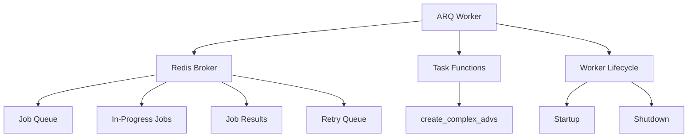
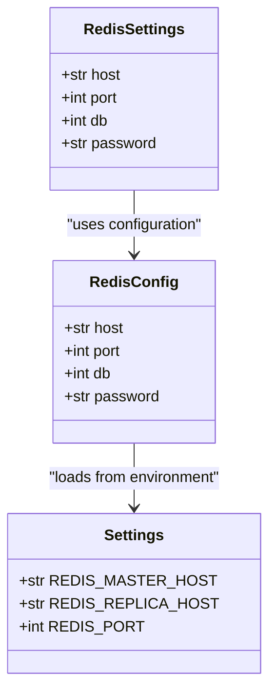
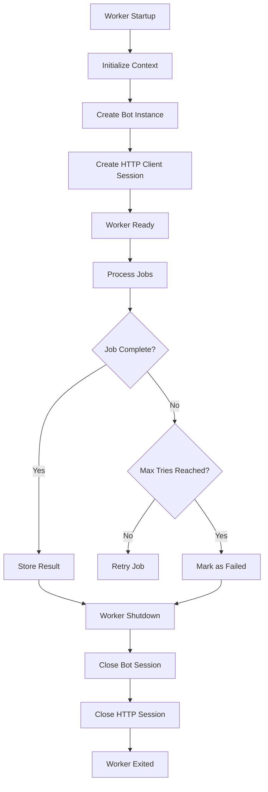
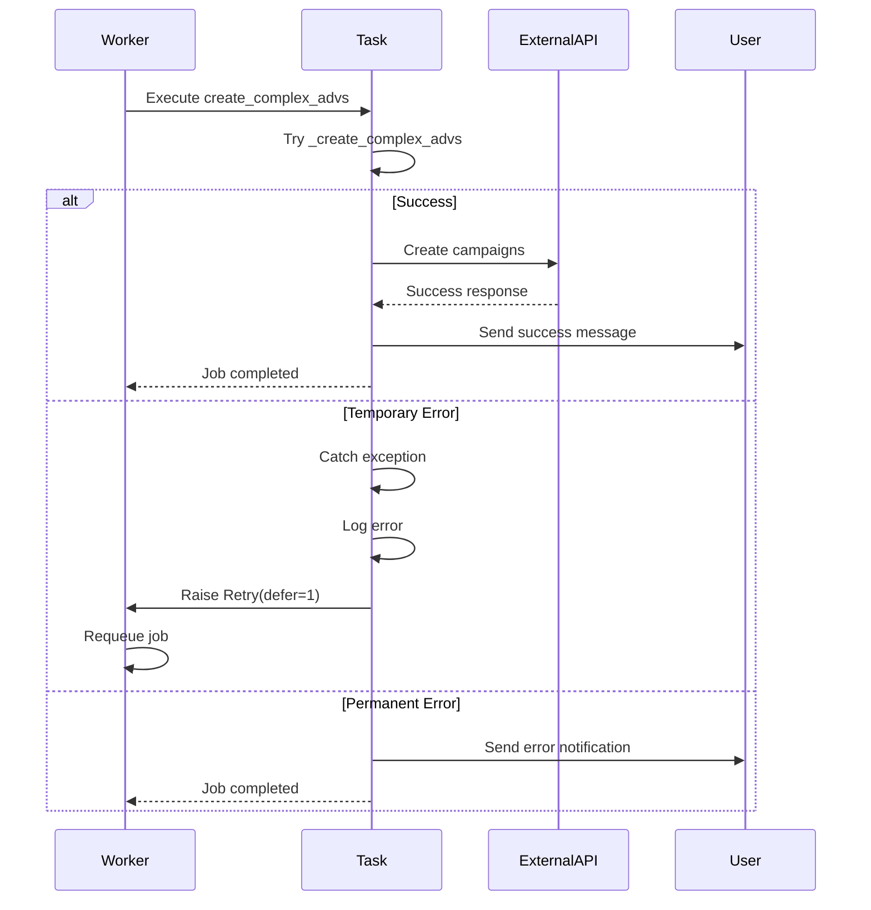
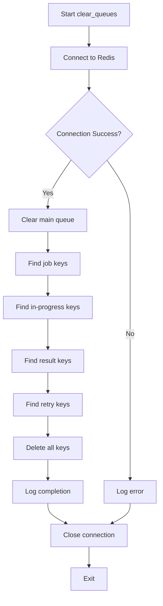
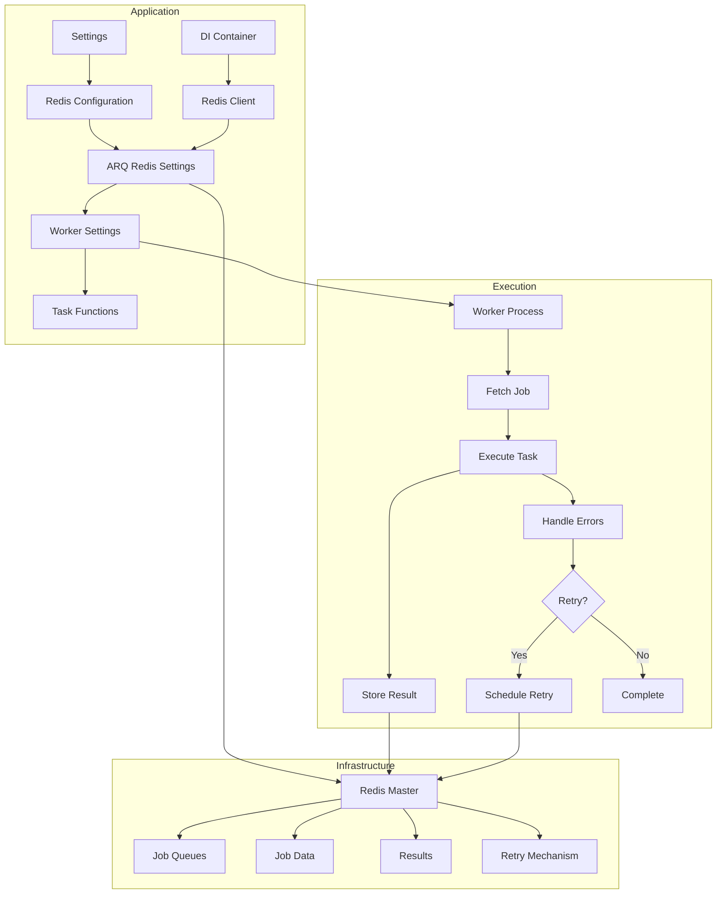

# ARQ Workers Configuration

<cite>
**Referenced Files in This Document**   
- [arq_redis_settings.py](file://app/arq_workers/arq_redis_settings.py)
- [workers.py](file://app/arq_workers/workers.py)
- [clear_queues.py](file://app/arq_workers/clear_queues.py)
- [tasks.py](file://app/modules/adv_creator/backend/tasks.py)
- [settings_master.py](file://app/settings/settings_master.py)
- [redis_config.py](file://app/configs/infrastructure_config/redis_config.py)
- [app_container.py](file://app/core/di/app_container.py)
- [redis.py](file://app/core/di/databases/redis.py)
- [redis_client.py](file://app/core/redis_manager_v2/redis_client.py)
</cite>

## Table of Contents
1. [Introduction](#introduction)
2. [ARQ Configuration Overview](#arq-configuration-overview)
3. [Redis Connection Settings](#redis-connection-settings)
4. [Worker Settings and Job Configuration](#worker-settings-and-job-configuration)
5. [Task Implementation and Error Handling](#task-implementation-and-error-handling)
6. [Queue Management Utility](#queue-management-utility)
7. [Task Registration and Concurrency](#task-registration-and-concurrency)
8. [Monitoring and Debugging](#monitoring-and-debugging)
9. [Best Practices](#best-practices)
10. [Architecture Overview](#architecture-overview)

## Introduction
This document provides comprehensive documentation for the ARQ-based background job system in the application. The system enables asynchronous task processing through Redis-based queues, supporting critical operations such as creating complex advertising campaigns. The documentation covers configuration settings, task implementation patterns, error handling mechanisms, administrative utilities, and best practices for reliable background job processing.

## ARQ Configuration Overview

The ARQ background job system is configured through two primary components: Redis connection settings and worker configuration. The system uses Redis as a message broker to manage job queues, track job status, and store results. The configuration enables robust task processing with features like automatic retries, job timeouts, and worker lifecycle management.

**Diagram sources**
- [workers.py](file://app/arq_workers/workers.py#L1-L100)
- [arq_redis_settings.py](file://app/arq_workers/arq_redis_settings.py#L1-L5)

**Section sources**
- [workers.py](file://app/arq_workers/workers.py#L1-L100)
- [arq_redis_settings.py](file://app/arq_workers/arq_redis_settings.py#L1-L5)

## Redis Connection Settings

The ARQ system connects to Redis using configuration values loaded from environment variables through the application settings. The connection is established to the Redis master host, which is specified in the environment configuration.

The Redis settings are defined in `arq_redis_settings.py` and use the `RedisSettings` class from the ARQ library. The host is retrieved from the application settings, specifically the `REDIS_MASTER_HOST` environment variable. Additional Redis configuration parameters such as port, database number, and password are managed through Pydantic settings with the `RedisConfig` class, which automatically loads values prefixed with "REDIS_" from environment variables.

**Diagram sources**
- [arq_redis_settings.py](file://app/arq_workers/arq_redis_settings.py#L1-L5)
- [redis_config.py](file://app/configs/infrastructure_config/redis_config.py#L1-L15)
- [settings_master.py](file://app/settings/settings_master.py#L200-L220)

**Section sources**
- [arq_redis_settings.py](file://app/arq_workers/arq_redis_settings.py#L1-L5)
- [settings_master.py](file://app/settings/settings_master.py#L200-L220)
- [redis_config.py](file://app/configs/infrastructure_config/redis_config.py#L1-L15)

## Worker Settings and Job Configuration

The worker configuration is defined in `workers.py` through the `WorkerSettings` class, which specifies various parameters for ARQ worker behavior. This includes the list of functions that can be executed as background tasks, Redis connection settings, lifecycle hooks, and job execution policies.

Key configuration parameters include:
- `functions`: List of task functions that workers can execute
- `redis_settings`: Redis connection configuration
- `on_startup`: Function to execute when worker starts
- `on_shutdown`: Function to execute when worker shuts down
- `keep_jobs`: Duration (in seconds) to keep job records (86,400 seconds = 24 hours)
- `max_tries`: Maximum number of retry attempts for failed jobs (10)
- `job_timeout`: Maximum execution time for jobs (86,400 seconds = 24 hours)

The worker lifecycle includes startup and shutdown hooks that manage resources such as the Telegram bot instance and HTTP client session. During startup, the bot is initialized and stored in the context, along with an HTTP client session. During shutdown, these resources are properly closed to prevent resource leaks.

**Diagram sources**
- [workers.py](file://app/arq_workers/workers.py#L50-L100)

**Section sources**
- [workers.py](file://app/arq_workers/workers.py#L50-L100)

## Task Implementation and Error Handling

The primary task implemented in the system is `create_complex_advs`, which creates complex advertising campaigns on Wildberries. This task demonstrates the ARQ task pattern with proper error handling and retry mechanisms.

The task implementation follows a wrapper pattern where the main logic is in `_create_complex_advs`, and the public `create_complex_advs` function handles error processing. When specific exceptions occur, the task either handles them gracefully (by sending user notifications) or schedules a retry with exponential backoff.

For recoverable errors, the task raises a `Retry` exception with a defer period, causing ARQ to requeue the job for later execution. This prevents overwhelming external services during temporary failures. For unrecoverable errors, the task sends appropriate notifications to users and completes without retrying.

The error handling strategy includes:
- API permission errors: Notify user about missing permissions
- Temporary system errors: Retry with exponential backoff
- Business logic errors: Handle with user notifications (e.g., insufficient balance, card not found)

**Diagram sources**
- [tasks.py](file://app/modules/adv_creator/backend/tasks.py#L1-L100)
- [workers.py](file://app/arq_workers/workers.py#L30-L50)

**Section sources**
- [tasks.py](file://app/modules/adv_creator/backend/tasks.py#L1-L100)

## Queue Management Utility

The `clear_queues.py` utility provides administrative functionality for managing ARQ job queues. This script allows operators to clear all job-related data from Redis, which can be useful for troubleshooting, testing, or system maintenance.

The utility connects to Redis using the same configuration as the workers and clears various types of keys:
- Main job queue
- Job data keys (prefixed with "job:")
- In-progress job keys (prefixed with "in-progress:")
- Result keys (prefixed with "result:")
- Retry keys (prefixed with "retry:")
- Abort jobs sorted set

The script implements comprehensive error handling and logs the clearing process, including the number of keys found and deleted. This provides visibility into the queue state before and after clearing operations.

**Diagram sources**
- [clear_queues.py](file://app/arq_workers/clear_queues.py#L1-L75)

**Section sources**
- [clear_queues.py](file://app/arq_workers/clear_queues.py#L1-L75)

## Task Registration and Concurrency

Tasks are registered with the ARQ worker by adding them to the `functions` list in the `WorkerSettings` class. Currently, only the `create_complex_advs` task is registered, but additional tasks can be added to this list to enable parallel processing of different job types.

The system's concurrency is controlled by the number of worker processes and the Redis connection pool settings. Each worker can process one job at a time, and multiple workers can be run in parallel to increase throughput. The Redis connection settings in the application configuration determine the connection pool size and other performance characteristics.

Task serialization is handled automatically by ARQ, which serializes function arguments and results using JSON. This limits the types of objects that can be passed as arguments to JSON-serializable types (strings, numbers, lists, dictionaries).

To register a new task:
1. Define an async function with a context parameter and other arguments
2. Add the function to the `functions` list in `WorkerSettings`
3. Ensure all arguments are JSON-serializable
4. Implement appropriate error handling and retry logic

## Monitoring and Debugging

The ARQ system provides several mechanisms for monitoring and debugging job execution:

1. **Logging**: Comprehensive logging is implemented throughout the system, with structured log messages that include context about job execution. The `setup_logging()` function configures logging with appropriate levels and formatting.

2. **Job Status Tracking**: ARQ automatically tracks job status in Redis, including queued, in-progress, completed, and failed states. This allows operators to monitor job progress and identify bottlenecks.

3. **Result Storage**: Job results are stored in Redis with configurable retention (24 hours by default), allowing inspection of successful job outputs.

4. **Retry Tracking**: Failed jobs are automatically retried up to 10 times, with retry attempts tracked in Redis. This provides visibility into transient failures.

5. **Administrative Utilities**: The `clear_queues.py` script provides a way to reset the job system, which can be useful when debugging stuck jobs or corrupted queue states.

To monitor job execution through Redis, operators can use Redis CLI commands to inspect various key patterns:
- `KEYS "arq:job:*"` - List all job data
- `KEYS "arq:in-progress:*"` - List currently executing jobs
- `KEYS "arq:result:*"` - List job results
- `ZCARD arq:retry` - Count jobs waiting for retry

## Best Practices

### Task Idempotency
All ARQ tasks should be designed to be idempotent, meaning they can be safely executed multiple times without causing unintended side effects. This is crucial because:
- Failed jobs are automatically retried
- Network issues may cause duplicate job submissions
- System restarts may cause job reprocessing

To ensure idempotency:
- Use unique job IDs for deduplication
- Implement checks to detect if work has already been completed
- Design operations to be safe when repeated

### Payload Size Optimization
Since task arguments are serialized to JSON and stored in Redis, it's important to keep payload sizes small:
- Avoid passing large data structures as arguments
- Use reference IDs instead of passing complete objects
- Store large data in Redis or database and pass only the key
- Consider chunking large operations into smaller tasks

### Debugging Failed Jobs
When debugging failed jobs, follow these steps:
1. Check application logs for error messages and stack traces
2. Examine the job payload in Redis to understand input parameters
3. Verify that all dependencies (APIs, databases) are accessible
4. Test the task function directly in a development environment
5. Use the `clear_queues.py` utility to reset the queue if needed

### Error Handling Strategy
Implement a comprehensive error handling strategy:
- Distinguish between transient and permanent errors
- Use retry mechanisms for transient errors with appropriate backoff
- Handle permanent errors gracefully with user notifications
- Log sufficient context for debugging without exposing sensitive data
- Monitor retry patterns to identify systemic issues

## Architecture Overview

The ARQ background job system integrates with the application's dependency injection container and Redis infrastructure to provide reliable asynchronous task processing. The architecture follows a clean separation of concerns, with configuration, worker logic, and task implementation in distinct modules.

**Diagram sources**
- [workers.py](file://app/arq_workers/workers.py#L1-L100)
- [arq_redis_settings.py](file://app/arq_workers/arq_redis_settings.py#L1-L5)
- [app_container.py](file://app/core/di/app_container.py#L1-L50)
- [redis_client.py](file://app/core/redis_manager_v2/redis_client.py#L1-L200)

**Section sources**
- [workers.py](file://app/arq_workers/workers.py#L1-L100)
- [arq_redis_settings.py](file://app/arq_workers/arq_redis_settings.py#L1-L5)
- [app_container.py](file://app/core/di/app_container.py#L1-L50)