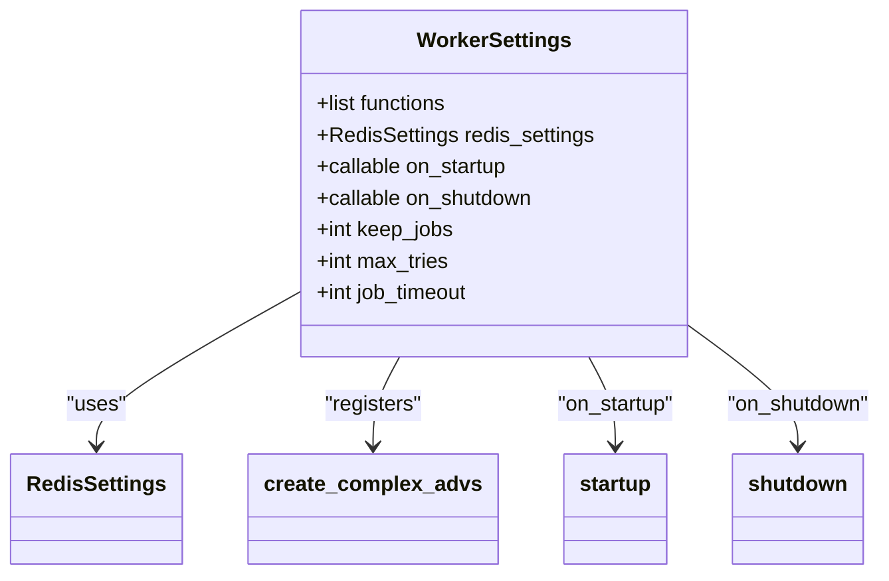
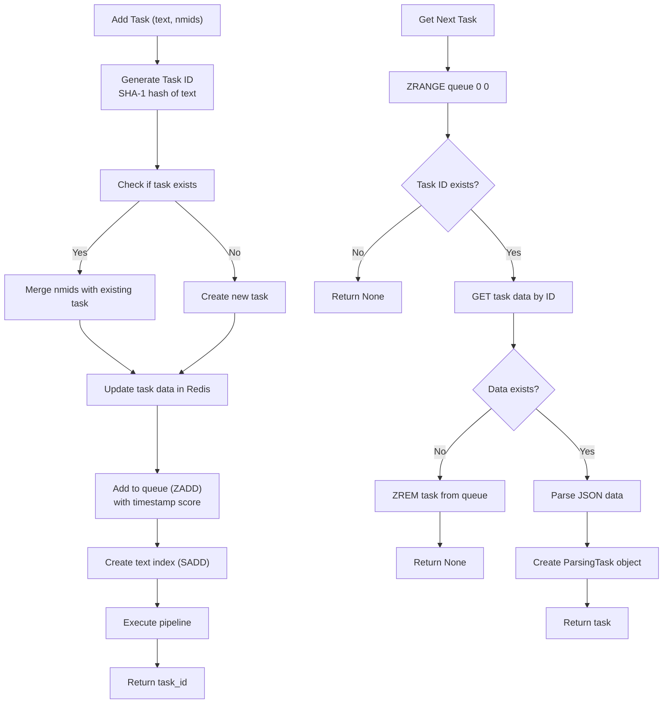
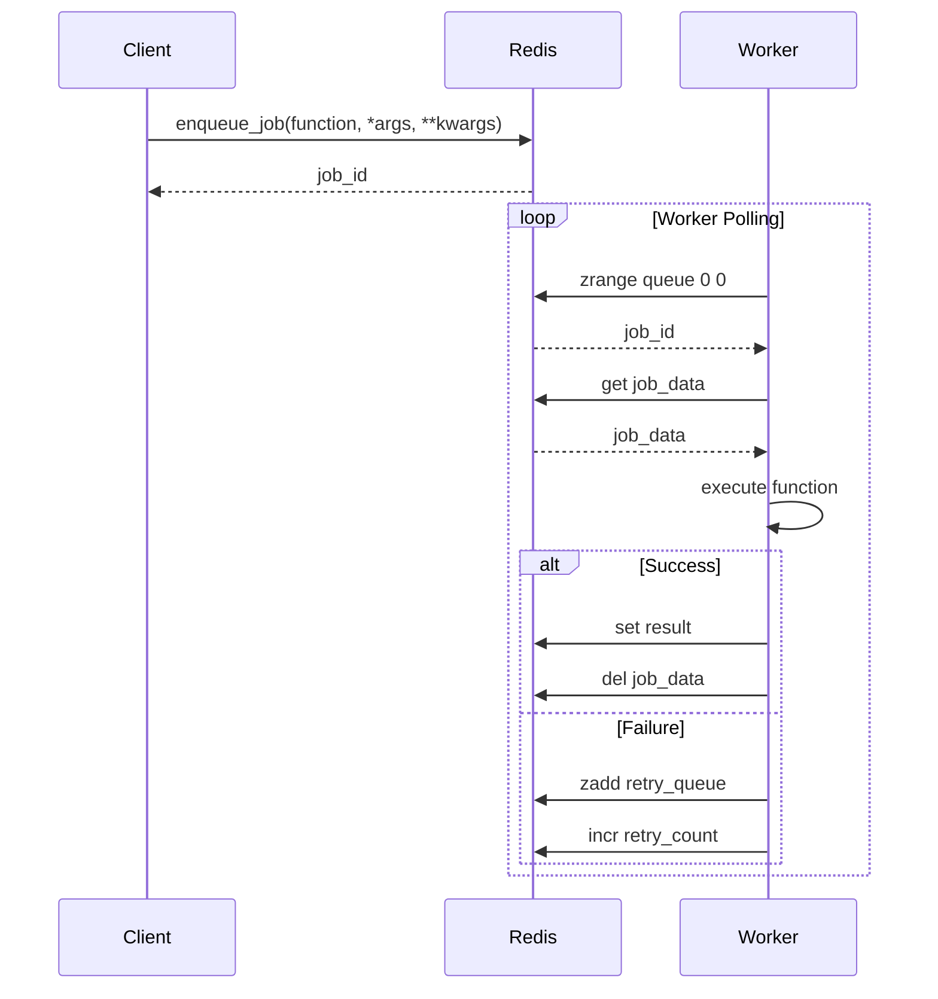
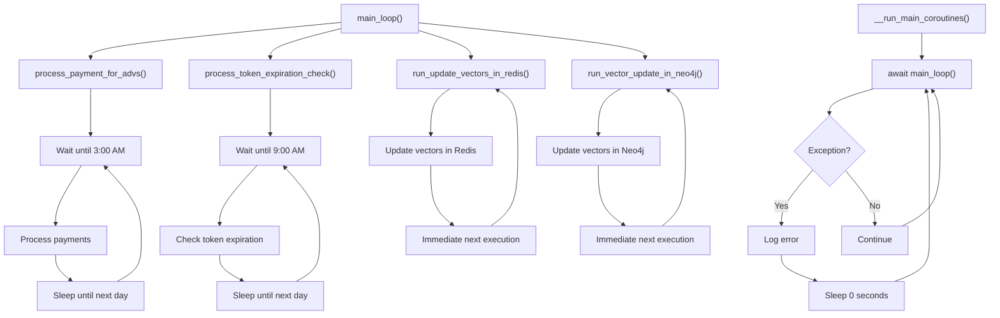
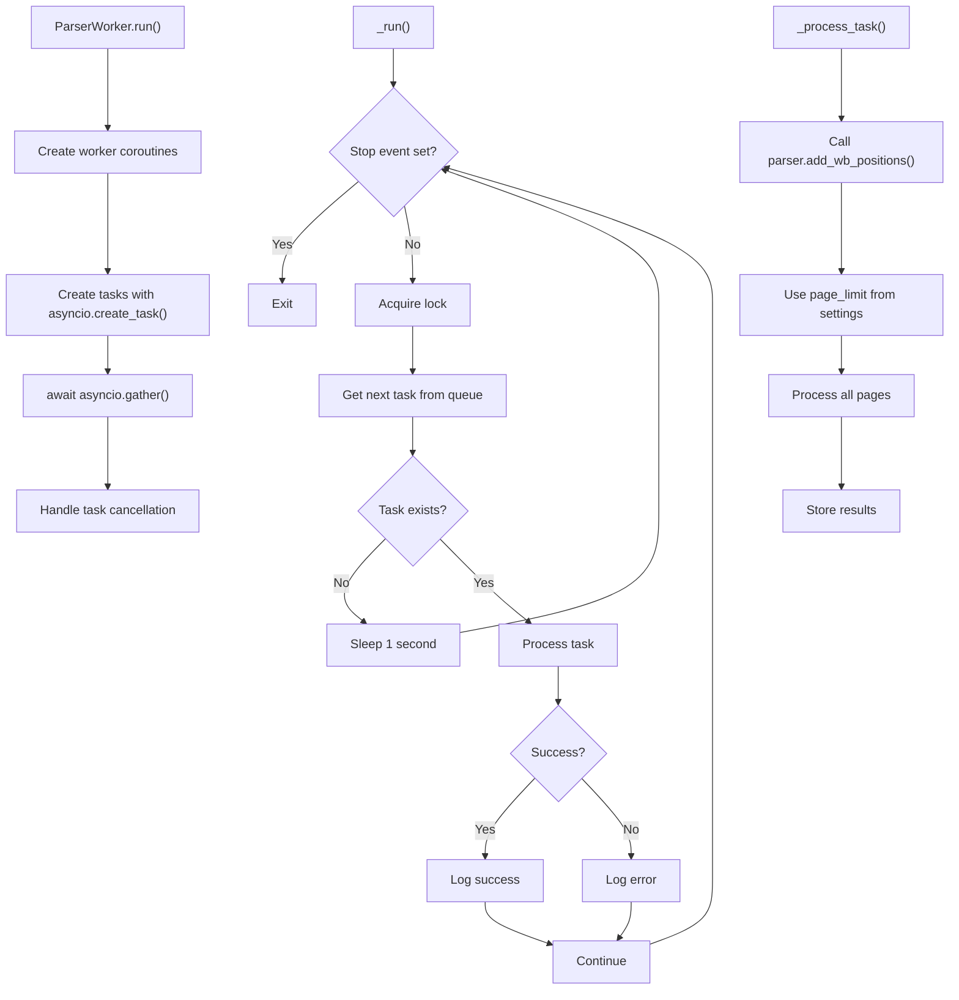
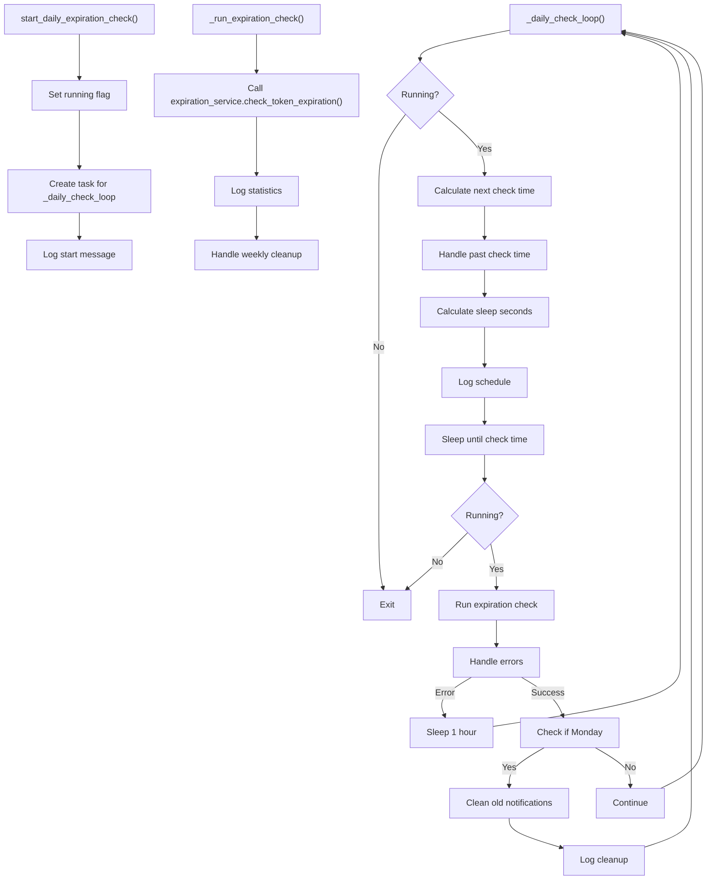
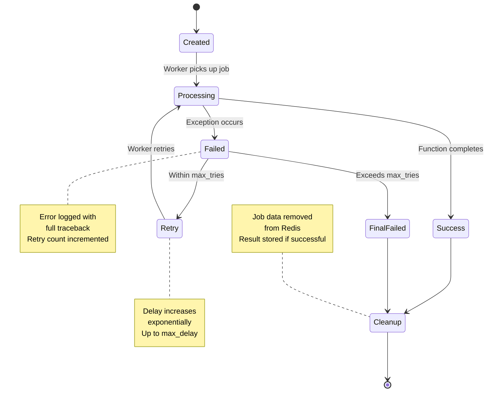

# Asynchronous Background Jobs

<cite>
**Referenced Files in This Document**   
- [workers.py](file://app/arq_workers/workers.py)
- [arq_redis_settings.py](file://app/arq_workers/arq_redis_settings.py)
- [parser_worker.py](file://app/modules/wb_keywords_parser/parser_worker.py)
- [global_parsing_queue_manager.py](file://app/modules/wb_keywords_parser/global_parsing_queue_manager.py)
- [parsing_task.py](file://app/modules/wb_keywords_parser/parsing_task.py)
- [scheduler.py](file://app/modules/token_monitoring/scheduler.py)
- [token_monitoring_service.py](file://app/modules/token_monitoring/services/token_monitoring_service.py)
- [runner.py](file://app/modules/wb_adv_updater/runner.py)
</cite>

## Table of Contents
1. [Introduction](#introduction)
2. [ARQ Worker Configuration](#arq-worker-configuration)
3. [Task Queuing Mechanisms](#task-queuing-mechanisms)
4. [Job Execution Patterns](#job-execution-patterns)
5. [Runner.py Coroutine Architecture](#runnerpy-coroutine-architecture)
6. [Parser Worker Implementation](#parser-worker-implementation)
7. [Token Monitoring Scheduler](#token-monitoring-scheduler)
8. [Job Lifecycle and Error Handling](#job-lifecycle-and-error-handling)
9. [Configuration Examples](#configuration-examples)
10. [Conclusion](#conclusion)

## Introduction
This document provides comprehensive documentation for the asynchronous background processing system in the adv-bot application. The system handles various background tasks including keyword parsing, token monitoring, and periodic updates through a combination of ARQ workers, custom coroutine runners, and Redis-based task queues. The architecture is designed for high reliability, fault tolerance, and efficient resource utilization in a distributed environment.

## ARQ Worker Configuration
The ARQ worker system is configured through the WorkerSettings class in the workers.py module. This configuration defines the core parameters for job processing, including function registration, Redis connection settings, and lifecycle hooks.



**Diagram sources**
- [workers.py](file://app/arq_workers/workers.py#L35-L49)
- [arq_redis_settings.py](file://app/arq_workers/arq_redis_settings.py#L4)

**Section sources**
- [workers.py](file://app/arq_workers/workers.py#L1-L51)
- [arq_redis_settings.py](file://app/arq_workers/arq_redis_settings.py#L1-L6)

## Task Queuing Mechanisms
The system implements a sophisticated task queuing mechanism for keyword parsing operations using Redis as the backend storage. The GlobalParsingQueueManager class provides atomic operations for task management, ensuring data consistency in a distributed environment.

The queuing system uses Redis Sorted Sets (ZSET) to maintain task priority based on insertion time, with additional Redis structures for task data storage and text-based indexing. Tasks are uniquely identified using SHA-1 hashing of the keyword text, ensuring deduplication of identical tasks.



**Diagram sources**
- [global_parsing_queue_manager.py](file://app/modules/wb_keywords_parser/global_parsing_queue_manager.py#L37-L129)
- [parsing_task.py](file://app/modules/wb_keywords_parser/parsing_task.py#L1-L25)

**Section sources**
- [global_parsing_queue_manager.py](file://app/modules/wb_keywords_parser/global_parsing_queue_manager.py#L1-L131)
- [parsing_task.py](file://app/modules/wb_keywords_parser/parsing_task.py#L1-L25)

## Job Execution Patterns
The system employs multiple job execution patterns tailored to different types of background processing requirements. The ARQ framework handles discrete, function-based jobs with retry capabilities, while custom coroutine workers manage continuous, stream-based processing.

For ARQ jobs, the execution pattern follows a clear lifecycle: job creation, Redis persistence, worker pickup, execution with error handling, and result storage. Failed jobs are automatically retried up to the configured maximum (10 attempts), with completed job records retained for 24 hours for debugging and auditing purposes.



**Diagram sources**
- [workers.py](file://app/arq_workers/workers.py#L1-L51)
- [clear_queues.py](file://app/arq_workers/clear_queues.py#L1-L73)

**Section sources**
- [workers.py](file://app/arq_workers/workers.py#L1-L51)
- [clear_queues.py](file://app/arq_workers/clear_queues.py#L1-L73)

## Runner.py Coroutine Architecture
The runner.py module implements a long-running coroutine architecture for periodic background processes. This architecture uses asyncio.gather to run multiple independent coroutines concurrently, each responsible for a specific background task such as payment processing, token expiration checks, and vector updates.

The coroutines follow a pattern of infinite loops with strategic sleep intervals, allowing them to run continuously while minimizing resource consumption. Each coroutine calculates its next execution time based on a fixed schedule (e.g., daily at 3:00 AM for payment processing) and sleeps until that time, ensuring consistent timing across restarts.



**Diagram sources**
- [runner.py](file://app/modules/wb_adv_updater/runner.py#L1-L145)

**Section sources**
- [runner.py](file://app/modules/wb_adv_updater/runner.py#L1-L145)

## Parser Worker Implementation
The parser_worker.py module implements a parallel task processing system for keyword parsing. The ParserWorker class manages a configurable number of concurrent workers (default: 3) that process tasks from a shared Redis-based queue.

Each worker follows a consistent pattern: acquire a task from the queue, process the task by calling the parser service, handle any errors, and continue to the next task. The implementation uses asyncio.Lock to ensure thread-safe access to the queue when retrieving tasks, preventing race conditions in a multi-worker environment.



**Diagram sources**
- [parser_worker.py](file://app/modules/wb_keywords_parser/parser_worker.py#L1-L80)
- [global_parsing_queue_manager.py](file://app/modules/wb_keywords_parser/global_parsing_queue_manager.py#L1-L131)

**Section sources**
- [parser_worker.py](file://app/modules/wb_keywords_parser/parser_worker.py#L1-L80)
- [parsing_task.py](file://app/modules/wb_keywords_parser/parsing_task.py#L1-L25)

## Token Monitoring Scheduler
The token monitoring scheduler provides time-based execution of token expiration checks through the TokenMonitoringScheduler class. The scheduler runs a daily check at a configurable time (default: 9:00 AM), calculating the appropriate sleep duration to reach the next scheduled execution.

The scheduler implements a robust error handling mechanism, with automatic recovery from exceptions by sleeping for one hour before retrying. Weekly cleanup of old notifications occurs every Monday, maintaining database efficiency while preserving historical data for the configured retention period (30 days).



**Diagram sources**
- [scheduler.py](file://app/modules/token_monitoring/scheduler.py#L1-L186)

**Section sources**
- [scheduler.py](file://app/modules/token_monitoring/scheduler.py#L1-L186)
- [token_monitoring_service.py](file://app/modules/token_monitoring/services/token_monitoring_service.py#L1-L209)

## Job Lifecycle and Error Handling
The system implements comprehensive job lifecycle management and error handling strategies across all background processing components. Jobs progress through well-defined states from creation to completion, with appropriate error recovery mechanisms at each stage.

For ARQ jobs, the lifecycle includes job creation, worker execution, success/failure determination, retry management, and final cleanup. The system retains job records for 24 hours to facilitate debugging and auditing, with failed jobs automatically retried up to 10 times before final failure.



**Diagram sources**
- [workers.py](file://app/arq_workers/workers.py#L35-L49)
- [scheduler.py](file://app/modules/token_monitoring/scheduler.py#L1-L186)

**Section sources**
- [workers.py](file://app/arq_workers/workers.py#L1-L51)
- [scheduler.py](file://app/modules/token_monitoring/scheduler.py#L1-L186)

## Configuration Examples
The system provides extensive configuration options for job behavior, including timeouts, retry limits, and concurrency settings. These configurations are defined in the WorkerSettings class and various settings modules.

```mermaid
erDiagram
WORKER_SETTINGS {
string functions
RedisSettings redis_settings
callable on_startup
callable on_shutdown
int keep_jobs
int max_tries
int job_timeout
}
PARSER_WORKER {
int max_parallel_tasks
int page_limit
}
TOKEN_SCHEDULER {
time check_time
int cleanup_days
}
WORKER_SETTINGS ||--o{ PARSER_WORKER : "configures"
WORKER_SETTINGS ||--o{ TOKEN_SCHEDULER : "configures"
class WORKER_SETTINGS {
functions: List of registered functions
redis_settings: Redis connection configuration
on_startup: Initialization hook
on_shutdown: Cleanup hook
keep_jobs: Retention period in seconds
max_tries: Maximum retry attempts
job_timeout: Maximum execution time
}
class PARSER_WORKER {
max_parallel_tasks: Concurrent worker count
page_limit: Maximum pages to parse
}
class TOKEN_SCHEDULER {
check_time: Daily execution time
cleanup_days: Notification retention period
}
```

**Diagram sources**
- [workers.py](file://app/arq_workers/workers.py#L35-L49)
- [parser_worker.py](file://app/modules/wb_keywords_parser/parser_worker.py#L1-L80)
- [scheduler.py](file://app/modules/token_monitoring/scheduler.py#L1-L186)

**Section sources**
- [workers.py](file://app/arq_workers/workers.py#L1-L51)
- [parser_worker.py](file://app/modules/wb_keywords_parser/parser_worker.py#L1-L80)
- [scheduler.py](file://app/modules/token_monitoring/scheduler.py#L1-L186)

## Conclusion
The asynchronous background processing system in the adv-bot application demonstrates a robust and scalable architecture for handling various background tasks. By combining the ARQ framework for discrete jobs with custom coroutine runners for continuous processes, the system achieves high reliability and efficient resource utilization.

Key strengths of the system include comprehensive error handling, configurable retry mechanisms, and efficient task queuing with Redis. The token monitoring scheduler provides reliable time-based execution, while the parser worker enables parallel processing of keyword parsing tasks. Together, these components form a cohesive background processing ecosystem that supports the application's core functionality.