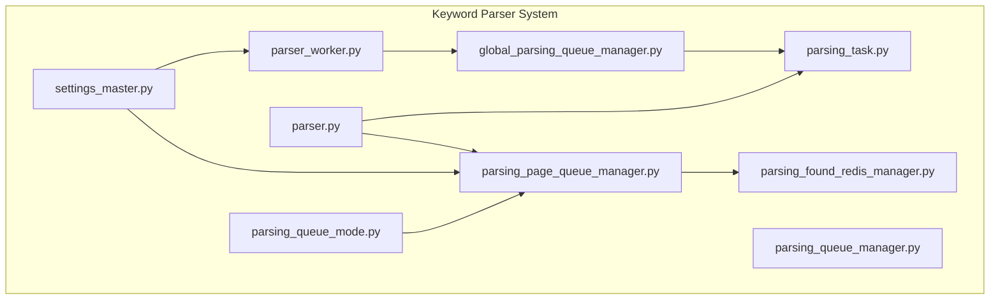
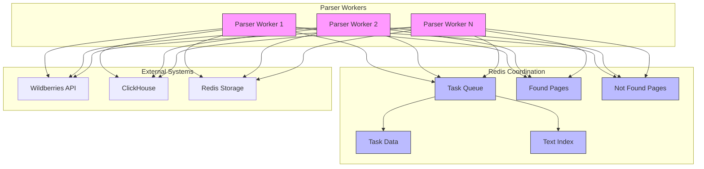
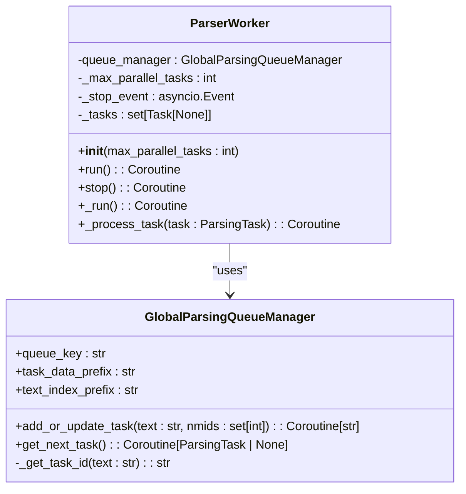
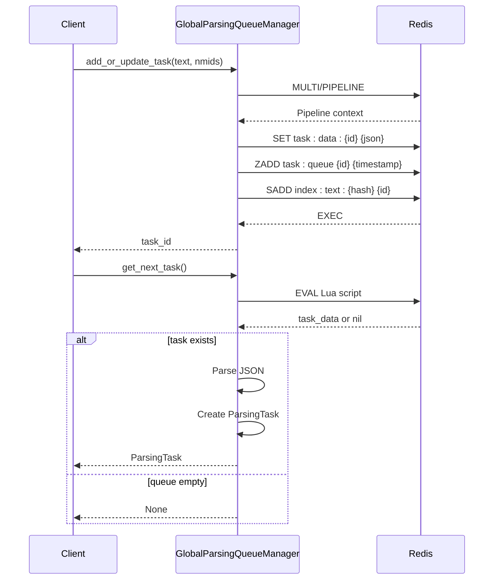
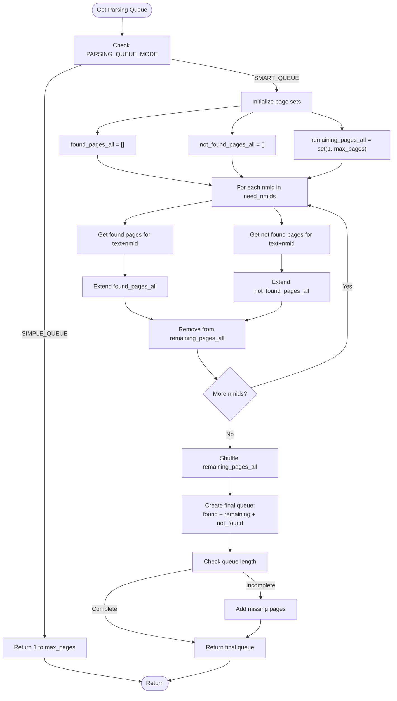
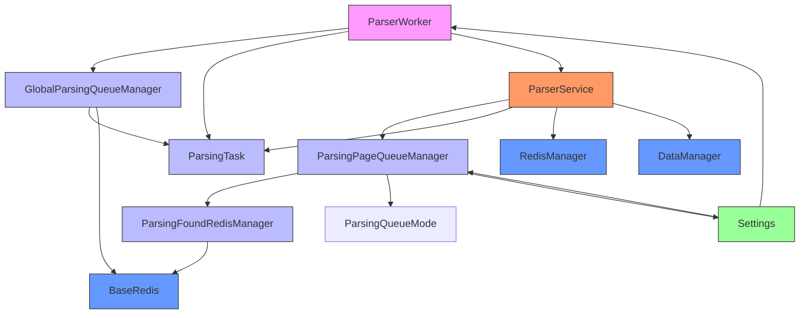

# Keyword Parser Workers

<cite>
**Referenced Files in This Document**   
- [parser_worker.py](file://app/modules/wb_keywords_parser/parser_worker.py)
- [parsing_task.py](file://app/modules/wb_keywords_parser/parsing_task.py)
- [global_parsing_queue_manager.py](file://app/modules/wb_keywords_parser/global_parsing_queue_manager.py)
- [parsing_page_queue_manager.py](file://app/modules/wb_keywords_parser/wb_parser/parsing_page_queue_manager.py)
- [parsing_found_redis_manager.py](file://app/modules/wb_keywords_parser/parsing_found_redis_manager.py)
- [parser.py](file://app/modules/wb_keywords_parser/wb_parser/parser.py)
- [settings_master.py](file://app/settings/settings_master.py)
- [parsing_queue_mode.py](file://app/modules/wb_keywords_parser/wb_parser/parsing_queue_mode.py)
</cite>

## Table of Contents
1. [Introduction](#introduction)
2. [Project Structure](#project-structure)
3. [Core Components](#core-components)
4. [Architecture Overview](#architecture-overview)
5. [Detailed Component Analysis](#detailed-component-analysis)
6. [Dependency Analysis](#dependency-analysis)
7. [Performance Considerations](#performance-considerations)
8. [Troubleshooting Guide](#troubleshooting-guide)
9. [Conclusion](#conclusion)

## Introduction
The Keyword Parser Workers system is designed to extract and analyze search terms from Wildberries by efficiently processing keyword parsing tasks. This system leverages a distributed architecture with Redis-based queues for task coordination, multiprocessing for parallel execution, and intelligent page prioritization for optimized parsing. The core components include the parser worker, task management system, and Redis-backed coordination logic that enables scalable and fault-tolerant keyword analysis. This document details the system's architecture, implementation, and operational characteristics.

## Project Structure
The keyword parsing system is organized within the `app/modules/wb_keywords_parser/` directory with a clear separation of concerns. The system consists of worker processes, task management components, Redis coordination modules, and parsing logic. The structure enables modular development and maintenance while supporting distributed deployment across multiple instances.



**Diagram sources**
- [parser_worker.py](file://app/modules/wb_keywords_parser/parser_worker.py)
- [global_parsing_queue_manager.py](file://app/modules/wb_keywords_parser/global_parsing_queue_manager.py)
- [parsing_page_queue_manager.py](file://app/modules/wb_keywords_parser/wb_parser/parsing_page_queue_manager.py)

**Section sources**
- [parser_worker.py](file://app/modules/wb_keywords_parser/parser_worker.py)
- [parsing_task.py](file://app/modules/wb_keywords_parser/parsing_task.py)
- [global_parsing_queue_manager.py](file://app/modules/wb_keywords_parser/global_parsing_queue_manager.py)

## Core Components
The keyword parsing system consists of several core components that work together to extract and analyze search terms from Wildberries. The ParserWorker manages multiprocessing execution, GlobalParsingQueueManager handles task distribution through Redis, ParsingTask defines the unit of work, and ParsingPageQueueManager coordinates intelligent page parsing based on historical data. These components are designed to work together in a distributed environment, enabling horizontal scaling and efficient resource utilization.

**Section sources**
- [parser_worker.py](file://app/modules/wb_keywords_parser/parser_worker.py#L1-L80)
- [parsing_task.py](file://app/modules/wb_keywords_parser/parsing_task.py#L1-L25)
- [global_parsing_queue_manager.py](file://app/modules/wb_keywords_parser/global_parsing_queue_manager.py#L1-L131)

## Architecture Overview
The keyword parsing system follows a distributed worker pattern with Redis serving as the central coordination point. Multiple parser workers connect to a shared Redis instance to retrieve parsing tasks from a priority queue. Each task contains a keyword and a set of nmids (product identifiers) to locate. The system uses an intelligent parsing strategy that prioritizes pages based on historical success rates, minimizing redundant requests and optimizing parsing efficiency.



**Diagram sources**
- [parser_worker.py](file://app/modules/wb_keywords_parser/parser_worker.py)
- [global_parsing_queue_manager.py](file://app/modules/wb_keywords_parser/global_parsing_queue_manager.py)
- [parsing_found_redis_manager.py](file://app/modules/wb_keywords_parser/parsing_found_redis_manager.py)

## Detailed Component Analysis

### Parser Worker Analysis
The ParserWorker class implements a multiprocessing design that allows for concurrent processing of keyword parsing tasks. Each worker maintains a pool of parallel tasks (default: 3) that independently retrieve tasks from the shared Redis queue. The worker uses an asyncio.Event-based stop mechanism for graceful shutdown and employs a distributed lock to prevent race conditions when retrieving tasks from the queue.



**Diagram sources**
- [parser_worker.py](file://app/modules/wb_keywords_parser/parser_worker.py#L1-L80)
- [global_parsing_queue_manager.py](file://app/modules/wb_keywords_parser/global_parsing_queue_manager.py#L1-L131)

### Parsing Task Analysis
The ParsingTask dataclass represents the unit of work in the keyword parsing system. Each task contains a keyword to search for and a set of nmids (product identifiers) that need to be located within the search results. The task includes a computed property for generating a unique ID based on the keyword, enabling efficient deduplication and tracking. Tasks may also include an optional adv_id_order field for campaign tracking purposes.

```mermaid
classDiagram
class ParsingTask {
+keyword : str
+nmids : set[int]
+adv_id_order : str | None
+id : str
}
note right of ParsingTask
The id property generates a SHA1 hash
of the keyword, truncated to 12 characters
for efficient indexing and deduplication
end note
```

**Diagram sources**
- [parsing_task.py](file://app/modules/wb_keywords_parser/parsing_task.py#L1-L25)

### Task Queue Manager Analysis
The GlobalParsingQueueManager class manages the Redis-based task queue system that coordinates work distribution among parser workers. It uses a sorted set (ZSET) in Redis to maintain task priority based on insertion time, ensuring first-in-first-out processing. The manager implements atomic operations using Redis pipelines to safely add or update tasks while preventing race conditions in distributed environments.



**Diagram sources**
- [global_parsing_queue_manager.py](file://app/modules/wb_keywords_parser/global_parsing_queue_manager.py#L1-L131)

### Parsing Page Queue Manager Analysis
The ParsingPageQueueManager implements intelligent page prioritization logic that optimizes the parsing process by leveraging historical data. Instead of processing pages sequentially, it analyzes previous parsing results to create an optimized page processing order: pages where products were previously found are processed first, followed by pages with unknown status, and finally pages where products were not previously found.



**Diagram sources**
- [parsing_page_queue_manager.py](file://app/modules/wb_keywords_parser/wb_parser/parsing_page_queue_manager.py#L1-L86)
- [parsing_found_redis_manager.py](file://app/modules/wb_keywords_parser/parsing_found_redis_manager.py#L1-L30)

## Dependency Analysis
The keyword parsing system has a well-defined dependency structure that enables modularity and testability. The core dependencies are organized in a layered architecture with clear separation between worker processes, task management, and data storage components.



**Diagram sources**
- [parser_worker.py](file://app/modules/wb_keywords_parser/parser_worker.py)
- [global_parsing_queue_manager.py](file://app/modules/wb_keywords_parser/global_parsing_queue_manager.py)
- [parsing_page_queue_manager.py](file://app/modules/wb_keywords_parser/wb_parser/parsing_page_queue_manager.py)
- [parsing_found_redis_manager.py](file://app/modules/wb_keywords_parser/parsing_found_redis_manager.py)

**Section sources**
- [parser_worker.py](file://app/modules/wb_keywords_parser/parser_worker.py)
- [global_parsing_queue_manager.py](file://app/modules/wb_keywords_parser/global_parsing_queue_manager.py)
- [parsing_page_queue_manager.py](file://app/modules/wb_keywords_parser/wb_parser/parsing_page_queue_manager.py)

## Performance Considerations
The keyword parsing system incorporates several performance optimizations to maximize throughput and minimize resource consumption. The multiprocessing design allows for concurrent task processing, with configurable parallelism through the max_parallel_tasks parameter. The intelligent page queueing system reduces redundant API calls by prioritizing pages based on historical success rates. Task deduplication prevents redundant processing of identical keywords, while atomic Redis operations ensure data consistency in distributed environments. The system also implements exponential backoff for error recovery, preventing cascading failures during temporary service disruptions.

**Section sources**
- [parser_worker.py](file://app/modules/wb_keywords_parser/parser_worker.py#L1-L80)
- [parsing_page_queue_manager.py](file://app/modules/wb_keywords_parser/wb_parser/parsing_page_queue_manager.py#L1-L86)
- [settings_master.py](file://app/settings/settings_master.py)

## Troubleshooting Guide
Common issues in the keyword parsing system typically relate to Redis connectivity, task processing bottlenecks, or API rate limiting. Monitoring Redis queue length can help identify processing backlogs, while tracking worker logs can reveal individual task failures. The system's logging includes detailed information about task processing, including queue operations, page parsing attempts, and error conditions. For performance tuning, adjusting the PARSING_KEYWORDS_DELAY_BETWEEN_TASKS setting can help manage API request rates, while modifying the MAX_PAGE_LIMIT_PARSER_WORKER parameter can control parsing depth. The SMART_QUEUE mode should be used in production to optimize parsing efficiency, while SIMPLE_QUEUE mode can be useful for debugging and testing.

**Section sources**
- [parser_worker.py](file://app/modules/wb_keywords_parser/parser_worker.py#L1-L80)
- [global_parsing_queue_manager.py](file://app/modules/wb_keywords_parser/global_parsing_queue_manager.py#L1-L131)
- [parsing_page_queue_manager.py](file://app/modules/wb_keywords_parser/wb_parser/parsing_page_queue_manager.py#L1-L86)
- [settings_master.py](file://app/settings/settings_master.py)

## Conclusion
The Keyword Parser Workers system provides a robust and scalable solution for extracting and analyzing search terms from Wildberries. Its distributed architecture, intelligent parsing strategies, and Redis-based coordination enable efficient processing of large volumes of keyword data. The system's modular design allows for easy configuration and scaling, while its fault-tolerant mechanisms ensure reliable operation in production environments. By leveraging multiprocessing, task deduplication, and intelligent page prioritization, the system maximizes parsing throughput while minimizing redundant API calls and resource consumption.